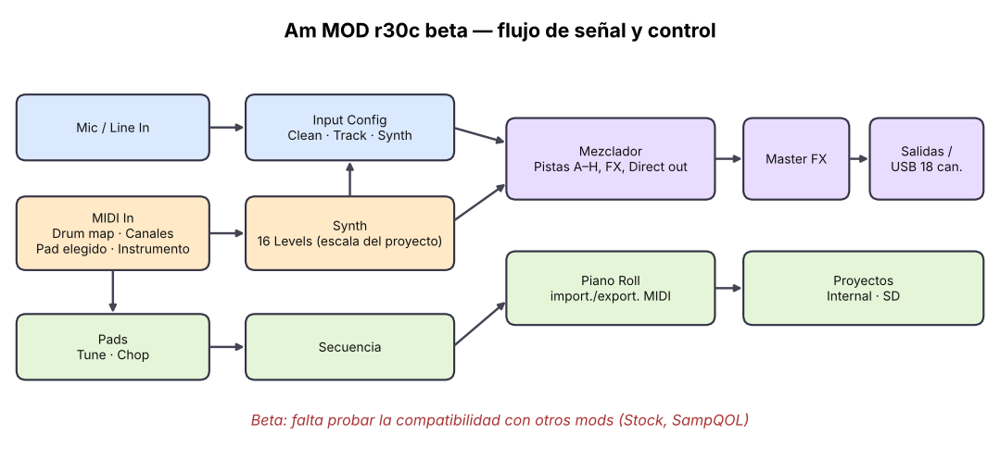
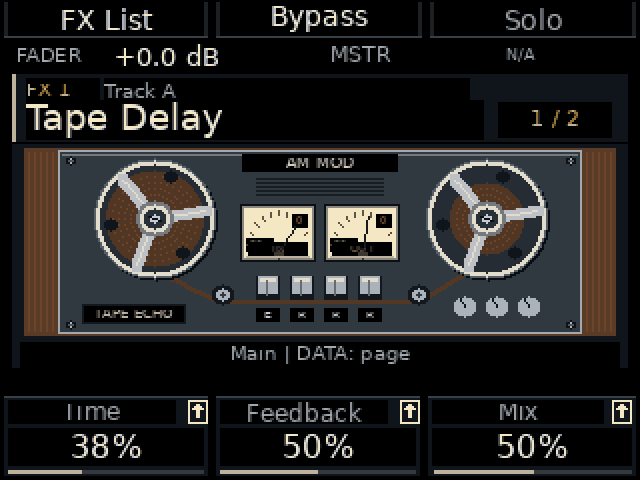
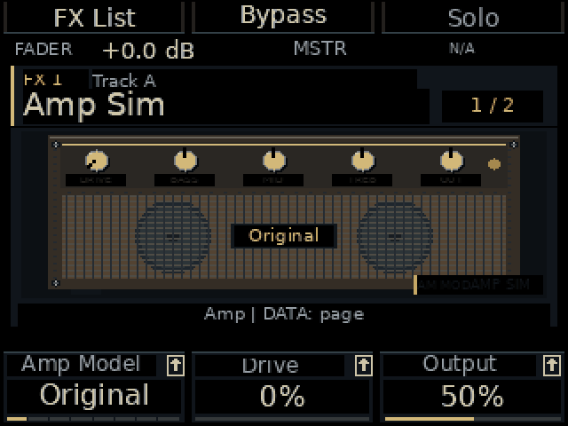
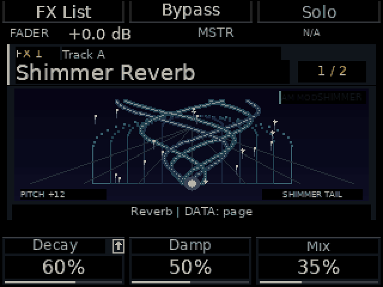

# Am MOD r30c beta1

**Mezclador, efectos ilustrados, Piano Roll y herramientas MIDI para Akai MPC Sample.**

[English](README.md) · [Русский](README.ru.md) · **Español** · [Descargar r30c beta1](https://github.com/AlekseyMalykh/am-mod/releases/tag/r30c-beta1)

> **BETA — r30c-beta1.** Esta es una versión beta. **Aún falta probar la compatibilidad con otros mods (Stock, SampQOL, D.S.B y otros)**: no la uses con la única copia de proyectos importantes; haz antes una copia de seguridad. Por favor, informa de los problemas.

Am MOD arranca desde una tarjeta SD con firmware **1.3.0.12**. La aplicación se ejecuta en RAM; no se reescribe el firmware instalado. Sin la tarjeta del mod, el MPC arranca con el sistema original.

## Novedades

- **Piano Roll:** capas Pads, Tune y Chop, selección, edición de grupos, rejilla, Follow, Undo/Redo compartidos e importación/exportación MIDI. Girar Shift+DATA en sentido positivo ahora acerca el zoom.
- **MIDI:** Monitor, mapas de entrada/salida, Learn, asignaciones de salida Pads/Levels y guardado en el proyecto. La recepción USB/TRS en equipos externos todavía requiere pruebas físicas.
- **Programas:** importación de MPC1000 PGM 1.00 y Drum XPM, con vista previa, selección de banco, comprobación de archivos/pads ocupados y una sola operación Undo.
- **Sequence Pad Mutes:** silencios locales independientes, modo con Mute+B3, limpieza con Mute+B2, indicaciones en la cabecera y un indicador rojo **SM**. La copia de un pad no hereda su silencio local; las secuencias copiadas empiezan sin silencios locales.
- **Sample Swap:** prueba otro archivo dentro de la secuencia en reproducción. Orig Note aparece sobre **K2**, la ruta de carpeta arriba y los estados SWAPPED/WAIT/PAUSED indican la situación. Preview Off restaura el original; confirmar la carga hace permanente el reemplazo.
- **Paleta:** 32 colores compartidos con nombres, reserva opcional de colores del sistema y asignaciones guardadas en el proyecto.
- **Correcciones:** pulsar Stop, soltarlo y pulsar Chop ya no abre el afinador; los carretes de Tape Delay se detienen; Original conserva el color de la onda. Se mantienen las correcciones de FX, compresores, takeover y rutas. EQ conserva los iconos del sample; el espectro de Filter/Filter Env se dibuja antes de las curvas originales.
- **Instalación:** el instalador **1.4.0** admite tarjetas normales, **mpc-boot-thingy** y **D.S.B Boot**, conservando el menú de arranque.

[Cambios](docs/RELEASE_NOTES-r30c.es.md) · [Instalación](docs/INSTALL.es.md) · [Manual](docs/USER_GUIDE.es.md) · [Plan de plugins](docs/PLUGIN_ROADMAP.es.md)

## Instalar y arrancar

1. Haz una copia de seguridad de proyectos, samples y ajustes. El candidato r30c conserva proyectos, samples y exportaciones de audio tanto en **Internal** como en **External**. Selecciona el destino con el control K3 de los diálogos Save/Export; los ajustes del sistema fuera de las carpetas de usuario siguen en la capa de sesión. La verificación final en el MPC está pendiente.
2. Descarga `am-mod-r30c-beta1.zip` y `MPC-Sample-Mod-Installer.exe` del enlace anterior. En macOS/Linux utiliza el instalador Python.
3. Conecta la tarjeta con un lector o SD Card Access, selecciona el ZIP y la tarjeta y pulsa Install. El instalador detecta el gestor de arranque; no reemplaces manualmente el autorun raíz de una tarjeta con menú.
4. Expulsa la unidad de forma segura, sal de SD Card Access y apaga/enciende el MPC. En el menú de arranque selecciona **AM Mod**.

Se recomienda exFAT y una etiqueta de volumen ASCII sin espacios, por ejemplo `MPC`. FAT32 sigue siendo experimental. El instalador guarda una copia de `autorun/`, no de los proyectos. [Instalación y recuperación detalladas](docs/INSTALL.es.md).

## Controles principales

| Desde | Acción |
|---|---|
| Knob FX | Mezclador; pads 1–8 = A–H, 15 = Input, 16 = Master |
| Shift+Knob FX desde Sample | FX de la pista del último pad tocado |
| Pads 9–12 del mezclador | Cuatro ranuras de efectos en serie |
| FX: Shift+Erase / Shift+B2 / Shift+B3 | Copy / Paste / Chain Bypass |
| Mute+B3 / Mute+B2 | Modo de silencios de secuencia / borrar sus silencios locales |
| Mantener Stop y pulsar Chop | Afinador; suelta Stop antes de Chop para abrir Chop normalmente |
| Step Edit → Events/Steps → Knob FX | Piano Roll; B1 vuelve |
| Shift+Pad8 → B2 Map / Log | MIDI Monitor y mapas |
| Navegador → Shift+B1 | Sample Swap |
| Navegador → Shift+B2 → Programs | Importar PGM/XPM |
| Shift+Pad16 → Mod Settings | Modo, USB, paleta y visualización |

En el mezclador, Loop/Reverse, Chop/Note On y 16 Levels no modifican el sample oculto. Mute controla las pistas.

## Efectos y USB

<table><tr><td></td><td></td></tr><tr><td></td><td></td></tr></table>

Los GIF usan el código de dibujo de producción, medidores sintéticos y una fuente de sustitución. Son ilustraciones, no grabaciones de un MPC físico. [Galería](docs/FX_GALLERY.md).

Las ocho pistas A–H, Master e Input tienen cuatro ranuras en serie cada una. Amp Sim añade voces de guitarra/bajo con diseños distintos: son presets de AIR Amp Sim, no capturas medidas de amplificadores reales. [Mapa de controles](docs/FX_KNOB_LAYOUT.ru.md).

USB usa Stereo Master por defecto. **Mod Settings → Quick → USB audio → Master + A–H**, y reinicia: **18 canales**, Master 1/2, A 3/4 … H 17/18. Si el audio del DAW vuelve al MPC, desactiva la monitorización de entrada de las pistas armadas del DAW para evitar realimentación. SD Card Access detiene la aplicación y el audio mientras comparte la tarjeta. [Manual USB en inglés](docs/USB_GUIDE.md).

## Estado y planes

r30c reúne las ramas de desarrollo r30b–r30e. Conserva los 88 módulos de r30e y contiene 105 módulos en total. El informe describe las pruebas automáticas host/ARM/QEMU y la carga nativa completa. No sustituyen las pruebas del paquete final en un MPC físico.

El alojamiento VST, los efectos HS de Henry dentro de AM Mod y guardar/volver a D.S.B son **planes futuros**, no funciones de r30c. SampQOL y D.S.B se descargan por separado y no se incluyen. [Plan de plugins](docs/PLUGIN_ROADMAP.es.md).

[Limitaciones](docs/KNOWN_ISSUES.md) · [Informar de errores](docs/FEEDBACK.md) · [Compilación](docs/BUILD.md) · [Historial](CHANGELOG.md) · [Licencia](LICENSE)

Proyecto no oficial, sin afiliación con Akai/inMusic. Gracias a Leusha, a los autores de Virtual MPC Sample y a la comunidad. Los componentes externos conservan sus licencias: [NOTICE](NOTICE.md).
