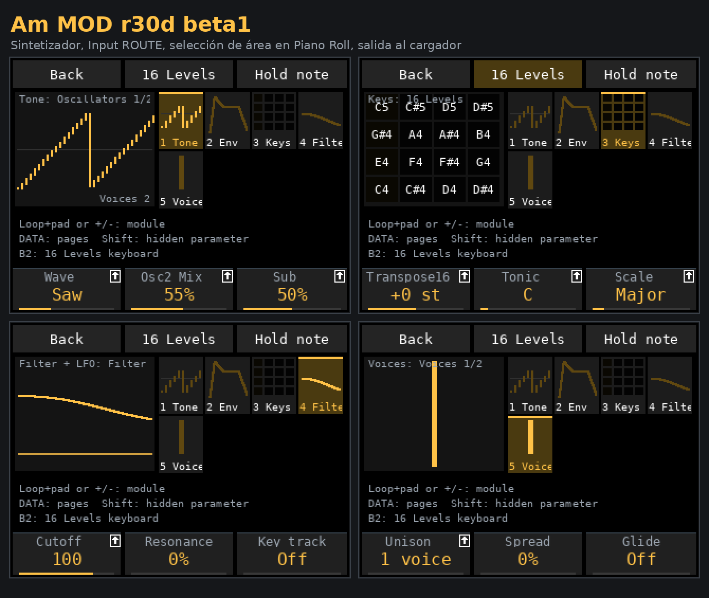
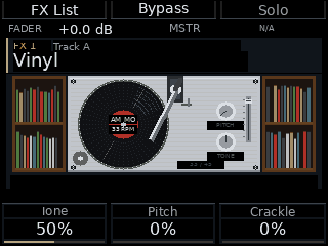

# Am MOD r30d beta4

**Mezclador, sintetizador integrado, efectos ilustrados, Piano Roll y herramientas MIDI para Akai MPC Sample.**

[English](README.md) · [Русский](README.ru.md) · **Español** · [Descargar r30d beta4](https://github.com/AlekseyMalykh/am-mod/releases/tag/r30d-beta4)

> **BETA — r30d-beta4.** Esta es una versión beta. **Aún falta probar la compatibilidad con otros mods y menús de arranque (Stock, SampQOL, D.S.B, SampleBoot, mpc-boot-thingy)**: no la uses con la única copia de proyectos importantes; haz antes una copia de seguridad. Por favor, informa de los problemas.

Am MOD arranca desde una tarjeta SD con el firmware **1.3.0.12**. La aplicación se ejecuta en RAM; el firmware instalado no se reescribe. Para usar el firmware original, arranca sin la tarjeta del mod.

## Novedades de r30d

- **Sintetizador de cinco módulos** en el pad 13 del mezclador: dos osciladores, sub, ruido, drive, envolventes de amplitud y filtro, filtro, LFO, unison y glide. **Mantén Loop + pad** (13–16, 9) o **+ / −** para cambiar de módulo; **DATA** pasa las páginas; una fila de potenciómetros, el parámetro poco usado en **Shift+K**. La página Keys y Sample Record usan la disposición de **Tune**. [Guía del sintetizador](docs/SYNTH_GUIDE.es.md).
- **Input ROUTE desde cualquier pantalla:** **Shift+Sample** abre una lista única de Input (Source Mic / Rear / USB / Resample / Synth, Mode, Monitor, Threshold, Tuner, filas de grabación). K1 en Sample Record elige el Source.
- **Selección de área en Piano Roll:** mantén **DATA**, gira el encoder (tiempo) y mueve el fader (filas).
- **Takeover en los potenciómetros del sintetizador** (Pickup / Scaled / Jump), como en el resto del mezclador.
- **Salida al bootloader:** *Mod Settings → About* guarda una copia del proyecto y vuelve al menú **D.S.B** (o al firmware original si no existe). El «arranque OK» de D.S.B ahora se traslada a la tarjeta, así que una sesión correcta ya no cuenta como fallo. [Menús de arranque](docs/BOOTLOADERS.es.md).
- **Efectos de Henry Skillz** (HS Saturator, HS Bass Focus, HS Heat) con sus propios gráficos; página MIDI Buttons y correcciones del Shift del controlador; búsqueda **Find** en el navegador.
- **Layout y Transpose16 intercambiados:** K1 = Transpose16, Shift+K1 = Layout en Tune, Keys del sintetizador y Sample Record.
- Desde r30c: Piano Roll, herramientas MIDI, importación PGM/XPM, Sequence Pad Mutes, Sample Swap, paleta de 32 ranuras, Internal/External, instalador **1.5.1** para tarjeta simple, **mpc-boot-thingy**, **D.S.B Boot** y **SampleBoot**.

[Cambios](docs/RELEASE_NOTES-r30d.es.md) · [Instalación](docs/INSTALL.es.md) · [Manual](docs/USER_GUIDE.es.md) · [Sintetizador](docs/SYNTH_GUIDE.es.md) · [Menús de arranque](docs/BOOTLOADERS.es.md)

## Instalar y arrancar

1. Haz una copia de proyectos, samples y ajustes de la tarjeta. **Beta:** la compatibilidad con otros mods y menús de arranque aún debe probarse; conserva una copia de tus proyectos y de la configuración anterior.
2. Descarga `am-mod-r30d-beta4.zip` y `MPC-Sample-Mod-Installer.exe` del enlace anterior. En macOS/Linux usa el instalador Python.
3. Conecta la tarjeta con un lector o SD Card Access, elige el ZIP y la tarjeta y pulsa Install. El instalador detecta la disposición de arranque; no reemplaces a mano la carpeta autorun raíz de una tarjeta con menú de arranque.
4. Expulsa la unidad con seguridad, sal de SD Card Access y reinicia el MPC. En una tarjeta con menú de arranque elige **AM Mod**. **Project → Mod Settings → About** muestra la versión.

Usa exFAT y una etiqueta de volumen ASCII como `MPC`, sin espacios. FAT32 sigue siendo experimental. El instalador copia `autorun/`, no tus proyectos. [Instalación y recuperación](docs/INSTALL.es.md).

## Orientación rápida

| Desde | Acción |
|---|---|
| Knob FX | Mezclador; pads 1–8 = A–H, 13 = Synth, 15 = Input, 16 = Master |
| Pad 13 del mezclador, luego Loop + pad / + − / DATA | Módulos y páginas del sintetizador |
| Sintetizador B2 / B3 | Teclado 16 Levels / Hold note |
| Shift+Sample (cualquier pantalla) | Lista Input ROUTE |
| Shift+Knob FX desde Sample | FX de la pista asignada al último pad tocado |
| Pads 9–12 del mezclador | Cuatro ranuras insert en serie |
| FX: Shift+Erase / Shift+B2 / Shift+B3 | Copy / Paste / Chain Bypass |
| Piano Roll: DATA + encoder + fader | Seleccionar un área |
| Mute+B3 / Mute+B2 | Modo mute de secuencias / borrar mutes locales de la secuencia |
| Mantener Stop y pulsar Chop | Afinador de samples |
| Step Edit → Events/Steps → Knob FX | Piano Roll; B1 vuelve |
| Shift+Pad8 → B2 Map / Log | Monitor MIDI y mapas MIDI |
| Browser → Shift+B1 / Shift+B2 | Sample Swap / importar programas |
| Shift+Pad16 → Mod Settings → About | Modo, audio USB, paleta, pantalla, **Exit to bootloader** |

Loop/Reverse, Chop/Note On y 16 Levels no editan el sample oculto mientras el mezclador está abierto: allí Mute controla las pistas.

## Menús de arranque y D.S.B

Am MOD puede estar en una tarjeta simple, bajo **D.S.B Boot** (`autorun/os/AM-Mod/`), **mpc-boot-thingy** o **SampleBoot** (marcador `sampleboot.inplace`). Desde Am MOD, **Exit to bootloader** vuelve al menú de **D.S.B**; con otros cargadores arranca el firmware original. Elige **AM Mod** una vez y sal cuando quieras otro sistema. Detalles, diagnóstico (`dsb-boot.log`, `dsb-state-fix.log`) y límites: [Menús de arranque y salida al bootloader](docs/BOOTLOADERS.es.md).

## Efectos y USB

<table><tr><td></td><td></td></tr><tr><td></td><td></td></tr></table>

Los GIF los genera el renderizador real de efectos con medidores sintéticos y una fuente sustituta: son ilustraciones, no grabaciones de un MPC físico. [Galería](docs/FX_GALLERY.md). Las imágenes del sintetizador de esta versión se crean igual (`docs/media/r30d/build_images.py`).

Las ocho pistas A–H, Master e Input tienen cuatro ranuras insert en serie. Amp Sim incluye voces extra de guitarra/bajo; son presets de AIR Amp Sim, no capturas medidas de amplificadores. [Referencia de potenciómetros](docs/FX_KNOB_LAYOUT.ru.md).

USB usa Stereo Master por defecto. **Mod Settings → Quick → USB audio → Master + A–H** y reiniciar activan **18 canales**: Master 1/2, A 3/4 … H 17/18. Desactiva el monitoreo de entrada del DAW si su reproducción vuelve al MPC, para evitar realimentación. SD Card Access detiene la reproducción y el audio mientras la tarjeta se comparte. [Guía USB](docs/USB_GUIDE.md).

## Estado y planes

Los módulos del sintetizador, Input ROUTE, el takeover del sintetizador, la selección de área en Piano Roll, el intercambio Layout/Transpose16 y la salida al bootloader se terminaron después de la última prueba completa en el dispositivo y **están pendientes de verificar en hardware**. Las pruebas automáticas host/ARM/QEMU no sustituyen probar el paquete final en un MPC físico.

El alojamiento VST y una convención común de «volver al cargador» para todos los menús son **planes futuros**. SampQOL y D.S.B se descargan por separado y no se incluyen. [Plan de plugins](docs/PLUGIN_ROADMAP.es.md).

[Limitaciones conocidas](docs/KNOWN_ISSUES.md) · [Informar de un error](docs/FEEDBACK.md) · [Compilar](docs/BUILD.md) · [Cambios](CHANGELOG.md) · [Licencia](LICENSE)

Proyecto no oficial, sin relación con Akai/inMusic. Gracias a Leusha, Henry Skillz (D.S.B y efectos HS), los autores de Virtual MPC Sample y la comunidad. Los componentes de terceros conservan sus licencias; véase [NOTICE](NOTICE.md).
