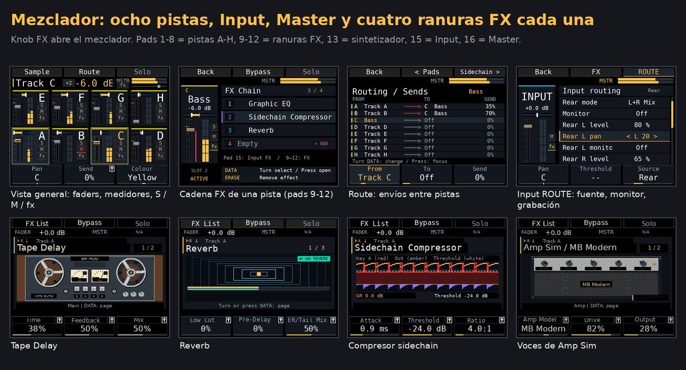

# Am MOD r31a

**Arrange, mezclador, sintetizador integrado, efectos ilustrados, Piano Roll y herramientas MIDI para Akai MPC Sample.**

[English](README.md) · [Русский](README.ru.md) · **Español** · [Descargar r31a](https://github.com/AlekseyMalykh/am-mod/releases/tag/r31a)

> **r31a — Arrange es una función beta.** El arreglo se guarda dentro del proyecto, y el firmware original o las versiones anteriores de Am MOD pueden perderlo si vuelven a guardar ese proyecto. Haz antes una copia de tus proyectos y de la tarjeta, y por favor informa de los problemas.

Am MOD arranca desde una tarjeta SD con el firmware **1.3.0.12**. La aplicación se ejecuta en RAM; el firmware instalado no se reescribe. Arranca sin la tarjeta del mod para usar el firmware original.

## Novedades de r31a

- **Arrange (beta)** — una línea de tiempo de la canción en la pantalla Song (**Song → Shift+B1**). Las pistas libres suenan juntas; los **bloques Seq** siguen en vivo a su secuencia original y los **patrones** son tus propias variaciones. Añade una secuencia tocando su pad, mueve un bloque o una selección de varias filas con **Note Repeat + DATA / fader**, reproduce desde el inicio o con **Shift+Play desde el cursor**, **Loop**, y **exporta todo el arreglo** (mezcla, stems) con Shift+B1. Las ediciones durante la reproducción se oyen al instante. [Guía de Arrange](docs/ARRANGE_GUIDE.es.md).
- **Piano Roll dentro de un bloque** — compases de la canción, cursor con **Follow** (Shift+B2), nombres de samples en las filas, **Shift+pads** para seleccionar filas, **Shift+Erase** copiar / pegar entre bloques (por ejemplo de una secuencia a un patrón), mover con Note Repeat y edición en su sitio de los bloques Seq con el deshacer original.
- **Renombrar** patrones y pistas de Arrange con la entrada de texto del mod (los pads escriben letras y se iluminan, K1 cambia pads / encoder).
- **Registros en una carpeta `Logs/`** dentro de la carpeta del mod, ya no mezclados con sus archivos; el instalador **1.6.0** los recoge para los informes de error.
- **Botón de encendido:** B1 Cancel, **B2 Bootloader**, B3 Power off (antes se guarda una copia del proyecto). **Rear** L / R con monitor, panorama y nivel independientes; correcciones de **To Seq**, **repeticiones de Song**, **SD Card Access con SampleBoot**, Sample Swap y Screen Mirror.
- Se mantiene: mezclador con 8 pistas, Input y Master con cuatro ranuras FX cada una, sidechain y envíos; sintetizador de cinco módulos; Input ROUTE; Piano Roll, herramientas MIDI, importación PGM/XPM, Sequence Pad Mutes, Sample Swap, almacenamiento Internal/External; compatibilidad con D.S.B, SampleBoot y mpc-boot-thingy.

[Notas de la versión](docs/RELEASE_NOTES-r31a.es.md) · [Guía de Arrange](docs/ARRANGE_GUIDE.es.md) · [Instalación](docs/INSTALL.es.md) · [Guía de uso](docs/USER_GUIDE.es.md) · [Sintetizador](docs/SYNTH_GUIDE.es.md) · [Menús de arranque](docs/BOOTLOADERS.es.md)

## Instalar y arrancar

1. Haz copia de tus proyectos, samples y ajustes de la tarjeta.
2. Descarga `am-mod-r31a.zip` y `MPC-Sample-Mod-Installer.exe` de la versión indicada arriba. En macOS/Linux usa el instalador en Python.
3. Conecta la tarjeta con un lector o SD Card Access, elige el ZIP y la tarjeta y pulsa Install. El instalador detecta el tipo de arranque (tarjeta simple, D.S.B, SampleBoot, mpc-boot-thingy); no sustituyas a mano la carpeta raíz `autorun` de un menú de arranque.
4. Expulsa la unidad con seguridad, sal de SD Card Access y apaga y enciende el MPC. En una tarjeta con menú elige **AM Mod**. La pantalla de arranque y **Project → Mod Settings → About** muestran la versión.

Usa exFAT y una etiqueta de volumen ASCII como `MPC`, sin espacios. FAT32 sigue siendo experimental. El instalador copia `autorun/`; no copia tus proyectos. [Instalación y recuperación](docs/INSTALL.es.md).

## Orientación rápida

| Desde | Acción |
|---|---|
| Song, transporte parado: **Shift+B1** | **Arrange**; B1 atrás, Shift+B1 exportar el arreglo |
| Arrange: tocar un pad de secuencia | Añadir esa secuencia en el cursor (B3 confirma) |
| Arrange: mantener **Note Repeat** + DATA / fader | Mover el bloque o la selección |
| Arrange: **Shift+B3** | Actions (Add / Block / Track / Song, renombrar) |
| Arrange: Play / **Shift+Play** / **Loop** | Desde el inicio / desde el cursor / bucle |
| Piano Roll del bloque: **Shift+pads**, **Shift+Erase** | Seleccionar filas / copiar y pegar |
| Knob FX | Mezclador; pads 1–8 = A–H, 13 = Synth, 15 = Input, 16 = Master (no mientras suena Song o Arrange) |
| Pad 13 del mezclador, luego Loop + pad / + − / DATA | Módulos y páginas del sintetizador |
| Shift+Sample (cualquier pantalla) | Lista Input ROUTE |
| Pads 9–12 del mezclador | Cuatro ranuras de inserción en serie |
| FX: Shift+Erase / Shift+B2 / Shift+B3 | Copiar / Pegar / Chain Bypass |
| Piano Roll: mantener DATA + encoder + fader | Seleccionar un área |
| Mantener Stop y luego Chop | Afinador de samples |
| Step Edit → Events/Steps → Knob FX | Piano Roll; B1 vuelve |
| Shift+Pad8 → B2 Map / Log | MIDI Monitor y mapas MIDI |
| Browser → Shift+B1 / Shift+B2 | Sample Swap / importar programas |
| Shift+Pad16 → Mod Settings → About | Modo, audio USB, paleta, pantalla, **Exit to bootloader** |
| Botón de encendido | B1 Cancel / B2 Bootloader / B3 Power off |

## Arrange en cinco pasos

1. Graba unas secuencias como siempre en Seq.
2. Abre **Song → Shift+B1**. Elige una fila con el fader, coloca el cursor con DATA, **toca un pad de secuencia** y confirma con B3. Repite en otras filas.
3. **Play** (o **Shift+Play** desde el cursor). Activa **Loop** para repetir un rango, una selección o un bloque.
4. Abre un bloque (**B3 Open**) para editarlo en el Piano Roll. En un bloque Seq editas la propia secuencia; mantén **B2 + pads y luego B3** para separar filas en un patrón propio para variaciones.
5. **Shift+B1** exporta el arreglo con el Song Export original (mezcla o stems). Guarda el proyecto.

## Mezclador y efectos

Las ocho pistas A–H, Master e Input tienen cuatro ranuras de inserción en serie. Las pistas tienen envíos, el compresor tiene sidechain y cada efecto tiene su propia ilustración que reacciona a la señal. Amp Sim tiene voces adicionales de guitarra y bajo; son presets originales de AIR Amp Sim, no capturas medidas de amplificadores. [Galería](docs/FX_GALLERY.md) · [Referencia de mandos](docs/FX_KNOB_LAYOUT.ru.md).

<table><tr><td></td><td></td></tr><tr><td></td><td></td></tr></table>

Las imágenes salen de los pintores de producción con datos de prueba y una fuente sustituta (`docs/media/r31a/build_images.py`); son ilustraciones, no fotos de un MPC físico.

El USB empieza en Stereo Master. **Mod Settings → Quick → USB audio → Master + A–H** y reiniciar activa **18 canales**: Master 1/2, A 3/4 … H 17/18. Desactiva la monitorización de entrada en la DAW si su reproducción vuelve al MPC, para evitar realimentación. SD Card Access detiene la reproducción y el audio mientras la tarjeta está compartida. [Guía USB](docs/USB_GUIDE.md).

## Menús de arranque

Am MOD puede estar en una tarjeta simple, bajo **D.S.B Boot** (`autorun/os/AM-Mod/`), **SampleBoot** (`autorun/mods/AM-Mod/`) o **mpc-boot-thingy**. **Exit to bootloader** (Mod Settings → About, o **B2** en el diálogo del botón de encendido) guarda una copia del proyecto y vuelve al menú de D.S.B o SampleBoot; con otros cargadores arranca el firmware original. [Menús de arranque](docs/BOOTLOADERS.es.md).

## Registros e informes de error

El mod escribe sus registros en **`Logs/`** dentro de su carpeta: `autorun/Logs/` en una tarjeta simple, `autorun/mods/AM-Mod/Logs/` con SampleBoot, `autorun/os/AM-Mod/Logs/` con D.S.B. Cada arranque sobrescribe la sesión anterior. **Report a bug** del instalador los reúne (y las ubicaciones antiguas) en un ZIP. [Informar de un error](docs/FEEDBACK.md).

## Estado y planes

Arrange se probó en un MPC físico con sus versiones de prueba; el paquete r31a final, el traslado de los registros a `Logs/` y la grabación experimental de Synth Keys aún necesitan una prueba en el equipo. Las comprobaciones automáticas host/ARM/QEMU no sustituyen la prueba en un MPC físico.

Próximo en Arrange: secciones con nombre, canciones de más de 128 compases, grabación en el arreglo (MIDI y tomas de audio), importación de archivos MIDI a patrones y el mezclador durante la reproducción. El alojamiento de VST queda para el futuro. SampQOL, D.S.B y SampleBoot se descargan aparte y no se incluyen aquí.

[Limitaciones conocidas](docs/KNOWN_ISSUES.md) · [Informar de un error](docs/FEEDBACK.md) · [Compilación](docs/BUILD.md) · [Registro de cambios](CHANGELOG.md) · [Licencia](LICENSE)

Proyecto no oficial, sin relación con Akai/inMusic. Gracias a Leusha, Henry Skillz (D.S.B y los efectos HS), a los autores de SampleBoot y Virtual MPC Sample y a la comunidad. Los componentes de terceros mantienen sus licencias; ver [NOTICE](NOTICE.md).
