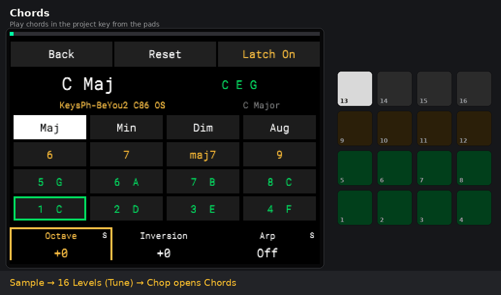
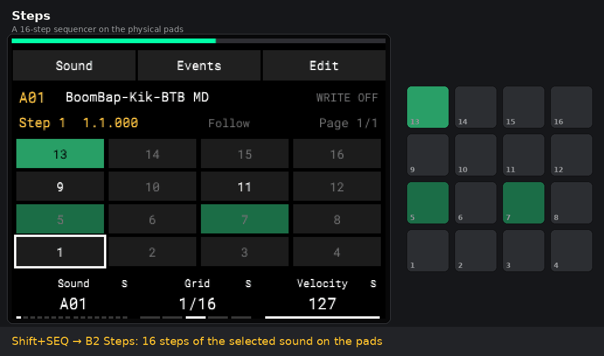
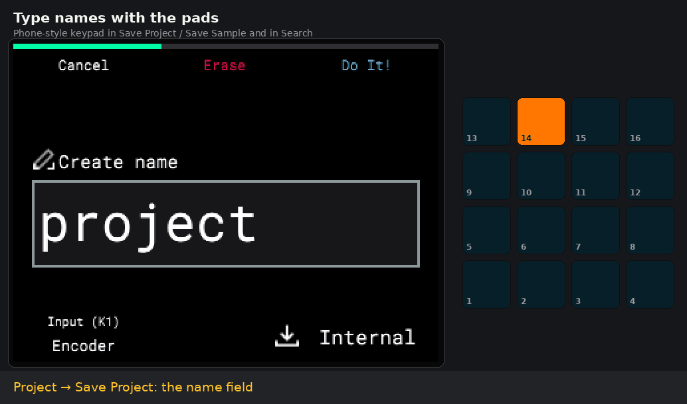
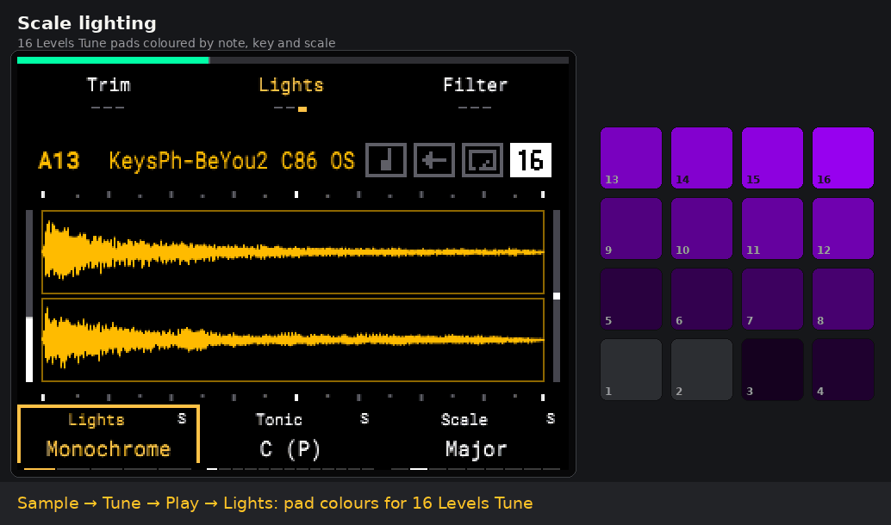
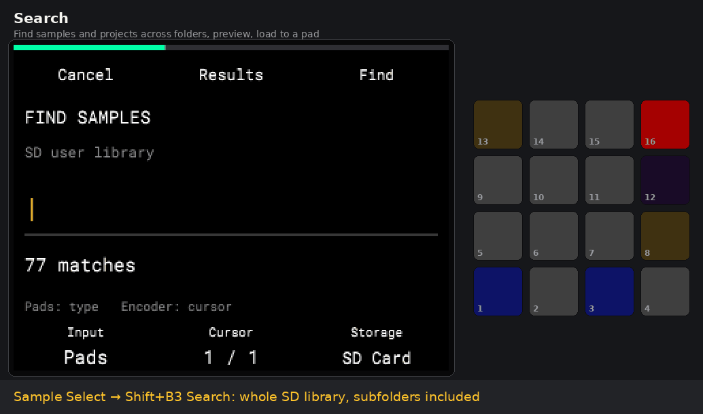
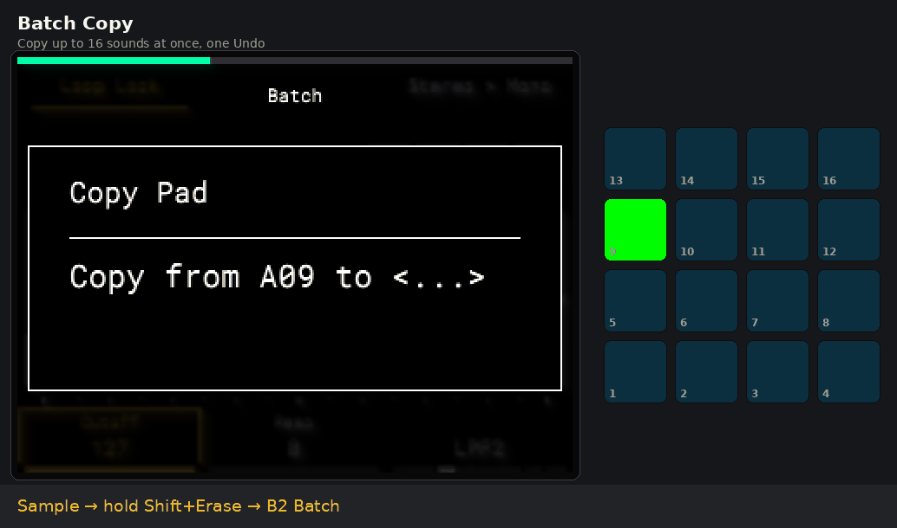
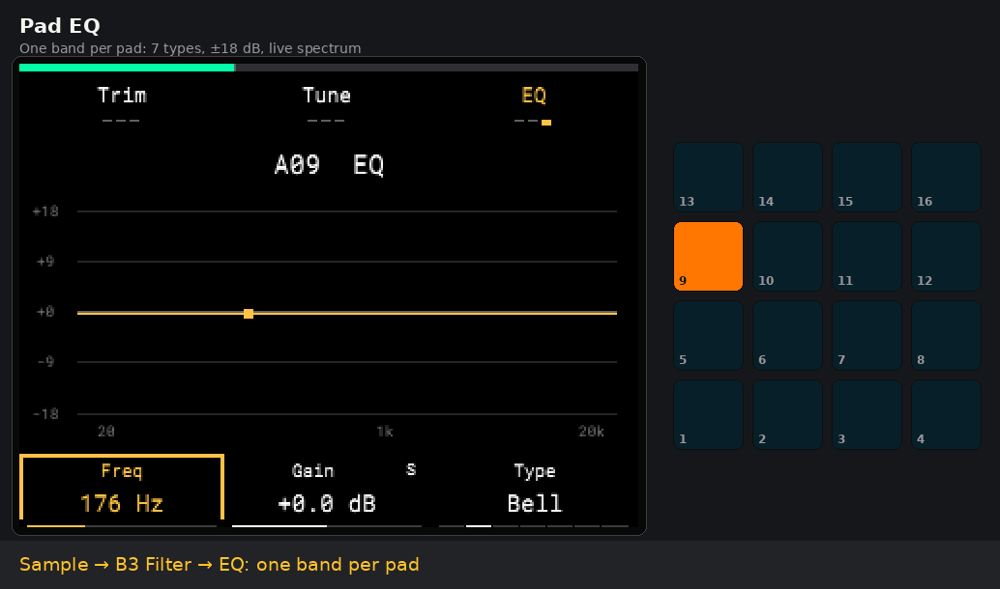
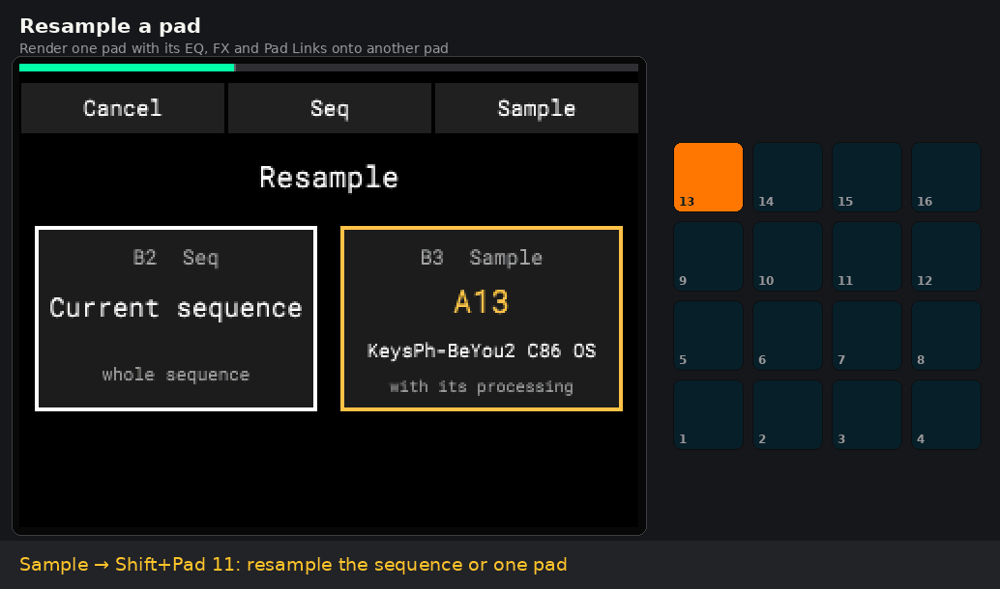

# AM Mod

**Unofficial SD card mod for the Akai MPC Sample**

**English** · [Русский](README.ru.md)

[r26d: fixes and new features](docs/RELEASE_NOTES-r26d.md)

[r26e candidate: experimental FAT32 support](docs/RELEASE_NOTES-r26e.md). The currently published r26d release still requires exFAT.


AM Mod is a community mod for the Akai MPC Sample (firmware **1.3.0.12**) that starts from the SD card.
It adds a step sequencer on the pads, a chord mode, typing names with the pads, scale
lighting, search across folders, batch copy, a per-pad EQ, resampling and more, on top of
the stock app. Nothing is flashed: the mod runs a patched copy of the stock app in RAM, and
**Project → Mod Off** brings the stock app back.

<p align="center"></p>
<p align="center"><sub>Recorded in the <a href="https://github.com/orrpunk-art/virtual-mpc-sample">Virtual MPC Sample</a> emulator running the stock firmware with the mod; the pads on the right show the colours the app sends.</sub></p>

> **Unofficial project.** Not affiliated with, endorsed by or supported by inMusic Brands
> or Akai Professional. **No firmware and no Akai code are in this repository or in the
> release packages**: the mod patches the copy of the app already on your MPC Sample.
> Use at your own risk. See [NOTICE](NOTICE.md).

## r26d update — 1 November 2026

- **Pad Colour across sound views:** Sample and Events sound pads use their assigned colours; FX Select keeps its native status colours. Events names use each sound's colour. In Steps, ordinary events use the selected sound's Pad Colour (Stock keeps the standard green).
- **Steps background:** empty steps are off; events of other sounds have a very dim white background, enabled by default. **Shift+K3 → Other Sounds** switches it off/on. If other sounds play on every step, this background can cover all 16 pads of a page. The selected sound's own events take priority and keep their colour.
- **Cursor:** the on-screen frame, pad fill and step numbers now agree in the order **13–16 → 9–12 → 5–8 → 1–4**. Encoder click hides/shows the selection cursor and its frame. Selection, playback, Mute and Erase indications take priority over sound colours.
- **Events deletion:** **B3 Erase**, labelled red, deletes the selected event row. An Erase tap does not delete a row; **Erase+pad** keeps the stock sequence-wide deletion for that sound, with confirmation. Shift+B3 still opens Copy/Paste; B3 in the Chop/Levels picker still applies the selection.

Published at the author's request after device trials. The automated checks cover native LED conversion, both LED senders, all 16 screen positions on two pages, event controls, normal/UBSan ARM fixtures and preload construction. They are separate from hardware test coverage; see the release verification record.

## r25x update — 1 November 2026

The author confirmed the current features on an MPC Sample with r25w. r25x removes temporary diagnostic messages and prepares the public documentation; feature behaviour is unchanged. ARM/QEMU checks are listed in the release notes and do not establish coverage of every setting combination on hardware.

- **Pad Colour:** Sample → B1 → **Mix** → **K2 without Shift**. 13 choices including **Stock**, saved per pad in the project. Encoder presses cycle Volume → Pad Colour → Pan; turning changes the focused parameter. **Shift+K2 is Kit Volume** and K1 remains Volume. Mute and Erase keep their native status colours.
- **Erase in Open Project:** project files use the native confirmation and also remove the companion `_[ProjectData]` directory. A project folder or a loose `_[ProjectData]` folder has a separate question: **B1 Cancel, B3 Delete**. Its samples are deleted too; this cannot be undone.
- **One exit copy:** `MPC-Sample/Projects/Mod-Exit-Last.xpj` and `Mod-Exit-Last_[ProjectData]`. The previous copy is replaced after the new save succeeds; staging is not listed as another project.
- **Latest project at startup:** opens the newest `.xpj` on SD in Projects or one directory level below it. Normally this is Mod-Exit-Last; a project saved later in the stock app takes priority. Selection uses file modification time, not a history of manually opened projects.
- **Storage labels:** browser B2 shows **Internal / External** from the actual path. Internal remains temporary in the mod.
- **Lights:** three modes — **Monochrome, Piano, Scale**. Older Tonic/Degrees settings load as Scale. Tonic, scale, Transpose16 and group colours remain available.
- **Interface:** framed **S** badges, white normally and red with Shift; Zoom: Loop lock at the right edge; a Seq Colour swatch. Pad-name entry has cursor and repaint fixes.

## Features

Status as of 1 November 2026 (build r26d). **Confirmed** means checked on a real MPC Sample;
**trial** means the specified automated checks passed; hardware coverage is pending as noted.

| Feature | Where | Status |
|---|---|---|
| **Readable K1–K3 panel**: parameter names and values always visible, amber focus, `S` marks for Shift functions | all standard screens | confirmed |
| **Type names with the pads** (phone keypad: ABC on pad 14, DEF on 15…, delete on 16) | Save Project / Save Sample, Search | confirmed |
| **Orig Note** of a sample, project **Key / Scale** | Sample → Tune → Shift+K1; Project → Key/Scale | confirmed |
| **Scale lighting** for 16 Levels Tune: Monochrome / Piano / Scale colours, Transpose16 | Sample → Tune/Play/**Lights** | partly confirmed |
| **Steps**: 16-step sequencer on the physical pads, grid 1/4…1/64 and triplets, velocity, mute steps, copy/paste | Shift+SEQ → B2 Steps | confirmed |
| **Events editor** with Chop / 16 Levels choice and audition, event move on the grid | Step Edit / Steps | confirmed |
| **Poly**: chords recorded and edited as separate notes | Seq | confirmed |
| **Search** samples and projects in Folder / Subfolders / Library, preview, load to a pad | Sample Select / Open Project → Shift+B3 | confirmed (basic) |
| **Batch Copy** of up to 16 sounds with automatic or manual targets | Sample → Shift+Erase → B2 | confirmed |
| **Resample** a pad (with Pad Link and Bypass) or a sequence to another pad | Shift+Pad 11 | confirmed |
| **Power key** asks, saves a separate copy of the project to SD, powers off | power key | confirmed |
| **Per-pad EQ**: one band, 7 types, ±18 dB, live spectrum behind the curve | Sample → B3 Filter → Filter Env → **EQ** | confirmed |
| **Stereo → Mono** (left or right channel to a new pad) | Sample → Shift+B3 | trial |
| **Chords**: 8 scale degrees, 6/7/maj7/9, Maj/Min/Dim/Aug/Sus4, octave, inversion, latch, arpeggiator, chord repeat with Note Repeat; recorded as normal Tune events | 16 Levels Tune → Chop | trial (r24v) |
| **Sequence pads**: 13 colours (Stock by default); the playing and the queued sequence blink with the tempo | Seq → Shift+K1 | trial (r24v) |
| **Batch Extract** chops to separate samples | Chop → Shift+B2 | confirmed |

Every feature with its controls and status: [docs/FEATURES.md](docs/FEATURES.md). Build history: [CHANGELOG.md](CHANGELOG.md).

### In action

<table>
<tr>
<td width="50%"><b>Steps</b><br></td>
<td width="50%"><b>Typing names with the pads</b><br></td>
</tr>
<tr>
<td width="50%"><b>Scale lighting</b><br></td>
<td width="50%"><b>Search</b><br></td>
</tr>
<tr>
<td width="50%"><b>Batch Copy</b><br></td>
<td width="50%"><b>Pad EQ</b><br></td>
</tr>
<tr>
<td width="50%"><b>Resample a pad</b><br></td>
<td width="50%"></td>
</tr>
</table>

## Install

> [!IMPORTANT]
> **FAT32 / MS-DOS (FAT32) is available experimentally starting with r26e; exFAT remains supported.** FAT32 requires the r26e package and installer **1.0.2+**, or a manual copy of r26e's `autorun/`. FAT32 has been checked in test images and the emulator; physical MPC testing is still pending. The published r26d and earlier packages require exFAT; updating only the installer does not add FAT32 support to an old package.
>
> **Use a card volume name such as `MPC` or `MPCSAMPLE`.** Only ASCII letters, digits, `.`, `_` and `-` are supported; spaces and Cyrillic letters in the card name prevent startup. This restriction applies to the card name, not your sample/project names.
>
> Check the filesystem before installing: Finder → select the SD volume → ⌘I → Format on macOS; drive Properties → File system on Windows. Installer **1.0.2+** checks the filesystem, card name and package compatibility before writing.
>
> **No reformatting is needed to use r26e on an existing FAT32 card.** Keep your projects and samples; replace the mod's `autorun/` folder with the complete new version. The installer backs up the previous folder and does not format or convert cards. FAT32 has a limit of **4 GiB minus 1 byte per file**.

You need an MPC Sample on firmware **1.3.0.12** (the mod checks the app's SHA-256 and
refuses to start on any other version) and a compatible SD card with a supported volume name: exFAT, or experimental FAT32 starting with r26e.

**Installer (Windows):** download `MPC-Sample-Mod-Installer.exe` and the
`am-mod-*.zip` package from [Releases](../../releases), run the installer, pick the zip
(or press *Latest release*) and the SD card, press **Install**.

**Installer (macOS / Linux / Windows with Python 3.8+):**

```bash
python3 installer/mpc_mod_installer.py                 # window
python3 installer/mpc_mod_installer.py cards           # list cards
python3 installer/mpc_mod_installer.py install am-mod-r26e.zip --card E:
python3 installer/mpc_mod_installer.py install --latest --card /Volumes/MPC
python3 installer/mpc_mod_installer.py remove --card E:
```

The installer writes only `autorun/` and `MPC_MOD_VERSION.json` on the card. It checks the
package, backs up the previous `autorun/` to `~/AM-Mod-Backups/`, writes the files
that start the mod last, and verifies everything it wrote. It never formats the card and
never touches `MPC-Sample/` (your projects and samples).

**By hand:** unzip the package and copy its `autorun` folder to the root of the card.

## Use

1. Insert the card and power on the MPC, or insert it into a running MPC. The mod starts
   by itself (since r22 there is no extra question) and takes a few seconds. If a start
   ever hangs at 0 %, power on without the card, wait for the normal screen, then insert it.

   > **The screen goes dark when the mod starts.** The stock app closes first, so the
   > screen and the pads go out for a few seconds before the mod appears. This is normal:
   > do not power off and do not pull the card. The same happens on Mod Off, when the stock
   > app comes back.

2. The mod checks the stock app and its own files before it starts; on any mismatch the
   stock app keeps running.
3. Work as usual. Save projects and samples to **External** (the SD card): in the mod,
   Internal storage is temporary and is lost when the mod stops.
4. To leave: **Project** (Shift+Pad 16) → **Mod Off** → confirm. The mod saves a copy of
   the project to `MPC-Sample/Projects/Mod-Exit-Last.xpj` and the stock app returns. Then eject
   the card as usual; in Windows use *Eject*.

The power key also works in the mod: it asks, saves a project copy to the card and powers
off. Do not pull the card while the mod is starting, saving or shutting down.

## Try it without the device

[**Virtual MPC Sample**](https://github.com/orrpunk-art/virtual-mpc-sample) runs the stock
firmware in QEMU with the whole device in your browser, and runs SD autorun packages the
way the MPC does. The GIFs above were recorded there:

```bash
python3 lab.py autorun am-mod-r26e.zip --no-reboot --yes
```

Emulator runs are useful for development, but they are not a hardware test: timing, audio
latency, battery and USB audio differ from the device.

## Build from source

Requirements: Linux or WSL, Python 3, AArch64 GCC/binutils and your **own** local copy of
the stock firmware 1.3.0.12; the expected SHA-256 of the app is
`b6584cba76e416e432ad202509099d34373dc2c3d6a8fb625f5678bf0193b508`. The firmware image,
updater, extracted partitions and rootfs are not part of this repository; paths to the
rootfs in older checks (`/home/user/mpc-rootfs-user-20260808`) need adjusting.

Order: get the local inputs with the expected hashes → build `sd-clone-trial` (the loader)
→ build the value patches in `sd-k-value-peek` → build the current `sd-mod-session`
revision. For r25x: `sd-mod-session/build_chords_candidate.py`, `verify_chords.py`,
`verify_pad_eq.py`, then `package_update.py` over the previous package. The ARM/QEMU checks (`verify_*.py`, `check_*.c`) use clearly marked
adapters and do not replace a hardware run.

| Folder | Contents |
|---|---|
| `sd-mod-session/` | the current mod: sources (`src/`), build and package scripts, checks, feature docs |
| `sd-clone-trial/` | the loader: runs a verified copy of the stock app in RAM and restores the stock app |
| `sd-k-value-peek/` | the first display patches (K1–K3 values) |
| `installer/` | the SD card installer and its tests |
| `virtual-mpc/` | an early browser model of the UI (not an emulator) |
| `research/`, `docs/` | reverse-engineering notes and scripts, history of the stages |

Most technical documents are in Russian.

## Legal

- Akai Professional and MPC are trademarks of inMusic Brands, Inc., used here only to name
  the device the mod runs on.
- No firmware, Akai code, factory content or Akai artwork is distributed. The mod copies
  the app that is on your device and patches that copy in RAM; it never writes the
  firmware or the boot loader.
- Release packages include `xdg-dbus-proxy` (LGPL-2.1-or-later) with its source.
- Details: [NOTICE.md](NOTICE.md).

## License

[MIT](LICENSE). Contributions: [CONTRIBUTING.md](CONTRIBUTING.md).
