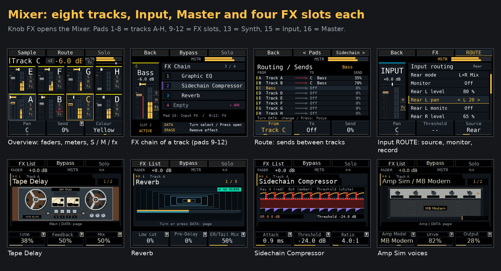

# Am MOD r31a

**Arrange, a mixer, a built-in synth, illustrated effects, Piano Roll and MIDI tools for Akai MPC Sample.**

**English** · [Русский](README.ru.md) · [Español](README.es.md) · [Download r31a](https://github.com/AlekseyMalykh/am-mod/releases/tag/r31a)

> **r31a — Arrange is a beta feature.** The arrangement is saved inside the project, and stock firmware or older Am MOD versions may drop it when they re-save that project. Back up your projects and card first, and please report problems.

Am MOD starts from an SD card on firmware **1.3.0.12**. The application runs in RAM; the installed firmware is not flashed. Start without the mod card to use stock firmware.

## What is new in r31a

- **Arrange (beta)** — a song timeline in the Song screen (**Song → Shift+B1**). Free lanes play together; **Seq blocks** follow their stock sequence live, **patterns** are your own variations. Add a sequence by tapping its pad, move a block or a whole multi-row selection with **Note Repeat + DATA / fader**, play from the start or **Shift+Play from the cursor**, **Loop**, and **export the whole arrangement** (mixdown, stems) with Shift+B1. Edits made while it plays are heard at once. [Arrange guide](docs/ARRANGE_GUIDE.md).
- **Piano Roll inside a block** — song bars, a playhead with **Follow** (Shift+B2), sample names on the rows, **Shift+pads** to select rows, **Shift+Erase** copy / paste between blocks (for example from a sequence into a pattern), Note Repeat move, and in-place editing of Seq blocks with the stock Undo.
- **Rename** patterns and Arrange tracks with the Mod text input (pads type letters and light up, K1 switches pads / encoder).
- **Logs in a `Logs/` folder** inside the mod folder, so they no longer mix with the mod files; installer **1.6.0** collects them for bug reports.
- **Power button:** B1 Cancel, **B2 Bootloader**, B3 Power off (a project copy is saved first). **Rear** L / R get independent monitor, pan and level; fixes for **To Seq**, **Song repeats**, **SD Card Access under SampleBoot**, Sample Swap and Screen Mirror.
- Carried over: Mixer with 8 tracks, Input and Master, four FX slots each, sidechain and sends; five-module synth; Input ROUTE; Piano Roll, MIDI tools, PGM/XPM import, Sequence Pad Mutes, Sample Swap, Internal/External storage; D.S.B, SampleBoot and mpc-boot-thingy support.

[Release notes](docs/RELEASE_NOTES-r31a.md) · [Arrange guide](docs/ARRANGE_GUIDE.md) · [Installation](docs/INSTALL.md) · [User guide](docs/USER_GUIDE.md) · [Synth guide](docs/SYNTH_GUIDE.md) · [Boot menus](docs/BOOTLOADERS.md)

## Install and start

1. Back up your projects, samples and card settings.
2. Download `am-mod-r31a.zip` and `MPC-Sample-Mod-Installer.exe` from the release above. On macOS/Linux use the Python installer.
3. Connect the card through a reader or SD Card Access, select the ZIP and the card, then Install. The installer detects the boot layout (plain card, D.S.B, SampleBoot, mpc-boot-thingy); do not replace a boot menu's root `autorun` folder by hand.
4. Safely eject the drive, leave SD Card Access, and power the MPC off and on. On a boot-menu card choose **AM Mod**. The boot screen and **Project → Mod Settings → About** show the version.

Use exFAT and an ASCII volume label such as `MPC` without spaces. FAT32 remains experimental. The installer backs up `autorun/`; it does not back up your projects. [Detailed installation and recovery](docs/INSTALL.md).

## Find your way around

| Start here | Action |
|---|---|
| Song, transport stopped: **Shift+B1** | **Arrange**; B1 back, Shift+B1 export the arrangement |
| Arrange: tap a sequence pad | Add that sequence at the cursor (B3 confirms) |
| Arrange: hold **Note Repeat** + DATA / fader | Move the block or the selection |
| Arrange: **Shift+B3** | Actions (Add / Block / Track / Song, rename) |
| Arrange: Play / **Shift+Play** / **Loop** | Play from the start / from the cursor / loop |
| Block Piano Roll: **Shift+pads**, **Shift+Erase** | Select rows / copy and paste |
| Knob FX | Mixer; pads 1–8 = A–H, 13 = Synth, 15 = Input, 16 = Master (not while Song or Arrange plays) |
| Mixer pad 13, then Loop + pad / + − / DATA | Synth modules and pages |
| Shift+Sample (any screen) | Input ROUTE list |
| Mixer pads 9–12 | Four serial insert slots |
| FX: Shift+Erase / Shift+B2 / Shift+B3 | Copy / Paste / Chain Bypass |
| Piano Roll: hold DATA + encoder + fader | Select an area |
| Hold Stop, then Chop | Sample tuner |
| Step Edit → Events/Steps → Knob FX | Piano Roll; B1 returns |
| Shift+Pad8 → B2 Map / Log | MIDI Monitor and MIDI maps |
| Browser → Shift+B1 / Shift+B2 | Sample Swap / Programs import |
| Shift+Pad16 → Mod Settings → About | Mode, USB audio, palette, display, **Exit to bootloader** |
| Power button | B1 Cancel / B2 Bootloader / B3 Power off |

## Arrange in five steps

1. Record a few sequences as usual in Seq.
2. Open **Song → Shift+B1**. Choose a row with the fader, place the cursor with DATA, **tap a sequence pad** and confirm with B3. Repeat on other rows.
3. **Play** (or **Shift+Play** from the cursor). Turn on **Loop** to repeat a range, a selection or a block.
4. Open a block (**B3 Open**) to edit it in the Piano Roll. In a Seq block you edit the sequence itself; hold **B2 + pads, then B3** to separate rows into a pattern of their own for variations.
5. **Shift+B1** exports the arrangement through the stock Song Export (mixdown or stems). Save the project.

## Mixer and effects

Eight tracks A–H, Master and Input have four serial insert slots. Tracks have sends, the compressor has a sidechain key, and every effect has its own illustration that reacts to the signal. Amp Sim has additional guitar/bass voices; these are stock AIR Amp Sim presets, not measured amplifier captures. [Gallery](docs/FX_GALLERY.md) · [Knob reference](docs/FX_KNOB_LAYOUT.ru.md).

<table><tr><td></td><td></td></tr><tr><td></td><td></td></tr></table>

The pictures are produced by the production painters with fixture data and a substitute font (`docs/media/r31a/build_images.py`); they are illustrations, not photos of a physical MPC.

USB defaults to Stereo Master. **Mod Settings → Quick → USB audio → Master + A–H**, then restart, enables **18 channels**: Master 1/2, A 3/4 through H 17/18. Disable DAW input monitoring if its playback is returned to the MPC, to avoid feedback. SD Card Access stops playback and audio while the card is shared. [USB guide](docs/USB_GUIDE.md).

## Boot menus

Am MOD can live on a plain card, under **D.S.B Boot** (`autorun/os/AM-Mod/`), **SampleBoot** (`autorun/mods/AM-Mod/`) or **mpc-boot-thingy**. **Exit to bootloader** (Mod Settings → About, or **B2** in the power-button dialog) saves a project copy and returns to the D.S.B or SampleBoot menu; with other loaders it starts stock firmware. [Boot menus and bootloader exit](docs/BOOTLOADERS.md).

## Logs and bug reports

The mod writes its journals to **`Logs/`** in its own folder: `autorun/Logs/` on a plain card, `autorun/mods/AM-Mod/Logs/` under SampleBoot, `autorun/os/AM-Mod/Logs/` under D.S.B. Each start overwrites the previous session. The installer's **Report a bug** collects them (and the older locations) into one ZIP. [Report a bug](docs/FEEDBACK.md).

## Status and plans

Arrange was tested on a physical MPC through its test builds; the final r31a package, the move of the logs to `Logs/` and the experimental Synth Keys recording still need a device check. Automated host/ARM/QEMU checks do not replace testing on a physical MPC.

Next for Arrange: named song sections, songs longer than 128 bars, recording into the arrangement (MIDI and audio takes), MIDI file import into patterns, and the Mixer during playback. VST hosting is future work. SampQOL, D.S.B and SampleBoot are separate downloads and are not bundled here.

[Known limitations](docs/KNOWN_ISSUES.md) · [Report a bug](docs/FEEDBACK.md) · [Build](docs/BUILD.md) · [Changelog](CHANGELOG.md) · [Licence](LICENSE)

Unofficial project, unaffiliated with Akai/inMusic. Thanks to Leusha, Henry Skillz (D.S.B and the HS effects), the SampleBoot and Virtual MPC Sample authors and the community. Third-party components retain their own licences; see [NOTICE](NOTICE.md).
