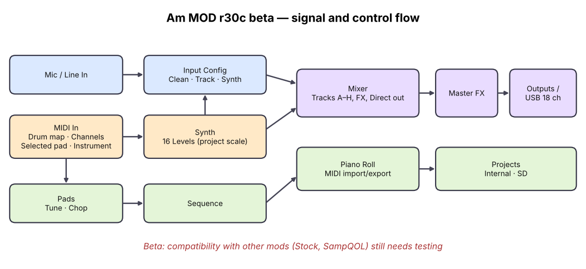
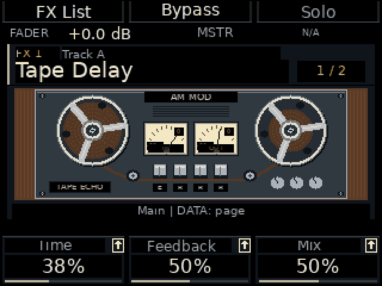
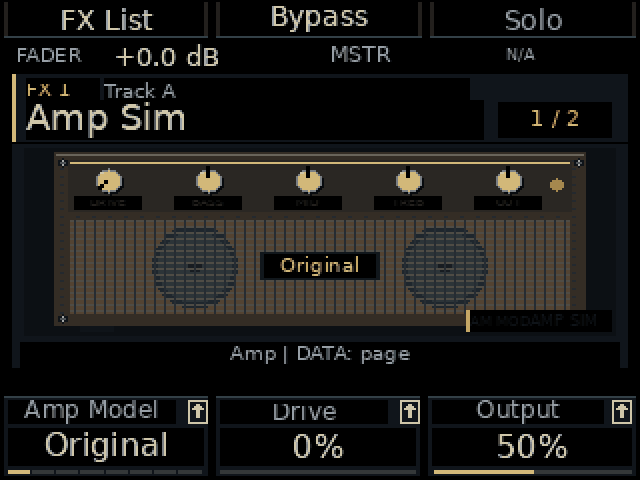
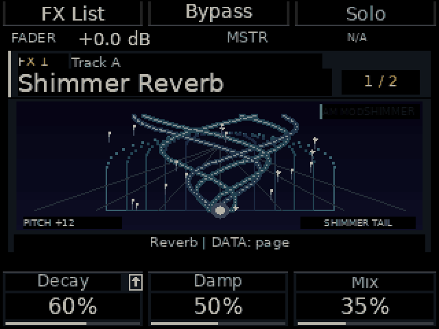
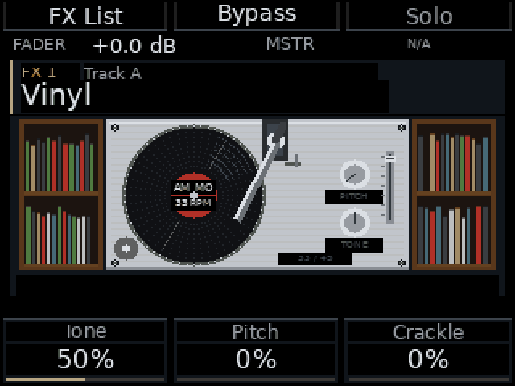

# Am MOD r30c beta1

**A mixer, illustrated effects, Piano Roll and MIDI tools for Akai MPC Sample.**

**English** · [Русский](README.ru.md) · [Español](README.es.md) · [Download r30c beta1](https://github.com/AlekseyMalykh/am-mod/releases/tag/r30c-beta1)

> **BETA — r30c-beta1.** This is a beta release. **Compatibility with other mods (Stock, SampQOL, D.S.B and others) still requires testing** — do not use it on the only copy of important projects; back up first. Please report problems.

Am MOD starts from an SD card on firmware **1.3.0.12**. The application runs in RAM; the installed firmware is not flashed. Start without the mod card to use stock firmware.

## What is new

- **Piano Roll:** Pads, Tune and Chop layers, selection, group editing, grid, Follow, shared Undo/Redo and MIDI file import/export. Positive Shift+DATA rotation now zooms in.
- **MIDI tools:** Monitor, input/output maps, Learn, separate outgoing Pads/Levels mappings and project persistence. USB/TRS reception on external equipment still needs device testing.
- **Programs:** import MPC1000 PGM 1.00 and Drum XPM, with a preview, bank selection, missing-file/occupied-pad checks and one Undo operation.
- **Sequence Pad Mutes:** independent local mutes, Mute+B3 mode, Mute+B2 clear, visible header hints and a red **SM** indicator. Copying a pad does not inherit its source's local mute; copied sequences start without local mutes.
- **Sample Swap:** hear another browser sample in your playing sequence. Orig Note is over **K2**, folder path is at the top, and SWAPPED/WAIT/PAUSED show what is happening. Preview Off restores the original; confirming a load makes the replacement permanent.
- **Palette:** 32 shared named colour slots, optional system-colour reservation and saved project assignments.
- **Fixes:** Stop then Chop no longer opens the tuner after Stop is released; Tape Delay reels stop with playback; Sample's original waveform colour is respected; FX/compressor controls, takeover and routing fixes are retained. EQ preserves sample status icons, and the Filter/Filter Env spectrum is drawn before the native curves.
- **Installation:** installer **1.4.0** supports a plain card, **mpc-boot-thingy** and **D.S.B Boot** without replacing an existing boot menu.

[Release notes](docs/RELEASE_NOTES-r30c.md) · [Installation](docs/INSTALL.md) · [User guide](docs/USER_GUIDE.md) · [Future plug-in plan](docs/PLUGIN_ROADMAP.md)

## Install and start

1. Back up your projects, samples and card settings. **Beta:** compatibility with other mods (Stock, SampQOL, D.S.B) still needs testing — keep a copy of your projects and your previous card setup. The r30c storage candidate preserves user projects, samples and audio exports in **Internal** as well as **External**. Use the native K3 Storage control in Save/Export dialogs; system settings outside the pinned user folders still use the private session layer. Final device verification is pending.
2. Download `am-mod-r30c-beta1.zip` and `MPC-Sample-Mod-Installer.exe` from the release above. On macOS/Linux use the Python installer.
3. Connect the card through a reader or SD Card Access, select the ZIP and card, then Install. The installer detects the boot layout; do not replace the root autorun folder of a boot-menu card manually.
4. Safely eject the drive, leave SD Card Access, and power the MPC off and on. On a boot-menu card choose **AM Mod**.

Use exFAT and an ASCII volume label such as `MPC` without spaces. FAT32 remains experimental. The installer backs up `autorun/`; it does not back up your projects. [Detailed installation and recovery](docs/INSTALL.md).

## Find your way around

| Start here | Action |
|---|---|
| Knob FX | Mixer; pads 1–8 = A–H, 15 = Input, 16 = Master |
| Shift+Knob FX from Sample | FX of the last played pad's assigned track |
| Mixer pads 9–12 | Four serial insert slots |
| FX: Shift+Erase / Shift+B2 / Shift+B3 | Copy / Paste / Chain Bypass |
| Mute+B3 / Mute+B2 | Sequence mute mode / clear this sequence's local mutes |
| Hold Stop, then Chop | Sample tuner; release Stop before Chop for ordinary Chop |
| Step Edit → Events/Steps → Knob FX | Piano Roll; B1 returns |
| Shift+Pad8 → B2 Map / Log | MIDI Monitor and MIDI maps |
| Browser → Shift+B1 | Sample Swap audition |
| Browser → Shift+B2 → Programs | PGM/XPM import |
| Shift+Pad16 → Mod Settings | Mode, USB audio, palette and display preferences |

Loop/Reverse, Chop/Note On and 16 Levels do not edit the hidden sample while the mixer is open. Mute controls the tracks there.

## Effects and USB

<table><tr><td></td><td></td></tr><tr><td></td><td></td></tr></table>

These GIFs are generated by the production effect painter with synthetic meters and a substitute font; they are illustrations, not physical-MPC recordings. [Gallery](docs/FX_GALLERY.md).

Eight tracks A–H, Master and Input have four serial insert slots. Amp Sim has additional guitar/bass voices with changing artwork; these are stock AIR Amp Sim presets, not measured amplifier captures. [Knob reference](docs/FX_KNOB_LAYOUT.ru.md).

USB defaults to Stereo Master. **Mod Settings → Quick → USB audio → Master + A–H**, then restart, enables **18 channels**: Master 1/2, A 3/4 through H 17/18. Disable DAW input monitoring if its playback is returned to the MPC to avoid feedback. SD Card Access stops playback and audio while the card is shared. [USB guide](docs/USB_GUIDE.md).

## Status and plans

r30c consolidates the previously separate r30b–r30e development branches. All 88 r30e linked modules are retained; the build has 105 modules. Automated host/ARM/QEMU checks and full native preload checks are documented in the release verification. They do not replace testing the final package on a physical MPC.

VST hosting, Henry's HS effects in AM Mod, and a save-and-return-to-D.S.B command are **future work**, not r30c features. SampQOL and D.S.B are separate downloads and are not bundled here. [Plug-in roadmap](docs/PLUGIN_ROADMAP.md).

[Known limitations](docs/KNOWN_ISSUES.md) · [Report a bug](docs/FEEDBACK.md) · [Build](docs/BUILD.md) · [Changelog](CHANGELOG.md) · [Licence](LICENSE)

Unofficial project, unaffiliated with Akai/inMusic. Thanks to Leusha, the Virtual MPC Sample authors and the community. Third-party components retain their own licences; see [NOTICE](NOTICE.md).
