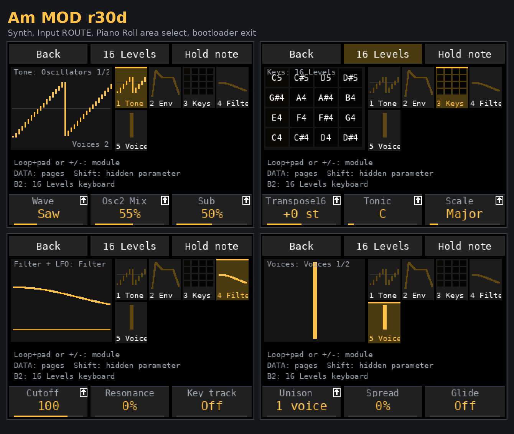
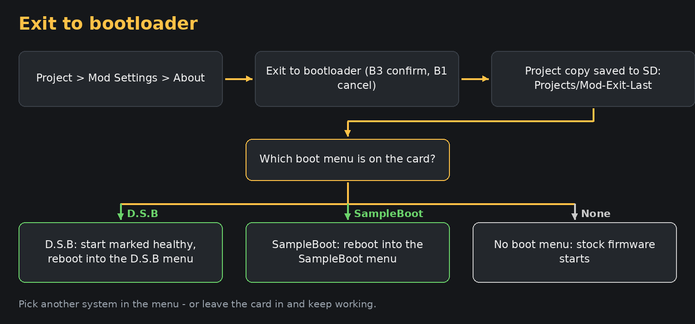

# Am MOD r30d beta1

**A mixer, built-in synth, illustrated effects, Piano Roll and MIDI tools for Akai MPC Sample.**

**English** · [Русский](README.ru.md) · [Español](README.es.md) · [Download r30d beta1](https://github.com/AlekseyMalykh/am-mod/releases/tag/r30d-beta1)

> **BETA — r30d-beta1.** This is a beta release. **Compatibility with other mods and boot menus (Stock, SampQOL, D.S.B, SampleBoot, mpc-boot-thingy) still requires testing** — do not use it on the only copy of important projects; back up first. Please report problems.

Am MOD starts from an SD card on firmware **1.3.0.12**. The application runs in RAM; the installed firmware is not flashed. Start without the mod card to use stock firmware.

## What is new in r30d

- **Synth with five modules** on Mixer pad 13: two oscillators, sub, noise, drive, amp and filter envelopes, filter, LFO, unison and glide. **Hold Loop + pad** (13–16, 9) or **+ / −** to change module, **DATA** to flip pages; one row of knobs with the rarely used parameter on **Shift+K**. Keys page and Sample Record use the **Tune** layout. [Synth guide](docs/SYNTH_GUIDE.md).
- **Input ROUTE from anywhere:** **Shift+Sample** opens one clear Input list (Source Mic / Rear / USB / Resample / Synth, Mode, Monitor, Threshold, Tuner, record rows). Sample Record K1 selects the Source.
- **Piano Roll area selection:** hold **DATA**, turn the encoder (time) and move the fader (rows).
- **Takeover for the synth knobs** (Pickup / Scaled / Jump) like the rest of the Mixer.
- **Exit to bootloader:** *Mod Settings → About* saves a project copy and returns to the **D.S.B menu** (or stock if there is none). D.S.B's “start OK” is now carried to the card, so a good session is no longer counted as a crash. [Boot menus](docs/BOOTLOADERS.md).
- **Henry Skillz effects** (HS Saturator, HS Bass Focus, HS Heat) with their own visuals; MIDI Buttons page and controller Shift fixes; browser search **Find**.
- **Layout and Transpose16 swapped:** K1 = Transpose16, Shift+K1 = Layout on Tune, synth Keys and Sample Record.
- Carried over from r30c: Piano Roll, MIDI tools, PGM/XPM import, Sequence Pad Mutes, Sample Swap, 32-slot palette, Internal/External storage, installer **1.4.0** for a plain card, **mpc-boot-thingy** and **D.S.B Boot**.

[Release notes](docs/RELEASE_NOTES-r30d.md) · [Installation](docs/INSTALL.md) · [User guide](docs/USER_GUIDE.md) · [Synth guide](docs/SYNTH_GUIDE.md) · [Boot menus](docs/BOOTLOADERS.md)

## Install and start

1. Back up your projects, samples and card settings. **Beta:** compatibility with other mods and boot menus still needs testing — keep a copy of your projects and your previous card setup.
2. Download `am-mod-r30d-beta1.zip` and `MPC-Sample-Mod-Installer.exe` from the release above. On macOS/Linux use the Python installer.
3. Connect the card through a reader or SD Card Access, select the ZIP and card, then Install. The installer detects the boot layout; do not replace the root autorun folder of a boot-menu card manually.
4. Safely eject the drive, leave SD Card Access, and power the MPC off and on. On a boot-menu card choose **AM Mod**. **Project → Mod Settings → About** shows the version.

Use exFAT and an ASCII volume label such as `MPC` without spaces. FAT32 remains experimental. The installer backs up `autorun/`; it does not back up your projects. [Detailed installation and recovery](docs/INSTALL.md).

## Find your way around

| Start here | Action |
|---|---|
| Knob FX | Mixer; pads 1–8 = A–H, 13 = Synth, 15 = Input, 16 = Master |
| Mixer pad 13, then Loop + pad / + − / DATA | Synth modules and pages |
| Synth B2 / B3 | 16 Levels keyboard / Hold note |
| Shift+Sample (any screen) | Input ROUTE list |
| Shift+Knob FX from Sample | FX of the last played pad's assigned track |
| Mixer pads 9–12 | Four serial insert slots |
| FX: Shift+Erase / Shift+B2 / Shift+B3 | Copy / Paste / Chain Bypass |
| Piano Roll: hold DATA + encoder + fader | Select an area |
| Mute+B3 / Mute+B2 | Sequence mute mode / clear this sequence's local mutes |
| Hold Stop, then Chop | Sample tuner |
| Step Edit → Events/Steps → Knob FX | Piano Roll; B1 returns |
| Shift+Pad8 → B2 Map / Log | MIDI Monitor and MIDI maps |
| Browser → Shift+B1 / Shift+B2 | Sample Swap / Programs import |
| Shift+Pad16 → Mod Settings → About | Mode, USB audio, palette, display, **Exit to bootloader** |

Loop/Reverse, Chop/Note On and 16 Levels do not edit the hidden sample while the mixer is open. Mute controls the tracks there.

## Boot menus and D.S.B

Am MOD can live on a plain card, under **D.S.B Boot** (`autorun/os/AM-Mod/`), **mpc-boot-thingy** or **SampleBoot** (the `sampleboot.inplace` marker). From Am MOD, **Exit to bootloader** returns to the **D.S.B** menu; with other loaders it starts stock firmware. Pick **AM Mod** once and use Exit whenever you want another system. Details, diagnostics (`dsb-boot.log`, `dsb-state-fix.log`) and limits: [Boot menus and bootloader exit](docs/BOOTLOADERS.md).

## Effects and USB

<table><tr><td></td><td></td></tr><tr><td></td><td></td></tr></table>

These GIFs are generated by the production effect painter with synthetic meters and a substitute font; they are illustrations, not physical-MPC recordings. [Gallery](docs/FX_GALLERY.md). The synth pictures in this release are produced the same way (`docs/media/r30d/build_images.py`).

Eight tracks A–H, Master and Input have four serial insert slots. Amp Sim has additional guitar/bass voices; these are stock AIR Amp Sim presets, not measured amplifier captures. [Knob reference](docs/FX_KNOB_LAYOUT.ru.md).

USB defaults to Stereo Master. **Mod Settings → Quick → USB audio → Master + A–H**, then restart, enables **18 channels**: Master 1/2, A 3/4 through H 17/18. Disable DAW input monitoring if its playback is returned to the MPC to avoid feedback. SD Card Access stops playback and audio while the card is shared. [USB guide](docs/USB_GUIDE.md).

## Status and plans

The synth modules, Input ROUTE, synth knob takeover, Piano Roll area selection, the layout swap and the bootloader exit were finished after the last full device check and are *pending* hardware verification. Automated host/ARM/QEMU checks do not replace testing the final package on a physical MPC.

VST hosting and a common “return to the loader” convention for every boot menu are **future work**. SampQOL and D.S.B are separate downloads and are not bundled here. [Plug-in roadmap](docs/PLUGIN_ROADMAP.md).

[Known limitations](docs/KNOWN_ISSUES.md) · [Report a bug](docs/FEEDBACK.md) · [Build](docs/BUILD.md) · [Changelog](CHANGELOG.md) · [Licence](LICENSE)

Unofficial project, unaffiliated with Akai/inMusic. Thanks to Leusha, Henry Skillz (D.S.B and the HS effects), the Virtual MPC Sample authors and the community. Third-party components retain their own licences; see [NOTICE](NOTICE.md).
