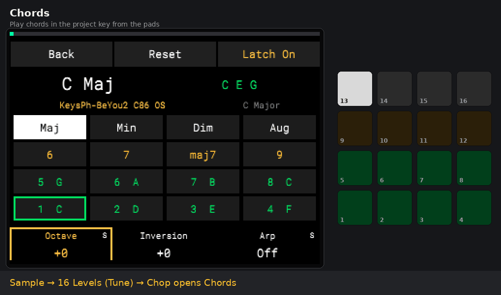
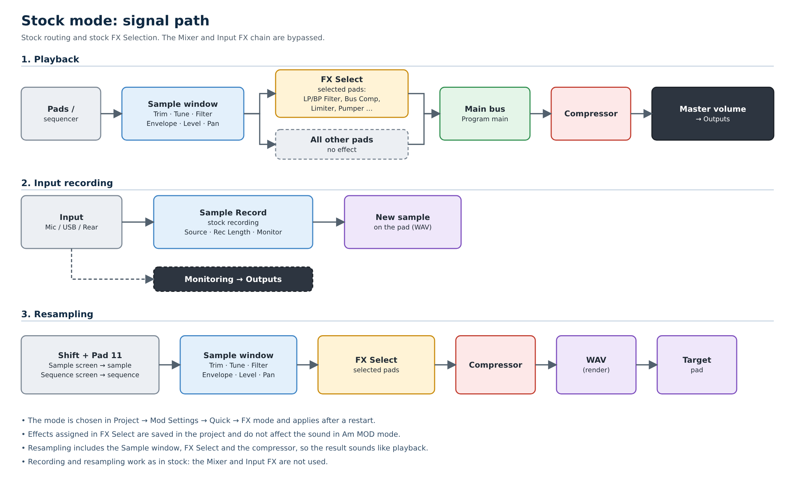
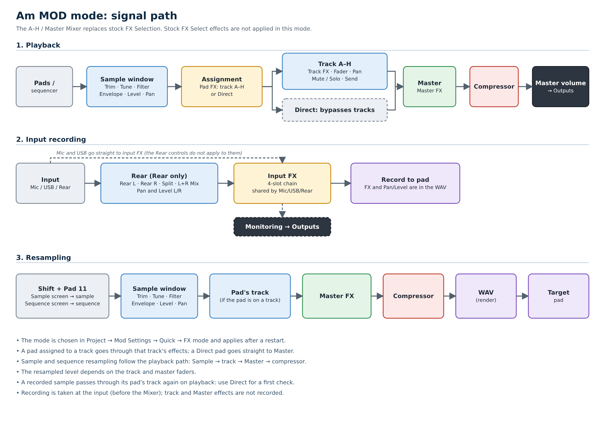
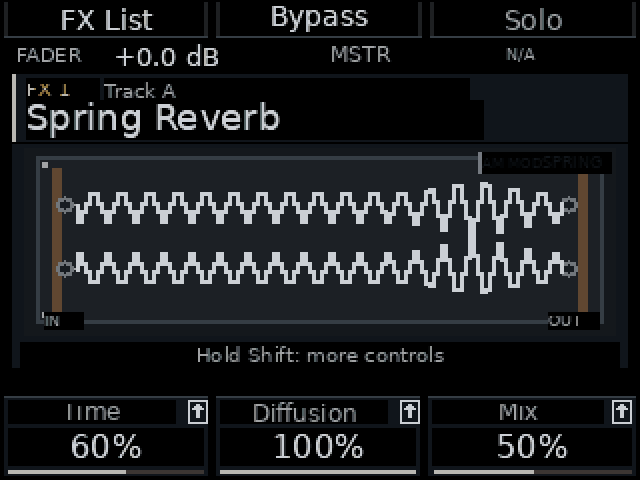
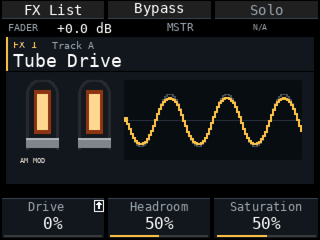
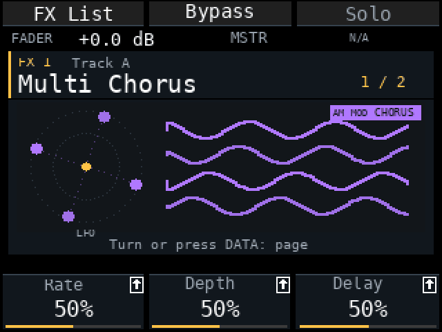
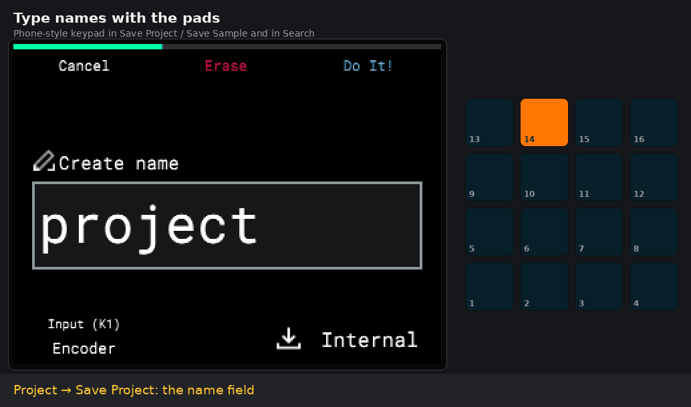
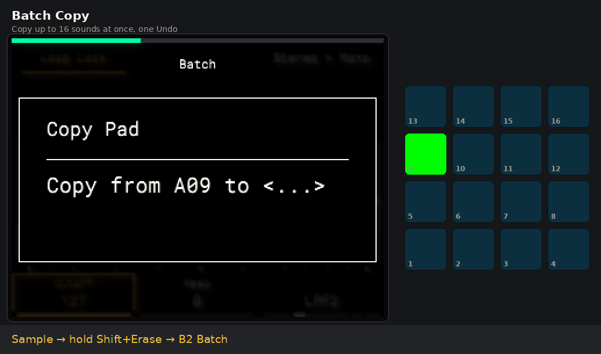
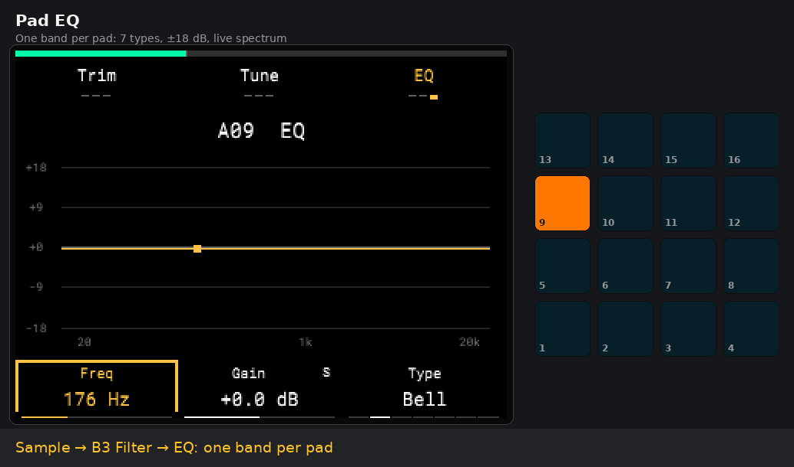

# Am MOD

**Unofficial SD card mod for the Akai MPC Sample**

**English** · [Русский](README.ru.md)

[**Download r30a**](https://github.com/AlekseyMalykh/am-mod/releases/tag/r30a) (latest) · [r29a](https://github.com/AlekseyMalykh/am-mod/releases/tag/r29a) (previous) · [r28d](https://github.com/AlekseyMalykh/am-mod/releases/tag/r28d) · [Feedback and help](docs/FEEDBACK.md) · [Known issues](docs/KNOWN_ISSUES.md) · [Discussions](https://github.com/AlekseyMalykh/am-mod/discussions)

Am MOD is a community mod for the Akai MPC Sample (firmware **1.3.0.12**) that starts from the SD card. On top of the stock app it adds an **A–H track mixer with effects and a Master bus**, a **recording input channel with a choice of record point**, **resampling of a pad or a whole sequence through the mixer**, a **tuner**, a step sequencer on the pads, a chord mode, typing names with the pads, scale lighting, search across folders, batch copy, a per-pad EQ and more. Nothing is flashed: the mod runs a patched copy of the stock app in RAM, and the stock app starts as usual without the card.

<p align="center"></p>
<p align="center"><sub>Recorded in the <a href="https://github.com/orrpunk-art/virtual-mpc-sample">Virtual MPC Sample</a> emulator running the stock firmware with the mod; the pads on the right show the colours the app sends.</sub></p>

> **Unofficial project.** Not affiliated with, endorsed by or supported by inMusic Brands or Akai Professional. **No firmware and no Akai code are in this repository or in the release packages**: the mod patches the copy of the app already on your MPC Sample. Use at your own risk. See [NOTICE](NOTICE.md).

> [!IMPORTANT]
> **Read before installing**
> - **Back up all projects and samples** from the SD card first.
> - **The "SD Card Access" item is hidden** in the Project menu (Shift+Pad 16) in both modes. USB transfer mode ("the card as a drive on your computer") cannot work while the mod runs, so the item was removed for safety. Use a card reader. [Details](#usb-transfer-mode--sd-card-access).
> - **There are two modes, Stock and Am MOD** (Project → Mod Settings → Quick → FX mode, applied after a restart). In Stock the stock FX Select is used and the mixer is off; in Am MOD the mixer replaces FX Select. [Signal paths](#two-modes-stock-and-am-mod).
> - Save projects and samples to **External** (the SD card). Internal storage is temporary while the mod runs.

## Contents

1. [What is new in r30a](#what-is-new-in-r30a)
2. [Two modes: Stock and Am MOD](#two-modes-stock-and-am-mod) (signal paths)
3. [Mixer](#mixer) · [Effects](#effects) · [Input channel and recording](#input-channel-and-recording) · [Resampling](#resampling) · [Tuner](#tuner) · [Pad colours](#pad-colours)
4. [Bugs fixed](#bugs-fixed-since-r29a)
5. [Features](#features) · [Install](#install) · [Use](#use) · [USB transfer mode](#usb-transfer-mode--sd-card-access)
6. [Thanks](#thanks)

## What is new in r30a

- **Two modes.** *Stock* keeps the stock FX Select. *Am MOD* replaces it with the mixer: **Knob FX opens the mixer**, stock FX Select effects saved in a project are ignored.
- **Mixer** with eight tracks A–H and Master, four insert effects per track, sends, sidechain and Song stems. Pads are assigned to tracks; unassigned pads go *Direct* to Master.
- **Input channel** in the mixer (pad 15): Level, Pan, Mute, the Input FX chain and **recording route**: Mic, USB or Rear is recorded at the **Input**, a **Track** or **Master** point, **Wet** (with effects) or **Dry**. Monitoring follows the same point.
- **Resampling goes through the mixer**: a single pad (Sample screen) or the whole sequence (Sequence screen), both with one destination dialog. A free pad renders at once; a recorded pad asks to confirm the replacement.
- **Tuner**: one full-screen window for the input signal (mixer, Sample Record) and for the sample of any pad (Sample screen).
- **Pad colour from Track**: pads and waveforms take the colour of the mixer track they play on, on every screen that shows pad sounds.
- **New effect screens** (Tape Delay, Tape, Vinyl, Spring Reverb, Tube Drive and more), **typing with the pads** by default, **stems to the SD card**.
- Many fixes; see [Bugs fixed](#bugs-fixed-since-r29a).

## Two modes: Stock and Am MOD

Choose the mode in **Project → Mod Settings → Quick → FX mode** (Stock / Am MOD). The default is Am MOD. A change applies after a restart. The modes never affect each other.

| | **Stock** | **Am MOD** |
|---|---|---|
| Effects on pads | stock **FX Select** (Knob FX, Shift+Knob FX, Pad FX) | **Mixer**: tracks A–H, Track FX, Master FX |
| Knob FX | stock effect screen | **opens the Mixer** |
| Stems | none | Song → Export → Stems |
| Input recording | stock Sample Record | recording through the input channel and the chosen record point |
| Resampling | pad or sequence through the stock FX Select | pad or sequence through the mixer (tracks, sends, FX, Master) |

### Why two modes

The stock **FX Select** is a single insert effect on the whole output. In Am MOD the **mixer takes its place in the signal chain**: every pad goes through a track (A–H) or Direct, each track has its own effects, and Master has its own chain. Two effect systems cannot sit in one chain, so the mod runs one of them at a time:

- **Am MOD** is for working with the mixer: per-track effects, sends, stems, and recording or resampling at a chosen point of the chain. The stock FX Select is ignored, even if a project saved an effect in it.
- **Stock** leaves the original behaviour untouched: one FX Select effect, no mixer, the stock recording and resampling path. Use it to compare with the stock app, to play projects that rely on FX Select, or if you do not need the mixer.

Your pads, samples and sequences are the same in both modes; only the effect and routing layer differs. Switching needs a restart.

**Input routing** is different too. In Stock the input is recorded as the stock Sample Record screen does it. In Am MOD the input is a mixer channel (pad 15 in the mixer): you choose the point where it is recorded (**Input**, **Track A–H** or **Master**) and whether the effects are included (**Wet**) or not (**Dry**); monitoring follows the same point. See [Input channel and recording](#input-channel-and-recording) and the Am MOD diagram below.

### Stock mode: signal path

<p align="center"></p>

### Am MOD mode: signal path

<p align="center"></p>

SVG versions: [stock](docs/diagrams/signal-path-stock.en.svg), [Am MOD](docs/diagrams/signal-path-ammod.en.svg).

## Mixer

*Am MOD mode only.* The mixer has eight tracks **A–H** and **Master**. Every pad goes to one track or *Direct* (straight to Master).

**Open and leave.** Press **Knob FX**. In the Sample screen **Shift+Knob FX** opens the mixer on the *Track FX* of the pad you hit last (Master if the pad has no track). **B1 "Sample"** returns to the Sample screen. Pad FX and Shift+Pad FX stay stock and process the whole Master.

**Overview** (tracks and Master)

| Control | Action |
|---|---|
| **Pads 1–8** | select track A–H (hold one and press more, or use **Shift**, to select a group) |
| **Pad 16** | select Master |
| **Pad 15** | open the [Input channel](#input-channel-and-recording) |
| **Fader** | level of the selected track (a group keeps its level differences; **Shift+fader** aligns them) |
| **DATA click** | cycle Level → Pan → Send → Colour (Master: Level, Pan); turn to change |
| **Mute** / **Shift+Mute** | mute the selection / clear all mutes |
| **B2 Route** | track routing: tabs *Sends*, *Pads*, *Sidechain* on B2/B3 |
| **B3 Solo** / **Shift+B3** | solo / clear all solos |
| **Shift+B2 Rename** | name the track (typing with the pads or the encoder) |

**Assigning pads to tracks.** Select a track, then in the mixer press **Pad FX** to open *Assign Pads*. Press a pad to put it on the selected track; press it again to send it Direct. **B2 Pad Lock** blocks any change; other tracks' pads blink red. The bank A–H LEDs show the assignment bank.

**Sends and sidechain.** Route → *Sends* sets a track's send to another track; a send is part of the receiving track's audio and can appear in several stems (a separate reverb return). *Sidechain* ties a Sidechain Compressor to a Key track.

**Song and stems.** Song Mixdown and **stems** (Song → Export → Stems) are written to the SD card as `Samples/User/Export/<song>/`: one file per sounding track (`<song>_track A.wav`, or with the track name if it was renamed) and `<song>_Master.wav`. Sends make stems overlap, so do not sum the files.

## Effects

Every track has **four insert slots**, Master has its own effect chain and the sample compressor. On a track press **pads 9–12** (the effect pads) or **Pad FX → FX**:

| Control | Action |
|---|---|
| **Pads 9–12** | open slot 1–4; a free slot opens the effect list (Shift+Pad adds nothing; use the first free slot) |
| **DATA turn / press** | select / open or add an effect |
| **Shift+DATA turn / press** | move the effect / bypass it |
| **K1–K3** | effect parameters (scales and names are shown above each knob) |
| **B1 FX List** | back to the list from an effect |
| **B2 Bypass** / **Shift+B2 Chain Bypass** | bypass the effect / the whole chain |
| **Shift+Erase** / **Shift+B2** (in the list) | copy / paste an effect |
| **Erase** | remove the effect (asks first; B3 confirms, B1 cancels) |

Effect pads change colour while the effect or the chain is bypassed. The Graphic **EQ** has up to four points (DATA selects a point, Shift+B3 adds one, Erase deletes the selected point after confirmation). Master also has the **OptoCat / Duck compressor** (Shift+Pad 5 in the Sample screen).

New in r29a: redrawn effect pictures.

<table>
<tr>
<td width="50%"><b>Tape Delay</b><br></td>
<td width="50%"><b>Tape (cassette)</b><br></td>
</tr>
<tr>
<td width="50%"><b>Vinyl</b><br></td>
<td width="50%"><b>Spring Reverb</b><br></td>
</tr>
<tr>
<td width="50%"><b>Tube Drive</b><br></td>
<td width="50%"><b>Multi Chorus</b><br></td>
</tr>
</table>
<p align="center"><sub>Frames rendered from the mod's painter with a test signal. Choose the look in Mod Settings → Quick → FX view (Illustrated / Classic).</sub></p>

## Input channel and recording

*Am MOD mode.* The **Input channel** is where Mic, USB and Rear enter the mixer. Open it with **pad 15** in the mixer.

| Control | Action |
|---|---|
| **Fader** | input level |
| **Mute** | mute the input |
| **B1 Back** | to the overview |
| **B2 FX** / **B3 ROUTE** | the Input FX chain (four slots, as on a track) / the routing list |
| **Shift+B2 Paste** / **Shift+B3 Chain Bypass** | paste an effect / bypass the whole chain |

**ROUTE rows.** Turn the encoder to choose a row, **click** to edit it, turn to change, click to accept.

| Row | Meaning |
|---|---|
| **Tuner >** | opens the [tuner](#tuner) |
| **Monitor** | Off / Auto / On: hear the input |
| **Record via** | **Input**, **Track** or **Master**: where the recording takes the signal |
| **Record track** | track A–H when *Record via* is Track |
| **Record FX** | **Dry**: no effects. **Wet**: the effects up to the chosen point (Track: Input FX, the track's effects, fader and pan; Master: and the Master effects) |
| **Rear mode** | only for the Rear source: Stereo, Rear L, Rear R, L+R Split, L+R Mix |

K2 is the input Pan (for Rear: K2/K3 are Pan L/R, with **Shift** Level L/R). Monitoring hears the signal from the same point that is recorded. Record on the stock **Sample Record** screen as usual: *Tap pad to record*. The settings are the same for Mic, USB and Rear.

## Resampling

Resampling renders what you hear into a new sample. In Am MOD it goes through the mixer (track fader, Mute/Solo, Track FX, sends, Master FX, the compressor); in Stock through the stock FX Select. The level of the result depends on the faders.

1. **A pad:** in the Sample screen select the pad with the sound, press **Shift+Pad 11** (the pad is the source, no question is asked). **A sequence:** in the Sequence screen press **Shift+Pad 11** (title *Resample Seq*).
2. The **destination page** opens. Pick the target pad:
   - a **free pad** renders at once;
   - a **recorded pad** shows *Replace?*: press the same pad again or **B3 Replace** to overwrite, **B1 Back** (or another pad) to change your mind. The target is shown red on the screen and on the pad.
3. **Pad Bank** steps the bank forward, **Shift+Pad Bank** back; **hold Pad Bank** and press pads 1–8 (red) to jump to a bank. The bank letters follow the dialog. The destination bank is independent of the sequence bank: after finishing or cancelling you return to your sequence bank.
4. If the transport is running, a window asks *Stop playback?*: **B3 Stop & Render** stops and starts, **B1 Cancel** keeps playing.
5. Progress is shown; cancel with **B1**. The result lands on the target pad.

## Tuner

One full-screen window, the same everywhere: note names, a straight ±50 cent scale with a moving needle (green when within ±5 cents), the frequency in Hz and the note with its octave.

- **Input signal:** mixer → Input → ROUTE → **Tuner** (DATA click), or **B3** on the stock *Sample Record* screen (the label *Tuner* is drawn next to the threshold icon). **B1**, **B2**, **B3** or DATA close it.
- **A pad's sample:** in the Sample screen hold **Stop** and press **Chop** (**Stop+Chop**). The window opens over the Sample screen: hit any pad and the window shows the pitch of that pad's sample (*Sample A05*). Percussive or noisy samples show *No pitch found*; notes below about 60 Hz are not detected. **B3 "Orig note"** stores the detected note as the sample's **Original note** (pitch class only; the pitch is not changed). **B1**, **B2** or **Chop** close it.

## Pad colours

Mod Settings → **Sample → Pad colour from**: **Pad** (the pad's own colour) or **Track** (the colour of the mixer track the pad plays on; pads sent Direct use the Master colour). With *Track* the colour appears on every screen with pad sounds: Sample, the step sequencer (header, event list, pad lights, chop picker), the sample browser, copy/move. The cursor and states keep one set of rules: the cursor and the selected sequence blink white; in Copy and Resample dialogs free targets are green and occupied targets red; muted pads are red.

## Bugs fixed since r29a

- **Save Project / Save Sample** sometimes said *Insert SD card to save* with the card inserted, or saved to Internal. Both fixed in Stock and Am MOD.
- **Stems export** failed when the stock window offered External; stems now always go to the card, and the Stems name window accepts pads at once.
- **Resampled pad lost its attack** (only the tail was kept): fixed.
- **Recording through Track or Master stayed dry**: new effect chains were never adopted on idle lanes; fixed.
- **Sequence resample skipped the mixer** (tracks, faders, sends, effects) and a first resample after start could be silent: fixed. Resample of a pad now includes track effects, sends and Master.
- **A stock FX Select effect saved in a project sounded in Am MOD** and one selected pad made Knob FX hit every pad: in Am MOD the stock FX Select is ignored.
- **Pad colours turned stock** under native dialogs (resample progress, Sample Record): the Am MOD colours stay.
- **Resample dialog:** Pad Bank step and quick bank change, bank letters on the panel, the stop confirmation window, the replace prompt with a red target and a "press again" hint for sequences, and a destination bank independent of the sequence bank.
- **Shift+Erase in the mixer** started the stock copy gesture: fixed.
- **Sample library:** the K3 Volume read-out no longer blinks or disappears while scrolling.
- **Master FX** no longer shows an unreliable pinned Sample Comp row (use OptoCat Comp).
- **Project menu:** the "SD Card Access" row is gone (it cannot work inside the mod).
- **Stock mode** no longer offers Stems in Song export.

Earlier fixes (Recall freezing, Chop lighting, Scaled takeover and more): [CHANGELOG](CHANGELOG.md), [Known issues](docs/KNOWN_ISSUES.md).

## Features

**Confirmed**: checked on a real MPC Sample. **Trial**: automated and emulator checks passed; a hardware check is still pending.

| Feature | Where | Status |
|---|---|---|
| **Mixer**: tracks A–H, Master, Track/Master FX, sends, sidechain, Song stems | Knob FX (Am MOD) | trial |
| **Input channel**: level, pan, mute, Input FX, record point Input / Track / Master, Wet / Dry, monitoring | Mixer → pad 15 | trial |
| **Resample** a pad or a sequence through the mixer; replace confirmation | Shift+Pad 11 | confirmed (pad), trial (sequence dialog) |
| **Tuner**: input and the sample of any pad, Original note from the tuner | Mixer Input ROUTE, Sample Record B3, Stop+Chop | confirmed (window), trial (Original note) |
| **Pad colour from Track** | Mod Settings → Sample | trial |
| **Readable K1–K3 panel**: names and values always visible | all standard screens | confirmed |
| **Type names with the pads** (phone keypad) | Save, Search, Export, Stems, track names | confirmed |
| **Orig Note**, project **Key / Scale** | Sample → Tune → Shift+K1; Project | confirmed |
| **Scale lighting** for 16 Levels: Monochrome / Piano / Scale / Degrees | Sample → Tune/Play/**Scales** | partly confirmed |
| **Steps**: 16-step sequencer on the pads, grid 1/4…1/64 and triplets | Shift+SEQ → B2 Steps | confirmed |
| **Events editor**, **Poly** chords | Step Edit / Seq | confirmed |
| **Search** samples and projects (Folder / Library / Internal / SD Card / All) | Sample Select / Open Project → Shift+B3 | confirmed |
| **Batch Copy** of up to 16 sounds, **Batch Extract** | Sample → Shift+Erase → B2; Chop → Shift+B2 | confirmed |
| **Per-pad EQ**: one band, 6 types, live spectrum | Sample → Filter → Filter Env → **EQ** | confirmed |
| **Chords**: 8 degrees, 6/7/maj7/9, inversion, latch, arpeggiator | 16 Levels Tune → Chop | trial |
| **OptoCat/Warm** compressor | Shift+Pad 5 | trial |
| **Sequence colours** (Default + eight), pulses with the beat | Seq → Shift+K1 | confirmed |
| **Rear recording**: Rear L / R / Split / Mix, monitor pan and level | Mixer Input ROUTE; Input Config | trial |
| **Preview from end** of a sample or slice | hold STOP + pad | trial |
| **Mod Settings**: FX mode, Text input, FX view, pad lighting, colours, cursor pulse | Project → Mod Settings | trial |
| **Screen Mirror** over USB-C | Mod Settings → Pads | confirmed |
| **Power key** asks, saves a copy to SD, powers off | power key | confirmed |
| **Recall** without freezing; **Pad Bank + K** resets a parameter | Sample Record; everywhere | confirmed |

All features with their controls: [docs/FEATURES.md](docs/FEATURES.md). Settings: [docs/MOD_SETTINGS.md](docs/MOD_SETTINGS.md). Release notes: [r30a](docs/RELEASE_NOTES-r30a.md), [r29a](docs/RELEASE_NOTES-r29a.md), [r28d](docs/RELEASE_NOTES-r28d.md). Build history: [CHANGELOG.md](CHANGELOG.md).

### In action

<table>
<tr>
<td width="50%"><b>Steps</b><br></td>
<td width="50%"><b>Typing names with the pads</b><br></td>
</tr>
<tr>
<td width="50%"><b>Scale lighting</b><br></td>
<td width="50%"><b>Search</b><br></td>
</tr>
<tr>
<td width="50%"><b>Batch Copy</b><br></td>
<td width="50%"><b>Pad EQ</b><br></td>
</tr>
<tr>
<td width="50%"><b>Resample a pad</b><br></td>
<td width="50%"></td>
</tr>
</table>

## Install

> [!IMPORTANT]
> **Before installing or updating Am MOD, back up all projects and samples from the SD card to your computer or another drive.** The installer's backup of `autorun/` does not include your projects or samples.

> [!IMPORTANT]
> **FAT32 / MS-DOS (FAT32) is available experimentally starting with r26e; exFAT remains supported.** FAT32 requires a package **r26e or newer** and installer **1.0.2+**, or a manual copy of that package's complete `autorun/`. FAT32 has been checked in test images and the emulator; physical MPC testing is still pending.
>
> **Use a card volume name such as `MPC` or `MPCSAMPLE`.** Only ASCII letters, digits, `.`, `_` and `-` are supported; spaces and Cyrillic letters in the card name prevent startup. This restriction applies to the card name, not to your sample or project names.
>
> Check the filesystem before installing: Finder → select the SD volume → ⌘I → Format on macOS; drive Properties → File system on Windows. **No reformatting is needed on an existing FAT32 card.** Keep your projects and samples; replace the mod's `autorun/` folder with the complete new version. FAT32 has a limit of **4 GiB minus 1 byte per file**.

You need an MPC Sample on firmware **1.3.0.12** (the mod checks the app's SHA-256 and refuses to start on any other version) and a compatible SD card with a supported volume name: exFAT, or experimental FAT32.

**Installer (Windows):** download `MPC-Sample-Mod-Installer.exe` and the `am-mod-*.zip` package from [Releases](../../releases), run the installer, pick the zip (or press *Latest release*) and the SD card, press **Install**. Installer **1.1.0** also shows release news and a diagnostic bug report form: [instructions](docs/INSTALLER-1.1.0.md).

**Installer (macOS / Linux / Windows with Python 3.8+):**

```bash
python3 installer/mpc_mod_installer.py                 # window
python3 installer/mpc_mod_installer.py cards           # list cards
python3 installer/mpc_mod_installer.py install am-mod-r30a.zip --card E:  # release package
python3 installer/mpc_mod_installer.py install --latest --card /Volumes/MPC
python3 installer/mpc_mod_installer.py remove --card E:
```

The installer writes only `autorun/` and `MPC_MOD_VERSION.json` on the card. It checks the package, backs up the previous `autorun/` to `~/AM-Mod-Backups/`, writes the files that start the mod last, and verifies everything it wrote. It never formats the card and never touches `MPC-Sample/` (your projects and samples).

**By hand:** unzip the package and copy its `autorun` folder to the root of the card.

## Use

1. Insert the card and power on the MPC, or insert it into a running MPC. The mod starts by itself. Preparation time depends on the card and project. If a start ever hangs at 0 %, power on without the card, wait for the normal screen, then insert it.

   > **The mod shows the Am MOD splash while preparing the app**, with the version and repository address. Do not power off or remove the card during preparation.

2. The mod checks the stock app and its own files before it starts; on any mismatch the stock app keeps running.
3. Work as usual. Save projects and samples to **External** (the SD card): in the mod, Internal storage is temporary and is lost when the mod stops.
4. Save to External and use the power key to switch off. Remove the card only after shutdown. Start without the mod card to use the stock app.

The power key also works in the mod: it asks, saves a project copy to the card and powers off. Do not pull the card while the mod is starting, saving or shutting down.

## Try it without the device

[**Virtual MPC Sample**](https://github.com/orrpunk-art/virtual-mpc-sample) runs the stock firmware in QEMU with the whole device in your browser, and runs SD autorun packages the way the MPC does. The GIFs above were recorded there:

```bash
python3 lab.py autorun am-mod-r30a.zip --no-reboot --yes
```

Emulator runs are useful for development, but they are not a hardware test: timing, audio latency, battery and USB audio differ from the device.

## Build from source

Requirements: Linux or WSL, Python 3, AArch64 GCC/binutils and your **own** local copy of the stock firmware 1.3.0.12; the expected SHA-256 of the app is `b6584cba76e416e432ad202509099d34373dc2c3d6a8fb625f5678bf0193b508`. The firmware image, updater, extracted partitions and rootfs are not part of this repository; paths to the rootfs used by the checks (`/home/user/mpc-rootfs-user-20260808` in the scripts) need adjusting.

Order: get the local inputs with the expected hashes → build `sd-clone-trial` (the loader) → build the value patches in `sd-k-value-peek` → build the current `sd-mod-session` revision (`sd-mod-session/build_resample_mixer.sh` runs the build, the `verify_*.py` / `check_*.c` checks and the packaging). These research scripts depend on frozen earlier build outputs, verified preceding packages and your local firmware/rootfs; they are not a standalone fresh-checkout build. ARM/QEMU checks use clearly marked adapters and do not replace a hardware run.

| Folder | Contents |
|---|---|
| `sd-mod-session/` | the current mod: sources (`src/`), build and package scripts, checks, feature docs |
| `sd-clone-trial/` | the loader: runs a verified copy of the stock app in RAM and restores the stock app |
| `sd-k-value-peek/` | the first display patches (K1–K3 values) |
| `installer/` | the SD card installer and its tests |
| `virtual-mpc/` | an early browser model of the UI (not an emulator) |
| `docs/diagrams/` | signal-path diagrams (SVG/PNG, RU/EN) and their generator |
| `research/`, `docs/` | reverse-engineering notes and scripts, history of the stages |

Most technical documents are in Russian.

## Legal

- Akai Professional and MPC are trademarks of inMusic Brands, Inc., used here only to name the device the mod runs on.
- No firmware, Akai code, factory content or Akai artwork is distributed. The mod copies the app that is on your device and patches that copy in RAM; it never writes the firmware or the boot loader.
- Release packages include `xdg-dbus-proxy` (LGPL-2.1-or-later) with its source.
- Details: [NOTICE.md](NOTICE.md).

## License

[MIT](LICENSE). Contributions: [CONTRIBUTING.md](CONTRIBUTING.md).

## USB transfer mode / SD card access

While Am MOD runs, the MPC's USB transfer mode ("SD card as a drive on the computer") does not work, in both Stock and Am MOD modes. The mod runs the application in an isolated copy without access to raw storage devices, and only that access lets the MPC present the card to a computer. The card is also in use by the mod while it runs, so exposing it would risk data corruption. For this reason the **SD Card Access** item is hidden in the Project menu.

To copy files, use a card reader (power off, remove the card, copy, put it back). To get USB transfer mode back, power off, remove the `autorun` folder from the SD card (or use a card without it) and start the MPC: it boots as stock. Projects and samples on the card are not affected.

## Thanks

Special thanks to **Leusha** for careful, detailed testing and for finding bugs: almost every fix in r27r and many in r30a started from those reports. Thanks also to mxt1iga and to everyone who tested builds and sent reproductions.
