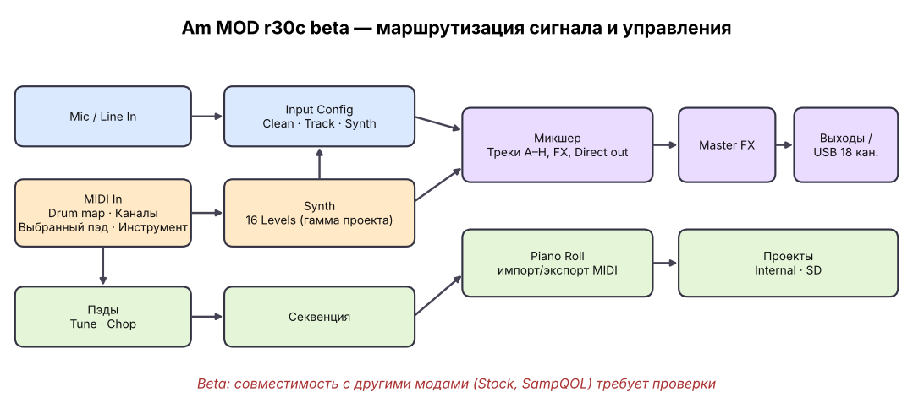

# Am MOD r30c beta1

**Микшер, иллюстрированные эффекты, пианоролл и MIDI-инструменты для Akai MPC Sample.**

[English](README.md) · **Русский** · [Español](README.es.md) · [Скачать r30c beta1](https://github.com/AlekseyMalykh/am-mod/releases/tag/r30c-beta1)

> **БЕТА — r30c-beta1.** Это бета-релиз. **Требуется тестирование совместимости с другими модами (Stock, SampQOL, D.S.B и др.)** — не используйте его на единственной копии важных проектов, сначала сделайте резервную копию. Пожалуйста, сообщайте о проблемах.

Am MOD запускается с SD-карты на прошивке **1.3.0.12**. Приложение работает в RAM, установленная прошивка не перепрошивается. Без карты мода запускается штатная система.

## Что нового

- **Пианоролл:** слои Pads, Tune и Chop, выделение, групповые правки, сетка, Follow, общие Undo/Redo и импорт/экспорт MIDI-файлов. Положительное вращение Shift+DATA теперь приближает масштаб.
- **MIDI:** Monitor, входные/выходные карты, Learn, отдельные исходящие назначения Pads/Levels и сохранение в проекте. Приём USB/TRS внешним оборудованием ещё требует аппаратной проверки.
- **Программы:** импорт MPC1000 PGM 1.00 и Drum XPM с проверкой содержимого, выбором банка, защитой занятых пэдов и одной операцией Undo.
- **Мьюты пэдов секвенции:** независимые локальные мьюты, Mute+B3 для режима, Mute+B2 для очистки, подсказки в шторке и красный **SM**. Копия пэда не наследует локальный мьют исходного пэда; копия секвенции начинает без локальных мьютов.
- **Sample Swap:** прослушивание другого файла в играющей секвенции. Orig Note над **K2**, путь папки наверху, статусы SWAPPED/WAIT/PAUSED. Preview Off возвращает оригинал; подтверждение загрузки делает замену постоянной.
- **Палитра:** 32 общих именованных цветовых слота, необязательное резервирование служебных цветов и сохранение назначений проекта.
- **Исправления:** Stop, затем Chop после отпускания Stop больше не открывает тюнер; бобины Tape Delay останавливаются; Original сохраняет исходный цвет волны. Сохранены исправления FX, компрессоров, takeover и маршрутизации. EQ сохраняет значки сэмпла, спектр Filter/Filter Env рисуется до штатных кривых.
- **Установка:** установщик **1.4.0** работает с обычной картой, **mpc-boot-thingy** и **D.S.B Boot**, сохраняя меню загрузки.

[Изменения r30c](docs/RELEASE_NOTES-r30c.ru.md) · [Установка](docs/INSTALL.ru.md) · [Руководство](docs/USER_GUIDE.ru.md) · [План плагинов](docs/PLUGIN_ROADMAP.ru.md)

## Установка и запуск

1. Скопируйте проекты, сэмплы и настройки карты в резервную копию. В кандидате r30c проекты, сэмплы и аудиоэкспорты сохраняются как в **Internal**, так и в **External**. Носитель выбирается штатной K3 в окнах Save/Export; системные настройки за пределами пользовательских папок остаются в отдельном слое сессии. Финальная проверка на MPC ещё требуется.
2. Скачайте `am-mod-r30c-beta1.zip` и `MPC-Sample-Mod-Installer.exe` по ссылке выше. На macOS/Linux используйте Python-установщик.
3. Подключите карту через картридер или SD Card Access, выберите ZIP и карту, нажмите Install. Установщик распознаёт загрузчик; вручную заменять корневой autorun на карте с меню загрузки нельзя.
4. Безопасно извлеките диск, выйдите из SD Card Access и выключите/включите MPC. В меню загрузчика выберите **AM Mod**.

Рекомендуется exFAT и латинское имя тома без пробелов, например `MPC`. FAT32 остаётся экспериментальным. Установщик сохраняет резервную копию `autorun/`, но не проектов. [Подробная установка и восстановление](docs/INSTALL.ru.md).

## Основное управление

| Откуда | Действие |
|---|---|
| Knob FX | Микшер; пэды 1–8 = A–H, 15 = Input, 16 = Master |
| Shift+Knob FX из Sample | FX трека последнего сыгранного пэда |
| Пэды 9–12 в микшере | Четыре последовательных FX-слота |
| В FX: Shift+Erase / Shift+B2 / Shift+B3 | Copy / Paste / Chain Bypass |
| Mute+B3 / Mute+B2 | Мьюты секвенции / очистка её локальных мьютов |
| Удерживать Stop, нажать Chop | Тюнер сэмпла; обычный Chop — после отпускания Stop |
| Step Edit → Events/Steps → Knob FX | Пианоролл; B1 возвращает назад |
| Shift+Pad8 → B2 Map / Log | MIDI Monitor и карты |
| Браузер → Shift+B1 | Sample Swap |
| Браузер → Shift+B2 → Programs | Импорт PGM/XPM |
| Shift+Pad16 → Mod Settings | Режим, USB, палитра и отображение |

В микшере Loop/Reverse, Chop/Note On и 16 Levels не изменяют скрытый сэмпл. Mute управляет треками.

## Эффекты и USB

<table><tr><td></td><td></td></tr><tr><td></td><td></td></tr></table>

GIF построены производственным кодом отрисовки с синтетическими метрами и заменённым шрифтом. Это иллюстрации, не съёмка настоящего MPC. [Галерея](docs/FX_GALLERY.md).

Восемь треков A–H, Master и Input имеют по четыре последовательных FX-слота. Дополнительные гитарные/басовые варианты Amp Sim меняют оформление; это пресеты штатного AIR Amp Sim, не измеренные модели реальных усилителей. [Карта кнобов](docs/FX_KNOB_LAYOUT.ru.md).

По умолчанию USB передаёт Stereo Master. **Mod Settings → Quick → USB audio → Master + A–H**, затем перезапуск: **18 каналов**, Master 1/2, A 3/4 … H 17/18. При возврате звука DAW в MPC отключите входной мониторинг записываемых дорожек DAW, чтобы избежать петли. SD Card Access останавливает приложение и аудио на время доступа к карте. [USB](docs/USB_GUIDE.ru.md).

## Состояние и планы

r30c объединяет отдельные линии разработки r30b–r30e. Все 88 модулей r30e сохранены; итог содержит 105 модулей. Автоматические проверки host/ARM/QEMU и полной нативной загрузки описаны в отчёте релиза. Они не заменяют проверку финального ZIP на настоящем MPC.

VST, эффекты Henry внутри AM Mod и команда сохранения/возврата в D.S.B — **планы**, в r30c их нет. SampQOL и D.S.B скачиваются отдельно и в этот пакет не входят. [План плагинов](docs/PLUGIN_ROADMAP.ru.md).

[Ограничения](docs/KNOWN_ISSUES.ru.md) · [Сообщить об ошибке](docs/FEEDBACK.ru.md) · [Сборка](docs/BUILD.md) · [Изменения](CHANGELOG.md) · [Лицензия](LICENSE)

Неофициальный проект, не связан с Akai/inMusic. Спасибо Leusha, авторам Virtual MPC Sample и сообществу. Сторонние компоненты сохраняют свои лицензии: [NOTICE](NOTICE.md).
