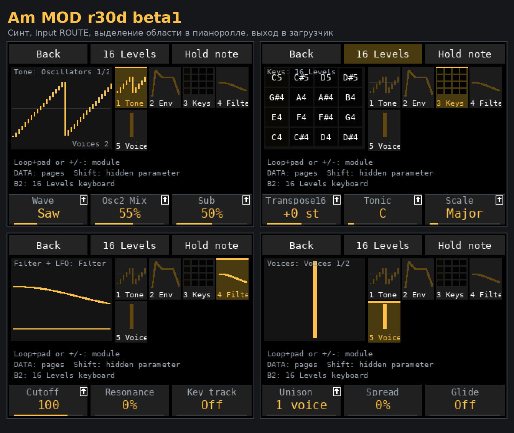
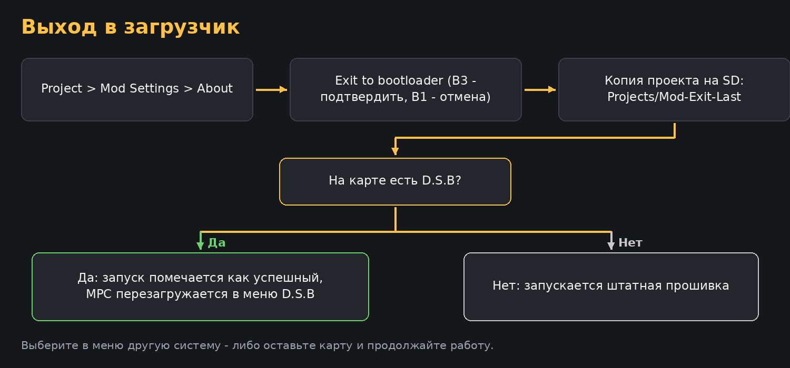

# Am MOD r30d beta1

**Микшер, встроенный синтезатор, иллюстрированные эффекты, пианоролл и MIDI-инструменты для Akai MPC Sample.**

[English](README.md) · **Русский** · [Español](README.es.md) · [Скачать r30d beta1](https://github.com/AlekseyMalykh/am-mod/releases/tag/r30d-beta1)

> **БЕТА — r30d-beta1.** Это бета-релиз. **Совместимость с другими модами и загрузочными меню (Stock, SampQOL, D.S.B, SampleBoot, mpc-boot-thingy) ещё требует тестирования** — не используйте его на единственной копии важных проектов, сначала сделайте резервную копию. Пожалуйста, сообщайте о проблемах.

Am MOD запускается с SD-карты на прошивке **1.3.0.12**. Приложение работает в ОЗУ, установленная прошивка не перепрошивается. Чтобы вернуться к штатной прошивке, запустите MPC без карты мода.

## Что нового в r30d

- **Синтезатор из пяти модулей** на pad 13 микшера: два осциллятора, sub, шум, drive, огибающие усилителя и фильтра, фильтр, LFO, unison и glide. **Удерживайте Loop + pad** (13–16, 9) или **+ / −**, чтобы сменить модуль, **DATA** листает страницы; один ряд ручек, редкий параметр на **Shift+K**. Страница Keys и Sample Record выполнены в раскладке **Tune**. [Руководство по синту](docs/SYNTH_GUIDE.ru.md).
- **Input ROUTE откуда угодно:** **Shift+Sample** открывает единый список Input (Source Mic / Rear / USB / Resample / Synth, Mode, Monitor, Threshold, Tuner, строки записи). K1 в Sample Record выбирает Source.
- **Выделение области в пианоролле:** удерживайте **DATA**, вращайте энкодер (время) и двигайте фейдер (строки).
- **Takeover для ручек синта** (Pickup / Scaled / Jump) — как в остальном микшере.
- **Выход в загрузчик:** *Mod Settings → About* сохраняет копию проекта и возвращает в меню **D.S.B** (или в штатную прошивку, если его нет). «Старт OK» от D.S.B теперь переносится на карту, поэтому удачный сеанс больше не считается сбоем. [Загрузочные меню](docs/BOOTLOADERS.ru.md).
- **Эффекты Henry Skillz** (HS Saturator, HS Bass Focus, HS Heat) с собственной графикой; страница MIDI Buttons и исправления Shift контроллера; поиск в браузере **Find**.
- **Layout и Transpose16 поменяны местами:** K1 = Transpose16, Shift+K1 = Layout в Tune, Keys синта и Sample Record.
- Из r30c: пианоролл, MIDI-инструменты, импорт PGM/XPM, Sequence Pad Mutes, Sample Swap, палитра на 32 слота, Internal/External, установщик **1.4.0** для обычной карты, **mpc-boot-thingy** и **D.S.B Boot**.

[Изменения](docs/RELEASE_NOTES-r30d.ru.md) · [Установка](docs/INSTALL.ru.md) · [Руководство](docs/USER_GUIDE.ru.md) · [Синтезатор](docs/SYNTH_GUIDE.ru.md) · [Загрузочные меню](docs/BOOTLOADERS.ru.md)

## Установка и запуск

1. Скопируйте проекты, сэмплы и настройки карты. **Бета:** совместимость с другими модами и загрузочными меню ещё требует тестирования — сохраните копию проектов и прежней настройки карты.
2. Скачайте `am-mod-r30d-beta1.zip` и `MPC-Sample-Mod-Installer.exe` по ссылке выше. На macOS/Linux используйте Python-установщик.
3. Подключите карту через картридер или SD Card Access, выберите ZIP и карту, нажмите Install. Установщик сам определяет раскладку загрузки; не заменяйте вручную корневую папку autorun карты с загрузочным меню.
4. Безопасно извлеките диск, выйдите из SD Card Access и перезагрузите MPC. На карте с загрузочным меню выберите **AM Mod**. **Project → Mod Settings → About** показывает версию.

Используйте exFAT и ASCII-метку тома, например `MPC`, без пробелов. FAT32 остаётся экспериментальным. Установщик делает копию `autorun/`, но не проектов. [Установка и восстановление](docs/INSTALL.ru.md).

## Быстрая навигация

| Откуда | Действие |
|---|---|
| Knob FX | Микшер; pads 1–8 = A–H, 13 = Synth, 15 = Input, 16 = Master |
| Pad 13 микшера, затем Loop + pad / + − / DATA | Модули и страницы синта |
| Синт B2 / B3 | Клавиатура 16 Levels / Hold note |
| Shift+Sample (любой экран) | Список Input ROUTE |
| Shift+Knob FX из Sample | FX трека, назначенного последнему сыгранному паду |
| Pads 9–12 микшера | Четыре последовательных insert-слота |
| FX: Shift+Erase / Shift+B2 / Shift+B3 | Copy / Paste / Chain Bypass |
| Пианоролл: DATA + энкодер + фейдер | Выделение области |
| Mute+B3 / Mute+B2 | Режим mute секвенций / сброс локальных mute секвенции |
| Удерживать Stop, затем Chop | Тюнер сэмпла |
| Step Edit → Events/Steps → Knob FX | Пианоролл; B1 — назад |
| Shift+Pad8 → B2 Map / Log | MIDI Monitor и MIDI-карты |
| Browser → Shift+B1 / Shift+B2 | Sample Swap / импорт программ |
| Shift+Pad16 → Mod Settings → About | Режим, USB-аудио, палитра, экран, **Exit to bootloader** |

Loop/Reverse, Chop/Note On и 16 Levels не меняют скрытый сэмпл, пока открыт микшер: Mute там управляет треками.

## Загрузочные меню и D.S.B

Am MOD можно держать на обычной карте, под **D.S.B Boot** (`autorun/os/AM-Mod/`), **mpc-boot-thingy** или **SampleBoot** (маркер `sampleboot.inplace`). Из Am MOD пункт **Exit to bootloader** возвращает в меню **D.S.B**; с другими загрузчиками запускается штатная прошивка. Выберите **AM Mod** один раз и выходите, когда нужна другая система. Подробности, диагностика (`dsb-boot.log`, `dsb-state-fix.log`) и ограничения: [Загрузочные меню и выход в загрузчик](docs/BOOTLOADERS.ru.md).

## Эффекты и USB

<table><tr><td></td><td></td></tr><tr><td></td><td></td></tr></table>

GIF создаются рабочим отрисовщиком эффектов с синтетическими индикаторами и заменяющим шрифтом: это иллюстрации, а не записи с физического MPC. [Галерея](docs/FX_GALLERY.md). Картинки синтезатора этого релиза сделаны так же (`docs/media/r30d/build_images.py`).

У восьми треков A–H, Master и Input по четыре последовательных insert-слота. У Amp Sim есть дополнительные гитарные/басовые голоса; это штатные пресеты AIR Amp Sim, а не снятые слепки усилителей. [Справочник ручек](docs/FX_KNOB_LAYOUT.ru.md).

USB по умолчанию — Stereo Master. **Mod Settings → Quick → USB audio → Master + A–H** и перезапуск включают **18 каналов**: Master 1/2, A 3/4 … H 17/18. Отключите мониторинг входа в DAW, если его воспроизведение возвращается в MPC, чтобы не было обратной связи. SD Card Access останавливает воспроизведение и звук, пока карта общая. [USB](docs/USB_GUIDE.md).

## Статус и планы

Модули синта, Input ROUTE, takeover ручек синта, выделение области в пианоролле, замена Layout/Transpose16 и выход в загрузчик сделаны после последней полной проверки на устройстве и **ждут проверки на железе**. Автоматические проверки host/ARM/QEMU не заменяют проверку финального пакета на настоящем MPC.

Хостинг VST и общая конвенция «возврата в загрузчик» для всех меню — **планы**. SampQOL и D.S.B скачиваются отдельно и в пакет не входят. [План плагинов](docs/PLUGIN_ROADMAP.ru.md).

[Известные ограничения](docs/KNOWN_ISSUES.ru.md) · [Сообщить об ошибке](docs/FEEDBACK.ru.md) · [Сборка](docs/BUILD.md) · [Журнал изменений](CHANGELOG.md) · [Лицензия](LICENSE)

Неофициальный проект, не связан с Akai/inMusic. Спасибо Leusha, Henry Skillz (D.S.B и эффекты HS), авторам Virtual MPC Sample и сообществу. Сторонние компоненты сохраняют свои лицензии, см. [NOTICE](NOTICE.md).
