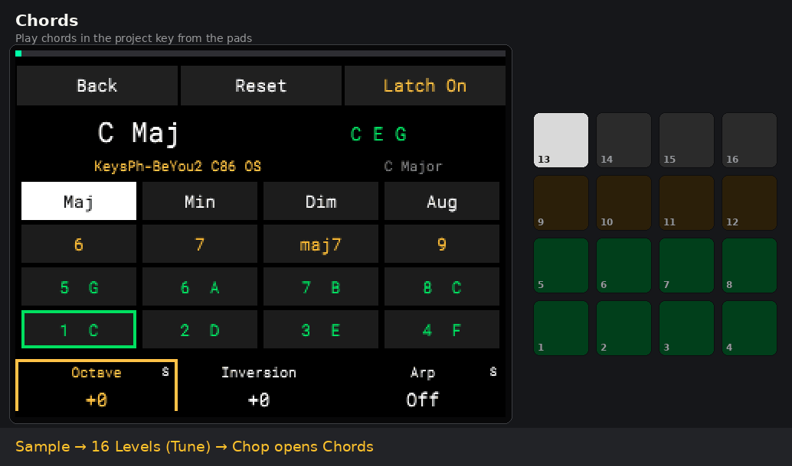
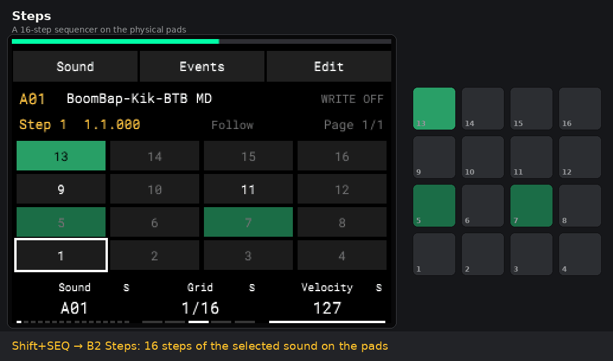
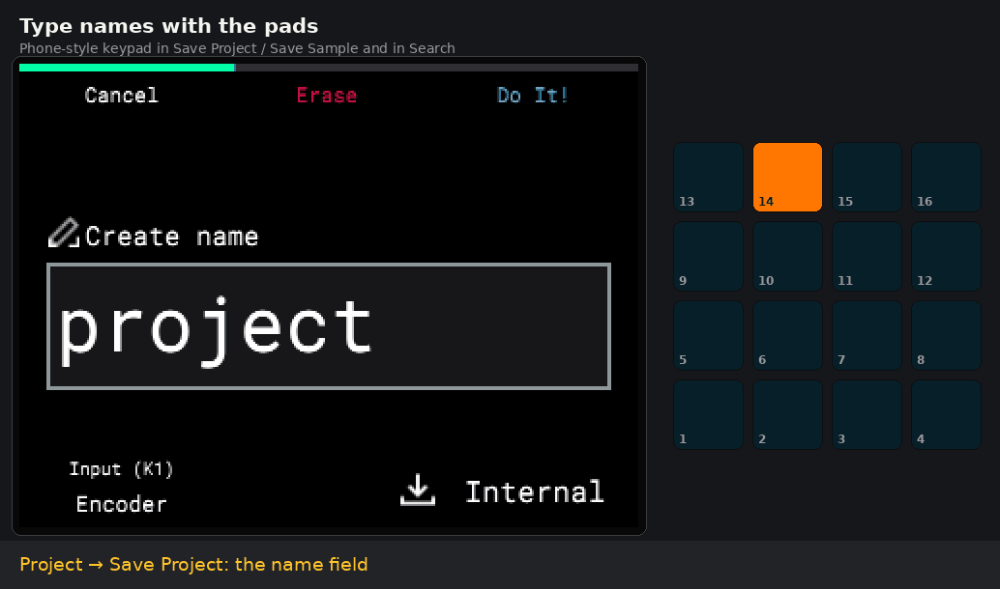
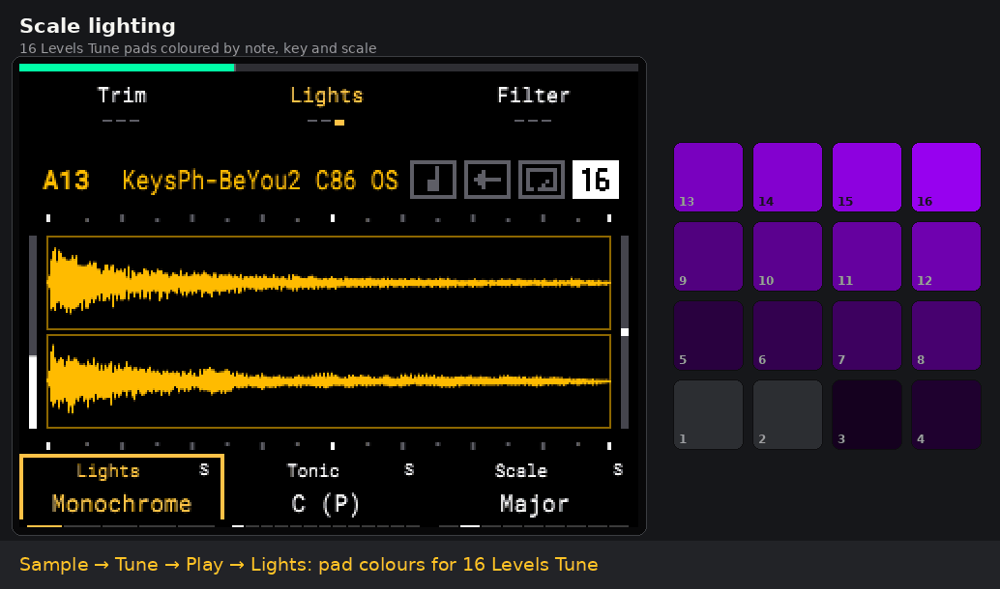
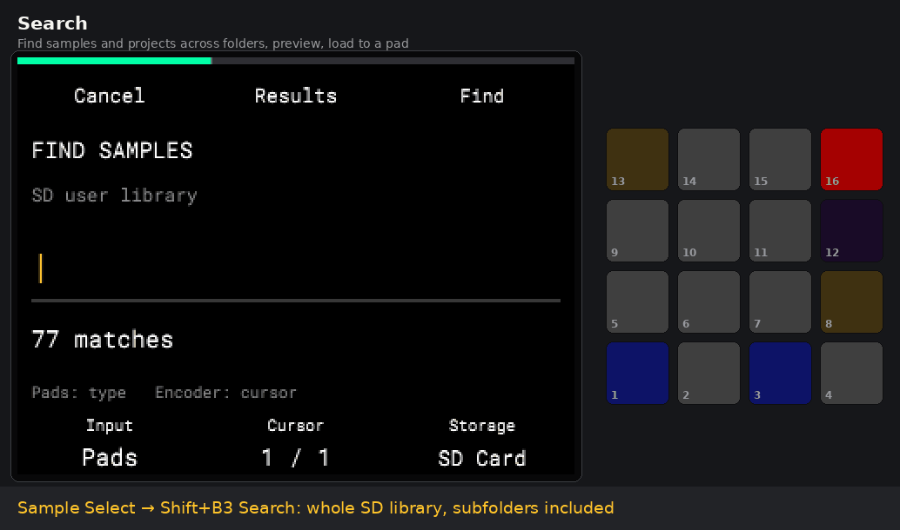
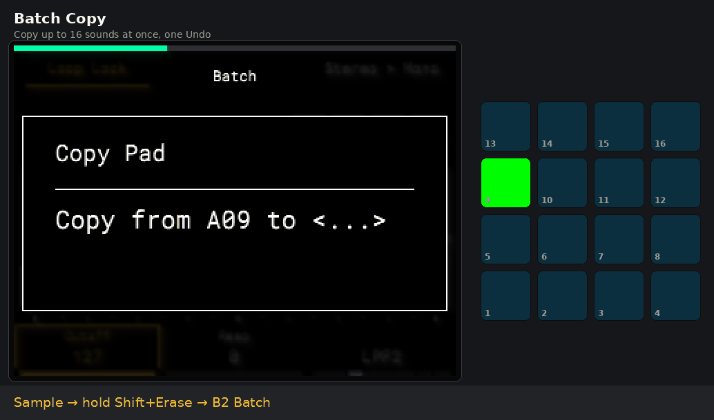
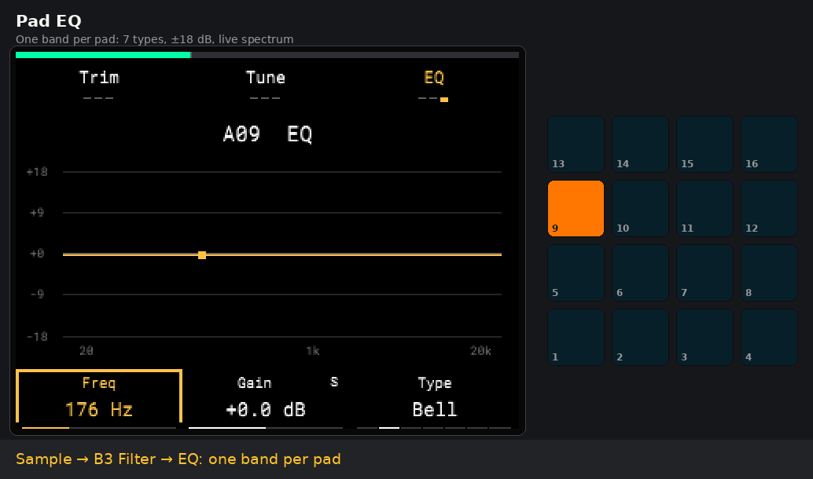
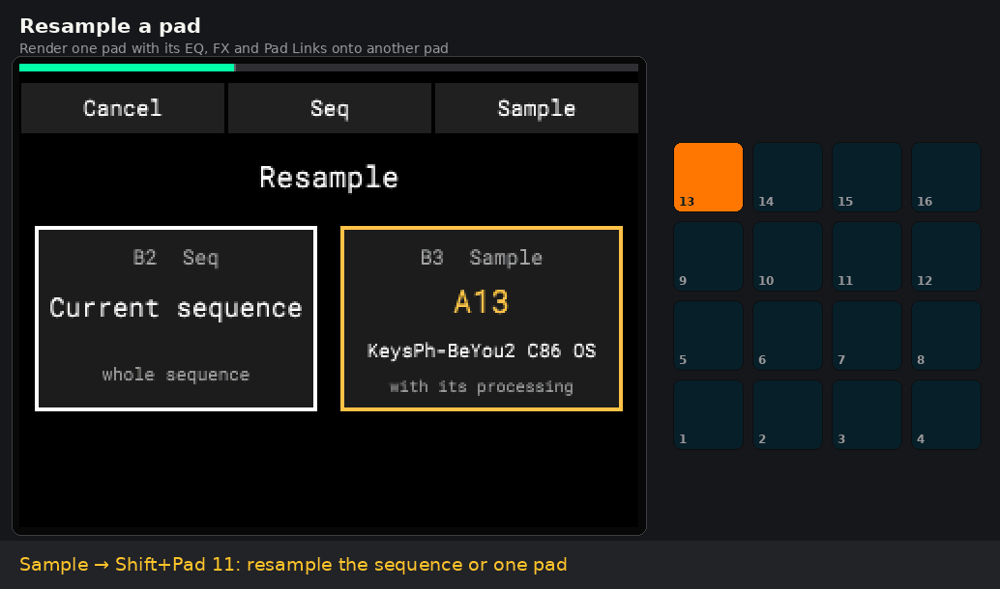

# AM Mod

**Неофициальный мод для Akai MPC Sample, запускаемый с SD-карты**

[English](README.md) · **Русский**

[Отзывы и помощь](docs/FEEDBACK.ru.md) · [Известные проблемы](docs/KNOWN_ISSUES.ru.md) · [Обсуждения](https://github.com/AlekseyMalykh/am-mod/discussions)

[**Предварительный релиз r27n**](https://github.com/AlekseyMalykh/am-mod/releases/tag/r27n) · [Стабильная r26s](https://github.com/AlekseyMalykh/am-mod/releases/tag/r26s)

OptoCat/Warm, исправление K, цвета во временных экранах, пульсация Seq,
курсор Sound и боковые шкалы EQ. **FAT32 доступен экспериментально**, exFAT поддерживается.
[Список изменений](docs/RELEASE_NOTES-r27n.ru.md) · [Оставшиеся замечания](docs/KNOWN_ISSUES.ru.md).
Автор подтвердил исправление K на MPC; область автоматических и оставшихся
аппаратных проверок указана в релизе.

AM Mod — мод сообщества для Akai MPC Sample (прошивка **1.3.0.12**), который запускается с SD-карты.
Поверх штатного приложения он добавляет шаговый секвенсор на пэдах, режим аккордов, ввод
имён пэдами, подсветку по ладу, поиск по папкам, пакетное копирование, EQ для пэда,
ресэмплинг и другое. Ничего не прошивается: мод запускает изменённую копию штатного
приложения в RAM, r27n сохраняет работу при обычном выключении. В стабильной r26s ещё есть Project → Mod Off.

<p align="center"></p>
<p align="center"><sub>Записано в эмуляторе <a href="https://github.com/orrpunk-art/virtual-mpc-sample">Virtual MPC Sample</a> со штатной прошивкой и модом; справа — цвета пэдов, которые отправляет приложение.</sub></p>

> **Неофициальный проект.** Не связан с inMusic Brands и Akai Professional, ими не одобрен и
> не поддерживается. **В репозитории и пакетах релизов нет прошивки и кода Akai**: мод
> изменяет копию приложения, которая уже есть на вашем MPC Sample. Используйте на свой
> риск. См. [NOTICE](NOTICE.md).

## Предварительный релиз r27n

**Перед обновлением сделайте резервную копию сэмплов и проектов.**

- **Прослушивание концовки.** Удерживайте **STOP** и нажмите пэд в Sample или Chop, чтобы услышать конец сэмпла или среза с учётом обрезки. Настройка **Project → Mod Settings → B3 → Sample → Preview from end** задаёт отступ от 100 до 4000 мс. По умолчанию 1000 мс. Значение сохраняется в проекте и в настройках на карте.
- **Steps.** K1 задаёт длину секвенции в тактах, K2 — сетку, Shift+K1 свободен. **SOUND + пэд** выбирает звук, **PAD BANK** переключает банки. Доступные пустые шаги светятся приглушённо, шаги с событиями — ярче, за границей секвенции пэды гаснут. В режиме Mute звучащие шаги зелёные, заглушённые красные, а шаги с обоими типами событий чередуют эти цвета.
- **Подсветка Sample.** Играющий луп мигает своим цветом после выбора другого пэда. Простое нажатие SHIFT сохраняет яркость пэдов. В режиме Mute звучащие и заглушённые пэды отображаются зелёным и красным. У заглушённого пэда волна и спектр серые, кривые фильтра и EQ и огибающие остаются видимыми.
- **Палитра.** Для сэмплов и секвенций доступны восемь назначаемых цветов и Default. Шесть отдельных системных цветов можно менять местами в Mod Settings.
- **Copy Pad и восстановление.** Временное аудио использует служебную папку на SD-карте, чтобы избежать ложной ошибки «Insufficient space on drive» при копировании длинных сэмплов. После успешного Save имя сохранённого проекта записывается для восстановления.

STOP + пэд и изменения Steps подтверждены на MPC. Для предварительного релиза выберите скачанный ZIP r27n в установщике 1.0.3. Latest выбирает стабильный релиз.

[Изменения r27n](docs/RELEASE_NOTES-r27n.ru.md) · [Настройки мода](docs/MOD_SETTINGS.ru.md) · [Изменения r27f](docs/RELEASE_NOTES-r27f.ru.md) · [Статус проверок](docs/KNOWN_ISSUES.ru.md).

Синт, стемы, микшер/маршрутизация эффектов и отдельный RGB-редактор остаются
пожеланиями, в пакет не входят. Спасибо Leusha, mxt1iga и всем тестировщикам!

Идеи C01/C02: живое изменение удерживаемых аккордов/арпеджио и динамика по силе нажатия — [отдельный план пожеланий](docs/IDEAS.ru.md), не реализовано в r27n. Velocity новых ударов уже передаётся; непрерывный pressure ещё нужно исследовать.
План M01: аудит MIDI In/Out, каналов и clock, работы Chords/арпеджио, velocity и Note On/Off с внешними устройствами; подробности в том же плане. Проверка ещё не выполнена.

## Возможности

Публичная предварительная r27n, 4 ноября 2026 года; стабильная — r26s. **Подтверждено** — проверено на настоящем MPC Sample;
**проба** — указанные автоматические проверки пройдены; аппаратная проверка уточняется отдельно.

| Функция | Где | Статус |
|---|---|---|
| **Читаемая панель K1–K3**: названия и значения параметров видны всегда, янтарный фокус, отметки `S` для функций с Shift | все стандартные экраны | подтверждено |
| **Ввод имён пэдами** (телефонная клавиатура: ABC на пэде 14, DEF на 15…, удаление на 16) | Save Project / Save Sample, поиск | подтверждено |
| **Orig Note** сэмпла, **Key / Scale** проекта | Sample → Tune → Shift+K1; Project → Key/Scale | подтверждено |
| **Подсветка по ладу** для 16 Levels Tune: Monochrome / Piano / Scale, Transpose16 | Sample → Tune/Play/**Lights** | частично подтверждено |
| **Steps**: 16-шаговый секвенсор на физических пэдах, сетка 1/4…1/64 и триоли, velocity, Mute шагов, Copy/Paste | Shift+SEQ → B2 Steps | подтверждено |
| **Редактор событий** с выбором Chop / 16 Levels и прослушиванием, сдвиг события по сетке | Step Edit / Steps | подтверждено |
| **Poly**: аккорды записываются и редактируются отдельными нотами | Seq | подтверждено |
| **Поиск** сэмплов и проектов в Folder / Subfolders / Library, прослушивание, загрузка на пэд | Sample Select / Open Project → Shift+B3 | подтверждено (базовый) |
| **Batch Copy** до 16 звуков с автоматическими или ручными целями | Sample → Shift+Erase → B2 | подтверждено |
| **Ресэмплинг** пэда (с Pad Link и Bypass) или секвенции на другой пэд | Shift+пэд 11 | подтверждено |
| **Кнопка питания** спрашивает, сохраняет отдельную копию проекта на SD и выключает MPC | кнопка питания | подтверждено |
| **EQ пэда**: одна полоса, 6 типов + Bypass, ±18 дБ, живой спектр за кривой | Sample → B3 Filter → Filter Env → **EQ** | подтверждено |
| **Stereo → Mono** (левый или правый канал на новый пэд) | Sample → Shift+B3 | проба |
| **Chords**: 8 ступеней лада, 6/7/maj7/9, Maj/Min/Dim/Aug/Sus4, октава, обращения, Latch, арпеджиатор, повтор аккорда по Note Repeat; запись обычными Tune-событиями | 16 Levels Tune → Chop | проба (r24v) |
| **OptoCat/Warm**: оптическое сжатие, Gain −6…+6 dB, Shift Attack/Release/Knee; лапка по красной GR, общий Bypass | Shift+Pad5 → B2 Type; B1 Warm | реализовано; аппаратная проба XPJ ожидается |
| **Пэды секвенций AM Mod**: Default + восемь цветов; выбранная при Stop мигает раз в такт, играющая — по долям, очередь — вдвое чаще; фон не гаснет, остальные пэды не тускнеют от Play | Seq → Shift+K1 (AM Mod) | проба (r26q) |
| **Batch Extract**: чопы в отдельные сэмплы | Chop → Shift+B2 | подтверждено |

Все функции с кнопками и статусами: [docs/FEATURES.ru.md](docs/FEATURES.ru.md). История сборок: [CHANGELOG.md](CHANGELOG.md).

### Как это выглядит

<table>
<tr>
<td width="50%"><b>Steps</b><br></td>
<td width="50%"><b>Ввод имён пэдами</b><br></td>
</tr>
<tr>
<td width="50%"><b>Подсветка по ладу</b><br></td>
<td width="50%"><b>Поиск</b><br></td>
</tr>
<tr>
<td width="50%"><b>Batch Copy</b><br></td>
<td width="50%"><b>EQ пэда</b><br></td>
</tr>
<tr>
<td width="50%"><b>Ресэмплинг пэда</b><br></td>
<td width="50%"></td>
</tr>
</table>

## Установка

> [!IMPORTANT]
> **Перед установкой или обновлением AM Mod рекомендую сделать резервную копию всех проектов и сэмплов с SD-карты на компьютер или другой накопитель.** Резервная копия папки `autorun/`, которую создаёт установщик, не включает ваши проекты и сэмплы.

> [!IMPORTANT]
> **Начиная с r26e формат FAT32 / MS-DOS (FAT32) доступен в экспериментальном режиме; exFAT по-прежнему поддерживается.** Для FAT32 нужны пакет **r26e или новее** (текущая предварительная версия — r27n) и установщик **1.0.2+** либо ручное копирование полной папки `autorun/` из актуального пакета. FAT32 проверен на тестовых образах и в эмуляторе; аппаратная проба на MPC пока не выполнена. Старые пакеты r26d и предыдущие сборки требуют exFAT; обновление одного установщика не добавит поддержку FAT32 старому пакету.
>
> **Назовите том карты, например, `MPC` или `MPCSAMPLE`.** Допустимы только латинские буквы ASCII, цифры, `.`, `_` и `-`; пробелы и кириллица в имени карты мешают запуску. Это ограничение имени самой карты, а не названий сэмплов и проектов.
>
> Проверьте файловую систему до установки: macOS — Finder → выделить SD-карту → ⌘I → «Формат»; Windows — свойства диска → «Файловая система». Установщик **1.0.2 и новее** проверяет файловую систему, имя карты и совместимость пакета до записи.
>
> **Для актуальной версии существующую карту FAT32 переформатировать не нужно.** Проекты и сэмплы можно оставить; замените папку мода `autorun/` полной новой версией. Установщик сохраняет резервную копию прежней папки и не форматирует и не конвертирует карты. Ограничение FAT32: **4 ГиБ минус 1 байт на один файл**.

Нужен MPC Sample на прошивке **1.3.0.12** (мод сверяет SHA-256 приложения и не запускается
на другой версии) и совместимая SD-карта с поддерживаемым именем тома: exFAT либо экспериментальный FAT32 начиная с r26e.

**Установщик (Windows):** скачайте `MPC-Sample-Mod-Installer.exe` и пакет
`am-mod-*.zip` из [Releases](../../releases), запустите установщик, выберите zip (или
нажмите *Latest release*) и SD-карту, нажмите **Install**.

**Установщик (macOS / Linux / Windows с Python 3.8+):**

```bash
python3 installer/mpc_mod_installer.py                 # окно
python3 installer/mpc_mod_installer.py cards           # список карт
python3 installer/mpc_mod_installer.py install am-mod-r27n.zip --card E:
python3 installer/mpc_mod_installer.py install --latest --card /Volumes/MPC
python3 installer/mpc_mod_installer.py remove --card E:
```

Установщик записывает на карту только `autorun/` и `MPC_MOD_VERSION.json`. Он проверяет
пакет, сохраняет прежнюю папку `autorun/` в `~/AM-Mod-Backups/`, записывает
запускающие мод файлы последними и сверяет всё записанное. Карту он не форматирует и
`MPC-Sample/` (ваши проекты и сэмплы) не трогает.

**Вручную:** распакуйте пакет и скопируйте папку `autorun` в корень карты.

## Работа

1. Вставьте карту и включите MPC или вставьте её в уже работающий MPC. Мод запускается
   сам (с r22 без дополнительного вопроса). Время подготовки зависит от карты и проекта. Если запуск когда-нибудь
   зависнет на 0 %, включите MPC без карты, дождитесь обычного экрана и вставьте карту.

   > **В r27n при подготовке показывается Am MOD**, версия и адрес репозитория.
   > В публичной r26s вместо этого остаётся тёмный переход. Во время подготовки
   > не выключайте MPC и не вынимайте карту. Искусственного таймера показа нет.

2. Перед запуском мод проверяет штатное приложение и свои файлы; при любом расхождении
   продолжает работать штатное приложение.
3. Работайте как обычно. Проекты и сэмплы сохраняйте на **External** (SD-карту): в моде
   Internal временный и очищается после завершения мода.
4. В r27n: сохраните проект на External и выключите MPC кнопкой питания.
   После завершения выключения можно извлечь карту. Для запуска stock включите MPC без карты.
   В опубликованной r26s ещё доступен Project → Mod Off.

Кнопка питания в моде тоже работает: спрашивает, сохраняет копию проекта на карту и
выключает MPC. Не вынимайте карту во время запуска, сохранения и выключения мода.

## Попробовать без устройства

[**Virtual MPC Sample**](https://github.com/orrpunk-art/virtual-mpc-sample) запускает
штатную прошивку в QEMU, весь прибор открывается в браузере, а пакеты SD autorun
выполняются так же, как на MPC. Гифки выше записаны в нём:

```bash
python3 lab.py autorun am-mod-r27n.zip --no-reboot --yes
```

Эмулятор удобен для разработки, но не заменяет проверку на устройстве: тайминги, задержка
звука, батарея и USB-аудио там другие.

## Сборка из исходников

Нужны Linux или WSL, Python 3, AArch64 GCC/binutils и **своя** локальная копия штатной
прошивки 1.3.0.12; ожидаемый SHA-256 приложения —
`b6584cba76e416e432ad202509099d34373dc2c3d6a8fb625f5678bf0193b508`. Образ прошивки,
updater, извлечённые разделы и rootfs в репозиторий не входят; пути к rootfs в старых
проверках (`/home/user/mpc-rootfs-user-20260808`) нужно поправить под себя.

Порядок: получить локальные входные файлы с ожидаемыми хешами → собрать `sd-clone-trial`
(загрузчик) → собрать патчи значений `sd-k-value-peek` → собрать текущую ревизию
`sd-mod-session`. Текущая сборка приложения — `sd-mod-session/build_chords_candidate.py`;
`verify_*.py` проверяют отдельные области. Исследовательские скрипты требуют
зафиксированных прежних результатов сборки, проверенных предыдущих пакетов и
вашей локальной прошивки/rootfs; это не автономная сборка из свежего checkout.
r27n собрана через `package_palette_recovery.py` на основе проверенного предыдущего пакета. `refresh_release_docs.py` обновляет
документацию из явно указанного проверенного ZIP, сверяя неизменность autorun. ARM/QEMU-проверки (`verify_*.py`,
`check_*.c`) используют явно обозначенные адаптеры и не заменяют пробу на устройстве.

| Папка | Содержимое |
|---|---|
| `sd-mod-session/` | текущий мод: исходники (`src/`), сборка и упаковка, проверки, описания функций |
| `sd-clone-trial/` | загрузчик: запускает проверенную копию штатного приложения в RAM и восстанавливает штатное |
| `sd-k-value-peek/` | первые патчи отображения (значения K1–K3) |
| `installer/` | установщик на SD-карту и его тесты |
| `virtual-mpc/` | ранняя браузерная модель интерфейса (не эмулятор) |
| `research/`, `docs/` | заметки и скрипты исследования, история этапов |

## Правовая информация

- Akai Professional и MPC — товарные знаки inMusic Brands, Inc.; здесь они только называют
  устройство, на котором работает мод.
- Прошивка, код Akai, заводской контент и графика Akai не распространяются. Мод копирует
  приложение с вашего устройства и изменяет эту копию в RAM; прошивка и загрузчик не
  перезаписываются.
- Пакеты релизов содержат `xdg-dbus-proxy` (LGPL-2.1-or-later) с исходниками.
- Подробнее: [NOTICE.md](NOTICE.md).

## Лицензия

[MIT](LICENSE). Участие в разработке: [CONTRIBUTING.md](CONTRIBUTING.md).
