# Am MOD

**Неофициальный мод с SD-карты для Akai MPC Sample**

[English](README.md) · **Русский**

[**Скачать r30a**](https://github.com/AlekseyMalykh/am-mod/releases/tag/r30a) (последняя) · [r29a](https://github.com/AlekseyMalykh/am-mod/releases/tag/r29a) (предыдущая) · [r28d](https://github.com/AlekseyMalykh/am-mod/releases/tag/r28d) · [Обратная связь и помощь](docs/FEEDBACK.md) · [Известные проблемы](docs/KNOWN_ISSUES.md) · [Обсуждения](https://github.com/AlekseyMalykh/am-mod/discussions)

Am MOD — любительский мод для Akai MPC Sample (прошивка **1.3.0.12**), который запускается с SD-карты. Поверх штатного приложения он добавляет **микшер с треками A–H, эффектами и мастер-шиной**, **входной канал с выбором точки записи**, **ресемплинг пэда или всей секвенции через микшер**, **тюнер**, пошаговый секвенсор на пэдах, режим аккордов, набор имён пэдами, подсветку гаммы, поиск по папкам, пакетное копирование, эквалайзер на пэд и другое. Ничего не прошивается: мод запускает исправленную копию штатного приложения в памяти, а без карты MPC стартует как обычно.

<p align="center">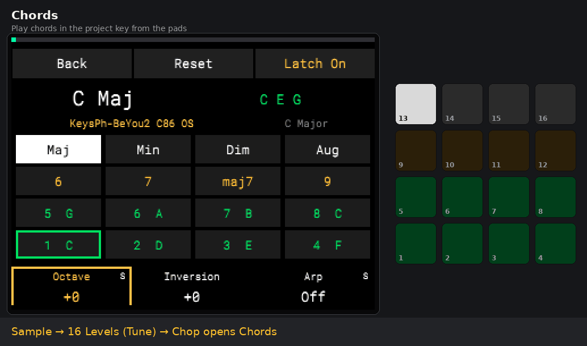</p>
<p align="center"><sub>Запись в эмуляторе <a href="https://github.com/orrpunk-art/virtual-mpc-sample">Virtual MPC Sample</a> со штатной прошивкой и модом; пэды справа показывают цвета, которые отправляет приложение.</sub></p>

> **Неофициальный проект.** Не связан с inMusic Brands и Akai Professional, не одобрен и не поддерживается ими. **В репозитории и релизных пакетах нет прошивки и кода Akai**: мод исправляет копию приложения, уже находящегося в вашем MPC Sample. Используйте на свой риск. См. [NOTICE](NOTICE.md).

> [!IMPORTANT]
> **Прочитайте перед установкой**
> - **Сделайте резервную копию всех проектов и сэмплов** с SD-карты.
> - **Пункт «SD Card Access» скрыт** в меню Project (Shift+Pad 16) в обоих режимах. USB-режим передачи («карта как диск на компьютере») не может работать, пока запущен мод, поэтому пункт убран в целях безопасности. Используйте карт-ридер. [Подробнее](#usb-режим-передачи--доступ-к-sd-карте).
> - **Есть два режима: Stock и Am MOD** (Project → Mod Settings → Quick → FX mode, применяется после перезапуска). В Stock работает штатный FX Select (один эффект), микшер выключен; в Am MOD микшер заменяет FX Select. [Схемы сигнала](#два-режима-stock-и-am-mod).
> - Сохраняйте проекты и сэмплы в **External** (на SD-карту). Internal во время работы мода временный.

## Содержание

1. [Что нового в r30a](#что-нового-в-r30a)
2. [Два режима: Stock и Am MOD](#два-режима-stock-и-am-mod) (схемы сигнала)
3. [Микшер](#микшер) · [Эффекты](#эффекты) · [Входной канал и запись](#входной-канал-и-запись) · [Ресемплинг](#ресемплинг) · [Тюнер](#тюнер) · [Цвета пэдов](#цвета-пэдов)
4. [Исправленные ошибки](#исправленные-ошибки-с-r29a)
5. [Возможности](#возможности) · [Установка](#установка) · [Использование](#использование) · [USB-режим](#usb-режим-передачи--доступ-к-sd-карте)
6. [Благодарности](#благодарности)

## Что нового в r30a

- **Два режима.** *Stock* оставляет штатный FX Select. *Am MOD* заменяет его микшером: **Knob FX открывает микшер**, эффекты штатного FX Select, сохранённые в проекте, игнорируются.
- **Микшер**: восемь треков A–H и Master, четыре insert-эффекта на трек, посылы, сайдчейн и стемы в Song. Пэды назначаются на треки; не назначенные идут *Direct* на Master.
- **Входной канал** в микшере (пэд 15): Level, Pan, Mute, цепочка Input FX и **маршрут записи**: Mic, USB или Rear пишутся в точке **Input**, **Track** или **Master**, **Wet** (с эффектами) или **Dry**. Мониторинг идёт из той же точки.
- **Ресемплинг через микшер**: один пэд (экран Sample) или вся секвенция (экран Sequence), с единым окном выбора цели. Свободный пэд рендерится сразу; занятый просит подтвердить замену.
- **Тюнер**: одно полноэкранное окно для входного сигнала (микшер, Sample Record) и для сэмпла любого пэда (экран Sample).
- **Цвет пэда от трека**: пэды и волны берут цвет трека микшера, на котором играют, на всех экранах со звуками пэдов.
- **Новые экраны эффектов** (Tape Delay, Tape, Vinyl, Spring Reverb, Tube Drive и др.), **набор текста пэдами** по умолчанию, **стемы на SD-карту**.
- Много исправлений; см. [Исправленные ошибки](#исправленные-ошибки-с-r29a).

## Два режима: Stock и Am MOD

Режим выбирается в **Project → Mod Settings → Quick → FX mode** (Stock / Am MOD). По умолчанию Am MOD. Изменение применяется после перезапуска. Режимы не влияют друг на друга.

| | **Stock** | **Am MOD** |
|---|---|---|
| Эффекты на пэдах | штатный **FX Select** (один эффект: Knob FX, Shift+Knob FX, Pad FX) | **Микшер**: треки A–H, Track FX, Master FX |
| Knob FX | штатный экран эффекта | **открывает микшер** |
| Стемы | нет | Song → Export → Stems |
| Запись входа | штатный Sample Record | запись через входной канал и выбранную точку записи |
| Ресемплинг | пэд или секвенция через штатный FX Select | пэд или секвенция через микшер (треки, посылы, FX, Master) |

### Зачем два режима

Штатный **FX Select** — один insert-эффект на весь выход. В Am MOD **микшер занимает его место в цепи сигнала**: каждый пэд идёт через трек (A–H) или Direct, у каждого трека свои эффекты, у Master своя цепочка. Две системы эффектов в одной цепи работать не могут, поэтому мод включает одну из них:

- **Am MOD** — для работы с микшером: эффекты на треках, посылы, стемы, запись и ресемплинг в выбранной точке цепи. Штатный FX Select игнорируется, даже если проект сохранил в нём эффект.
- **Stock** оставляет оригинальное поведение: один эффект FX Select, без микшера, штатные запись и ресемплинг. Нужен, чтобы сравнить со штатным приложением, играть проекты, которые опираются на FX Select, или если микшер вам не нужен.

Пэды, сэмплы и секвенции одинаковы в обоих режимах; отличаются только слой эффектов и маршрутизация. Переключение требует перезапуска.

**Маршрутизация входа** тоже разная. В Stock вход пишется так, как это делает штатный экран Sample Record. В Am MOD вход — канал микшера (пэд 15 в микшере): вы выбираете точку записи (**Input**, **Track A–H** или **Master**) и пишется ли звук с эффектами (**Wet**) или без (**Dry**); мониторинг идёт из той же точки. См. [Входной канал и запись](#входной-канал-и-запись) и схему Am MOD ниже.

### Режим Stock: путь сигнала

<p align="center">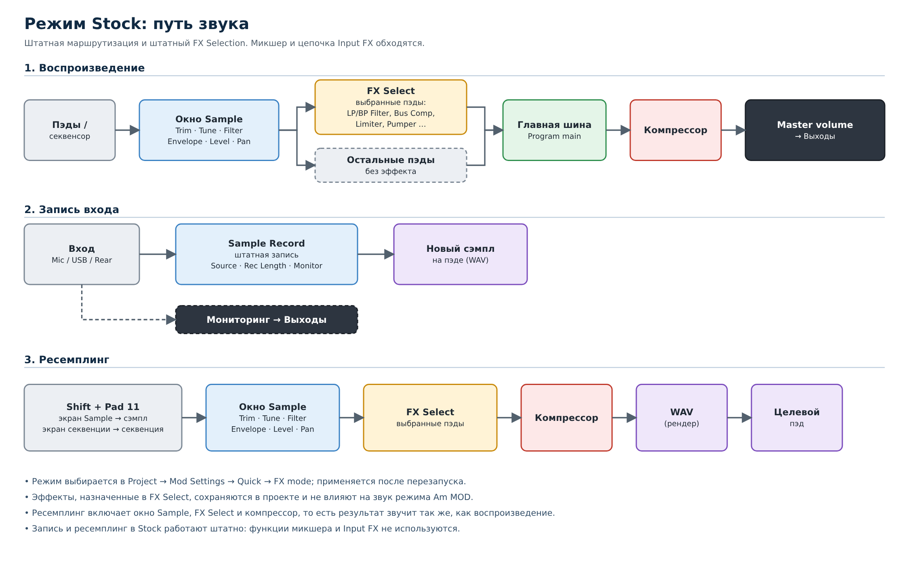</p>

### Режим Am MOD: путь сигнала

<p align="center">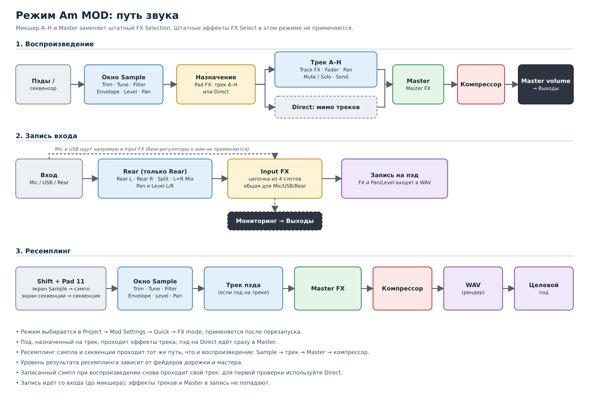</p>

SVG-версии: [Stock](docs/diagrams/signal-path-stock.ru.svg), [Am MOD](docs/diagrams/signal-path-ammod.ru.svg).

## Микшер

*Только режим Am MOD.* В микшере восемь треков **A–H** и **Master**. Каждый пэд идёт на один трек или *Direct* (прямо на Master).

**Вход и выход.** Нажмите **Knob FX**. На экране Sample **Shift+Knob FX** открывает микшер на *Track FX* пэда, по которому вы ударили последним (на Master, если у пэда нет трека). **B1 «Sample»** возвращает на экран Sample. Pad FX и Shift+Pad FX остаются штатными и обрабатывают весь Master.

**Обзор** (треки и Master)

| Управление | Действие |
|---|---|
| **Пэды 1–8** | выбрать трек A–H (зажмите один и нажимайте другие, либо **Shift**, чтобы выбрать группу) |
| **Пэд 16** | выбрать Master |
| **Пэд 15** | открыть [входной канал](#входной-канал-и-запись) |
| **Фейдер** | уровень выбранного трека (группа сохраняет разницу уровней; **Shift+фейдер** выравнивает) |
| **Клик DATA** | переключает Level → Pan → Send → Colour (Master: Level, Pan); вращение меняет значение |
| **Mute** / **Shift+Mute** | заглушить выбранное / снять все mute |
| **B2 Route** | маршрутизация треков: вкладки *Sends*, *Pads*, *Sidechain* на B2/B3 |
| **B3 Solo** / **Shift+B3** | solo / снять все solo |
| **Shift+B2 Rename** | имя трека (набор пэдами или энкодером) |

**Назначение пэдов на треки.** Выберите трек, в микшере нажмите **Pad FX**, откроется *Assign Pads*. Нажмите пэд, чтобы назначить его на выбранный трек; повторное нажатие отправляет его Direct. **B2 Pad Lock** блокирует любые изменения; пэды других треков мигают красным. Светодиоды банков A–H показывают банк назначения.

**Посылы и сайдчейн.** Route → *Sends* задаёт посыл трека на другой трек; посыл входит в звук принимающего трека и может попасть в несколько стемов (отдельный возврат ревера). *Sidechain* связывает Sidechain Compressor с Key-треком.

**Song и стемы.** Mixdown и **стемы** (Song → Export → Stems) пишутся на SD-карту в `Samples/User/Export/<song>/`: по файлу на каждый звучащий трек (`<song>_track A.wav` или с именем трека, если он переименован) и `<song>_Master.wav`. Из-за посылов стемы перекрываются, не суммируйте файлы.

## Эффекты

У каждого трека **четыре insert-слота**, у Master своя цепочка и компрессор. На треке нажмите **пэды 9–12** (пэды эффектов) или **Pad FX → FX**:

| Управление | Действие |
|---|---|
| **Пэды 9–12** | открыть слот 1–4; свободный слот открывает список эффектов |
| **Вращение / нажатие DATA** | выбрать / открыть или добавить эффект |
| **Shift+вращение / Shift+нажатие DATA** | переместить эффект / байпас |
| **K1–K3** | параметры эффекта (шкалы и названия показаны над ручками) |
| **B1 FX List** | из эффекта назад к списку |
| **B2 Bypass** / **Shift+B2 Chain Bypass** | байпас эффекта / всей цепочки |
| **Shift+Erase** / **Shift+B2** (в списке) | копировать / вставить эффект |
| **Erase** | удалить эффект (спросит; B3 подтверждает, B1 отменяет) |

Пэды эффектов меняют цвет, пока эффект или цепочка в байпасе. Графический **EQ** имеет до четырёх точек (DATA выбирает точку, Shift+B3 добавляет, Erase удаляет выбранную после подтверждения). У Master также есть компрессор **OptoCat / Duck** (Shift+Pad 5 на экране Sample).

Новое в r29a: перерисованные картинки эффектов.

<table>
<tr>
<td width="50%"><b>Tape Delay</b><br></td>
<td width="50%"><b>Tape (кассета)</b><br>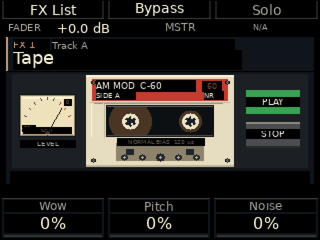</td>
</tr>
<tr>
<td width="50%"><b>Vinyl</b><br>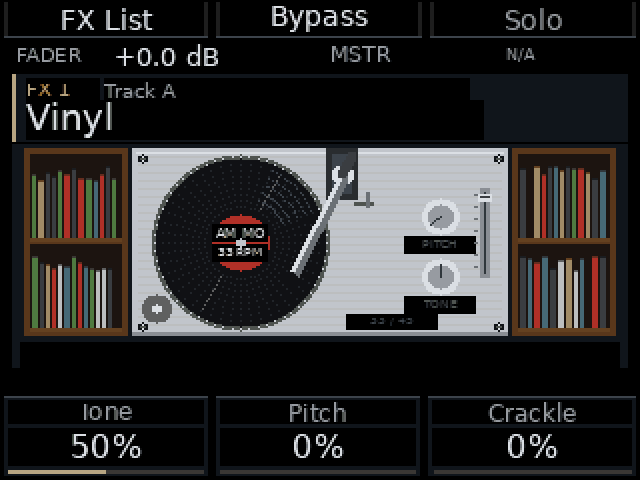</td>
<td width="50%"><b>Spring Reverb</b><br>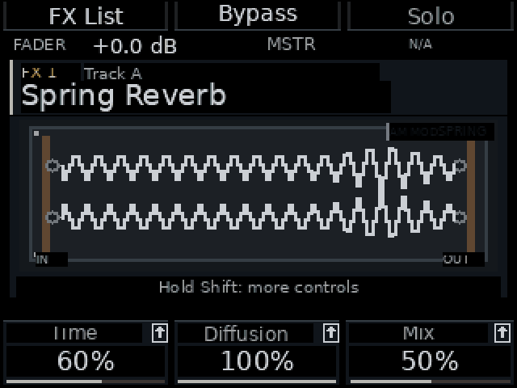</td>
</tr>
<tr>
<td width="50%"><b>Tube Drive</b><br>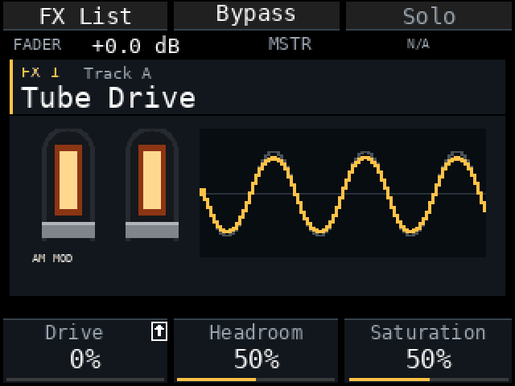</td>
<td width="50%"><b>Multi Chorus</b><br>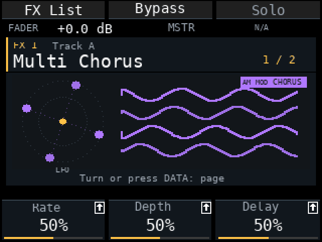</td>
</tr>
</table>
<p align="center"><sub>Кадры отрисованы painter'ом мода на тестовом сигнале. Вид выбирается в Mod Settings → Quick → FX view (Illustrated / Classic).</sub></p>

## Входной канал и запись

*Режим Am MOD.* **Входной канал** — место, где Mic, USB и Rear попадают в микшер. Откройте его **пэдом 15** в микшере.

| Управление | Действие |
|---|---|
| **Фейдер** | уровень входа |
| **Mute** | заглушить вход |
| **B1 Back** | в обзор |
| **B2 FX** / **B3 ROUTE** | цепочка Input FX (четыре слота, как на треке) / список маршрутизации |
| **Shift+B2 Paste** / **Shift+B3 Chain Bypass** | вставить эффект / байпас всей цепочки |

**Строки ROUTE.** Вращением выберите строку, **кликом** войдите в правку, вращением измените, кликом примите.

| Строка | Значение |
|---|---|
| **Tuner >** | открывает [тюнер](#тюнер) |
| **Monitor** | Off / Auto / On: слышать вход |
| **Record via** | **Input**, **Track** или **Master**: из какой точки берётся запись |
| **Record track** | трек A–H, если *Record via* = Track |
| **Record FX** | **Dry**: без эффектов. **Wet**: эффекты до выбранной точки (Track: Input FX, эффекты трека, фейдер и пан; Master: плюс эффекты Master) |
| **Rear mode** | только для источника Rear: Stereo, Rear L, Rear R, L+R Split, L+R Mix |

K2 — пан входа (для Rear: K2/K3 — Pan L/R, с **Shift** — Level L/R). Мониторинг слышит сигнал из той же точки, из которой идёт запись. Записывайте на штатном экране **Sample Record**, как обычно: *Tap pad to record*. Настройки одинаковы для Mic, USB и Rear.

## Ресемплинг

Ресемплинг рендерит то, что вы слышите, в новый сэмпл. В Am MOD он идёт через микшер (фейдер трека, Mute/Solo, Track FX, посылы, Master FX, компрессор); в Stock — через штатный FX Select. Уровень результата зависит от фейдеров.

1. **Пэд:** на экране Sample выберите пэд со звуком, нажмите **Shift+Pad 11** (источник — этот пэд, вопросов нет). **Секвенция:** на экране Sequence нажмите **Shift+Pad 11** (заголовок *Resample Seq*).
2. Откроется **страница назначения**. Выберите целевой пэд:
   - **свободный пэд** — рендер начинается сразу;
   - **занятый пэд** показывает *Replace?*: нажмите тот же пэд ещё раз или **B3 Replace**, чтобы перезаписать; **B1 Back** (или другой пэд), чтобы передумать. Цель подсвечивается красным на экране и на пэде.
3. **Pad Bank** листает банк вперёд, **Shift+Pad Bank** назад; **удерживая Pad Bank**, нажмите пэды 1–8 (красные), чтобы перейти в банк. Буквы банков следуют за диалогом. Банк назначения не связан с банком секвенций: после завершения или отмены вы возвращаетесь в свой банк секвенций.
4. Если транспорт запущен, окно спросит *Stop playback?*: **B3 Stop & Render** останавливает и запускает рендер, **B1 Cancel** продолжает воспроизведение.
5. Показывается прогресс; отмена — **B1**. Результат появится на целевом пэде.

## Тюнер

Одно полноэкранное окно везде одинаковое: названия нот, прямая шкала ±50 центов с движущейся стрелкой (зелёная в пределах ±5 центов), частота в Гц и нота с октавой.

- **Входной сигнал:** микшер → Input → ROUTE → **Tuner** (клик DATA) или **B3** на штатном экране *Sample Record* (подпись *Tuner* рядом со значком порога). **B1**, **B2**, **B3** или DATA закрывают окно.
- **Сэмпл пэда:** на экране Sample удерживайте **Stop** и нажмите **Chop** (**Stop+Chop**). Окно открывается поверх экрана Sample: ударьте по любому пэду, и окно покажет высоту сэмпла этого пэда (*Sample A05*). Ударные и шумовые сэмплы дают *No pitch found*; ноты ниже примерно 60 Гц не определяются. **B3 «Orig note»** сохраняет найденную ноту как **Original note** сэмпла (только нота; высота звука не меняется). **B1**, **B2** или **Chop** закрывают окно.

## Цвета пэдов

Mod Settings → **Sample → Pad colour from**: **Pad** (собственный цвет пэда) или **Track** (цвет трека микшера, на котором играет пэд; пэды Direct берут цвет Master). При *Track* цвет виден на всех экранах со звуками пэдов: Sample, пошаговый секвенсор (заголовок, список событий, подсветка пэдов, выбор чопа), браузер сэмплов, копирование/перенос. Курсор и состояния подчиняются единым правилам: курсор и выбранная секвенция мигают белым; в диалогах Copy и Resample свободные цели зелёные, занятые красные; заглушённые пэды красные.

## Исправленные ошибки с r29a

- **Save Project / Save Sample** иногда писали *Insert SD card to save* при вставленной карте или сохраняли в Internal. Исправлено в Stock и Am MOD.
- **Экспорт стемов** падал, когда штатное окно предлагало External; теперь стемы всегда пишутся на карту, а окно имени Stems сразу принимает пэды.
- **Пересэмплированный пэд терял атаку** (оставался только хвост): исправлено.
- **Запись через Track или Master оставалась «сухой»**: новые цепочки эффектов не подхватывались на неактивных линиях; исправлено.
- **Ресемплинг секвенции обходил микшер** (треки, фейдеры, посылы, эффекты), а первый ресемплинг после запуска мог быть тихим: исправлено. Ресемплинг пэда теперь включает эффекты трека, посылы и Master.
- **Эффект штатного FX Select, сохранённый в проекте, звучал в Am MOD**, а один выбранный пэд заставлял Knob FX действовать на все пэды: в Am MOD штатный FX Select игнорируется.
- **Цвета пэдов становились штатными** под нативными окнами (прогресс ресемплинга, Sample Record): теперь цвета Am MOD сохраняются.
- **Окно ресемплинга:** шаг Pad Bank и быстрая смена банка, буквы банков на панели, окно подтверждения остановки, запрос замены с красной целью и подсказкой «нажмите ещё раз» для секвенций, банк назначения независим от банка секвенций.
- **Shift+Erase в микшере** запускал штатный жест копирования: исправлено.
- **Библиотека сэмплов:** показание K3 Volume больше не мигает и не пропадает при прокрутке.
- **Master FX** больше не показывает ненадёжную закреплённую строку Sample Comp (используйте OptoCat Comp).
- **Меню Project:** строка «SD Card Access» убрана (внутри мода она не может работать).
- **Режим Stock** больше не предлагает Stems в экспорте Song.

Более ранние исправления (зависание Recall, подсветка Chop, Scaled takeover и др.): [CHANGELOG](CHANGELOG.md), [Известные проблемы](docs/KNOWN_ISSUES.md).

## Возможности

**Подтверждено**: проверено на реальном MPC Sample. **Пробная**: автоматические проверки и проверки в эмуляторе пройдены; проверка на устройстве ещё впереди.

| Возможность | Где | Статус |
|---|---|---|
| **Микшер**: треки A–H, Master, Track/Master FX, посылы, сайдчейн, стемы Song | Knob FX (Am MOD) | пробная |
| **Входной канал**: уровень, пан, mute, Input FX, точка записи Input / Track / Master, Wet / Dry, мониторинг | Микшер → пэд 15 | пробная |
| **Ресемплинг** пэда или секвенции через микшер; подтверждение замены | Shift+Pad 11 | подтверждено (пэд), пробная (диалог секвенции) |
| **Тюнер**: вход и сэмпл любого пэда, Original note из тюнера | Mixer Input ROUTE, Sample Record B3, Stop+Chop | подтверждено (окно), пробная (Original note) |
| **Цвет пэда от трека** | Mod Settings → Sample | пробная |
| **Читаемая панель K1–K3**: названия и значения всегда видны | все стандартные экраны | подтверждено |
| **Набор имён пэдами** (телефонная клавиатура) | Save, Search, Export, Stems, имена треков | подтверждено |
| **Orig Note**, **Key / Scale** проекта | Sample → Tune → Shift+K1; Project | подтверждено |
| **Подсветка гаммы** для 16 Levels: Monochrome / Piano / Scale / Degrees | Sample → Tune/Play/**Scales** | частично подтверждено |
| **Steps**: 16-шаговый секвенсор на пэдах, сетка 1/4…1/64 и триоли | Shift+SEQ → B2 Steps | подтверждено |
| **Редактор событий**, **Poly**-аккорды | Step Edit / Seq | подтверждено |
| **Поиск** сэмплов и проектов (Folder / Library / Internal / SD Card / All) | Sample Select / Open Project → Shift+B3 | подтверждено |
| **Batch Copy** до 16 звуков, **Batch Extract** | Sample → Shift+Erase → B2; Chop → Shift+B2 | подтверждено |
| **EQ на пэд**: одна полоса, 6 типов, живой спектр | Sample → Filter → Filter Env → **EQ** | подтверждено |
| **Аккорды**: 8 ступеней, 6/7/maj7/9, обращение, latch, арпеджиатор | 16 Levels Tune → Chop | пробная |
| Компрессор **OptoCat/Warm** | Shift+Pad 5 | пробная |
| **Цвета секвенций** (Default + восемь), пульс в такт | Seq → Shift+K1 | подтверждено |
| **Запись Rear**: Rear L / R / Split / Mix, пан и уровень мониторинга | Mixer Input ROUTE; Input Config | пробная |
| **Прослушивание с конца** сэмпла или среза | удерживать STOP + пэд | пробная |
| **Mod Settings**: FX mode, ввод текста, FX view, подсветка пэдов, цвета, пульс курсора | Project → Mod Settings | пробная |
| **Screen Mirror** по USB-C | Mod Settings → Pads | подтверждено |
| **Кнопка питания** спрашивает, сохраняет копию на SD, выключает | кнопка питания | подтверждено |
| **Recall** без зависаний; **Pad Bank + K** сбрасывает параметр | Sample Record; везде | подтверждено |

Все возможности с управлением: [docs/FEATURES.md](docs/FEATURES.md). Настройки: [docs/MOD_SETTINGS.md](docs/MOD_SETTINGS.md). Заметки о релизах: [r30a](docs/RELEASE_NOTES-r30a.ru.md), [r29a](docs/RELEASE_NOTES-r29a.ru.md), [r28d](docs/RELEASE_NOTES-r28d.ru.md). История сборок: [CHANGELOG.md](CHANGELOG.md).

### В действии

<table>
<tr>
<td width="50%"><b>Steps</b><br>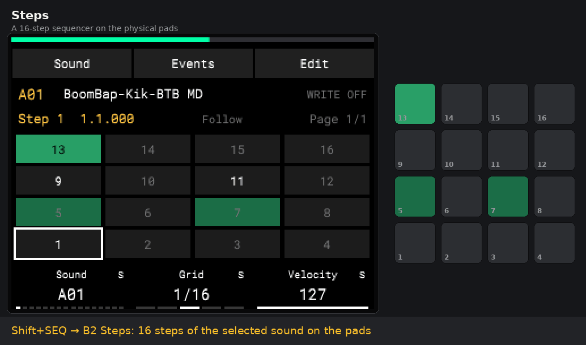</td>
<td width="50%"><b>Набор имён пэдами</b><br>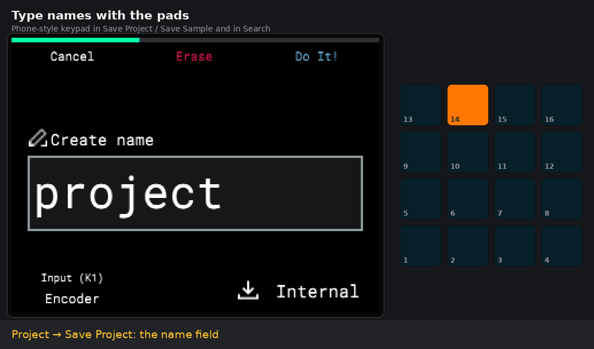</td>
</tr>
<tr>
<td width="50%"><b>Подсветка гаммы</b><br>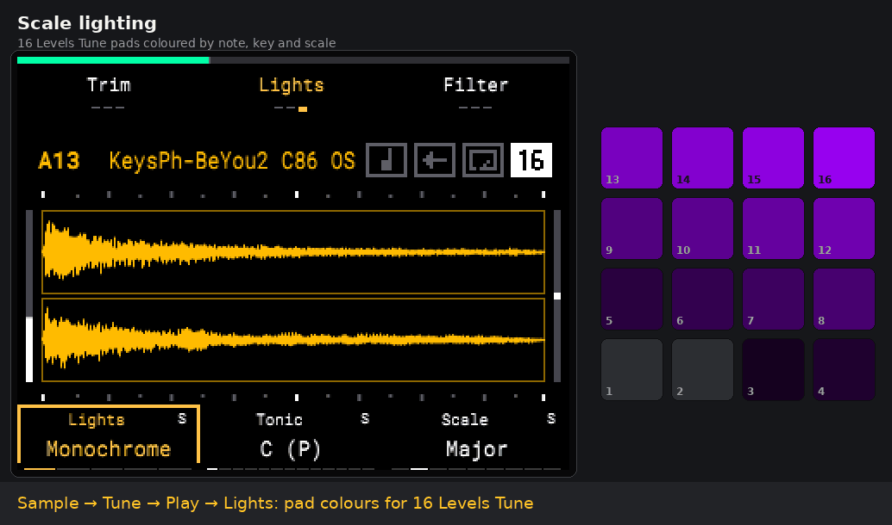</td>
<td width="50%"><b>Поиск</b><br>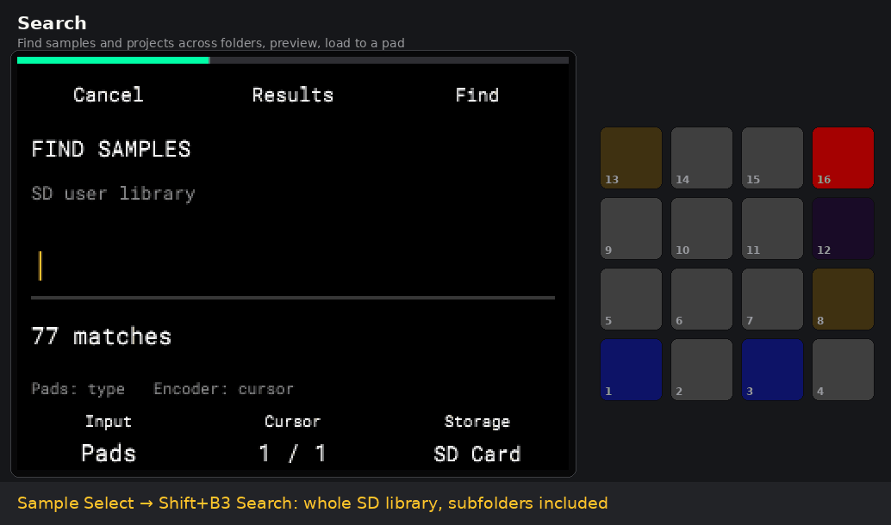</td>
</tr>
<tr>
<td width="50%"><b>Batch Copy</b><br>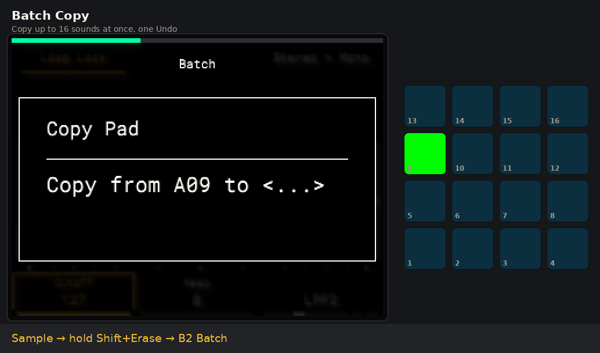</td>
<td width="50%"><b>EQ пэда</b><br>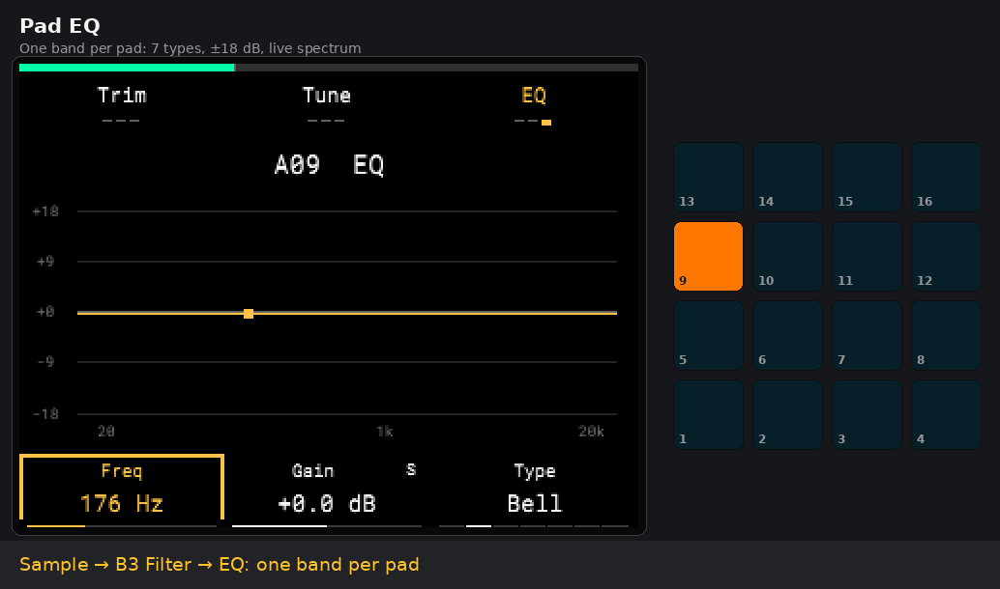</td>
</tr>
<tr>
<td width="50%"><b>Ресемплинг пэда</b><br>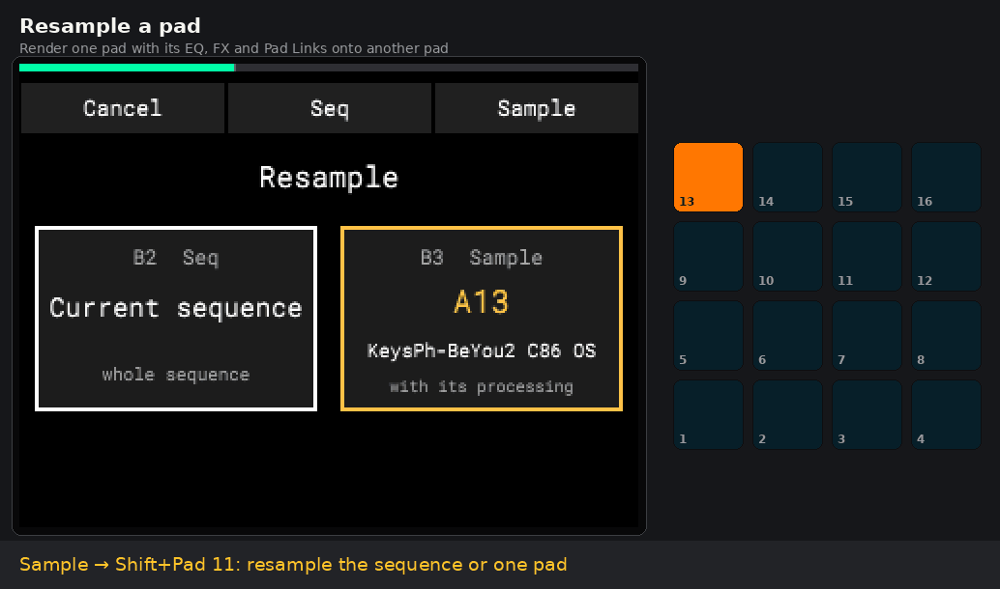</td>
<td width="50%"></td>
</tr>
</table>

## Установка

> [!IMPORTANT]
> **Перед установкой или обновлением Am MOD сделайте резервную копию всех проектов и сэмплов с SD-карты на компьютер или другой диск.** Резервная копия `autorun/`, которую делает установщик, не включает ваши проекты и сэмплы.

> [!IMPORTANT]
> **FAT32 / MS-DOS (FAT32) доступна экспериментально начиная с r26e; exFAT по-прежнему поддерживается.** Для FAT32 нужен пакет **r26e или новее** и установщик **1.0.2+**, либо ручное копирование полной папки `autorun/` этого пакета. FAT32 проверена на тестовых образах и в эмуляторе; проверка на физическом MPC ещё впереди.
>
> **Имя тома карты — вроде `MPC` или `MPCSAMPLE`.** Допустимы только ASCII-буквы, цифры, `.`, `_` и `-`; пробелы и кириллица в имени карты не дают моду запуститься. Ограничение относится к имени карты, а не к именам ваших сэмплов и проектов.
>
> Проверьте файловую систему перед установкой: Finder → выберите том SD → ⌘I → Формат на macOS; свойства диска → Файловая система на Windows. **Переформатировать существующую карту FAT32 не нужно.** Сохраните проекты и сэмплы, замените папку `autorun/` мода полной новой версией. Лимит FAT32 — **4 ГиБ минус 1 байт на файл**.

Нужен MPC Sample с прошивкой **1.3.0.12** (мод проверяет SHA-256 приложения и не запускается на любой другой версии) и совместимая SD-карта с допустимым именем тома: exFAT или экспериментальная FAT32.

**Установщик (Windows):** скачайте `MPC-Sample-Mod-Installer.exe` и пакет `am-mod-*.zip` из [Releases](../../releases), запустите установщик, выберите zip (или нажмите *Latest release*) и SD-карту, нажмите **Install**. Установщик **1.1.0** также показывает новости релизов и форму диагностического отчёта: [инструкция](docs/INSTALLER-1.1.0.md).

**Установщик (macOS / Linux / Windows с Python 3.8+):**

```bash
python3 installer/mpc_mod_installer.py                 # окно
python3 installer/mpc_mod_installer.py cards           # список карт
python3 installer/mpc_mod_installer.py install am-mod-r30a.zip --card E:  # релизный пакет
python3 installer/mpc_mod_installer.py install --latest --card /Volumes/MPC
python3 installer/mpc_mod_installer.py remove --card E:
```

Установщик пишет на карту только `autorun/` и `MPC_MOD_VERSION.json`. Он проверяет пакет, копирует прежнюю `autorun/` в `~/AM-Mod-Backups/`, последними записывает файлы, запускающие мод, и проверяет всё записанное. Он никогда не форматирует карту и не трогает `MPC-Sample/` (ваши проекты и сэмплы).

**Вручную:** распакуйте пакет и скопируйте папку `autorun` в корень карты.

## Использование

1. Вставьте карту и включите MPC или вставьте её в работающий MPC. Мод запускается сам. Время подготовки зависит от карты и проекта. Если запуск завис на 0 %, включите MPC без карты, дождитесь обычного экрана, затем вставьте карту.

   > **Во время подготовки приложения мод показывает заставку Am MOD** с версией и адресом репозитория. Не выключайте питание и не вынимайте карту во время подготовки.

2. Перед запуском мод проверяет штатное приложение и свои файлы; при любом несовпадении продолжает работать штатное приложение.
3. Работайте как обычно. Сохраняйте проекты и сэмплы в **External** (на SD-карту): в моде Internal временный и теряется при остановке мода.
4. Сохраните в External и выключайте кнопкой питания. Вынимайте карту только после выключения. Чтобы работать со штатным приложением, включите без карты с модом.

Кнопка питания работает и в моде: спрашивает, сохраняет копию проекта на карту и выключает. Не вынимайте карту во время запуска, сохранения и выключения мода.

## Попробовать без устройства

[**Virtual MPC Sample**](https://github.com/orrpunk-art/virtual-mpc-sample) запускает штатную прошивку в QEMU с целым устройством в браузере и умеет запускать SD-пакеты autorun так же, как MPC. GIF выше записаны там:

```bash
python3 lab.py autorun am-mod-r30a.zip --no-reboot --yes
```

Запуски в эмуляторе полезны для разработки, но не заменяют проверку на устройстве: тайминги, задержка звука, батарея и USB-аудио отличаются.

## Сборка из исходников

Нужны: Linux или WSL, Python 3, AArch64 GCC/binutils и **ваша** локальная копия штатной прошивки 1.3.0.12; ожидаемый SHA-256 приложения — `b6584cba76e416e432ad202509099d34373dc2c3d6a8fb625f5678bf0193b508`. Образ прошивки, апдейтер, извлечённые разделы и rootfs в репозиторий не входят; пути к rootfs, используемые проверками (`/home/user/mpc-rootfs-user-20260808` в скриптах), нужно поправить.

Порядок: получить локальные входные данные с ожидаемыми хэшами → собрать `sd-clone-trial` (загрузчик) → собрать патчи значений в `sd-k-value-peek` → собрать текущую ревизию `sd-mod-session` (`sd-mod-session/build_resample_mixer.sh` запускает сборку, проверки `verify_*.py` / `check_*.c` и упаковку). Эти исследовательские скрипты зависят от замороженных результатов прежних сборок, проверенных предыдущих пакетов и вашей локальной прошивки/rootfs; это не самостоятельная сборка из чистого checkout. Проверки ARM/QEMU используют явно помеченные адаптеры и не заменяют запуск на устройстве.

| Папка | Содержимое |
|---|---|
| `sd-mod-session/` | текущий мод: исходники (`src/`), скрипты сборки и упаковки, проверки, документация возможностей |
| `sd-clone-trial/` | загрузчик: запускает проверенную копию штатного приложения в памяти и возвращает штатное приложение |
| `sd-k-value-peek/` | первые патчи экрана (значения K1–K3) |
| `installer/` | установщик на SD-карту и его тесты |
| `virtual-mpc/` | ранняя браузерная модель интерфейса (не эмулятор) |
| `docs/diagrams/` | схемы пути сигнала (SVG/PNG, RU/EN) и генератор |
| `research/`, `docs/` | заметки и скрипты реверс-инжиниринга, история этапов |

Большинство технических документов — на русском.

## Правовая информация

- Akai Professional и MPC — торговые марки inMusic Brands, Inc., используются здесь только для названия устройства, на котором работает мод.
- Прошивка, код Akai, заводской контент и графика Akai не распространяются. Мод копирует приложение, находящееся на вашем устройстве, и исправляет эту копию в памяти; он никогда не записывает прошивку или загрузчик.
- В релизные пакеты входит `xdg-dbus-proxy` (LGPL-2.1-or-later) с исходным кодом.
- Подробнее: [NOTICE.md](NOTICE.md).

## Лицензия

[MIT](LICENSE). Участие: [CONTRIBUTING.md](CONTRIBUTING.md).

## USB-режим передачи / доступ к SD-карте

Пока работает Am MOD, USB-режим передачи MPC («SD-карта как диск на компьютере») не работает — ни в режиме Stock, ни в Am MOD. Мод запускает приложение в изолированной копии без доступа к «сырым» устройствам хранения, а именно этот доступ позволяет MPC показать карту компьютеру. Кроме того, карта занята модом, и её открытие грозило бы порчей данных. Поэтому пункт **SD Card Access** в меню Project скрыт.

Чтобы скопировать файлы, используйте карт-ридер (выключите, выньте карту, скопируйте, верните). Чтобы вернуть USB-режим, выключите MPC, удалите папку `autorun` с SD-карты (или возьмите карту без неё) и включите: он загрузится как штатный. Проекты и сэмплы на карте не затрагиваются.

## Благодарности

Особая благодарность **Leusha** за внимательное, подробное тестирование и найденные ошибки: почти каждое исправление в r27r и многие в r30a начались с её отчётов. Спасибо также mxt1iga и всем, кто тестировал сборки и присылал воспроизведения.
