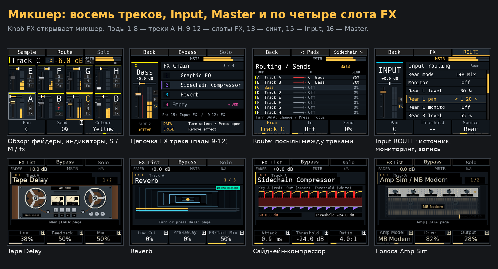

# Am MOD r31a

**Аранжировщик, микшер, встроенный синтезатор, иллюстрированные эффекты, пианоролл и MIDI-инструменты для Akai MPC Sample.**

[English](README.md) · **Русский** · [Español](README.es.md) · [Скачать r31a](https://github.com/AlekseyMalykh/am-mod/releases/tag/r31a)

> **r31a — Arrange в статусе бета.** Аранжировка сохраняется внутри проекта, и штатная прошивка или старые версии Am MOD могут потерять её, если пересохранят этот проект. Сначала сделайте копию проектов и карты; пожалуйста, сообщайте о проблемах.

Am MOD запускается с SD-карты на прошивке **1.3.0.12**. Приложение работает в ОЗУ, установленная прошивка не перепрошивается. Чтобы вернуться к штатной прошивке, запустите MPC без карты мода.

## Что нового в r31a

- **Arrange (бета)** — временная шкала песни в экране Song (**Song → Shift+B1**). Свободные дорожки звучат вместе; **Seq-блоки** живо следуют за штатной секвенцией, **паттерны** — ваши собственные вариации. Секвенция добавляется нажатием её пэда, блок или выделение через несколько строк переносится **Note Repeat + DATA / фейдер**, воспроизведение с начала или **Shift+Play от курсора**, **Loop**, **экспорт всей аранжировки** (сведение, стемы) по Shift+B1. Правки во время воспроизведения слышны сразу. [Руководство по Arrange](docs/ARRANGE_GUIDE.ru.md).
- **Пианоролл внутри блока** — такты песни, курсор воспроизведения с **Follow** (Shift+B2), имена сэмплов в строках, **Shift+пэды** выделяют строки, **Shift+Erase** копирует и вставляет между блоками (например, из секвенции в паттерн), перенос с Note Repeat, правка Seq-блоков на месте со штатным Undo.
- **Переименование** паттернов и дорожек Arrange стандартным вводом мода (пэды набирают буквы и подсвечиваются, K1 переключает пэды / энкодер).
- **Журналы в папке `Logs/`** внутри папки мода — больше не смешиваются с файлами мода; установщик **1.6.0** собирает их для отчёта об ошибке.
- **Кнопка питания:** B1 Cancel, **B2 Bootloader**, B3 Power off (сначала сохраняется копия проекта). **Rear** L / R получили независимые мониторинг, панораму и уровень; исправления **To Seq**, **Repeats в Song**, **SD Card Access под SampleBoot**, Sample Swap и Screen Mirror.
- Осталось из прошлых версий: микшер на 8 треков, Input и Master по четыре слота FX, сайдчейн и посылы; синтезатор из пяти модулей; Input ROUTE; пианоролл, MIDI-инструменты, импорт PGM/XPM, Sequence Pad Mutes, Sample Swap, Internal/External; поддержка D.S.B, SampleBoot и mpc-boot-thingy.

[Изменения](docs/RELEASE_NOTES-r31a.ru.md) · [Arrange](docs/ARRANGE_GUIDE.ru.md) · [Установка](docs/INSTALL.ru.md) · [Руководство](docs/USER_GUIDE.ru.md) · [Синтезатор](docs/SYNTH_GUIDE.ru.md) · [Загрузочные меню](docs/BOOTLOADERS.ru.md)

## Установка и запуск

1. Скопируйте проекты, сэмплы и настройки карты.
2. Скачайте `am-mod-r31a.zip` и `MPC-Sample-Mod-Installer.exe` по ссылке выше. На macOS/Linux используйте Python-установщик.
3. Подключите карту через картридер или SD Card Access, выберите ZIP и карту, нажмите Install. Установщик сам определяет раскладку (обычная карта, D.S.B, SampleBoot, mpc-boot-thingy); не заменяйте вручную корневую папку `autorun` загрузочного меню.
4. Безопасно извлеките диск, выйдите из SD Card Access и перезагрузите MPC. На карте с загрузочным меню выберите **AM Mod**. Версию показывают загрузочный экран и **Project → Mod Settings → About**.

Используйте exFAT и ASCII-метку тома, например `MPC`, без пробелов. FAT32 остаётся экспериментальным. Установщик делает копию `autorun/`, но не проектов. [Установка и восстановление](docs/INSTALL.ru.md).

## Быстрая навигация

| Откуда | Действие |
|---|---|
| Song, транспорт остановлен: **Shift+B1** | **Arrange**; B1 — назад, Shift+B1 — экспорт аранжировки |
| Arrange: нажать пэд секвенции | Добавить эту секвенцию на курсор (B3 подтверждает) |
| Arrange: удерживать **Note Repeat** + DATA / фейдер | Перенос блока или выделения |
| Arrange: **Shift+B3** | Actions (Add / Block / Track / Song, переименование) |
| Arrange: Play / **Shift+Play** / **Loop** | С начала / от курсора / цикл |
| Пианоролл блока: **Shift+пэды**, **Shift+Erase** | Выделить строки / копировать и вставить |
| Knob FX | Микшер; пэды 1–8 = A–H, 13 = Synth, 15 = Input, 16 = Master (не во время воспроизведения Song или Arrange) |
| Пэд 13 микшера, затем Loop + пэд / + − / DATA | Модули и страницы синта |
| Shift+Sample (любой экран) | Список Input ROUTE |
| Пэды 9–12 микшера | Четыре последовательных insert-слота |
| FX: Shift+Erase / Shift+B2 / Shift+B3 | Copy / Paste / Chain Bypass |
| Пианоролл: DATA + энкодер + фейдер | Выделение области |
| Удерживать Stop, затем Chop | Тюнер сэмпла |
| Step Edit → Events/Steps → Knob FX | Пианоролл; B1 — назад |
| Shift+Pad8 → B2 Map / Log | MIDI Monitor и MIDI-карты |
| Browser → Shift+B1 / Shift+B2 | Sample Swap / импорт программ |
| Shift+Pad16 → Mod Settings → About | Режим, USB-аудио, палитра, экран, **Exit to bootloader** |
| Кнопка питания | B1 Cancel / B2 Bootloader / B3 Power off |

## Arrange за пять шагов

1. Запишите несколько секвенций обычным образом в Seq.
2. Откройте **Song → Shift+B1**. Фейдером выберите строку, DATA поставьте курсор, **нажмите пэд секвенции** и подтвердите B3. Повторите на других строках.
3. **Play** (или **Shift+Play** от курсора). Включите **Loop**, чтобы повторять диапазон, выделение или блок.
4. Откройте блок (**B3 Open**), чтобы править его в пианоролле. В Seq-блоке правится сама секвенция; удерживайте **B2 + пэды, затем B3**, чтобы вынести строки в собственный паттерн для вариаций.
5. **Shift+B1** экспортирует аранжировку через штатный Song Export (сведение или стемы). Сохраните проект.

## Микшер и эффекты

У восьми треков A–H, Master и Input по четыре последовательных insert-слота. У треков есть посылы, у компрессора — сайдчейн, у каждого эффекта своя иллюстрация, реагирующая на сигнал. У Amp Sim есть дополнительные гитарные/басовые голоса; это штатные пресеты AIR Amp Sim, а не снятые слепки усилителей. [Галерея](docs/FX_GALLERY.md) · [Справочник ручек](docs/FX_KNOB_LAYOUT.ru.md).

<table><tr><td></td><td></td></tr><tr><td></td><td></td></tr></table>

Картинки сделаны рабочими отрисовщиками с тестовыми данными и заменённым шрифтом (`docs/media/r31a/build_images.py`); это иллюстрации, а не снимки физического MPC.

USB по умолчанию — Stereo Master. **Mod Settings → Quick → USB audio → Master + A–H** и перезапуск включают **18 каналов**: Master 1/2, A 3/4 … H 17/18. Отключите мониторинг входа в DAW, если его воспроизведение возвращается в MPC, чтобы не было обратной связи. SD Card Access останавливает воспроизведение и звук, пока карта общая. [USB](docs/USB_GUIDE.ru.md).

## Загрузочные меню

Am MOD можно держать на обычной карте, под **D.S.B Boot** (`autorun/os/AM-Mod/`), **SampleBoot** (`autorun/mods/AM-Mod/`) или **mpc-boot-thingy**. **Exit to bootloader** (Mod Settings → About или **B2** в диалоге кнопки питания) сохраняет копию проекта и возвращает в меню D.S.B или SampleBoot; с другими загрузчиками запускается штатная прошивка. [Загрузочные меню и выход в загрузчик](docs/BOOTLOADERS.ru.md).

## Журналы и отчёты об ошибках

Мод пишет журналы в **`Logs/`** в своей папке: `autorun/Logs/` на обычной карте, `autorun/mods/AM-Mod/Logs/` под SampleBoot, `autorun/os/AM-Mod/Logs/` под D.S.B. Каждый запуск перезаписывает прошлую сессию. Кнопка **Report a bug** в установщике собирает их (и старые места) в один ZIP. [Сообщить об ошибке](docs/FEEDBACK.ru.md).

## Статус и планы

Arrange проверен на физическом MPC в тестовых сборках; итоговый пакет r31a, перенос журналов в `Logs/` и экспериментальная запись Synth Keys ещё ждут проверки на устройстве. Автоматические проверки host/ARM/QEMU не заменяют проверку на настоящем MPC.

Дальше в Arrange: именованные части песни, песни длиннее 128 тактов, запись в аранжировку (MIDI и аудиодубли), импорт MIDI-файлов в паттерны и микшер во время воспроизведения. Хостинг VST — в планах. SampQOL, D.S.B и SampleBoot скачиваются отдельно и в пакет не входят.

[Известные ограничения](docs/KNOWN_ISSUES.ru.md) · [Сообщить об ошибке](docs/FEEDBACK.ru.md) · [Сборка](docs/BUILD.md) · [Журнал изменений](CHANGELOG.md) · [Лицензия](LICENSE)

Неофициальный проект, не связан с Akai/inMusic. Спасибо Leusha, Henry Skillz (D.S.B и эффекты HS), авторам SampleBoot и Virtual MPC Sample и сообществу. Сторонние компоненты сохраняют свои лицензии, см. [NOTICE](NOTICE.md).
