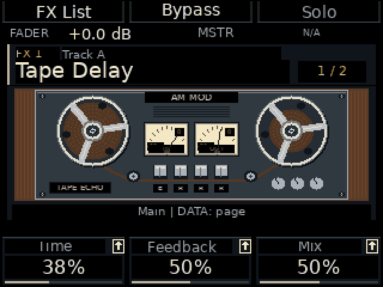

# Am MOD

**Микшер, эффекты и многоканальный USB для Akai MPC Sample.**

[English](README.md) · **Русский** · [Скачать r30b](https://github.com/AlekseyMalykh/am-mod/releases/tag/r30b) · [Все релизы](https://github.com/AlekseyMalykh/am-mod/releases) · [Обратная связь](docs/FEEDBACK.ru.md)

Am MOD запускается с SD-карты на прошивке **1.3.0.12**. Добавляет восемь треков A–H, Master и Input FX, ресемплинг через микшер, тюнер, аккорды, пошаговый секвенсор и удобную работу с пэдами. Приложение работает в RAM; установленная прошивка не перезаписывается. Для штатного запуска включите устройство без карты с модом.

<table>
<tr><td width="50%"><b>Tape Delay</b><br></td><td width="50%"><b>Shimmer Reverb</b><br></td></tr>
<tr><td><b>Amp Sim: гитарные и басовые варианты</b><br></td><td><b>Tape</b><br></td></tr>
</table>

*GIF отрисованы текущим кодом мода с тестовыми PCM/уровнями и заменяющим шрифтом. Это демонстрация интерфейса, а не видеозапись MPC. [Галерея и воспроизведение](docs/FX_GALLERY.md).*

> [!IMPORTANT]
> Перед установкой сохраните копию проектов и сэмплов на ПК. Сохраняйте работу в **External**: Internal в сессии мода временный. Нужна именно прошивка **1.3.0.12**; другая версия не поддерживается. Am MOD — неофициальный проект, не связанный с Akai/inMusic. [Правовая информация](NOTICE.md).

## Новое в r30b

- **SD Card Access снова доступен.** Сохранение копии проекта, USB-диск на ПК и возврат кнопками **B3 Disconnect → B3 Return**, без выдёргивания кабеля. Через этот диск можно обновить мод; новая версия применяется после перезапуска.
- **USB-аудио:** стерео Master для телефона/ПК или **18 каналов — Master + восемь стереотреков A–H**. Имена каналов сообщает MPC; алиасы в REAPER не нужны. Stock сохраняет стереорежим.
- **Новые экраны эффектов:** механика ленты и катушек, проигрыватель Vinyl, помещение Shimmer, временные сетки Delay, оформление усилителей. Bypass останавливает анимацию эффекта.
- **Понятные K1–K3:** отдельные раскладки, Shift-слой и подписанные страницы. Amp Sim получил семь настроенных вариантов в дополнение к Original, включая три басовых.
- **Плавные изменения FX и фоновый тюнер.** Состояние незатронутых эффектов сохраняется; пользователь подтвердил исчезновение щелчков.
- **Управление:** B2 Bypass в FX Chain, статус под треком, единые Copy/Paste/Chain Bypass, переход A–H/Master кнопками ±, DATA в Duck/OptoCat и поддержка Pickup/Scaled/Jump.
- **Route:** недоступны назначения, создающие прямую или косвенную петлю посылов.

[Полный список изменений и границы проверки](docs/RELEASE_NOTES-r30b.ru.md).

## Быстрый старт

1. Скачайте `am-mod-r30b.zip` и установщик из [релиза](https://github.com/AlekseyMalykh/am-mod/releases/tag/r30b).
2. Подключите SD через кардридер или **Project → SD Card Access → Connect**. Для первой установки используйте штатный SD Card Access.
3. В установщике выберите ZIP и карту, нажмите **Install**. Вручную: замените папку `autorun/` в корне карты полной папкой из ZIP.
4. Безопасно извлеките диск на ПК. При подключении через MPC нажмите **B3 → B3** для возврата в мод; в штатной прошивке следуйте её подсказке отключения USB.
5. **Выключите и включите MPC.** Копирование обновления не меняет версию, уже работающую в RAM.

Поддерживается exFAT; FAT32 — экспериментально, предел файла менее 4 ГиБ. Имя тома карты: ASCII-буквы, цифры, `.`, `_`, `-`, без пробелов. Установщик не форматирует карту, сохраняет прежнюю `autorun/` в `~/AM-Mod-Backups/` и не меняет проекты/сэмплы. Его резервная копия не заменяет копию ваших проектов.

```bash
python3 installer/mpc_mod_installer.py install am-mod-r30b.zip --card E:
python3 installer/mpc_mod_installer.py status --card E:
```

На macOS вместо `E:` укажите, например, `/Volumes/MPC`; на Linux — путь монтирования карты. [Инструкция установщика](docs/INSTALLER-1.1.0.ru.md) · [USB и обновление](docs/USB_GUIDE.ru.md).

## Выберите режим

**Project → Mod Settings → Quick → FX mode**, затем перезапуск.

| | Stock | Am MOD |
|---|---|---|
| Knob FX | Штатный FX Select | Микшер A–H / Master / Input |
| Обработка | Штатная цепь | Четыре последовательных insert-слота на канал, посылы и сайдчейн |
| USB на ПК/телефон | Стерео Master | Стерео Master или Master + A–H |
| Запись / ресемплинг | Штатный тракт | Выбор точки Input / Track / Master, Wet / Dry |
| Stems | Нет | Song → Export → Stems на SD |

В Am MOD сохранённый штатный FX Select не включается параллельно микшеру. Сэмплы, пэды и секвенции сохраняются при смене режима. По умолчанию включён Am MOD, USB-аудио — Stereo.

## Микшер и эффекты

**Knob FX** открывает микшер. Пэды **1–8** выбирают A–H, **16** — Master, **15** — Input. **Pad FX** открывает назначение пэдов на трек; неназначенные идут Direct в Master. Фейдер — уровень, Mute — заглушение, B3 — Solo, B2 — Route.

Пэды **9–12** открывают четыре FX-слота. Цепочка идёт сверху вниз: **Slot 1 → 2 → 3 → 4**. Последующий эффект и его анализатор получают выход предыдущего. Порядок важен, например для Delay и Distortion. EQ показывает локальную кривую настройки и живой спектр выбранного слота.

| Управление в FX | Действие |
|---|---|
| K1–K3 / Shift+K | Основной / дополнительный слой |
| DATA | Страницы параметров; в списке — выбрать / открыть слот |
| B2 | Bypass выбранного эффекта |
| Shift+Erase / Shift+B2 | Copy / Paste |
| Shift+B3 | Chain Bypass |
| Shift+DATA в EQ | Добавить точку |
| Пэды 1–8 / 15 / 16 | Перейти к списку FX другого канала |

[Amp-варианты](docs/AMP_VOICES.ru.md) — настройки штатного AIR Amp Sim, а не измеренные модели схем или IR. [Все раскладки FX](docs/FX_KNOB_LAYOUT.ru.md) · [Руководство](docs/USER_GUIDE.ru.md).

## USB: Master или отдельные треки

**Mod Settings → Quick → USB audio → Stereo / Master + A–H**, затем **перезапуск MPC** и повторное открытие аудиоустройства в DAW.

| Пара | Сигнал |
|---|---|
| 1/2 | Master |
| 3/4, 5/6, 7/8, 9/10 | Track A, B, C, D |
| 11/12, 13/14, 15/16, 17/18 | Track E, F, G, H |

Телефон: выбирайте **Stereo**, чтобы записывать Master как прежде. Совместимость конкретного телефона/адаптера проверяется отдельно. В REAPER выберите полный диапазон 1–18 и пары 1/2, 3/4 и т. д. Смешанные пары 2/3, 4/5 — соседние моноканалы, а не новые стереошины.

> [!IMPORTANT]
> **Избегайте петли мониторинга:** если выход DAW возвращается в MPC по USB и мониторится на MPC, отключите input monitoring вооружённых дорожек DAW. Иначе Master → DAW → USB Return → Master замыкается в петлю.

SD Card Access временно останавливает приложение и звук. USB-диск и воспроизведение/USB-запись мода одновременно не работают. [Подробная инструкция](docs/USB_GUIDE.ru.md).

## Остальные возможности

- Ресемплинг пэда или секвенции через микшер; входная запись через Input, Track или Master.
- **Stop+Chop** — тюнер сэмпла; тюнер входа доступен в Input ROUTE и Sample Record.
- Шаги и аккорды на пэдах, подсветка ладов, поиск по папкам, массовое копирование, набор имён пэдами, EQ отдельных пэдов.
- Screen Mirror и подсветка пэдов; собственные цвета треков, настройки Pad Link / Mute Group.

[Руководство](docs/USER_GUIDE.ru.md) · [Настройки](docs/MOD_SETTINGS.ru.md) · [Известные ограничения](docs/KNOWN_ISSUES.ru.md) · [История](CHANGELOG.md).

## Разработка

[Сборка и проверки](docs/BUILD.md) · [Структура документации](docs/README.md) · [Участие](CONTRIBUTING.md).

Нужны Linux/WSL, AArch64 toolchain, ваша локальная прошивка/rootfs и замороженные входные данные предыдущих сборок. Сборка из чистого checkout пока не автономная. Прошивка и личные проекты не публикуются. GPL-исходники USB-драйвера поставляются в ZIP отдельно от кода самого мода. [NOTICE](NOTICE.md).

Спасибо **Leusha** за проверки и отчёты, авторам [Virtual MPC Sample](https://github.com/orrpunk-art/virtual-mpc-sample) — за среду разработки, участникам сообщества — за обратную связь. Лицензия: [MIT](LICENSE), сторонние компоненты — по собственным лицензиям.
