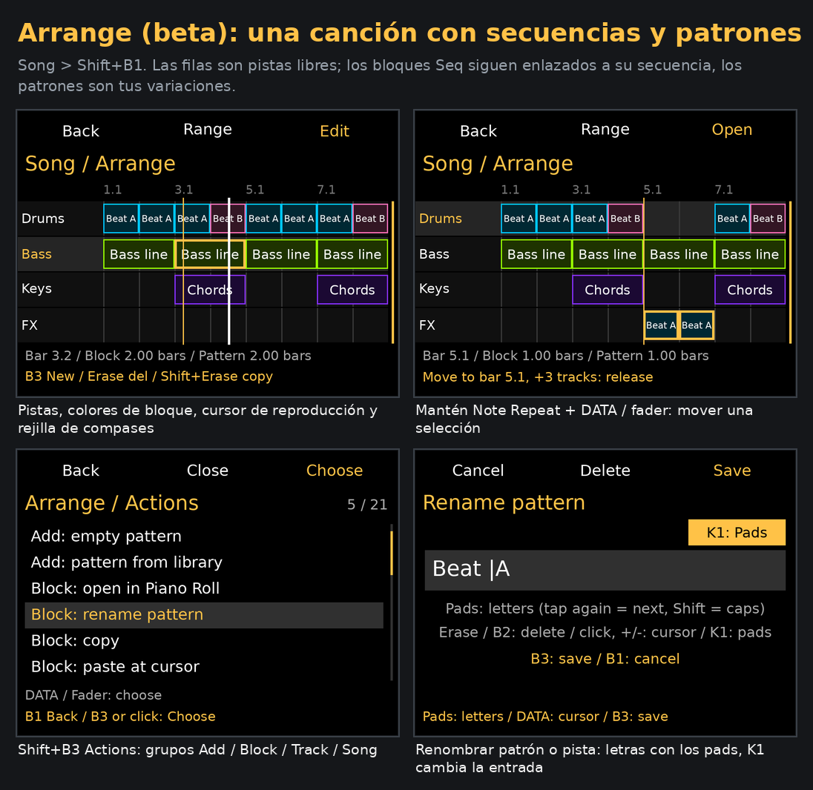

# Guía de Arrange (r31a, beta)

Arrange construye una canción en una línea de tiempo. Las filas son pistas libres (no pistas del mezclador); en ellas se colocan **bloques** y todas las filas suenan a la vez. Un bloque es una ventana a una de dos fuentes:

- **Bloque Seq**: una vista en vivo de una secuencia original. Siempre reproduce la versión actual de la secuencia, así que una secuencia regrabada suena en Arrange al instante. Editar un bloque Seq edita la propia secuencia.
- **Patrón**: tu propia copia. Se construye con eventos de secuencias, vive en el proyecto y no cambia cuando se regraba la secuencia de origen. Usa patrones para las variaciones.

El arreglo se guarda dentro del proyecto. El firmware original y las versiones anteriores de Am MOD no conocen estos campos y pueden perderlos al guardar el mismo proyecto: guarda una copia aparte de los proyectos que arregles.

*Las imágenes salen del pintor de producción en un entorno QEMU con una fuente sustituta; el contenido son datos de prueba, no una foto del equipo.*

## Abrir y salir

| Acción | Resultado |
|---|---|
| Pantalla Song, transporte parado: **Shift+B1** | Abre Arrange |
| **B1** | Atrás: cancela una edición, cierra un menú, quita la selección; con la pantalla limpia vuelve a la Song secuencial |
| **Shift+B1** | Exportar el arreglo con el menú original Song Export (ver *Exportar*) |

## Moverse por la línea de tiempo

| Control | Resultado |
|---|---|
| **DATA** | Mueve el cursor según la rejilla |
| **Shift+DATA** | Zoom |
| **Stop + DATA** izquierda / derecha | Ir al inicio / al final del último bloque |
| **Fader** | Elegir fila |
| **Shift+Fader** | Altura de las filas (3–6 filas en pantalla) |
| **K1 / K2 / K3** | Desplazar filas / tamaño de rejilla (1/4 de tiempo … 1 compás) / desplazar el tiempo |

La rejilla sigue los compases (los tiempos con más zoom) y se desplaza con los bloques. La línea de estado muestra el cursor como compás.tiempo y la longitud del bloque.

## Añadir bloques

- **Toca un pad de secuencia** (el banco de pads elige el grupo de secuencias): Arrange pregunta *Add Seq NN here?*; **B3** o un clic de DATA añade un bloque Seq en vivo en el cursor de la fila actual.
- **B3 New** en un lugar vacío lista las secuencias con notas y *Empty pattern*. Con **B2 Range** activo, New crea un patrón vacío con la longitud del rango.
- **Shift+B3 → Actions → Add: pattern from library** inserta un patrón existente.

Seq 128 es la ranura de servicio desde la que suena Arrange; no la uses para tu material.

## Seleccionar, editar, mover

| Control | Resultado |
|---|---|
| **Clic de DATA** | Seleccionar / deseleccionar el bloque bajo el cursor |
| Mantener **DATA** + girar / mover el fader | Dibuja un rango sobre varias filas; al soltar se seleccionan todos los bloques dentro (un solo marco) |
| **B3 Edit** en un bloque seleccionado | Vista previa: DATA tiempo, fader fila, K3 longitud; **B3** aplica, **B1** cancela |
| Mantener **Note Repeat** + DATA / fader | Mover el bloque o la selección (se dibujan en su nuevo lugar); al soltar se aplica |
| **Erase** | Borrar el bloque o la selección |
| **Shift+Erase** | Copiar el bloque (o la selección) justo después |
| **Chop** | Cortar el bloque en el cursor |
| **Shift+ − / +** | Deshacer / Rehacer |

Los bloques usan el color de su secuencia; los patrones, un color de la paleta. El nombre va centrado en el bloque.

## Actions (Shift+B3)

Lista agrupada; gira DATA o mueve el fader y pulsa clic o B3.

- **Add:** current sequence · empty pattern · pattern from library
- **Block:** open in Piano Roll · rename pattern · copy · paste at cursor · move selection here · extend one cycle · trim end to cursor · join next block · make variation · delete
- **Track:** add · rename · mute · solo · delete (pide confirmación)
- **Song:** +4 bars · −4 bars · render to current sequence

## Renombrar patrones y pistas

*Block: rename pattern* y *Track: rename* usan la entrada de texto del mod, como en el explorador y el mezclador: los pads escriben letras (otro toque, la letra siguiente; Shift, mayúsculas), DATA mueve el cursor, Erase o B2 borran, **K1** cambia entre pads y encoder (se muestra arriba a la derecha), **B3** guarda, **B1** cancela. Los pads se iluminan con sus letras. Renombrar un bloque Seq solo cambia la etiqueta del bloque; la secuencia original conserva su nombre.

## Reproducir

| Control | Resultado |
|---|---|
| **Play** | Reproducir el arreglo desde el inicio |
| **Shift+Play** | Reproducir desde el cursor |
| **Stop** | Parar |
| **Loop** (encendido si está activo) | Repetir el rango, la selección, el bloque bajo el cursor o toda la canción, redondeado a compases. Se aplica desde el siguiente Play |

Un cursor blanco sigue la canción y la vista se desplaza con él. La reproducción se detiene al final del último bloque. Las ediciones durante la reproducción (mover, copiar, borrar bloques, editar un bloque Seq) se vuelven a renderizar y se oyen sin parar.

Mientras suena Song o Arrange **el mezclador no se abre** (la pantalla Song original no puede volver a abrirse durante la reproducción). Para primero y luego usa Knob FX.

## Editar un bloque en el Piano Roll

Abre un bloque con **B3 Open**, **Shift+clic de DATA** o *Block: open in Piano Roll*. El Piano Roll se abre sobre Arrange (B1 vuelve). La cabecera muestra la posición del bloque en la canción (por ejemplo `3.1-5.1`), la regla cuenta compases de la canción y cada fila muestra su pad y el inicio del nombre del sample.

| Control | Resultado |
|---|---|
| Play / Shift+Play / Stop | Igual que en la línea de tiempo; el cursor avanza dentro del bloque |
| **Shift+B2** | Follow sí / no |
| **Loop** | Repetir este bloque (independiente del loop de la línea de tiempo) |
| **Pad** | Ir a su fila; en una celda vacía **clic** o **B3** inserta un evento |
| **Shift+pads** (o mantener **B2** + pads) | Seleccionar filas completas; se pueden varias |
| Mantener **B2** + pads y luego **B3** | Separate: llevar las filas seleccionadas a un patrón propio |
| **Shift+Erase** | Copiar la selección; sin selección, pegar en el cursor. El portapapeles se conserva al abrir otro bloque, así puedes copiar de una secuencia a un patrón |
| **Erase** | Borrar la selección al soltar; Erase + pad vacía esa fila |
| Mantener **Note Repeat** + DATA / fader | Mover los eventos seleccionados; al soltar se aplica |
| **Shift+ − / +** | Deshacer / Rehacer (un bloque Seq usa el historial original de la secuencia) |
| Stop + DATA | Ir al inicio / final del bloque |

No se puede abrir un bloque mientras suena la canción, pero sí iniciar la reproducción desde un bloque abierto; tus ediciones se vuelven a renderizar y se oyen mientras suena.

## Exportar

**Shift+B1** en Arrange renderiza el arreglo en Seq 128, deja la Song con ese único paso y abre el menú original **Song Export** (mezcla, stems). Tus pasos de Song se restauran al terminar. El menú Export abierto desde Arrange no vuelve a ofrecer Arrange.

## Límites en r31a

- Todavía no hay grabación en Arrange (Rec, tomas de audio) ni secciones con nombre; las canciones muy largas (más de 128 compases) aún no se admiten.
- Después de usar Arrange la secuencia actual puede quedar en Seq 128.
- El mezclador no se abre mientras suena Song o Arrange.
- La importación de archivos MIDI a patrones está prevista.

[Notas de la versión](RELEASE_NOTES-r31a.es.md) · [README](../README.es.md)
