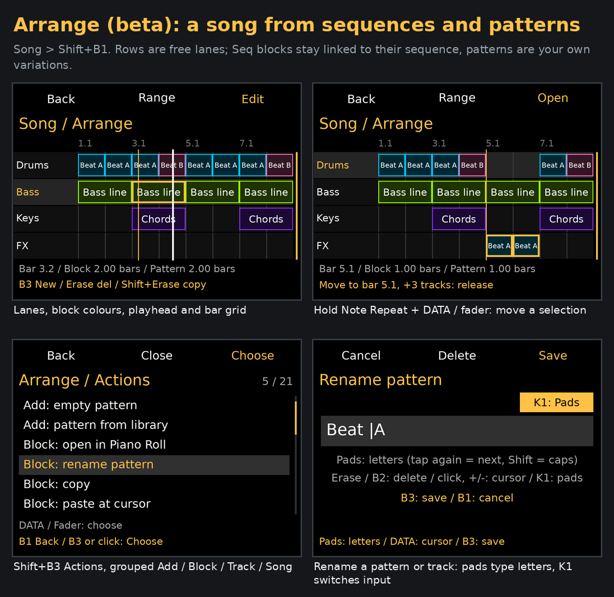

# Arrange guide (r31a, beta)

Arrange builds a song on a timeline. Rows are free lanes (not Mixer tracks); you place **blocks** on them, and all rows play together. A block is a window into one of two sources:

- **Seq block**: a live view of a stock sequence. It always plays the sequence's current version, so a re-recorded sequence sounds in Arrange at once. Editing a Seq block edits the sequence itself.
- **Pattern**: your own copy. It is built from sequence events, lives in the project, and does not change when the source sequence is re-recorded. Use patterns for variations.

The arrangement is saved inside the project. Stock firmware and older Am MOD versions do not know these fields and may drop them when they save the same project, so keep a separate copy of projects you arrange.

*Pictures come from the production painter in a QEMU fixture with a substitute font; the content is test data, not a hardware photo.*

## Open and leave

| Action | Result |
|---|---|
| Song screen, transport stopped: **Shift+B1** | Opens Arrange |
| **B1** | Back: cancels an edit, closes a menu, clears the selection; on a clean screen returns to the sequential Song |
| **Shift+B1** | Export the arrangement through the stock Song Export menu (see *Export*) |

## Move around the timeline

| Control | Result |
|---|---|
| **DATA** | Move the cursor by the grid |
| **Shift+DATA** | Zoom in / out |
| **Stop + DATA** left / right | Jump to the start / to the end of the last block |
| **Fader** | Choose a row |
| **Shift+Fader** | Row height (3–6 rows on screen) |
| **K1 / K2 / K3** | Scroll rows / grid size (1/4 beat … 1 bar) / scroll time |

The grid follows bar lines (beats when zoomed in) and scrolls with the blocks. The status line shows the cursor as bar.beat and the length of the block under it.

## Add blocks

- **Tap a sequence pad** (the pad bank selects the sequence group): Arrange asks *Add Seq NN here?*; **B3** or a DATA click adds a live Seq block at the cursor on the current row. Tap another pad to pick another sequence.
- **B3 New** on an empty place lists the sequences that have notes, plus *Empty pattern*. With **B2 Range** on, New creates an empty pattern as long as the range.
- **Shift+B3 → Actions → Add: pattern from library** inserts a pattern you already have.

Seq 128 is the service slot Arrange plays from; do not use it for your own material.

## Select, edit, move

| Control | Result |
|---|---|
| **DATA click** | Select / deselect the block under the cursor |
| Hold **DATA** + turn / move the fader | Draw a range across rows; on release every block inside is selected (one rectangle frame) |
| **B3 Edit** on a selected block | Preview: DATA time, fader row, K3 length; **B3** applies, **B1** cancels |
| Hold **Note Repeat** + DATA / fader | Move the block or the whole selection (the blocks are drawn at their new place); release applies |
| **Erase** | Delete the block or the selection |
| **Shift+Erase** | Copy the block (or the selection) right after itself |
| **Chop** | Cut the block at the cursor |
| **Shift+ − / +** | Undo / Redo |

Blocks use the colour of their sequence; patterns get a palette colour. Names are centred in the block.

## Actions (Shift+B3)

Grouped list; turn DATA or move the fader, then click or press B3.

- **Add:** current sequence · empty pattern · pattern from library
- **Block:** open in Piano Roll · rename pattern · copy · paste at cursor · move selection here · extend one cycle · trim end to cursor · join next block · make variation · delete
- **Track:** add · rename · mute · solo · delete (asks for confirmation)
- **Song:** +4 bars · −4 bars · render to current sequence

## Rename patterns and tracks

*Block: rename pattern* and *Track: rename* use the Mod text input, as in the browser and the Mixer: pads type letters (tap again for the next letter, Shift for capitals), DATA moves the cursor, Erase or B2 deletes, **K1** switches between pad and encoder input (shown top right), **B3** saves, **B1** cancels. The pads light with their letters. Renaming a Seq block renames the block's pattern label only; the stock sequence keeps its own name.

## Play

| Control | Result |
|---|---|
| **Play** | Play the arrangement from the start |
| **Shift+Play** | Play from the cursor |
| **Stop** | Stop |
| **Loop** (lit when on) | Loop the range, the selection, the block under the cursor, or the whole song, rounded to bars. Takes effect from the next Play |

A white playhead follows the song and the view scrolls with it. Playback stops at the end of the last block. Edits made while the song plays (moving, copying, deleting blocks, editing a Seq block) are rendered again and heard without stopping.

While Song or Arrange plays, **the Mixer does not open** (the stock Song screen cannot be re-entered during playback). Stop first, then use Knob FX.

## Edit a block in the Piano Roll

Open a block with **B3 Open**, **Shift+DATA click** or *Block: open in Piano Roll*. The Piano Roll opens on top of Arrange (B1 returns). The header shows the block's position in the song (for example `3.1-5.1`), the ruler counts song bars, and each row shows its pad and the beginning of the sample name.

| Control | Result |
|---|---|
| Play / Shift+Play / Stop | Same as on the timeline; the playhead runs inside the block |
| **Shift+B2** | Follow on / off |
| **Loop** | Loop this block (separate from the timeline loop) |
| **Pad** | Go to that row; on an empty cell **click** or **B3** inserts an event |
| **Shift+pads** (or hold **B2** + pads) | Select whole rows; several rows can be selected |
| Hold **B2** + pads, then **B3** | Separate: move the selected rows into their own pattern |
| **Shift+Erase** | Copy the selection; with nothing selected, paste at the cursor. The clipboard is kept when you open another block, so you can copy from a sequence into a pattern |
| **Erase** | Delete the selection on release; Erase + pad clears that row |
| Hold **Note Repeat** + DATA / fader | Move the selected events; release applies |
| **Shift+ − / +** | Undo / Redo (a Seq block uses the stock sequence history) |
| Stop + DATA | Jump to the start / end of the block |

A block cannot be opened while the song plays, but you can start playback from an open block; your edits there are rendered again and heard while it plays.

## Export

**Shift+B1** in Arrange renders the arrangement into Seq 128, sets the Song to that single step and opens the stock **Song Export** menu (mixdown, stems). Your own Song steps are restored when the export flow ends. The Export menu opened from Arrange does not offer Arrange again.

## Limits in r31a

- No recording in Arrange yet (Rec, audio takes); no named song sections; very long songs (more than 128 bars) are not supported yet.
- After using Arrange the current sequence may be Seq 128.
- No Mixer while Song or Arrange plays.
- MIDI file import into patterns is planned.

[Release notes](RELEASE_NOTES-r31a.md) · [Known limitations](KNOWN_ISSUES.md) · [README](../README.md)
