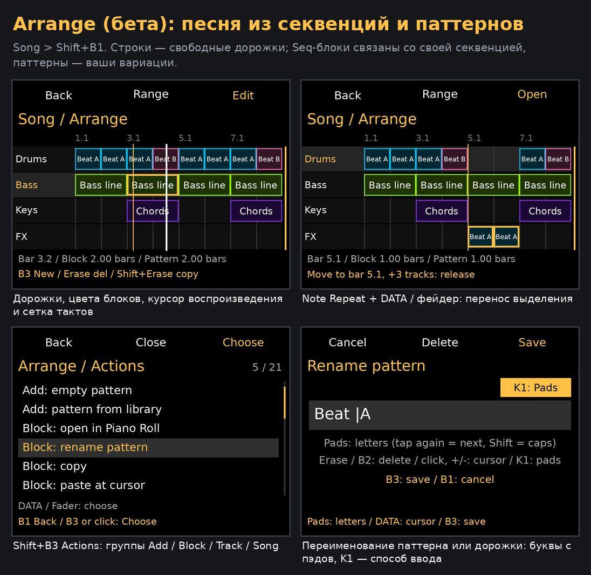

# Руководство по Arrange (r31a, бета)

Arrange собирает песню на временной шкале. Строки — это свободные дорожки (не треки микшера); на них ставятся **блоки**, все строки звучат одновременно. Блок — это окно в один из двух источников:

- **Seq-блок** — живое окно в штатную секвенцию. Он всегда играет её текущую версию: перезаписанная секвенция сразу звучит в Arrange. Правка Seq-блока правит саму секвенцию.
- **Паттерн** — ваша собственная копия. Собирается из событий секвенций, хранится в проекте и не меняется, когда исходную секвенцию перезаписывают. Паттерны нужны для вариаций.

Аранжировка сохраняется внутри проекта. Штатная прошивка и старые версии Am MOD не знают этих полей и могут потерять их, если пересохранят тот же проект, поэтому держите отдельную копию проектов, которые аранжируете.

*Картинки сделаны рабочим отрисовщиком в QEMU-фикстуре с заменённым шрифтом; содержимое — тестовые данные, а не снимок устройства.*

## Вход и выход

| Действие | Результат |
|---|---|
| Экран Song, транспорт остановлен: **Shift+B1** | Открывает Arrange |
| **B1** | Назад: отменяет правку, закрывает меню, снимает выделение; на чистом экране возвращает к обычному Song |
| **Shift+B1** | Экспорт аранжировки через штатное меню Song Export (см. «Экспорт») |

## Перемещение по шкале

| Элемент | Результат |
|---|---|
| **DATA** | Курсор по сетке |
| **Shift+DATA** | Масштаб |
| **Stop + DATA** влево / вправо | В начало / в конец последнего блока |
| **Фейдер** | Выбор строки |
| **Shift+фейдер** | Высота строк (3–6 строк на экране) |
| **K1 / K2 / K3** | Прокрутка строк / шаг сетки (1/4 доли … 1 такт) / прокрутка времени |

Сетка идёт по тактам (при увеличении — по долям) и двигается вместе с блоками. Строка статуса показывает курсор как такт.доля и длину блока под ним.

## Добавление блоков

- **Нажмите пэд секвенции** (банк пэдов выбирает группу секвенций): Arrange спросит *Add Seq NN here?*; **B3** или клик DATA добавляет живой Seq-блок на курсор в текущей строке. Другой пэд — другая секвенция.
- **B3 New** на пустом месте показывает список секвенций с нотами и *Empty pattern*. Если включён **B2 Range**, New создаёт пустой паттерн длиной в диапазон.
- **Shift+B3 → Actions → Add: pattern from library** вставляет уже существующий паттерн.

Seq 128 — служебный слот, из которого играет Arrange; не используйте его для своего материала.

## Выделение, правка, перенос

| Элемент | Результат |
|---|---|
| **Клик DATA** | Выделить / снять выделение блока под курсором |
| Удерживать **DATA** + вращать / двигать фейдер | Рамка через несколько строк; после отпускания выделены все блоки внутри (одна общая рамка) |
| **B3 Edit** на выделенном блоке | Предпросмотр: DATA — время, фейдер — строка, K3 — длина; **B3** применяет, **B1** отменяет |
| Удерживать **Note Repeat** + DATA / фейдер | Перенос блока или всего выделения (блоки рисуются на новом месте); отпускание применяет |
| **Erase** | Удалить блок или выделение |
| **Shift+Erase** | Копия блока (или выделения) сразу после него |
| **Chop** | Разрезать блок на курсоре |
| **Shift+ − / +** | Undo / Redo |

Блоки окрашены цветом своей секвенции, паттерны получают цвет из палитры. Название пишется по центру блока.

## Actions (Shift+B3)

Сгруппированный список; DATA или фейдер, затем клик или B3.

- **Add:** current sequence · empty pattern · pattern from library
- **Block:** open in Piano Roll · rename pattern · copy · paste at cursor · move selection here · extend one cycle · trim end to cursor · join next block · make variation · delete
- **Track:** add · rename · mute · solo · delete (с подтверждением)
- **Song:** +4 bars · −4 bars · render to current sequence

## Переименование паттернов и дорожек

*Block: rename pattern* и *Track: rename* используют стандартный ввод мода, как в браузере и микшере: пэды набирают буквы (повторное нажатие — следующая буква, Shift — заглавные), DATA двигает курсор, Erase или B2 удаляют, **K1** переключает ввод между пэдами и энкодером (показано справа вверху), **B3** сохраняет, **B1** отменяет. Пэды подсвечиваются своими буквами. Переименование Seq-блока меняет только подпись блока; штатная секвенция сохраняет своё имя.

## Воспроизведение

| Элемент | Результат |
|---|---|
| **Play** | Играть аранжировку с начала |
| **Shift+Play** | Играть от курсора |
| **Stop** | Остановить |
| **Loop** (горит, когда включён) | Зациклить диапазон, выделение, блок под курсором или всю песню с округлением до тактов. Действует со следующего Play |

Белый курсор воспроизведения идёт по песне, вид прокручивается за ним. Воспроизведение останавливается в конце последнего блока. Правки во время воспроизведения (перенос, копирование, удаление блоков, правка Seq-блока) пересобираются и слышны без остановки.

Пока играет Song или Arrange, **микшер не открывается** (штатный экран Song нельзя открыть заново во время воспроизведения). Сначала Stop, затем Knob FX.

## Правка блока в пианоролле

Откройте блок через **B3 Open**, **Shift+клик DATA** или *Block: open in Piano Roll*. Пианоролл открывается поверх Arrange (B1 — назад). Заголовок показывает место блока в песне (например, `3.1-5.1`), линейка считает такты песни, в каждой строке — пэд и начало имени сэмпла.

| Элемент | Результат |
|---|---|
| Play / Shift+Play / Stop | Как на шкале; курсор воспроизведения идёт внутри блока |
| **Shift+B2** | Follow вкл / выкл |
| **Loop** | Цикл этого блока (отдельно от цикла шкалы) |
| **Пэд** | Перейти к его строке; на пустой клетке **клик** или **B3** вставляет событие |
| **Shift+пэды** (или удерживать **B2** + пэды) | Выделить строки целиком; можно несколько |
| Удерживать **B2** + пэды, затем **B3** | Separate: вынести выделенные строки в отдельный паттерн |
| **Shift+Erase** | Копировать выделение; без выделения — вставить на курсор. Буфер сохраняется при открытии другого блока, так можно копировать из секвенции в паттерн |
| **Erase** | Удалить выделение при отпускании; Erase + пэд очищает строку |
| Удерживать **Note Repeat** + DATA / фейдер | Перенос выделенных событий; отпускание применяет |
| **Shift+ − / +** | Undo / Redo (Seq-блок использует штатную историю секвенции) |
| Stop + DATA | В начало / конец блока |

Открыть блок во время воспроизведения нельзя, но запустить воспроизведение из открытого блока можно; правки в нём пересобираются и слышны во время игры.

## Экспорт

**Shift+B1** в Arrange рендерит аранжировку в Seq 128, ставит в Song один этот шаг и открывает штатное меню **Song Export** (сведение, стемы). Ваши шаги Song восстанавливаются после экспорта. Меню экспорта, открытое из Arrange, повторно Arrange не предлагает.

## Ограничения r31a

- Записи в Arrange пока нет (Rec, аудиодубли); нет именованных частей песни; очень длинные песни (больше 128 тактов) пока не поддерживаются.
- После работы в Arrange текущей секвенцией может остаться Seq 128.
- Во время воспроизведения Song или Arrange микшер не открывается.
- Импорт MIDI-файлов в паттерны — в планах.

[Изменения](RELEASE_NOTES-r31a.ru.md) · [Известные ограничения](KNOWN_ISSUES.ru.md) · [README](../README.ru.md)
