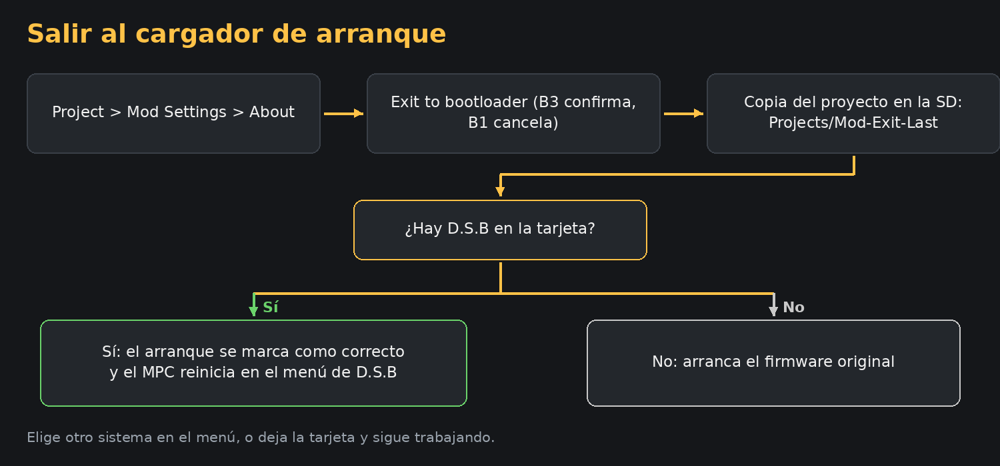

# Menús de arranque y salida al cargador (r30d)

[README](../README.es.md) · [Instalación](INSTALL.es.md) · [English](BOOTLOADERS.md) · [Русский](BOOTLOADERS.ru.md)

Am MOD ejecuta una copia de la aplicación desde la tarjeta SD y nunca flashea el MPC. Arranca desde una tarjeta normal o desde un menú de arranque **ya instalado** en la tarjeta. Los menús de arranque son proyectos de otros autores: Am MOD no los incluye, ni descarga, ni modifica.

## Qué se admite

| Disposición de la tarjeta | Dónde está Am MOD | Inicio | Exit to bootloader |
|---|---|---|---|
| Tarjeta normal | `autorun/` | automático al encender | vuelve al firmware original |
| **D.S.B Boot** (Henry Skillz) | `autorun/os/AM-Mod/` con `sampleboot.inplace` | elige **AM-Mod** en el menú de D.S.B | **vuelve al menú de D.S.B** |
| mpc-boot-thingy | `autorun/apps/am-mod/autorun/` con `boot.entry` en la carpeta superior | elige **AM Mod** | vuelve al firmware original |
| SampleBoot | se respeta el marcador `sampleboot.inplace` | elige la entrada | vuelve al firmware original; *prueba en dispositivo pendiente* |

El instalador 1.4.0 detecta la disposición y escribe en la carpeta correcta. Nunca sustituye la carpeta `autorun` raíz del menú de arranque. Usa exFAT y una etiqueta de volumen ASCII.

## Salir al cargador

1. Abre **Project → Mod Settings** y ve a la última pestaña, **About**.
2. Elige **Exit to bootloader**. La pantalla de confirmación indica: *Bootloader menu, or stock if none*.
3. Pulsa **B3** para confirmar (**B1** cancela).
4. Am MOD guarda una copia del proyecto actual en la tarjeta como **`Projects/Mod-Exit-Last`** (sustituye a la anterior), detiene la copia de la aplicación y vuelca la tarjeta.
5. Si la tarjeta contiene el menú D.S.B, Am MOD marca este arranque como **correcto** en el archivo de estado de D.S.B (no se cuenta ningún fallo y el mod no se inicia de nuevo automáticamente) y **reinicia en el menú de D.S.B**. Elige otro sistema, o Am MOD otra vez.
6. Si no hay D.S.B, el MPC arranca el firmware original.

Apagar y encender funciona como siempre; Exit to bootloader es la forma rápida de cambiar de sistema sin tocar el botón de encendido. **Idea de arranque rápido:** elige AM Mod una vez para que la tarjeta lo inicie directamente y usa Exit to bootloader cuando quieras otro sistema.

## Por qué D.S.B ya no ofrece Stock tras una sesión correcta

D.S.B marca un arranque como pendiente y cuenta un fallo si el sistema no informa «ok»; tras dos fallos Stock pasa a ser el predeterminado. En la disposición con carpeta de AM, el «ok» del menú caía en una copia local del archivo de estado y el archivo real conservaba la marca de pendiente. r30d copia el «ok» del propio D.S.B al archivo de estado real poco después del arranque (varias comprobaciones durante unos 70 segundos) y registra lo que hizo.

Diagnóstico que se escribe en `autorun/os/AM-Mod/` de la tarjeta (se sobrescribe en cada sesión):

| Archivo | Contenido |
|---|---|
| `dsb-boot.log` | diario de arranque de D.S.B (en el dispositivo solo vive en RAM; se copia para ti) |
| `dsb-state-fix.log` | lo que vio e hizo la corrección de estado |
| `MPC_MOD_EVENTS.txt`, `MPC_MOD_CONSOLE.txt`, `MPC_CLONE_TRIAL.txt` | los registros propios del mod |

Al informar de un problema de arranque, adjunta estos archivos e indica el menú de arranque y su versión.

## Límites

- Exit to bootloader entrega el control solo a **D.S.B**. Volver a SampleBoot o mpc-boot-thingy desde el mod no está implementado; una convención común de «un sistema puede volver al cargador» requeriría un acuerdo con los autores de esos proyectos.
- La compatibilidad con SampleBoot (un probador informó de un bloqueo al iniciar desde su menú, mientras que el mod funciona solo) y con mpc-boot-thingy sigue en pruebas.
- D.S.B muestra el nombre de la carpeta (**AM-Mod**), no la grafía del producto.
- En una tarjeta normal, el firmware original no tiene menú de cargador; para usar el original con una tarjeta de menú de arranque elige su entrada Stock o retira la tarjeta.

## Recuperación

Retira la tarjeta para arrancar el firmware original. Para deshacer una actualización restaura la copia de seguridad completa y correspondiente de `autorun` (el instalador guarda una en `~/AM-Mod-Backups/`). Tus proyectos van aparte: el mod no los copia. Consulta [Instalación](INSTALL.es.md).
