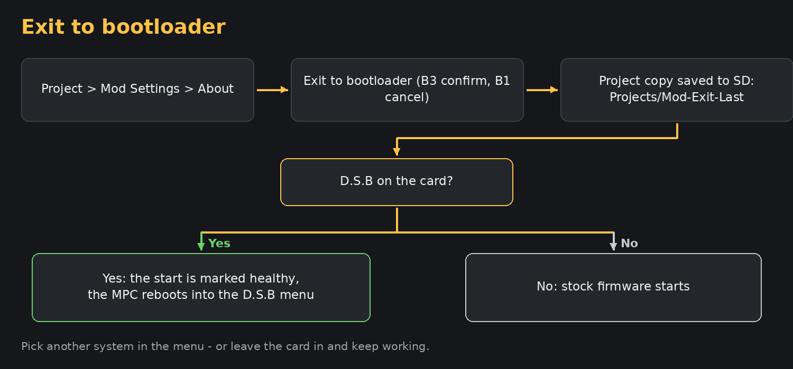

# Boot menus and exit to the bootloader (r30d)

[README](../README.md) · [Installation](INSTALL.md) · [Русский](BOOTLOADERS.ru.md) · [Español](BOOTLOADERS.es.md)

Am MOD runs an application copy from the SD card; it never flashes the MPC. It starts from a plain card or from a boot menu that is **already installed** on the card. Boot menus are separate projects by other authors. Am MOD does not bundle, download or modify them.

## What is supported

| Card layout | Where Am MOD lives | Start | Exit to bootloader |
|---|---|---|---|
| Plain card | `autorun/` | automatic at power-on | returns to stock firmware |
| **D.S.B Boot** (Henry Skillz) | `autorun/os/AM-Mod/` with `sampleboot.inplace` | choose **AM-Mod** in the D.S.B menu | **returns to the D.S.B menu** |
| mpc-boot-thingy | `autorun/apps/am-mod/autorun/` with `boot.entry` in the parent | choose **AM Mod** | returns to stock firmware |
| SampleBoot | marker `sampleboot.inplace` is honoured | choose the entry | returns to stock firmware; *device testing pending* |

The installer 1.4.0 detects the layout and writes to the right folder. It never replaces the boot menu's root `autorun` folder. Use exFAT and an ASCII volume label.

## Exit to bootloader

1. Open **Project → Mod Settings** and go to the last tab, **About**.
2. Choose **Exit to bootloader**. The confirmation screen says what will happen: *Bootloader menu, or stock if none*.
3. Press **B3** to confirm (**B1** cancels).
4. Am MOD saves a copy of the current project to the card as **`Projects/Mod-Exit-Last`** (it replaces the previous one), stops the application copy and flushes the card.
5. If the card contains the D.S.B menu, Am MOD marks this start as **healthy** in D.S.B's state file (no crash is counted and the mod is not started again automatically) and **reboots into the D.S.B menu**. Pick another system, or Am MOD again.
6. If there is no D.S.B, the MPC starts the stock firmware.

Power off/on works as before; Exit to bootloader is the quick way to switch systems without touching the power button. **Fast boot idea:** choose AM Mod once so the card starts it directly, and use Exit to bootloader whenever you want another system.

## Why D.S.B no longer offers Stock after a good session

D.S.B marks a start as pending and counts a crash if the system does not report “ok”; after two crashes it makes Stock the default. In the AM folder layout the menu's “ok” landed in a folder-local copy of the state file, so the real file kept the pending mark. r30d copies D.S.B's own “ok” to the real state file shortly after boot (a few checks within about 70 seconds) and records what it did.

Diagnostics written to `autorun/os/AM-Mod/` on the card (they are overwritten each session):

| File | Content |
|---|---|
| `dsb-boot.log` | D.S.B's boot journal (RAM only on the device, copied for you) |
| `dsb-state-fix.log` | what the state fix saw and did |
| `MPC_MOD_EVENTS.txt`, `MPC_MOD_CONSOLE.txt`, `MPC_CLONE_TRIAL.txt` | the mod's own logs |

When you report a boot problem, attach these files and name the boot menu and its version.

## Limits

- Exit to bootloader hands over to **D.S.B** only. Returning to SampleBoot or mpc-boot-thingy from the mod is not implemented; a common “an OS may return to the loader” convention would need an agreement with those projects' authors.
- Compatibility with SampleBoot (a tester reported a freeze when starting from its menu while the mod works alone) and mpc-boot-thingy is still being tested.
- D.S.B shows the folder name (**AM-Mod**), not the product spelling.
- In stock mode and on a plain card, the stock firmware has no loader menu; to run stock on a boot-menu card choose its Stock entry or remove the card.

## Recovery

Remove the card to start stock firmware. To undo an update restore the complete matching `autorun` backup (the installer keeps one in `~/AM-Mod-Backups/`). Your projects are separate: the mod does not back them up. See [Installation](INSTALL.md).
