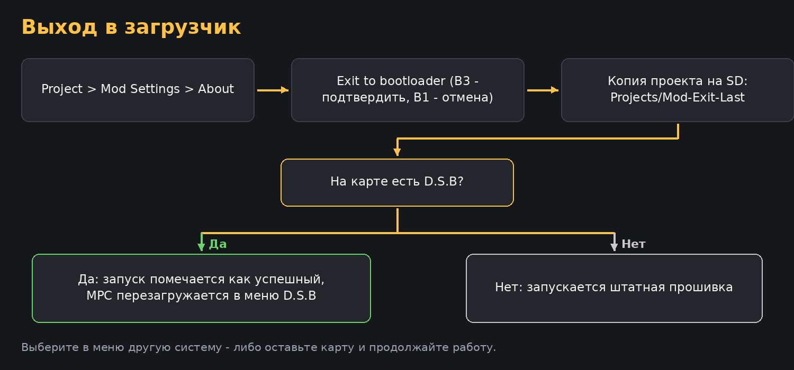

# Меню загрузки и выход в загрузчик (r30d)

[README](../README.ru.md) · [Установка](INSTALL.ru.md) · [English](BOOTLOADERS.md) · [Español](BOOTLOADERS.es.md)

Am MOD запускает копию приложения с SD-карты и не прошивает MPC. Он стартует с обычной карты или из меню загрузки, **уже установленного** на карте. Меню загрузки — отдельные проекты других авторов; Am MOD их не включает, не скачивает и не изменяет.

## Что поддерживается

| Раскладка карты | Где лежит Am MOD | Запуск | Exit to bootloader |
|---|---|---|---|
| Обычная карта | `autorun/` | автоматически при включении | возвращает штатную прошивку |
| **D.S.B Boot** (Henry Skillz) | `autorun/os/AM-Mod/` и `sampleboot.inplace` | выберите **AM-Mod** в меню D.S.B | **возвращает в меню D.S.B** |
| mpc-boot-thingy | `autorun/apps/am-mod/autorun/`, `boot.entry` в родительской папке | выберите **AM Mod** | возвращает штатную прошивку |
| **SampleBoot** (pxcm) | `autorun/mods/AM-Mod/` с `sampleboot.inplace` | выберите **Am MOD** в меню SampleBoot | **возвращает в меню SampleBoot** |

Установщик 1.5.0 определяет раскладку и пишет в нужную папку. Корневую папку `autorun` меню загрузки он никогда не заменяет. Используйте exFAT и латинское имя тома.

## Выход в загрузчик

1. Откройте **Project → Mod Settings** и перейдите на последнюю вкладку **About**.
2. Выберите **Exit to bootloader**. Экран подтверждения сообщает: *Bootloader menu, or stock if none*.
3. Нажмите **B3**, чтобы подтвердить (**B1** — отмена).
4. Am MOD сохраняет копию текущего проекта на карту как **`Projects/Mod-Exit-Last`** (заменяя предыдущую), останавливает копию приложения и сбрасывает буферы на карту.
5. Если на карте есть меню D.S.B, Am MOD отмечает этот запуск как **успешный** в файле состояния D.S.B (сбой не засчитывается, мод автоматически не стартует повторно) и **перезагружает MPC в меню D.S.B**. Выберите другую систему либо снова Am MOD.
6. Если на карте SampleBoot, Am MOD перезагружает MPC, и SampleBoot показывает своё меню (запомненного выбора у него нет, перезагрузки достаточно).
7. Если меню загрузки нет, MPC запускает штатную прошивку.

Выключение/включение питания работает как раньше; Exit to bootloader — быстрый способ сменить систему, не трогая кнопку питания. **Идея быстрой загрузки:** один раз выберите AM Mod, чтобы карта стартовала его сразу, а когда нужна другая система — используйте Exit to bootloader.

## Почему D.S.B больше не предлагает Stock после удачного сеанса

D.S.B отмечает запуск как «ожидающий» и засчитывает сбой, если система не сообщила «ok»; после двух сбоев по умолчанию выбирается Stock. В раскладке с папкой AM «ok» меню попадал в локальную копию файла состояния, а настоящий файл сохранял отметку ожидания. r30d вскоре после загрузки копирует «ok» самого D.S.B в настоящий файл состояния (несколько проверок в течение ~70 секунд) и записывает, что сделал.

Диагностика, которая пишется в `autorun/os/AM-Mod/` на карте (перезаписывается каждый сеанс):

| Файл | Содержимое |
|---|---|
| `dsb-boot.log` | журнал загрузки D.S.B (на устройстве живёт только в RAM, копируется для вас) |
| `dsb-state-fix.log` | что увидело и сделало исправление состояния |
| `MPC_MOD_EVENTS.txt`, `MPC_MOD_CONSOLE.txt`, `MPC_CLONE_TRIAL.txt` | собственные журналы мода |

Сообщая о проблеме загрузки, приложите эти файлы и назовите меню загрузки и его версию.

## Ограничения

- Exit to bootloader передаёт управление **D.S.B** и **SampleBoot**. Возврат в mpc-boot-thingy из мода не реализован; общая договорённость «система может вернуться в загрузчик» потребует согласия автора этого проекта.
- SampleBoot: если его настройка `ROOT_FILES` показывает в `mods/` файл из корня карты (по умолчанию `mpcqol.conf`, если он есть), проверка песочницы Am MOD не даёт запуститься. Задайте `ROOT_FILES=""` в `autorun/sampleboot/sampleboot.conf`; SampQOL тогда не видит свои настройки из корня карты.
- Совместимость с mpc-boot-thingy ещё тестируется.
- D.S.B показывает имя папки (**AM-Mod**), а не фирменное написание.
- На обычной карте у штатной прошивки нет меню загрузчика; чтобы запустить Stock с картой меню загрузки, выберите её пункт Stock или извлеките карту.

## Восстановление

Извлеките карту — запустится штатная прошивка. Чтобы откатить обновление, восстановите полную соответствующую резервную копию `autorun` (установщик хранит её в `~/AM-Mod-Backups/`). Проекты — отдельно: мод их не копирует. См. [Установку](INSTALL.ru.md).
