# Updated FX gallery — r30b

[README](../README.md) · [Русский README](../README.ru.md)

These GIFs are rendered from the production C painter with synthetic PCM/meters and a substitute DejaVu Sans font. They are **not recordings from a physical MPC**. Actual knob values are shown; the animation is a UI demonstration, not an audio comparison. Amp voices are presets of the existing AIR Amp Sim.

## Tape Delay

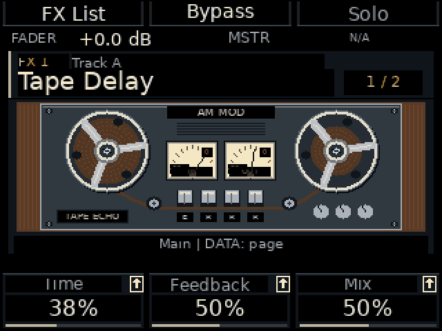

## Tape

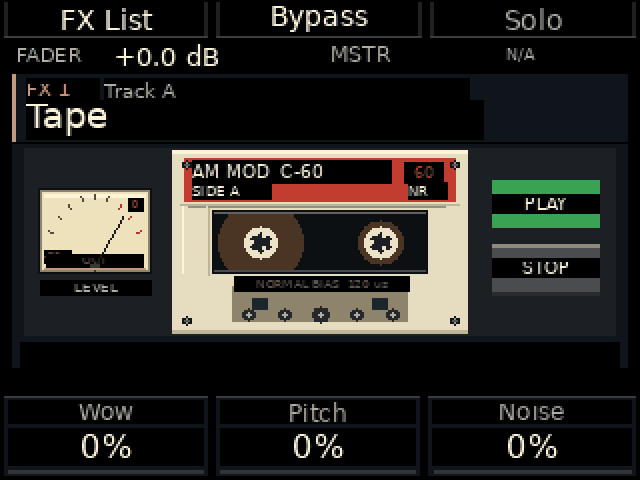

## Vinyl

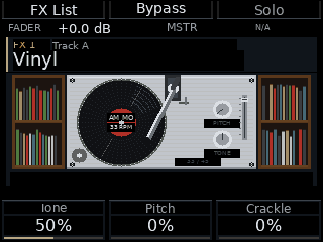

## Shimmer Reverb

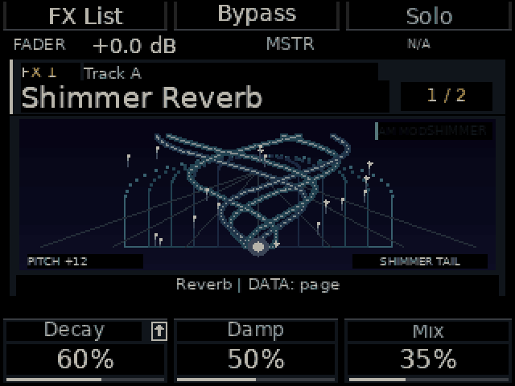

## Delay

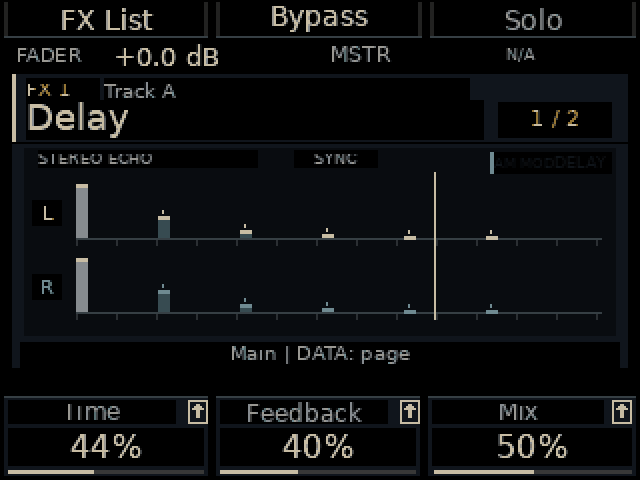

## Diff Delay

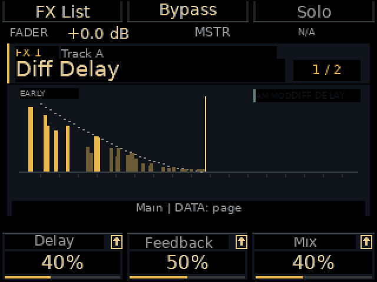

## Spring Reverb

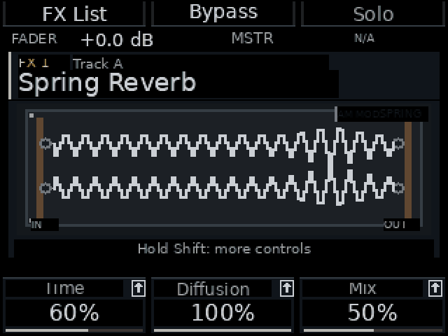

## Phaser

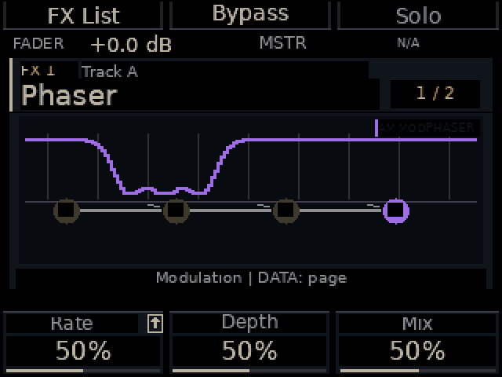

## Flanger

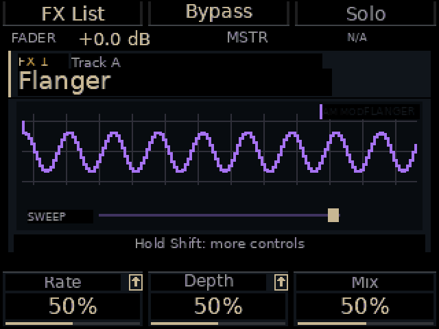

## Amp Sim — Original, guitar and bass voices

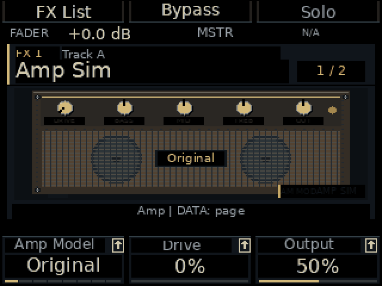

## Bass voices

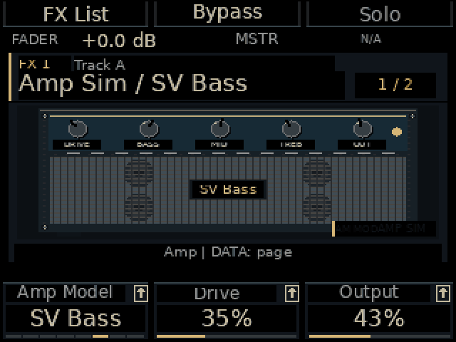

## OptoCat Comp

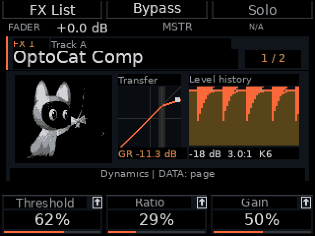

## Reproduce

Linux/WSL, gcc, Python, Pillow and DejaVu Sans; no firmware is needed:

```bash
cd sd-mod-session
python3 -m venv build/media-venv
build/media-venv/bin/python -m pip install Pillow
build/media-venv/bin/python build_fx_gifs.py
```

The script builds the actual painter and resolves catalogue indexes from the code. Source hashes and GIF hashes are written to `build/fx-gifs/verification.json`. Older gallery GIFs not listed above belong to earlier documentation and are retained for history.
