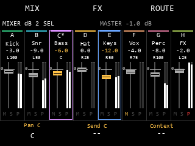
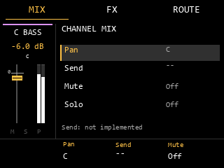
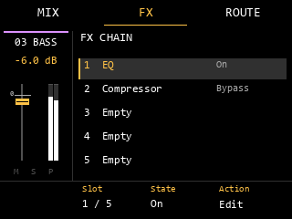
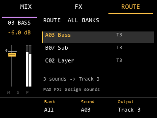
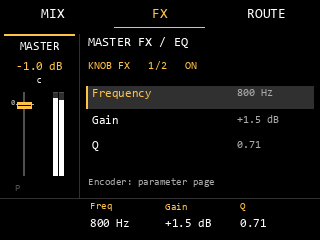
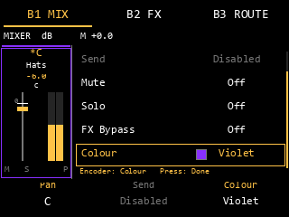
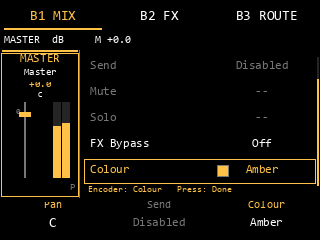

# AM Mod — Mixer, Song Mode & Stems: Classic Console UI

Статус: архитектурное задание и поэтапная реализация, обновлено04.11.2026.
Ветка: `feature/mixer-song-stems`.
Основа аудита исходников: `am-mod/main`, `160cee8` (r26s).
Первый пакет: [audio hooks, block updates и C painter](MIXER_STEP1.md).
Второй пакет в работе: [controller, FX pages и audio→archive ack](MIXER_STEP2.md).
Experimental candidate автоматически создаёт сессию по снимку живого
аудиовызова и подключает её к UI. Восемь Track, primary-output Master, updates,
ввод и lifecycle проверены в ARM/QEMU. Assign получает маску занятых звуков
из native owner queue; Bank, +/− и K3 переключают все восемь банков.
Тракт физических LED подключён с приоритетами штатных слоёв и голосов,
проверен на ARM/QEMU с подменённым получателем. Native FX работают на Track/Master
с живым transport clock; [проверены все 25 эффектов каталога](MIXER_STEP2.md).
Пользовательские цвета доступны в B1 MIX через K3 и энкодер. Впереди полный XPJ
round-trip, аппаратная проверка, Song Mode и стемы.

Продолжение реализации: [native audit и ARM-проверки](MIXER_NATIVE_AUDIT.md),
[Mixer data model V1 и codec](MIXER_DATA_MODEL.md).
[PCM metering core](MIXER_METERING.md) получает данные Track и Master из
подключённых точек аудиотракта.
04.11 добавлен [экспериментальный archive bridge](MIXER_ARCHIVE.md) в Save/Load/New
callbacks под отдельным build flag. Полный XPJ round-trip и аппаратный Save/Load
ещё не подтверждены; обычная сборка этот флаг не включает.
Также реализован [eight-bus PCM core](MIXER_BUSES.md): реальные Track/Direct/Master
buffers и FX/mix/meters. [Scoped native adapter](MIXER_NATIVE_ADAPTER.md) проверяет
отдельный Pad-buffer путь через новый граф в ARM/QEMU; [live layer](MIXER_STEP1.md)
добавляет installer, atomic session handoff и Master после engine mix.
Shared/physical и другие неподдержанные Pad пути сохраняют штатную обработку.
Для default Instrument path проверены native allocated buffers, existing Pad EQ,
Program gain и полный 64-frame voice walk с fixture oscillators. Адаптер теперь
публикует настоящие Track/Direct meter snapshots. Его промежуточный Master — N/A;
live layer отдельно измеряет реальный physical pair0 после нижестоящего микса.

Приоритет требований: Classic Console Layout → дополнение B1–B3 / Routing LEDs
→ исходное задание Mixer / Song / Stems. В частности, Pads 9–15 пока свободны,
а не дублируют MIX, FX и ROUTE из первоначальной предварительной раскладки.
Работа остаётся в feature-ветке; merge в main, публикация и изменение стабильных
release artifacts в этот этап не входят.

## 1. Проверенная основа и незакрытые вопросы

Продолжение аудита с исполняемыми ARM/QEMU проверками resolver, stereo summing
и Song/Seq export entry: [MIXER_NATIVE_AUDIT.md](MIXER_NATIVE_AUDIT.md).
Полный Phase 0 остаётся открытым; проверенные entry points не равны live-интеграции.

| Что установлено по исходникам | Основание | Следствие для Mixer |
|---|---|---|
| Рабочая система координат UI — **320×240** | [`resample_view.h`](../sd-mod-session/src/resample_view.h), `resample_view_paint()` в [`resample_view.c`](../sd-mod-session/src/resample_view.c), `paint()` в [`compressor_ui.c`](../sd-mod-session/src/compressor_ui.c) | Проектировать в этих пикселях, без масштабирования desktop-макета |
| Верхние кнопки занимают примерно y=5…29; нижние K-панели начинаются с y=198 | Те же painter и compressor UI | Сохранить знакомые три верхние вкладки и три нижние подписи |
| Существующий software Image имеет 320×164, 4 байта/пиксель, stride 1280; выводится с y=34 | `compressor_image_pixels()` / `compressor_image_draw()` в [`compressor_image.cc`](../sd-mod-session/src/compressor_image.cc) | Это промежуточное изображение компрессора, **не** размер физического framebuffer; не копировать его ABI как новый экран |
| Лёгкие rect/text уже доступны через native Graphics | `resample_painter`, compressor UI | Использовать существующий painter/Graphics, без нового UI toolkit |
| Реальные stereo PCM input/output peaks уже измеряются у принадлежащего моду компрессора | `process_owned()` / `compressor_meter_levels()` в [`compressor_native.c`](../sd-mod-session/src/compressor_native.c) | Полезный образец audio-owned telemetry, но не meters восьми Track и не гарантированный final Master tap |
| Готовая FX-модель ограничена пятью слотами, 32 параметрами на слот; prepare/reclaim вне audio callback | [`fx_chain.h`](../sd-mod-session/src/fx_chain.h), [`fx_chain.c`](../sd-mod-session/src/fx_chain.c) | Повторно использовать проверяемые контракты, отдельно доказав live-интеграцию и CPU-бюджет |
| Pad render/output stream — отдельный offline путь с явным владением PCM | [`pad_render.h`](../sd-mod-session/src/pad_render.h), [`pad_output_stream.h`](../sd-mod-session/src/pad_output_stream.h), [`pad_native_block.h`](../sd-mod-session/src/pad_native_block.h) | Наличие PCM исходного Sample не доказывает доступность обработанного live-сигнала пэда |
| Native renderer/resample имеет существующий offline loop и writer | `frame()` / `buffer_peak()` в [`resample_fast_native.cc`](../sd-mod-session/src/resample_fast_native.cc), [`resample_stock.cc`](../sd-mod-session/src/resample_stock.cc) | Кандидат для дальнейшего аудита общего рендера, не готовый SongRenderer |
| Ввод и LED имеют нескольких владельцев и очередь с поколениями | [`phone_native.c`](../sd-mod-session/src/phone_native.c), [`phone_events.h`](../sd-mod-session/src/phone_events.h), [`resample_ui.cc`](../sd-mod-session/src/resample_ui.cc), [`resample_simple_ui.cc`](../sd-mod-session/src/resample_simple_ui.cc) | Встраивать явного владельца Mixer, проверяя фактически собираемый UI adapter |

Полноэкранного mmap framebuffer в проверенном UI-пути нет: мод рисует через
native Graphics. 320×240 подтверждено границами действующих экранов; physical
framebuffer format/stride здесь не измерены. Перед подключением Mixer проверить
bounds/clip реального Graphics target на устройстве. Не выдавать stride 1280
вспомогательного Image за измерение framebuffer устройства.

Остаются обязательными отдельные исследования: точка live PCM после индивидуальной
обработки каждого пэда до суммирования; порядок всех штатных Master FX и финального
gain; внутренние Song Part/repeat/tempo boundaries; Song Export и хвосты;
восстановление при Mod Off; сериализация новых данных. Полный Phase 0 этим UI-аудитом
не закрыт. Адреса/ABI из pinned 1.3.0.12 нельзя переносить на другую прошивку
без проверки сигнатур и времени жизни объектов.

## 2. Аудиоданные существуют независимо от открытой вкладки

Проверенные участки текущего кода, без предположений о наличии восьми шин:

```text
Sample PCM -> offline pad_render / FX chain -> owned PCM / output stream
Native render loop -> native output buffers -> WAV writer
Bound Master compressor PCM -> actual input/output telemetry
```

Это отдельные найденные участки, а не доказанная сквозная схема всего live-движка.
Целевая схема после подтверждения точки перехвата:

```text
Pad -> existing individual processing -> project Pad Output
  Track A..H -> Track FX -> Level/Pan -> Mute/Solo gate -> Track PCM tap --+
  Master    -> Master Direct PCM tap ----------------------------------+-> sum
  future sends -> return buses (explicit routing/export policy required)+
  sum -> Master FX -> Master Level -> final Master PCM tap -> output

Song Arrangement -> shared Playback Plan -> same routing/FX/buses
                                          -> live / mixdown / stems
```

Track meter показывает post-FX, post-Level/Pan, post-Mute/Solo PCM перед суммой.
Master meter — final Master PCM после Master FX/Level перед output.
Master Direct не является девятой пользовательской дорожкой и не содержит Track A–H.
Meter tap не меняется при B1/B2/B3, bypass или открытии редактора.
Pre-gate sidechain tap, если понадобится, существует отдельно и не подменяет meter.
Нельзя использовать compressor input/output meter как final Master без проверки
его места в реальном тракте. Если фактический порядок отличается от схемы,
сначала документировать и проверить адаптацию, затем подключать UI.

Единственные сохраняемые данные проекта: восемь Track (Level, Pan, Mute/Solo,
имя, цвет, FX и будущие Send), Master, общая таблица `Pad Output = Master / A..H`
для всех банков. В старом проекте все Outputs = Master, gain unity, новые FX
неактивны; никакой обязательной конвертации. Pad Settings, B3 и PAD FX используют
один объект и один путь изменения/сохранения, без параллельных таблиц UI.
Save/Save As/Load/перезапуск и Mod Off требуют отдельных интеграционных проверок.

Mix Scene принадлежит Song Part, а не Sequence или вкладке Mixer; без Scene
действуют настройки проекта. Scene может менять микс, но не скрыто менять Pad Output.
Применение Scene выполняет playback/control owner на границе части, без участия paint.
План сохраняет sequence/repeats, tempo, time signature, границы и хвосты, не меняя
исходные Sequence. Live, mixdown и stems используют те же состояния и шины;
стемы имеют общий frame origin и длину. UI не реализует отдельный экспорт через
последовательное Solo. При sidechain источник продолжает рассчитываться даже для
неэкспортируемого канала. Политика нелинейных Master FX и Send returns должна быть
определена отдельно: сумма dry/pre-master stems не обязана совпадать с Master Mix.

## 3. Main Mixer Overview: восемь полосок без прокрутки

Короткое Shift+Pad9 открывает **Overview**, даже если предыдущий сеанс завершился
во вкладке или PAD/KNOB FX. Начальный выбор — последний валидный Track, иначе Track A.
Master выбирается Pad16; девятой колонки нет. При выбранном Master Overview
сохраняет восемь Track strips, а заголовок явно показывает `MASTER` и его Level.
B1/B2/B3 или KNOB FX затем показывают detail с Master Strip.



Размер каждого макета — 320×240. Значения фейдеров и уровни meter в этих
**статических иллюстрациях заданы вручную**, только для проверки компоновки.
Runtime не получает из них никаких данных. `*` отмечает primary Track;
рамки отмечают все выбранные Track. M/S/P означают Mute/Solo/Peak.

| Область | Геометрия (x, y, width, height) | Содержимое |
|---|---|---|
| Верхние вкладки | (0,5,106,24), (106,5,107,24), (213,5,107,24) | B1 MIX, B2 FX, B3 ROUTE; в Overview ни одна не активна |
| Заголовок | (4,32,312,16) | MIXER / primary или group / компактный Master Level; при наличии места отдельные L/R Master bars |
| Восемь strips | (40×i,50,40,148), i=0…7 | Внутренние поля 2 px, вертикальный разделитель |
| Буква / короткое имя | y=54 / y=67 | A–H с primary marker, имя по фактической ширине шрифта |
| Сохранённый Level | y=80, height=11 | Одно десятичное, например `-12.0`; общая подпись `dB` в заголовке |
| Панорама каждого трека | y=91, height=10 | `L100`…`L1`, `C`, `R1`…`R100`; отдельная от Level строка |
| Fader и meter | y=102…177 | Fader слева; отдельные L/R meter справа (по 3 px, промежуток 1 px) |
| Статусы | y=182…195 | Фиксированные места M, S, P; неактивные приглушены |
| K footer | (0,198,320,42) | K1 Pan, K2 Send, K3 контекст; подписи текущих значений |

Фейдер занимает примерно x=strip+6…23, meter x=strip+29…35. Неподвижная
отметка unity `0` относится к **шкале gain**, а верх meter — к **0 dBFS**.
Это разные шкалы. Не соединять meter с положением ручки фейдера.
Уровень фейдера рисуется по сохранённому Level модели, включая изменения Scene,
а не по необработанному положению физического Fader.

Стартовая UI-шкала gain для макетов: -60…0 dB на нижних 60 px, 0…+6 dB
на верхних 12 px, отдельное нижнее положение OFF (`-inf`). Это предложение
для реализации, а не уже проверенный диапазон native gain. После аудита gain
зафиксировать единый диапазон и одну forward/inverse mapping для всех strips
и физического Fader. Unity обязана иметь точную координату. Meter имеет
независимую логарифмическую шкалу -60…0 dBFS, значения выше неё насыщают bar
и зажигают P, не двигая gain-fader.

Чёрный фон `#000000`, белый текст, серый вторичный текст. Янтарный `#ffc247`
для активного параметра/вкладки по resample/OptoCat; существующий overlay amber
`#ffb000` допускается в соответствующем native слое. Пользовательский цвет
Track — тонкая полоса и рамка выбранного канала; primary дополнительно имеет
`*`, группа — несколько рамок. Для чёрного/тусклого цвета добавить белую рамку,
чтобы выбор оставался виден. Цвет не единственный признак выбора/Mute/Solo/Peak.
Клип — красный P с удержанием, а не заливка всего канала.

В B1 MIX K3 выбирает Colour из12 цветов существующей палитры AM Mod.
Строка Colour — шестая в правом списке; прокручивается только панель параметров,
слева остаётся тот же Channel/Master Strip. На строке Colour нажатие энкодера
включает настройку вращением, повторное завершает её. Смена вкладки/канала или
выход снимает этот focus. K1 остаётся Pan, физический Fader — Level.
Для группы выбор цвета Disabled: сначала выбрать один Track. Master имеет
независимый цвет. Модель хранит RGB, индекс палитры не записывается; старые
произвольные RGB сохраняются и отображаются как `#RRGGBB` до явного изменения.
Новый цвет проходит общую confirmed revision: до ack экран и LED сохраняют
прежний цвет и показывают Pending. Это изменение не меняет параметры звука.

Полные имена доступны в detail. Начальный overview-шрифт 10–11 px; строки
обрезаются по измеренной ширине без наложений. Если чтение на железе недостаточно,
сначала сократить имя, убрать дробь Level в Overview и упростить tick marks.
Сохранить все восемь фейдеров и реальные meters; допустим один bar `max(L,R)`
на Overview с явным обозначением MONO PEAK и stereo L/R в detail. Прокручиваемый
список вместо восьми strips допускается только после документированного
измерения и технического обоснования; это не исходный вариант.

## 4. Общий Track / Master Detail

Левая область **80 px (25%)**, правая **240 px (75%)**. Верхние вкладки остаются
на всю ширину. В пределах y=34…197 слева неизменно находятся номер/короткое имя,
Level в dB, gain-fader с unity, реальный L/R meter, M/S/P. Вертикальная граница
x=79; контент справа начинается с x=88. Переключение страницы меняет только
правую панель, активную вкладку и K footer. На правой стороне помещаются
примерно пять строк по 24 px; длинные списки прокручиваются **только внутри неё**.
Master Strip использует те же координаты, с заголовком MASTER и без M/S-команд.

| B1 MIX | B2 FX |
|---|---|
|  |  |

| B3 ROUTE | Master / KNOB FX |
|---|---|
|  |  |

Исполняемый C painter с выбором цвета (PCM в стенде задан тестом, это не фото MPC):

| Track Colour | Master Colour |
|---|---|
|  |  |

| Контекст | Правая панель | Encoder / K1–K3 |
|---|---|---|
| B1 MIX | Pan, Send, Mute, Solo, FX Bypass, Colour; Level виден слева | Encoder выбирает строку; на Colour press включает/завершает настройку вращением. K1 Pan, K2 Send при наличии DSP, K3 Colour |
| B2 FX | FX Chain, слот, имя, On/Bypass; Empty slots | Encoder выбирает слот, press открывает editor в том же split layout. K1 Slot, K2 On/Bypass, K3 доступное действие слота |
| B3 ROUTE | Назначенные звуки как bank+pad+name; Output; банк и количество источников | Encoder прокручивает/выбирает звук, press открывает его Output. K1 Bank filter (All доступен), K2 Sound, K3 Output только при подтверждённом выборе звука |
| KNOB FX | Параметры выбранного FX, On/Bypass, номер страницы | Encoder выбирает слот/страницу; press переключает Slot/Params focus. K1–K3 — явно подписанные параметры текущей страницы |
| Shift+KNOB FX | Advanced / Sidechain | Source Pad/Track, Target Compressor и GR только после реализации; пока `Not implemented`, без активных фиктивных контролов |
| Master MIX / FX / ROUTE | Те же панели; ROUTE перечисляет 8 Track и прямые Pad-источники | Mute/Solo для Master недоступны; нельзя переназначить Output самого Master/Track через список его источников |

В B3 Output меняет только явно выбранный Pad, не банк и не Track целиком.
Все банки видны через All; Bank filter не меняет primary Track. KNOB FX и
Advanced сохраняют левый strip; встроенный editor не должен вызывать штатный
полноэкранный FX экран поверх Mixer и терять его контекст.

K1 **никогда не Volume**. Fader управляет Level во всех перечисленных страницах,
в том числе во время редактирования FX и маршрутов. Disabled Send/Sidechain/FX
показывают причину и `--`; вращение не изменяет скрытое значение и не создаёт DSP.
Значения имеют единицы (dB, %, ms, ratio), Pan — C/L/R, Off — `-inf`.

При группе detail показывает primary strip и явное `GROUP n`. Pan/Send и другие
индивидуальные параметры относятся к primary с подписью `Tn`; групповые операции
ограничены Fader, Mute и Solo. Индивидуальный FX editor и routing assignment
недоступны до выбора одного Track. B2/B3 можно читать для primary без смены выбора.

## 5. Выбор и физический Fader

Восемь независимых треков обозначаются **A–H**. Pads 1–8 мгновенно выбирают
Track A–H в Overview и detail без смены вкладки; Pad16 выбирает Master.
Назначение звуков свободное из любого банка: Bank A не привязан к Track A.
На экране назначения всегда различать `Bank A` / `A01` и `Track A`.
Внутренние output IDs 1–8 и format version не меняются. Имена по умолчанию
`Track A`…`Track H`; сохранённые пользовательские имена сохраняются при Load.

Pan индивидуален для каждого трека, работает в аудиотракте перед meter tap и
сохраняется в проекте. K1 меняет Pan основного выбранного трека; все восемь
значений видны над фейдерами в Overview, а в detail Pan остаётся на левом strip
и доступен в MIX справа. Показаны подтверждённые значения, включая Mix Scene.

- Pads 1–8: одиночное нажатие заменяет выбор; удержание Track Pad и добавление
  других образует группу. Первый удерживаемый становится primary; он не меняется
  при добавлении. Выбор не может стать пустым. Pads 9–15 пока без mixer-команд.
- Pad16 выбирает только Master и очищает group. Нажатие Track Pad после Master
  выбирает этот Track. PAD FX временно использует все пэды как звуки, без смены Track.
- Одиночный Fader: pickup/soft takeover, нет изменения до пересечения сохранённого
  уровня с согласованным допуском. Показывать компактное `PICKUP`/направление;
  thumb отражает сохранённый Level даже при несовпадении с физическим положением.
- Group Fader: после pickup по primary фиксировать уровни `g[i]` и позицию-якорь.
  Общий сдвиг в dB `delta` даёт `g[i]+delta`. Ограничивать **общий** delta пересечением
  диапазонов всех конечных участников, не клиппировать каналы независимо: баланс
  сохраняется и на пределе. Пример -3/-9/-6 → +2 → -1/-7/-4 dB.
- `-inf` не участвует в арифметике dB: выключенные участники остаются Off;
  если вся группа Off, отображать `Select one track to raise from Off`.
  Одиночный выбор позволяет вывести канал из Off. Этот случай тестировать отдельно.
- Изменение выбора, Load/Scene или внешнее изменение Level переустанавливает pickup
  и group anchors. Простое переключение B-вкладки не переустанавливает их.
  Физический Fader никогда параллельно не пишет native fader target вне Mixer.
- Shift+B1 Mute и Shift+B3 Solo: если все выбранные активны — выключить всем,
  иначе включить всем. Shift+B2 — FX Bypass одного Track/Master, для группы Disabled.
  Mute/Solo не удаляют маршруты; Master не участвует в этих операциях.

## 6. Навигация и восстановление штатного ввода

```text
Stock -- short Shift+Pad9 release --> Overview
Stock -- long Shift+Pad9 ----------> existing Fader Settings
Overview -- B1 / B2 / B3 -----------> MIX / FX / ROUTE
MIX / FX / ROUTE -- same B --------> Overview
MIX / FX / ROUTE -- different B ---> selected tab directly
Mixer context -- PAD FX ----------> Assign -- PAD FX --> saved context
Mixer context -- Shift+PAD FX ----> Inspect -- PAD FX --> saved context
Mixer context -- KNOB FX ---------> FX Edit -- KNOB FX --> saved context
Mixer context -- Shift+KNOB FX ---> Advanced -- KNOB FX --> saved context
Any Mixer page -- Sample/Seq/Song/other native mode --> Stock destination
```

Короткий Shift+Pad9 распознаётся на Pad9 release, если long press не сработал.
[Проверка native input](MIXER_INPUT.md) выявила, что штатный Fader Settings
открывается на down без отдельного long-press timer. Поэтому один общий gesture
owner задерживает native pad down и различает short/long; начальный порог500ms
является политикой AM Mod и требует аппаратной проверки. Второй параллельный
таймер не вводится. Shift может быть отпущен раньше Pad9:
принадлежность gesture фиксируется на down. Long срабатывает ровно один раз,
не открывает Mixer перед Fader Settings и не вызывает Mixer на release.

Отдельного обязательного Exit нет. Выход выполняется **до** штатной доставки
Sample/Seq/Song, и native получает полную корректную пару нажатия/отпускания
без повторного down. Смена проекта, Mod Off, уничтожение экрана, ошибка очереди
также закрывают Mixer input context. Play/Stop остаются штатными.

Для Assign/Inspect/FX Edit/Advanced хранить один return context: страница,
primary/group, scroll/focus, FX slot/parameter page. Повтор соответствующей
кнопки возвращает именно туда. Переключение PAD↔KNOB заменяет временный контекст,
сохраняя исходную точку возврата, без растущего стека. Временная страница + B1–B3
сразу открывает указанную вкладку и очищает return context; дальнейшее повторное
нажатие активной B возвращает Overview. Выбор Track на обычных detail/FX Edit
обновляет strip и контент; возврат не восстанавливает устаревший Track.

Состояние будущего UI принадлежит одному Mixer controller: active/session epoch,
page, return context, selected mask, primary, focus, pickup anchors и owned inputs.
Это transient state, не глобальные флаги страниц Sample/Seq/Song/current FX.
Вход запрещён при несовместимом модальном владельце (naming, destructive job,
resample и т.п.); owner arbitration расширяет существующий dispatcher, не подменяет
все клавиши глобально. Готовность audio routing обязательна для включения функции
в сборке: экран с декоративными восемью Track не считается готовым Mixer.

Применить используемый в проекте подход queue/ticket/paired release: producer
передаёт только события и числовое поколение, UI owner обрабатывает их. При выходе
инвалидировать epoch, отбросить отложенные K/pad/B события прежнего контекста,
сбросить return/pickup/Assign и отпустить LED ownership. Для поглощённого down
поглотить соответствующий late up, затем очистить owned bit; нельзя передать native
одинокий up или оставить вечный захват кнопки. Реальные Shift/Erase/native held
состояния согласовывать с текущим dispatcher, не обнулять произвольно. Следующее
полное нажатие PAD FX/KNOB FX/B1–B3/Pad вне Mixer должно целиком идти штатному владельцу.

## 7. PAD FX: единая маршрутизация и LED

Assign требует одного выбранного Track; при группе или Master показать
`Select one Track` без изменения маршрутов. Inspect разрешён для просмотра,
ничего не пишет. В обоих режимах 16 физических пэдов — звуки текущего банка;
Bank/+ меняют банк вперёд, Shift+Bank/− — назад, с переходом H↔A;
K3 выбирает банк напрямую. Выбранный Track сохраняется. При входе в Mixer
исходный банк берётся из существующей модели UI. В Assign/Inspect выбор банка
синхронизируется с существующей моделью Bank, чтобы native playback относился
к тем же16 звукам. Вне этих страниц Bank/+ /− получают штатную обработку.
Маска занятости обновляется через Copy owner queue: все128 пэдов, до8 слоёв,
с release каждого native sample reference. Snapshot связан с Program, audio
epoch и поколением проекта. Опрос не чаще4Hz только при открытом Mixer;
данные старше750ms не разрешают назначения. UI передаётся только копия маски.
Перерисовка маски и отправка routing LED через действующий `rgb()` подключены.
В split layout справа показывать банк, sound cursor и старый/новый Output.

| Состояние Pad | Базовый LED | Нажатие в Assign |
|---|---|---|
| Output = selected Track | Яркий пользовательский цвет Track | → Master |
| Output = другой Track | Приглушённый цвет того Track | → selected Track, кратко показать `Tn -> Tm` |
| Output = Master | Тусклый нейтральный | → selected Track |
| Empty | Выключен | Без изменений |

Это базовый routing слой, ниже критической штатной индикации playback/Mute/Erase,
overwrite и ошибок. Не обходить приоритеты действующего `rgb()`/palette refresh
в `phone_native.c`; согласовать также единую палитру из
[`pad_palette.h`](../sd-mod-session/src/pad_palette.h). Цвета пользовательских Track
здесь обозначают маршрут, критические статусы сохраняют свои цвета/мигание.
[`mixer_leds.c`](../sd-mod-session/src/mixer_leds.c) наблюдает штатный выбор
слоя (`1534a00`), Playing Refresh (`1539610`) и Playing event (`15398d0`).
Разрешение заменить фон получается из native DrumProgram/voice list, без
догадок по оттенку или яркости. Голос, pulse/tail, slice preview, другой
выигравший слой и неизвестный RGB-источник сохраняют native RGB. Mute (`2b`),
Erase (`09`) и latched Mute дополнительно проверяются на пути отправки.
Resample, workflow и naming сохраняют приоритет; нижние пользовательские
палитры не перекрашивают native fallback при открытом Assign/Inspect.
UI публикует только атомарный снимок подтверждённых16 цветов, Program identity
и банка. Нативные указатели разыменовываются внутри их native callbacks;
RGB/Timer не читают Program. Load/New отзывает старые разрешения, в том числе
при повторном адресе Program. Неизвестный источник остаётся штатным до
проверенного native refresh; эту ветку и частоту обновления проверить на MPC.
Снятие Assign/Inspect освобождает палитру, Timer восстанавливает актуальный
штатный/обычный AM Mod слой. Кэш учитывает прямые RGB-записи между UI ticks.
При снятии приоритета заново вычислять routing LED из модели, а не старого снимка.
Подтверждённое изменение обновляет Pad Settings, ROUTE, LED и audio routing из
одного project revision. До audio acknowledgement не показывать завершённый маршрут;
при отказе — ошибка и прежнее назначение. Переключение выполняется безопасно на
границе audio block с проверенной политикой ramp/crossfade и жизнью активных голосов.

## 8. Реальные meters и бюджет отрисовки

Meter получает реальный PCM указанной шины, никогда Level/Fader, MIDI velocity,
note activity, LFO, случайные значения или общий Master вместо восьми Track.
Для каждого L/R: `peak = max(abs(pcm))`, `dBFS = 20*log10(peak)` при peak>0;
тишина даёт пустую шкалу. Mono корректно отображается в двух каналах согласно
формату шины. Неконечные PCM — отдельная ошибка, не валидный яркий bar.
P фиксирует sample peak >=1.0 до визуального clipping; это sample-peak индикатор,
не true-peak измерение. Начальное удержание P — 1 s, decay bar — около 300 ms;
их время зависит от audio frames/монотонных часов, а не частоты paint.

Audio owner накапливает peaks так, чтобы короткий transient между UI frames
не терялся. Публикуется bounded coherent snapshot: bus id, project/session
generation, L/R peak envelope, clip hold, frame counter и valid. Изучить подход
компрессора, но отдельно реализовать безопасное чтение всех шин: никаких
неатомарных shared structs/data races или потенциально блокирующих atomic fallback
в RT. UI читает только числовые снимки, не native PCM pointers. Один data owner;
prepare/reclaim и log/IO/allocations вне audio callback. Закрытие вкладки не
останавливает сбор telemetry или расчёт шин.

Недоступный tap — `N/A`, не неподвижный зелёный bar. При смене поколения снимок
немедленно инвалидируется. Если producer перестал обновлять frame counter более
250 ms и не сообщил корректный stopped/silence snapshot — `N/A`; при обычном Stop
meter затухает от последнего настоящего peak и очищается. Сохранённый gain остаётся
видимым при тишине/Stop/Mute. Ни meter smoothing, ни P latch не меняют аудиоданные.

Логическое разделение (имена функций не обязательны):

| Компонент | Ответственность | Когда перерисовывать |
|---|---|---|
| RenderMixerOverview | Статическая сетка восьми каналов, заголовок/footer | Вход, resize/clip change, полная инвалидация |
| RenderMixerChannelStrip | Имя, цвет/выбор, gain thumb, Level, M/S | Только изменившийся strip; общий компонент Overview/detail/Master |
| RenderMixerContextPanel | MIX/FX/ROUTE/Assign/editor | Смена вкладки, focus, параметра, списка; только правая область |
| RenderMixerMeters | L/R bars, peak hold, N/A | По свежему snapshot, только изменившиеся meter/status bounds |

Использовать существующий native UI Timer и rect/text painter, как `music_ui.c`;
все paint и Component pointers принадлежат UI thread. Начать с meters 25 Hz,
пропуская неизменившиеся пиксели. Не вызывать безусловный full-root repaint
на каждом meter tick. Проверить поддержку native regional invalidation; если
она не подтверждена, отдельно описать ограничение и проверить clip/cached layer
в существующем Graphics, не считать API с двумя uint64 доказательством dirty rect.
Объединять соседние dirty rectangles, очищать старый thumb/bar перед новым.
Контекстная панель и footer не обновляются только из-за audio meter tick.

Полный RGBA image 320×240 потребовал бы 307200 B (300 KiB); он не нужен для
rect/text пути. Stereo float buffers девяти входных шин + Master при 256 frames
дали бы 10×2×256×4 = 20480 B, без FX/work buffers — оценка, не измерение CPU/RAM
и не обязательный размер native block. UI хранит только маленькие snapshots,
не копирует PCM и не накапливает Song в RAM. CPU/RAM, максимальную длительность
callback, underruns и реальную частоту repaint измерить на MPC при восьми
активных каналах, высокой полифонии и FX. До таких измерений нет обещания
производительности, количества live FX или готовности восьми шин.

## 9. Acceptance и порядок проверки

Документ/макеты дополнены исполняемыми core/native/painter проверками первого
пакета. Полные device-сценарии ниже по-прежнему обязательны и пока **не выполнены**;
частичное QEMU-покрытие перечислено в [отчёте](MIXER_STEP1.md).

| Сценарий | Ожидаемый результат / доказательство |
|---|---|
| Short/long Shift+Pad9, включая отпускание Shift раньше Pad9 | Short открывает восемь strips на release; long только Fader Settings, без двойного входа |
| Сохранённые -3/-9/-6, Off и unity; тишина | Thumbs/цифры соответствуют модели, meters пусты; единство шкалы и точная отметка 0 dB |
| Одиночный/групповой выбор, яркие/тёмные Track colors, Pad16 | Видны все выбранные и primary; Master отдельно, восемь колонок не сжимаются |
| Fader pickup, +2 dB группе, края диапазона и Off | Нет скачка/изменений до pickup; общий delta сохраняет разность; K1 не пишет Level |
| PCM на одном Track, другой молчит; L-only/R-only; peak -12 dBFS | Соответствующие meters отвечают только своим шинам; независимо от gain thumb и MIDI activity |
| Короткий transient, PCM>=1, Mute/Solo, отсутствующий/stale tap | Peak не теряется, P держится; post-gate отражает фактический сигнал; missing=N/A |
| B1→B2→B3→B3; Master во всех вкладках | Общий левый strip, выбор не теряется, повтор B3 возвращает Overview, Master с тем же layout |
| PAD/KNOB FX повторно, перекрёстные переходы, B-вкладка из editor | Возврат по правилам контекста, без стека и устаревшего выбора |
| Shift+B1/B2/B3, группа, Master, Disabled функции | Групповые Mute/Solo определены; group FX bypass и Master Mute/Solo не выполняются |
| Assign/Inspect из любых банков, Empty, Other Track | Один Output во всех UI и PCM; Inspect не пишет; LED приоритеты сохраняются |
| Sample/Seq/Song из Overview, всех detail, Assign/Inspect/Edit/Advanced | Mixer закрыт; штатный режим получает корректный ввод; следующее PAD/KNOB FX/B/Pad работает штатно |
| Exit с удержанными Shift/Pad/B/FX, очередь событий, Load/Mod Off | Нет stale actions, stuck ownership/LED или чужих release; данные проекта сохраняются |
| Save/Save As/Load старого и нового проекта | Старый звучит без изменений; новые Level/Pan/FX/Output восстанавливаются |
| Один Song с повторными Sequence и Scene, UI закрыт/разные вкладки | Одинаковые PCM/границы/микс; UI не управляет применением Scene |
| Будущие Mixdown/Stems и sidechain | Одинаковые frame origin/count, Master Direct без Track, источники зависимых FX рассчитываются |
| Длительное воспроизведение с 8 Track и тяжёлым FX | Профиль callback/underruns/CPU/RAM и repaint; нет перерисовки всей панели от каждого peak |

До подключения UI: закончить audio/Song audit → версионируемая data model →
доказанные восемь шин и Master Direct → реальные meter snapshots → input owner и
split painter → проверки согласованности UI/audio/save → аппаратная проба.
Song Playback Plan, Stem Export и Sidechain остаются отдельными этапами;
открытая вкладка не должна стать их зависимостью. Каждый функциональный этап —
отдельный коммит, сборка и релевантные проверки. PC/ARM/QEMU и макеты не заменяют
проверку читаемости, Fader, LED и отсутствия audio underruns на MPC Sample.

Макеты воспроизводятся командой `python docs/media/mixer/render_mockups.py`.
Использован приблизительный monospace-шрифт, не штатный font renderer; перед
реализацией проверить ширину подписей через существующий native text API.
