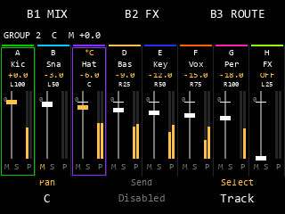
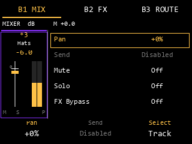
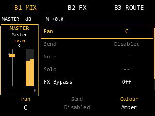

# Mixer — первый пакет: audio, updates, painter

04.11.2026; `feature/mixer-song-stems`. Реализована основа трёх согласованных
этапов: нативный audio adapter с primary-output Master, обновления на границе
блока и C painter классического пульта. Вторая часть — физическое управление,
native UI owner/session binding, FX editor, полный Save/Load и аппаратные пробы —
ещё предстоит. На устройстве пользователь пока не может открыть новый экран.

## Что подключено в experimental candidate

[`mixer_live_native.c`](../sd-mod-session/src/mixer_live_native.c) устанавливает
четыре проверенных pinned-1.3.0.12 entry hooks до запуска audio:

| Entry | Назначение |
|---|---|
| `2226fb0` | Оригинальный engine block выполняется один раз; новый Master работает после его возврата |
| `286be30` | Capture только явно привязанной Program внутри привязанного engine scope |
| `2769bf0` | Вызовы вне scope штатные; внутри — Pad PCM через scoped routing/shadow recovery |
| `276a310` | Finish Track/Direct перед первой native Program stage; остальные стадии штатные |

Все четыре сигнатуры проверяются до изменения кода. Trampolines сохраняют
PAC/stack/guard prologue, Program ADRP перенесён через literal. Pages переключаются
RW → RX; hooks не пишут firmware-файл. Повторная установка с тем же base допустима,
другой base/неверная сигнатура отклоняются. Installer не запускается в audio callback.
Stable builder не включает `MPC_MIXER_LIVE`.

Candidate включает hooks, но **не создаёт и не привязывает сессию автоматически**.
Без сессии все вызовы уходят в native originals. Во второй части control owner
должен подтвердить идентичность/время жизни engine и Program, подготовить session
из project snapshot и связать её с Load/New/Mod Off. UI tab не владеет DSP lifetime.

[`mixer_live.c`](../sd-mod-session/src/mixer_live.c) разделяет Track graph и Master:

```text
Pad -> native Instrument/Pad EQ -> Track/Direct graph (its Master is unity)
    -> native Program FX/gain -> native downstream Program/router mix
    -> physical stereo output pair0
    -> new Master FX/Level/Pan -> primary-output Master PCM meter
```

Primary tap определяется реальным `18ccbc0` по destination2/subIndex0 у router
`engine+0x110 -> owner+0x130`, после возврата исходного `2226fb0 -> 18c79f0`.
Он включает upstream native Program processing и прямые маршруты в эту пару.
Master не берётся из промежуточного Program/core buffer, и native gain не
применяется повторно. Другие physical pairs и последующие hardware/monitor/device
стадии этим контрактом не объявлены измеренными; это **primary engine output**,
не измерение электрического выхода. Порядок дополнительных режимов ещё проверяется.

Track0…7/Direct и primary Master собираются в один SPSC snapshot с общей epoch
и frame counter. При unsupported Track block Track taps unavailable; реальный
primary Master по-прежнему можно измерить после native processing. При отказе
нового Master buffer не заменяется неполным результатом, Master tap unavailable.
UI должен трактовать invalid/stale как N/A.

Attach/detach использует atomic pointer и счётчик активных engine callbacks.
Старую сессию можно получить через `mixer_live_native_take_retired()` только
после завершения всех callbacks, которые могли её увидеть. Audio не ждёт control
и ничего не освобождает. UI consumer также должен отпустить сессию до destroy.
Binding objects принадлежат native engine: atomic retirement не продлевает жизнь
Program после native project destruction. Этот lifecycle — обязательная часть
следующего пакета, поэтому автоматическая привязка пока отсутствует.

## Изменения без работы allocator в audio

[`mixer_buses.c`](../sd-mod-session/src/mixer_buses.c) принимает полные immutable
update packets. Один control producer готовит FX и packet вне RT, публикует в
один pending slot и освобождает retired packets/processors. Audio применяет
пакет только в `begin()`, после успешного native preflight. Busy не блокирует:
control может объединить ожидающие изменения и повторить из актуальной модели.

- Level/Pan/Mute/Solo меняют linear gains за5ms.
- Pad Output переводит входной PCM между прежней и новой шиной за5ms.
- Изменённые FX chains получают параллельный old/new процессинг с5ms crossfade.
- Неизменённые FX сохраняют активные instances/history при mix/routing edits.
- Track и Master updates стартуют в одном engine block; revision подтверждается
  только после успешного завершения обоих переходов.
- Публикация посреди незавершённого блока действует со следующего `begin()`.
- Новая update не перезаписывает неосвобождённые pending/retired processors.
- Одинаковые/старые submitted revisions у live API отклоняются.

Full tail при **замене** цепочки не обещан: прежняя цепь звучит во время5ms
crossfade, затем выводится из процесса. Неизменённые цепи продолжают tails.
Во время routing crossfade временно звучат обе шины; с разными/nonlinear FX
их сумма может изменяться. Это управляемый переход, не утверждение о неизменном
спектре или perfect null-test. Native FX backend обязан отдельно выполнять RT
контракт; без backend native-effect prepare отклоняется. Неподдержанный Send>0
не принимается; Sidechain не включён.

Обновление04.11: live native backend и его отдельные ARM/UBSan проверки
добавлены во [втором пакете](MIXER_STEP2.md#live-native-fx). Аппаратный RT-бюджет
по-прежнему требует измерений.

## Настоящий C painter

[`mixer_view.c`](../sd-mod-session/src/mixer_view.c) использует существующий
`resample_painter` rect/text API. Нет нового UI toolkit, framebuffer/image внутри
runtime, глобального режима или native Component pointers.

| Область | Реализация |
|---|---|
| Overview | Восемь strips по40px, каждый с отдельными gain thumb и L/R PCM bars |
| Выбор | Несколько рамок, `*` primary, user Track color с белым fallback для тёмного цвета |
| Шкалы | Gain: unity y114, +6 y102, -60 y174, Off y177; meter: независимые -60…0dBFS |
| Detail | Один80px Track/Master strip слева, context240px справа |
| MIX/FX/ROUTE | Реальные сохранённые Pan/Mute/Solo/bypass, slots и routing counts/bank |
| Disabled | Send и Advanced/Sidechain; KNOB FX пока показывает только выбранный слот |
| Meter tick | Отдельный masked draw трогает только meter/Peak bounds |

`mixer_view_state` передаётся UI owner как borrowed model/meter snapshot; painter
не пишет модель. Source Scene определяется part_id, не открытой страницей.
Epoch mismatch/age>250ms даёт N/A. Динамическая отрисовка отделена; подключение
native Timer/region invalidation во второй части ещё нужно проверить.
ROUTE `Pad outputs` считает записи таблицы назначений, а не наличие Sample у Pad;
сведения о реально загруженных звуках добавит native model owner во второй части.
Текущие имена сокращаются по UTF-8 codepoints, текст укладывается в заданный rect;
native glyph measurement и читаемость на экране устройства остаются проверкой.

Ниже **выход настоящего C painter из тестовых PCM/model fixtures**, а не screenshot
устройства. Pillow только воспроизводит его rect/text trace приблизительным font.





## Проверки и границы результата

Из `sd-mod-session` в WSL/Linux:

```sh
python3 verify_mixer_step1.py
MPC_RUNTIME_ROOT='/path/to/runtime' python3 verify_mixer_route_native.py
MPC_RUNTIME_ROOT='/path/to/runtime' python3 build_mixer_core_candidate.py
```

Первый скрипт выполняет8 host/ASan+UBSan/AArch64/ARM-UBSan прогонов updates/view:
ramps/endpoints, change-during-block, routing, сохранение FX history, crossfade,
concurrent control/audio handoff, отсутствие linked malloc/free в audio,
границы всех UI primitives,8 фейдеров, stale/epoch и meter-only repaint.
Native скрипт выполняет6 ARM normal/UBSan прогонов routing/DSP/installed-live.
Последний исполняет настоящие установленные hooks, `2226fb0`, `18c79f0`, Program
route sum, native Pad EQ/Program gain, primary Master gain/meter, единый update
и detach внутри callback. Voices, reset/event services и downstream insert —
fixtures; production native audio stack не запущен целиком.
Full candidate проходит `--no-undefined` link и настоящий preload constructor.
Также пройдены прежние eight-bus и FX exchange regression checks.

PNG воспроизводятся после C tests:

```sh
python docs/media/mixer/render_painter.py sd-mod-session/build/mixer-step1
```

SD/card/release не менялись. Не проверены hardware CPU/underruns, полный lifecycle,
все ветки optimized/native physical routes, все native insert FX, native paint
на устройстве, навигация, Fader/LED и XPJ round-trip. Работа продолжается вторым
пакетом; эти пункты не считаются выполненными на основании QEMU и PNG.
