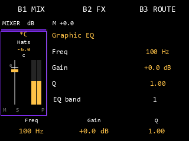
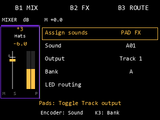

# Mixer — второй пакет, реализация продолжается

04.11.2026, `feature/mixer-song-stems`.
Реализованы UI-owner controller, подробные FX/Assign pages и связка
controller → actual live audio acknowledgement → archive owner.
Candidate автоматически привязывает сессию к живому аудиовызову и снимает её
после смены источника. До проверки на MPC остаются маска занятых звуков,
native FX backend, приоритеты подсветки и полный цикл сохранения и загрузки XPJ.

## Управление

Уточнение04.11: независимые треки обозначаются A–H, быстрый выбор — Pads1–8,
Master — Pad16. Банки звуков A–H остаются независимыми: любой из128 sounds
можно направить на любой Track. Старые output IDs1–8 и имена в сохранённых
проектах не преобразуются. У каждого трека отдельный Pan; на всех восьми strips
и слева в detail виден `L…` / `C` / `R…`. K1 изменяет Pan primary track.

Код: [`mixer_control.c`](../sd-mod-session/src/mixer_control.c),
[API](../sd-mod-session/src/mixer_control.h). Все операции выполняет UI owner;
native input producer должен доставлять числовые события с ticket через очередь.
Controller не читает native objects, не запускает audio и не владеет его lifetime.

- B1/B2/B3 открывают MIX/FX/ROUTE, повтор активной возвращает Overview.
- PAD FX / KNOB FX имеют один return context. Переход между ними не растит стек;
  B-кнопка открывает вкладку напрямую. Выбор Track при возврате не откатывается.
- Удержание нескольких Track pads создаёт группу с первым primary; Pad16 выбирает
  Master. Повторный down уже удерживаемой кнопки/пэда не повторяет действие.
- Shift+B1/B3 выполняет групповые Mute/Solo. Shift+B2 меняет bypass только одного
  Track/Master; group FX editing и assignment требуют одиночного выбора.
- Fader CC0x14 использует pickup: до пересечения сохранённого Level модель не
  меняется. В группе один delta ограничивается общим диапазоном, Off сохраняется.
  Одиночный Off можно поднять после pickup в нижней точке; группа Off не включается.
- Fader mapping:0=Off,1=-60dB,103=unity,127=+6dB. Ни K1, ни encoder не пишут Volume.
  K1 обычных MIX/Overview страниц меняет Pan; Send остаётся Disabled.
- Native mode action сначала закрывает controller, затем возвращает `forward`.
  Shift наблюдается и остаётся штатным модификатором. Поздние ups от поглощённых
  downs поглощаются даже после закрытия/смены ticket. Следующая полная пара вне
  Mixer возвращает `forward`; actual native parser этим controller test не подменён.

Сам controller не содержит long-press timer. Отдельный проверенный
[`mixer_input`](MIXER_INPUT.md) переводит raw кнопки и содержит единый entry owner;
native Fader Settings на самом деле открывается на down без штатного long timer.
Начальный порог500ms — явная политика AM. Native raw Sample/Seq IDs связаны с
controller mode action. `phone_native` пропускает события через общую очередь
после явной привязки готовой сессии на UI потоке. Для входа с MPC требуется
проверка автоматической привязки на самом устройстве.

## Assign / Inspect и FX

Нативный model owner должен передать маску действительно занятых звуков128 pads.
Controller не выводит её из таблицы Output или MIDI activity. PAD FX использует
все16 pads текущего банка; Assign переключает выбранный Track ↔ Master, переносит
назначение с другого Track. Empty не меняется. K3 меняет банк; encoder — sound.
Inspect read-only, включая Fader/K1, и не создаёт DSP updates.

LED API рассчитывает RGB из **подтверждённого** Output: свой Track яркий, другой
приглушённый, Direct нейтральный, Empty off. До audio ack сохраняются прежние LED.
Он ещё не включён в physical `rgb()` priority chain; реальные playback/Mute/Erase
сигналы нельзя перекрывать прямой отправкой этих цветов.

KNOB FX использует существующий `fx_catalog`: выбор/add/replace, slot bypass,
Shift+encoder press remove. Shift+encoder в B2 меняет порядок цепи. Все настройки
редактируют один `mixer_project`, без временной отдельной копии параметров FX.

EQ: encoder выбирает существующую band, включая8-band сохранённую конфигурацию;
K1 Frequency, K2 Gain, K3 Q. Shift: Type, Band enable, EQ Output gain. Пустой слот
добавляет штатный4-band default из каталога, не выдуманную8-band конфигурацию.
Native FX: encoder листает тройки **именованных** параметров, пропуская пустые
native slots; K1–K3 меняют их нормализованные значения. Проверен доступ к18-му
параметру Reverb; исходная32-value модель сохраняется целиком. Percentage labels
не объявляются физическими ms/Hz, если такая шкала не подтверждена metadata.
Sidechain/Advanced по-прежнему Disabled.

[`mixer_view.c`](../sd-mod-session/src/mixer_view.c) дополнен реальными страницами
каталога, EQ/native parameters, Shift EQ, Assign/Inspect, GROUP n/primary,
PICKUP и Pending. Общий левый channel strip сохраняется. Painter получает только
confirmed snapshot; выбранный pending effect/route не выдаётся за audio-applied.




Это review PNG из настоящих rect/text traces, не screenshots MPC.

## Сессия и сохранение

[`mixer_session.cc`](../sd-mod-session/src/mixer_session.cc) соединяет controller,
`mixer_live` и `mixer_archive`. В candidate сессию создаёт `mixer_runtime`
на UI owner по копии наблюдения из live callsite `18dc00c`. Снимок содержит
opaque identities Engine/Program, частоту и ёмкость native буфера.
Частота берётся из свойства Instrument base Program, которое использует
штатный allocator. Поддержан граф с одним Program.

Перед каждым блоком автоматическая привязка сверяется с текущим источником.
Другие вызовы того же рендера, включая offline, выполняют свой штатный путь.
Load/New сразу отзывает epoch. Archive scopes отмечают начало и завершение
операции, включая выход через исключение. После завершения runtime ждёт свежего
live наблюдения и готовит новую сессию.

```text
UI edit -> complete copied desired model / expected revision
    -> owner_tick validates current archive revision
    -> mixer_live_publish prepares paired Track/Master updates off RT
    -> actual native audio completes transition / acknowledges revision
    -> owner_tick mixer_archive_replace(expected revision)
    -> UI confirm: new saved model, faders, values and routing LEDs
```

UI может объединять движения, пока предыдущая ревизия ожидает ack. Busy не меняет
архив и не объявляет успех. При prepare rejection/error либо external Load/New
старый controller закрывается; stale desired snapshot не переписывает новый проект.
Сессию можно считать ready только после реального snapshot с valid всех10 taps;
само выделение объектов не доказывает готовность audio. Неподдержанный audio block
убирает readiness и закрывает controller, сохраняя штатный fallback движка.

Закрытие controller не уничтожает session/FX и не останавливает audio meters.
`owner_tick` и `ui_tick` продолжаются на UI Timer во всех режимах.
Runtime отвязывает UI, снимает audio attachment и ожидает возврата через atomic
retirement, после чего освобождает DSP на UI owner. Native identities служат
для сравнения. Доступ к объектам прошивки выполняется внутри их аудиовызова.
Смена Program, частоты, ёмкости или числа Program отзывает текущую привязку.

Automatic runtime сейчас создаёт встроенный EQ и mix/routing DSP. Передача
native FX backend и получение маски занятых звуков для Assign ещё требуют
подключения к владельцу нативных сервисов.

Успешный edit попадает в существующий versioned archive payload, а не только
в UI session. Confirmed model проверен через encode/decode; прежние реальные
native archive writer/reader tests относятся к отдельному bridge. Это не полный
XPJ Save As/перезапуск/Mod Off round-trip на устройстве. Если Save происходит
пока edit Pending, сохраняется последняя подтверждённая модель.

## Проверки

Из `sd-mod-session` в WSL/Linux:

```sh
python3 verify_mixer_control.py
python3 verify_mixer_step1.py
MPC_RUNTIME_ROOT='/path/to/runtime' python3 verify_mixer_session.py
MPC_RUNTIME_ROOT='/path/to/runtime' python3 build_mixer_core_candidate.py
```

- 4 controller runs: host, ASan+UBSan, AArch64, ARM UBSan. Проверяются navigation,
  return context, groups, pickup/Off/clamps, K1≠Volume, Mute/Solo, occupied-only
  assignment, read-only Inspect, confirmed LEDs, FX parameters/bypass/remove,
  repeat-down suppression, coalescing, late ups и epoch invalidation.
- 2 ARM session runs: normal/UBSan с настоящими установленными native live hooks,
  реальным output processing и audio revision. Archive до ack не меняется,
  после ack/model confirm сохраняется; закрытие UI оставляет audio работающим.
  Native model/services/voice oscillator fixtures, реальный XPJ на SD не открыт.
- Painter regression: 8 host/sanitizer/ARM updates/view runs; проверяются bounds,
  сохранение8 фейдеров, отдельные meters и новые context pages.
- Candidate полностью линкуется с runtime/controller/session/catalog и проходит
  preload. ARM-проверка выполняет автоматическую привязку, реальный PCM, смену
  epoch при прежнем адресе Program, sample-rate replacement и retirement.
  Для live caller используется envelope вокруг настоящего callsite.

Оставшаяся работа второго пакета включает native FX backend, маску занятых
звуков и приоритеты LED, полный цикл сохранения и загрузки XPJ/Mod Off и
аппаратную проверку экрана, фейдера, LED и нагрузки. Пока эти пункты открыты,
нельзя называть второй пакет или пользовательский Mixer завершённым.
