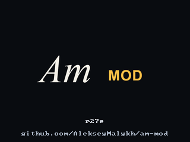

# Mod Settings — r27n

Доступны в публичной предварительной r27n; стабильной остаётся r26s.

Палитра содержит восемь пользовательских и шесть системных цветов. Старые сохранённые палитры поддерживаются.

В Project вместо Pad Lighting открыт пункт **Mod Settings**. **B2/B3** листают
вкладки по кругу, **B1** возвращает в Project. Энкодер выбирает строку;
нажатие включает редактирование значения, повторное нажатие завершает его.
**K1** также меняет выбранное значение. Список прокручивается вслед за курсором.

| Вкладка | Настройки | Рекомендуемые значения |
| --- | --- | --- |
| Pads | Standard / AM Mod | AM Mod |
| Sample | Независимое окрашивание волны и спектра, отступ для предпрослушивания конца | Original, отступ 1000 мс |
| System Colours | Курсор, свободная цель, занятая цель, исходное значение, позиция воспроизведения, Mute | White, Green, Red, Amber, Cyan, Grey |
| Selected Pad | Steady / Slow / Normal / Fast | Normal: цикл 800 мс |
| About (5/5) | Версия и адрес репозитория, только информация | Без настроек и сброса |

Последняя строка **каждого из четырёх разделов настроек — Restore recommended**.
About — пятая и последняя информационная вкладка; вращение ручек и нажатие
энкодера ничего на ней не меняют. B3: About → Pads; B2: Pads → About. Нажатие энкодера
открывает подтверждение для текущего раздела: **B1 — Cancel**, **B3 — Restore**.
Повторное нажатие энкодера и вращение ручек не подтверждают сброс. В System Colours возвращается весь набор назначений,
включая восемь пользовательских слотов, чтобы сохранить разделение ролей.
Звуки, события, назначения цветов пэдам и компрессор эта команда не сбрасывает.

Смена системного цвета **обменивает** его с прежним владельцем. Например,
курсор White → Violet делает курсор фиолетовым, а прежний пользовательский Violet —
белым. Подписи доступных цветов обновляются. Всегда остаются восемь пользовательских
слотов и Default; их цвета не совпадают с шестью системными ролями. Старые ID
цветов в XPJ не перенумеровываются. Цвет сохраняется как назначение слоту,
поэтому обмен меняет все пэды и секвенции, использующие этот слот.

В Standard пользовательские Pad Colour/Seq Colour отключены; настройки не
удаляются. Piano/Scale и раскладки 16 Levels доступны в обоих режимах.
Окрашивание волны/спектра действует в AM Mod. В Filter/Filter Env волна остаётся
скрытой, спектр рисуется за штатными кривыми. Огибающие, ручки, шкалы и кривые
не окрашиваются. Настройка **Selected Pad → Cursor pulse** действует и на
выбранный рабочий пэд, и на исходные пэды Copy/Batch/Chop/Mono/Render, и на
пэд загрузки из библиотеки. **Steady** — постоянный белый курсор;
**Slow / Normal / Fast** — чередование белого и назначенного цвета с циклом
1200 / 800 / 400 мс. Для пустого пэда между вспышками подсветка гаснет.
Если источник одновременно выбран целью, белый чередуется с красным/зелёным;
в Steady приоритет у красного/зелёного предупреждения. Цвет курсора меняется
в System Colours. Пульсация Seq по темпу и предупреждения цели сохраняют свой ритм.

## Сохранение с проектом

В XPJ добавлено необязательное поле **mpcSampleModSettingsV1**: режим подсветки,
полная палитра, волна/спектр, мигание, выбранный тип компрессора, а также
Threshold, Ratio, Gain, Attack, Release, Knee и Warm OptoCat. Штатные параметры
Duck и общий Bypass сохраняет штатный сериализатор.

При успешной загрузке проект восстанавливает свой снимок настроек. Неудачная
загрузка не меняет текущий снимок. Старые проекты открываются без нового поля:
сохраняются текущие настройки отображения, OptoCat возвращается к исходным
параметрам и типу Duck; Bypass определяется штатными данными проекта.
New Project сбрасывает параметры OptoCat; настройки отображения остаются.

Изменения в меню также записываются как начальные настройки этой карты в
`MPC-Sample/Projects/.am-mod-settings`. Загрузка другого проекта не переписывает
этот файл. Старый `.am-mod-pad-lighting` читается при отсутствии нового файла.
Без доступной SD настройки работают в текущем сеансе; ошибка записи показывается.

Штатное приложение не использует поля мода и может удалить их при повторном
сохранении. Перед испытаниями рекомендуем сделать бэкап проектов и сэмплов.

## Проверка на MPC

1. В A выберите другую палитру, оттенок волны/спектра, скорость курсора и
   OptoCat с отличимыми Threshold/Attack/Warm. Сохраните A.
2. В B задайте другие настройки, тип Duck, сохраните B. Загрузите A, затем B:
   должны вернуться все соответствующие настройки, ноты, сэмплы и темп.
3. Проверьте окрашивание из раздела Sample в Trim и обеих вкладках Filter: кривые и
   огибающие остаются видны. В Standard остаются штатные цвета.
4. Проверьте обмен системного и пользовательского цвета, восемь доступных
   слотов, прокрутку и последний пункт Restore recommended в четырёх разделах настроек.
5. Выключите MPC обычной кнопкой и снова включите: страховочная копия должна
   сохранить полный проект и настройки. Её отображаемое имя должно быть
   исходным; первый Save после восстановления требует отдельного подтверждения.

В браузере Delete вызывается физической **ERASE**, со штатным подтверждением.
SEQ RECORD в Steps включает WRITE; SAMPLE RECORD — отдельный TOGGLE
(добавить/удалить событие нажатием пэда). Режимы взаимоисключающие.
В Steps ручка **K1 (Bars)** задаёт длину секвенции от 1 до 128 тактов.
Shift+K1 свободен. **K2** задаёт сетку, Shift+K2 включает триоли.
Звук выбирается удержанием Sound и нажатием пэда, банк — через Pad Bank.
Пустые шаги в пределах секвенции слабо подсвечены. Шаги с событиями ярче,
позиции за концом выключены. Изменение длины входит в штатную историю Undo.
При удержании или включении Mute шаги с нотами, которые можно заглушить,
светятся системным зелёным, полностью заглушённые — системным красным.
Шаги с обоими типами нот чередуют эти цвета.
В режиме Mute на экране Sample используются те же зелёный и красный.
После выхода заглушённый пэд отображается серым. Его волна и спектр серые
до снятия Mute независимо от настройки окрашивания.
В Sample и Chop удерживайте Stop и нажмите пэд, чтобы прослушать конец
фрагмента до текущей границы End. В разделе Sample строка Preview from end
задаёт отступ от 100 до 4000 мс, по умолчанию 1000 мс.

В r26y убран пункт Mod Off из Project. Обычное выключение с записью копии и
аварийное возвращение штатного приложения сохранены. Минимальная заставка
**Am MOD** выводится загрузчиком до подготовки приложения. SD-проект выбирается
в первом штатном вызове загрузки, поздняя повторная автозагрузка отключена.
Политика самого нового сохранённого XPJ сохранена. Точное время и видимый
переход после квадратиков проверяются на MPC. [Схема запуска](BOOT_FLOW.ru.md).

Обновлённое превью заставки 320×240: уменьшенные версия и адрес у нижнего края.

Исходно выбран AM Mod и курсор Normal: 400 мс белый / 400 мс пауза. На пустом выбранном пэде Sample пауза полностью тёмная; на занятом виден назначенный цвет. Сохранённые настройки карты/проекта имеют приоритет.
