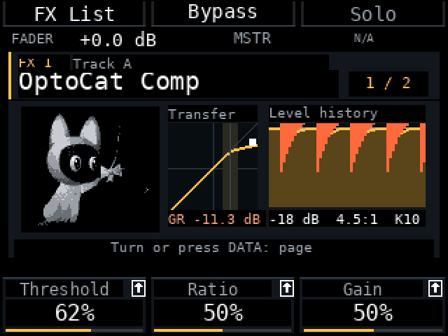
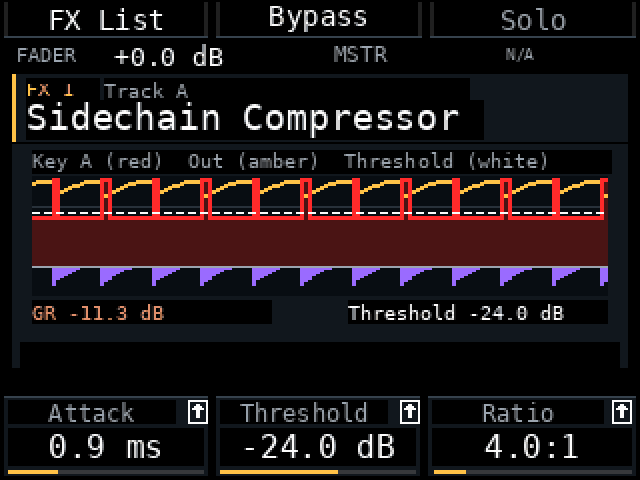
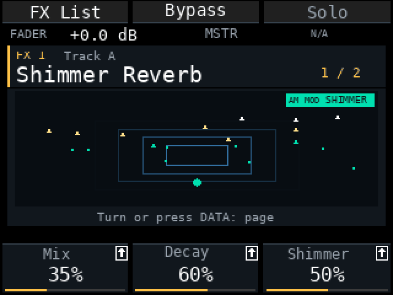
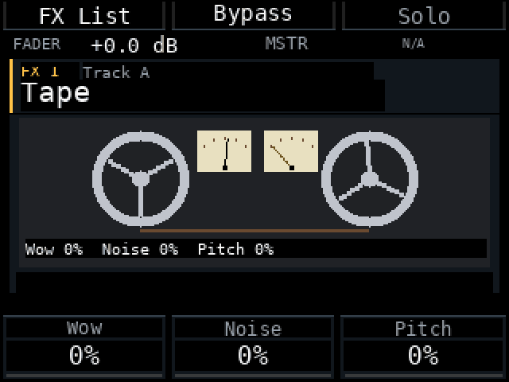

# Am MOD r28e-fx2 — illustrated mixer effects

Pre-release for Akai MPC Sample firmware **1.3.0.12**, 12 November 2026. Built on r28e; host and ARM/QEMU package checks passed, **hardware checks are still pending**.

**Back up projects and samples before updating.**

<table>
<tr>
<td width="50%"><b>OptoCat Comp</b> </td>
<td width="50%"><b>Sidechain Compressor</b> </td>
</tr>
<tr>
<td width="50%"><b>Shimmer Reverb</b> </td>
<td width="50%"><b>Tape</b> </td>
</tr>
</table>
Frames rendered from the mod's own painter with a test signal (a kick-driven duck), not recorded from a device.

## What's new

- **Illustrated effect screens.** Every mixer effect has an animated picture driven by its parameters (reverb rings, tape reels, filter curves, gate and compressor meters). With no signal, or when the effect is bypassed, the picture freezes and dims. Switch in **Mod Settings → Pads → FX view: Illustrated / Classic**; the pictures use CPU only while an effect screen is open.
- **Eight new mixer effects:** Shimmer Reverb, Pitch Shifter, Reverse Delay, Tremolo, Slow Attack, Ring Modulator, Bit Crusher and **OptoCat Comp** (an optical-style compressor, independent per track or Master; the cat is the same one as on Shift+Pad 5). Projects that use them do not load in older Am MOD versions.
- **Master FX shows the Sample compressor.** The pinned row **S / Sample Comp** is the same compressor as Shift+Pad 5: same settings, Bypass, Type and Warm. K1–K3 Threshold / Ratio / Gain, Shift for Attack / Release / Knee, B2 Bypass (or Shift+DATA on the row in the list), B3 Type (Duck / Opto), Shift+B3 Warm. A lamp under **MSTR** shows that Master has effects.
- **Add Effect category filter.** Turn **K3** to filter the list: All, EQ, Delay, Reverb, Filter, Dynamics, Drive, Modulation, Emulator, Pitch. The current filter is named in the K3 cell.
- **Sidechain Compressor.** The screen draws the key as a filled red area with a bright red outline, the output as an amber line, the threshold as a white dashed line on the same dB scale, and gain reduction in its own violet strip. **K1 is Attack, Shift+K1 is Key Track.** Stored parameters are unchanged, so saved projects open as before.
- **Chain Bypass is Shift+B2** on effect pages (B2 stays the effect's own Bypass).
- **Amp Sim Cab Model** shows named cabinets (Dense, Gritty, Loose, Roomy, Boxy, Cramped, Tiny, Nano) instead of 0–100. The names come from the firmware strings; please check the order on a device.
- **Solo overrides Mute.** A track that is both muted and soloed plays, and its Mute stays set; turn Solo off and it is silent again.
- **Double Stop also restarts the mixer effects.** Pressing Stop twice within 1.2 s rebuilds every effect so feedback loops and tails start from silence, like the stock all-sounds-off.

## Fixed

- **Noise Gate / Limiter:** the red threshold or ceiling line disappeared at 100 %; it is now drawn at the top edge.
- **Reverb, Diff Delay and the other effect pictures** kept moving with no signal and ignored the parameters. They now freeze when idle or bypassed, and reverb rings, brightness and mix follow Time, Size and Mix.
- **Sidechain:** the key graph was hidden behind the signal; the threshold was hard to read against it.
- **Tape:** the VU needles shortened and lengthened instead of rotating, and their boxes overlapped the reels.
- **Shift on pages with three parameters** showed empty K cells; the Shift layer now appears only where it exists.
- **OptoCat Comp in the mixer** never recorded its level history, and Knee was almost invisible on the transfer curve; the history moves and a knee band and a 1:1 reference line are drawn.
- **Tape Delay at high Feedbk** could run away with no way to stop it in the mixer. Double Stop now clears it.

## Tested and not yet tested

Host and ARM/QEMU checks, including the new unit tests for Solo over Mute, the double-Stop flush, the pinned Sample compressor row and the category filter, passed. Not tested on a device: frame time of the illustrated screens, the loudness of Shimmer Reverb, whether the Sample compressor row is available (open Shift+Pad 5 once if it shows N/A), the named Cab Models, and double Stop in a long song.

## Known limits

- Only the Sample compressor is pinned on Master. The stock Master FX effect from Pad FX / Program is not shown yet.
- The Vintage Emulator *Type* list is not named yet.
- Seq Record in the mixer is still unused; recording parameter automation is planned.

## Installation

Select `am-mod-r28e-fx2.zip` in MPC Sample Mod Installer, or copy its complete `autorun/` folder to the SD card root, replacing the previous mod files. Restart with the card inserted and check r28e-fx2 in About. Back up first; the installer keeps a copy of the previous `autorun/`.

## How to use

1. **Add an effect:** Mixer → FX → on an empty slot press DATA, turn K3 to pick a category, turn the encoder to browse, press DATA to add.
2. **Edit it:** press DATA on the slot. K1–K3 are the first three parameters; Shift shows the next three; Pad Bank + K resets one to its default.
3. **Bypass:** B2 for the effect, Shift+B2 for the whole chain.
4. **Master compressor:** select the **S** row below the Master chain; it is the same compressor as Shift+Pad 5.
5. **Illustrated or Classic:** Mod Settings → Pads → FX view.
6. **Sidechain:** add the Sidechain Compressor to the receiving track, then press Shift and turn K1 to choose the Key track.

[Русский](RELEASE_NOTES-r28e-fx2.ru.md)
