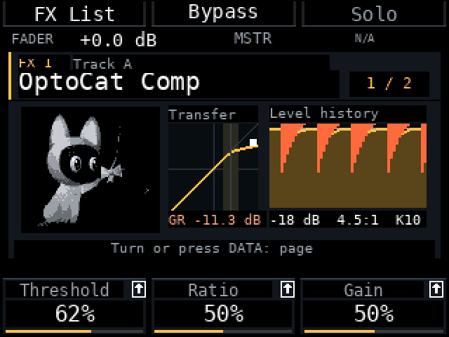
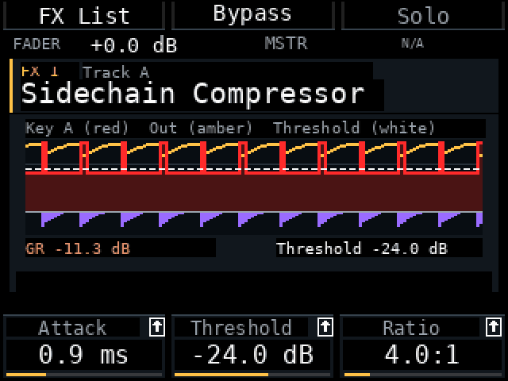
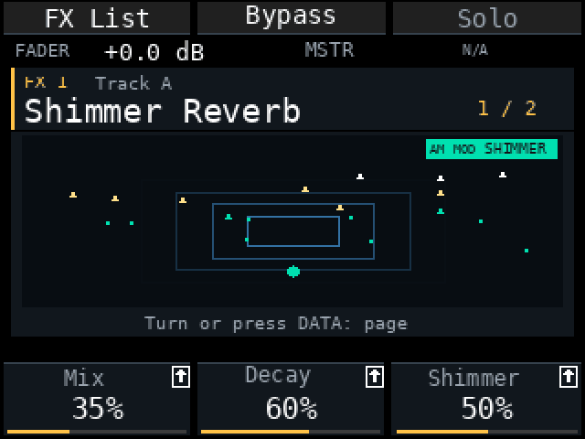
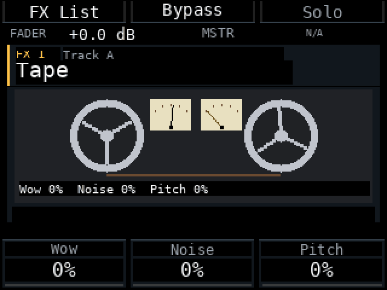

# Am MOD r28e-fx2 — эффекты микшера с картинками

Предрелиз для Akai MPC Sample с прошивкой **1.3.0.12**, 12 ноября 2026. Собран на основе r28e; проверки на хосте пройдены, **проверки ARM/QEMU при сборке пакета и на устройстве ещё впереди**.

**Перед обновлением сделайте резервную копию проектов и сэмплов.**

<table>
<tr>
<td width="50%"><b>OptoCat Comp</b> </td>
<td width="50%"><b>Sidechain Compressor</b> </td>
</tr>
<tr>
<td width="50%"><b>Shimmer Reverb</b> </td>
<td width="50%"><b>Tape</b> </td>
</tr>
</table>
Кадры отрисованы собственным рисовальщиком мода на тестовом сигнале (ducking от «бочки»), это не запись с устройства.

## Что нового

- **Эффекты с картинками.** У каждого эффекта микшера есть анимированная картинка, зависящая от параметров (кольца реверберации, бобины ленты, кривые фильтров, индикаторы гейта и компрессора). Без сигнала или в bypass картинка замирает и тускнеет. Переключатель — **Mod Settings → Pads → FX view: Illustrated / Classic**; картинки нагружают процессор только при открытом экране эффекта.
- **Восемь новых эффектов микшера:** Shimmer Reverb, Pitch Shifter, Reverse Delay, Tremolo, Slow Attack, Ring Modulator, Bit Crusher и **OptoCat Comp** (оптический компрессор, независимый на каждом треке или Master; кошка та же, что на Shift+Pad 5). Проекты с ними не открываются в старых версиях Am MOD.
- **Master FX показывает компрессор Sample.** Закреплённая строка **S / Sample Comp** — тот же компрессор, что на Shift+Pad 5: те же настройки, Bypass, Type и Warm. K1–K3 Threshold / Ratio / Gain, с Shift Attack / Release / Knee, B2 Bypass, B3 Type (Duck / Opto), Shift+B3 Warm. Лампа под **MSTR** показывает, что на Master есть эффекты.
- **Фильтр категорий в Add Effect.** Крутите **K3**: All, EQ, Delay, Reverb, Filter, Dynamics, Drive, Modulation, Emulator, Pitch. Текущий фильтр подписан в ячейке K3.
- **Sidechain Compressor.** Key рисуется красной заливкой с яркой красной линией по краю, выход — янтарной линией, порог — белой пунктирной линией в той же шкале дБ, а gain reduction — отдельной фиолетовой полосой. **K1 — Attack, Shift+K1 — Key Track.** Хранимые параметры не менялись, сохранённые проекты открываются как раньше.
- **Chain Bypass — Shift+B2** на страницах эффектов (B2 остаётся Bypass самого эффекта).
- **Amp Sim Cab Model** показывает названия кабинетов (Dense, Gritty, Loose, Roomy, Boxy, Cramped, Tiny, Nano) вместо 0–100. Названия взяты из строк прошивки; проверьте порядок на устройстве.
- **Solo главнее Mute.** Трек с включёнными Mute и Solo звучит, его Mute не снимается; выключите Solo — он снова молчит.
- **Двойной Stop перезапускает эффекты микшера.** Два нажатия Stop за 1,2 с пересоздают все эффекты, и петли обратной связи и хвосты начинают с тишины, как штатный all-sounds-off.

## Исправлено

- **Noise Gate / Limiter:** красная линия порога или потолка пропадала на 100 %; теперь рисуется у верхнего края.
- **Reverb, Diff Delay и остальные картинки** двигались без сигнала и не зависели от параметров. Теперь они замирают без сигнала и в bypass, а кольца, яркость и микс реверба следуют за Time, Size и Mix.
- **Sidechain:** график key прятался за сигналом, порог плохо читался на его фоне.
- **Tape:** стрелки VU укорачивались и удлинялись вместо поворота, а их рамки перекрывали бобины.
- **Shift на страницах с тремя параметрами** показывал пустые ячейки K; слой Shift теперь есть только там, где он существует.
- **OptoCat Comp в микшере** не записывал историю уровня, а Knee почти не было видно на кривой transfer; теперь история движется, нарисованы полоса колена и опорная линия 1:1.
- **Tape Delay при большом Feedbk** мог уйти в нарастающую обратную связь без способа остановить его в микшере. Теперь это сбрасывает двойной Stop.

## Проверено и не проверено

Проверки на хосте, включая новые тесты Solo поверх Mute, сброса по двойному Stop, закреплённой строки компрессора Sample и фильтра категорий, пройдены. ARM/QEMU-проверки выполняются при сборке пакета. На устройстве не проверено: время кадра экранов с картинками, громкость Shimmer Reverb, доступна ли строка компрессора Sample (если там N/A, один раз откройте Shift+Pad 5), названия Cab Model и двойной Stop в длинной песне.

## Известные ограничения

- На Master закреплён только компрессор Sample. Штатный эффект Master FX из Pad FX / Program пока не показан.
- Список *Type* у Vintage Emulator пока без названий.
- Seq Record в микшере по-прежнему не используется; запись автоматизации параметров запланирована.

## Установка

Выберите `am-mod-r28e-fx2.zip` в MPC Sample Mod Installer или скопируйте его целую папку `autorun/` в корень SD-карты с заменой старых файлов мода. Перезапустите с картой и проверьте r28e-fx2 в About. Сначала сделайте резервную копию; установщик сохраняет копию прежней `autorun/`.

## Как пользоваться

1. **Добавить эффект:** Mixer → FX → на пустом слоте нажмите DATA, K3 выбирает категорию, энкодер — эффект, DATA добавляет.
2. **Править его:** нажмите DATA на слоте. K1–K3 — первые три параметра; Shift показывает следующие три; Pad Bank + K сбрасывает параметр к значению по умолчанию.
3. **Bypass:** B2 — эффект, Shift+B2 — вся цепочка.
4. **Компрессор Master:** выберите строку **S** под цепочкой Master; это тот же компрессор, что на Shift+Pad 5.
5. **Illustrated или Classic:** Mod Settings → Pads → FX view.
6. **Sidechain:** добавьте Sidechain Compressor на принимающий трек, затем зажмите Shift и крутите K1, чтобы выбрать трек Key.

[English](RELEASE_NOTES-r28e-fx2.md)
