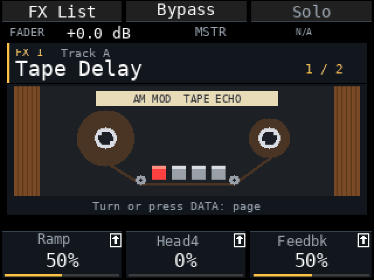
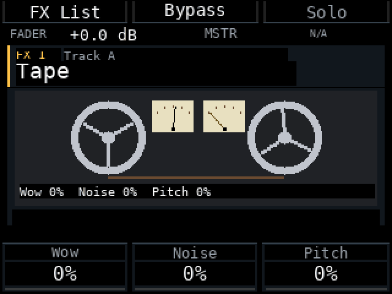
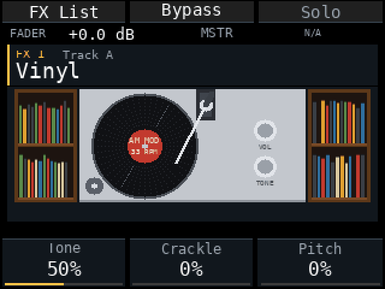
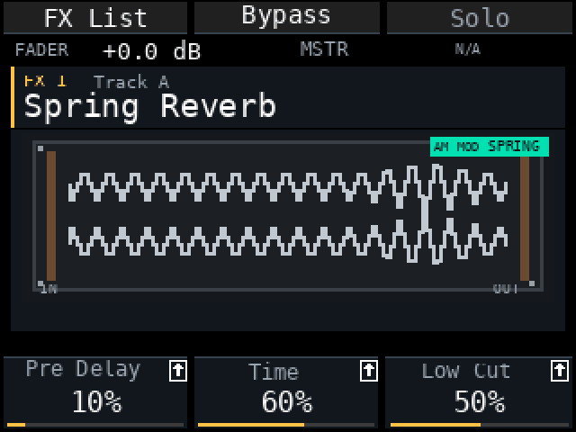
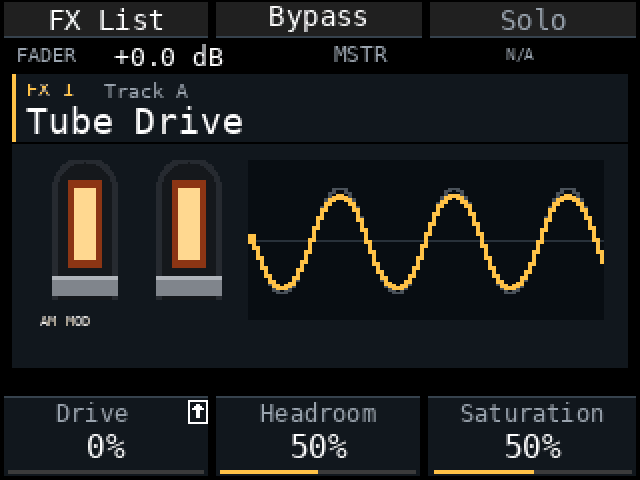
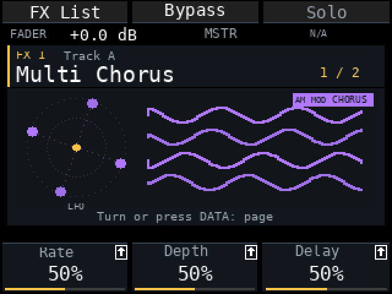
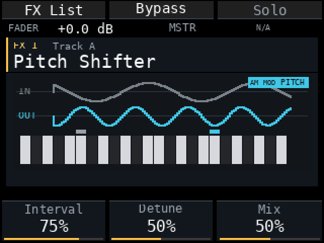
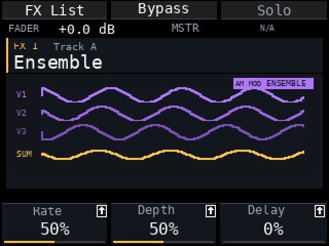

# Am MOD r29a — new effect screens, SD stems and pad typing

Release for Akai MPC Sample firmware **1.3.0.12**, 13 November 2026. Replaces the pre-release r28e-fx2 (and r28e-fx3 … fx16, which were test builds). Host and package checks passed; the new Save, Stems and text-input behaviour was tried on a device while it was being built.

**Back up projects and samples before updating.** Projects that use the effects added in r28e-fx2 do not load in older Am MOD versions.

<table>
<tr>
<td width="50%"><b>Tape Delay</b> </td>
<td width="50%"><b>Tape (cassette)</b> </td>
</tr>
<tr>
<td width="50%"><b>Vinyl</b> </td>
<td width="50%"><b>Spring Reverb</b> </td>
</tr>
<tr>
<td width="50%"><b>Tube Drive</b> </td>
<td width="50%"><b>Multi Chorus</b> </td>
</tr>
<tr>
<td width="50%"><b>Pitch Shifter</b> </td>
<td width="50%"><b>Ensemble</b> </td>
</tr>
</table>
Frames rendered from the mod's own painter with a test signal, not recorded from a device. More animations are in [media/fx](media/fx).

## What's new

- **New effect screens.** Every effect picture was redrawn: the value strip under the picture is gone (the values are on the parameter panel), each picture has a small *AM MOD* plate in its category colour, and many are now a real object. **Tape Delay** is a reel-to-reel with wooden cheeks, tape running tangentially to guide rollers and a red erase head. **Tape** is a cassette: the left tape pack, a VU meter whose needle follows the signal level, and **PLAY** / **STOP** keys (PLAY is down while sound runs, STOP when it stops; the reels turn only while playing). **Vinyl** is a turntable with a short tonearm and record shelves on both sides. Also redrawn: Sample Delay, Spring Reverb (spring tank), Tube Drive (glowing tubes), Soft Clipper (transfer curve and waveform), Ensemble (three voices and their sum), Multi Chorus (LFO circle), Auto Wah (pedal and sweep), Pitch Shifter (keyboard), Flanger and Bit Crusher.
- **Typing with the pads is the default** wherever a name or text is entered: Search, Save Project / Sample, Export, Stems and track names in the Mixer. **K1 still switches to Encoder.** New Mod Setting: **Quick → Text input: Pads / Encoder**, saved on the card.
- **Shift+Erase clears the whole text** in every pad-input window (Search already did). Erase still deletes one character.
- **The first Mod Settings tab is now called Quick** (it was Pads); FX view is there.
- **Stems go to the SD card** in a folder named after the song: `Samples/User/Export/<song>/`. The folder holds one file per sounding Track named `<song>_track A.wav`, or `<song>_track A_<Track name>.wav` if the Track was renamed, and **`<song>_Master.wav`** (the stock mixdown).

## Fixed

- **Save Project and Save Sample could save to Internal.** The windows now open with External selected and force it back to External when K3 is turned.
- **Stems export failed** (`SD_EXPORT_UNAVAILABLE`) when the stock Export window offered External. Stems now always go to the card, whichever destination the window shows, and no stray mixdown file is left in `Samples/Export`.
- **The Stems name window showed Pads but the pads did not respond** until K1 was toggled. Pads now work as soon as the window opens.
- **Master FX no longer shows a pinned Sample Comp row.** It only existed after Shift+Pad 5 had been opened once, and the Duck type had no Master view, so it was N/A or missing at start. Add **OptoCat Comp** from the effect list instead.
- Tape needles, idle and bypassed pictures and other small drawing issues of the redrawn screens.

## Tested and not yet tested

Host checks with sanitizers and the package checks passed, including new tests for the name editor (Pads default, Shift+Erase) and the Text input setting. Tried on a device while building: Save External-only and Stems export (folder, names, Master). Not tested on a device: all redrawn pictures (frame time, readability on the real screen), Shift+Erase in every native window, the Text input setting after a power cycle.

## Known limits

- The stock Master FX effect from Pad FX / Program is not shown in the mixer yet.
- The Vintage Emulator *Type* list is not named yet.
- Seq Record in the mixer is still unused; recording parameter automation is planned.
- Auto Wah and Amp Sim pictures are mostly static in the preview animations because the test signal does not move their controls.

## Installation

Select `am-mod-r29a.zip` in MPC Sample Mod Installer, or copy its complete `autorun/` folder to the SD card root, replacing the previous mod files. Restart with the card inserted and check r29a in About. Back up first; the installer keeps a copy of the previous `autorun/`.

## How to use

1. **Typing:** names and search open in Pads mode. Press K1 for Encoder. Erase deletes a character, Shift+Erase clears everything.
2. **Default input:** Mod Settings → Quick → Text input.
3. **Stems:** Song → Export → Stems, enter a name; files appear on the card in `Samples/User/Export/<song>/`.
4. **Effect pictures:** Mod Settings → Quick → FX view: Illustrated / Classic.

[Русский](RELEASE_NOTES-r29a.ru.md)
