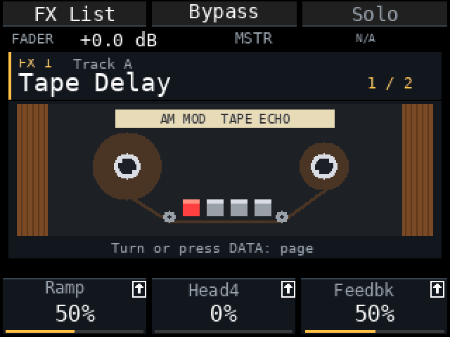
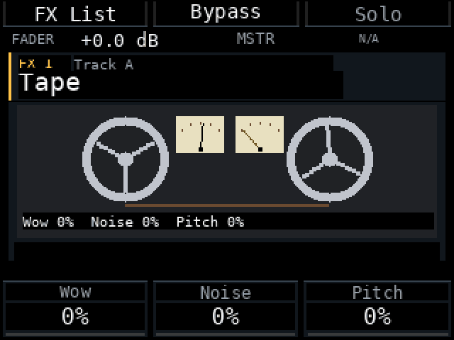
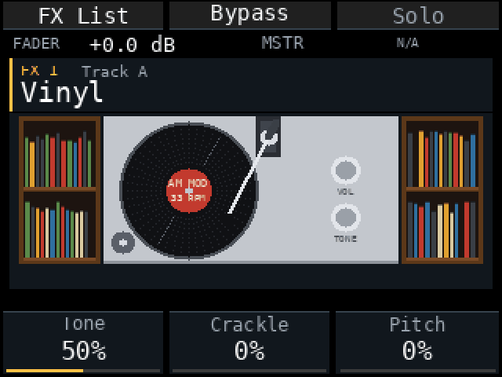
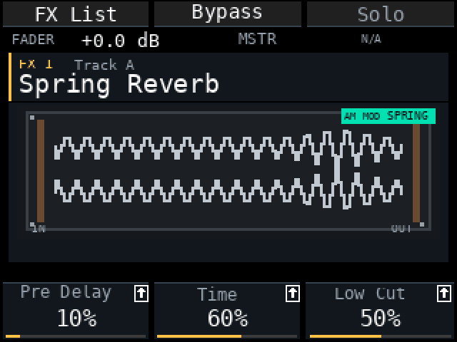
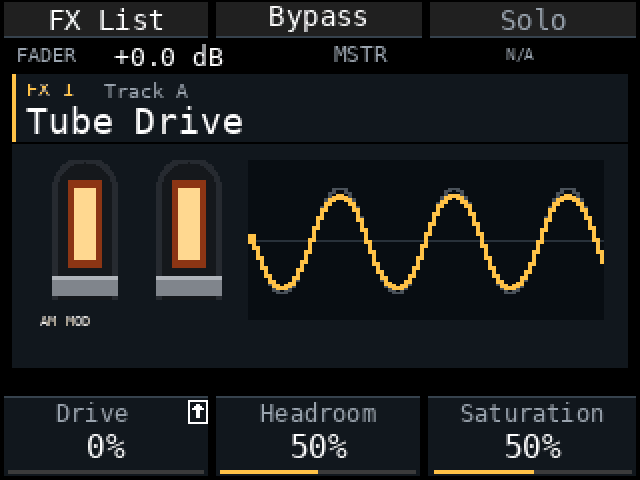
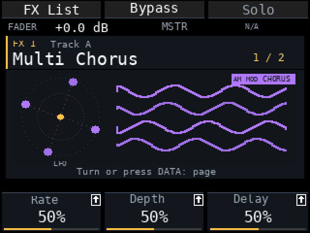
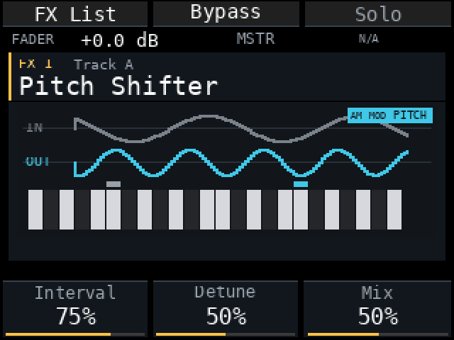
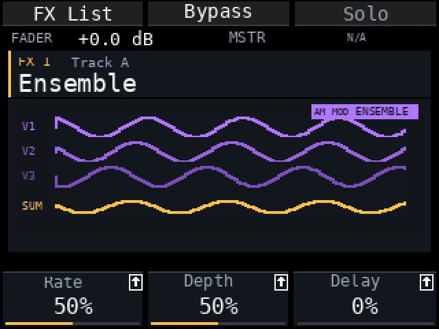

# Am MOD r29a — новые экраны эффектов, стемы на SD и ввод пэдами

Релиз для Akai MPC Sample, прошивка **1.3.0.12**, 13 ноября 2026 года. Заменяет предрелиз r28e-fx2 (а также тестовые сборки r28e-fx3 … fx16). Проверки на хосте и пакета пройдены; новое поведение Save, Stems и ввода текста проверялось на устройстве по ходу сборки.

**Перед обновлением сделайте резервную копию проектов и сэмплов.** Проекты с эффектами, добавленными в r28e-fx2, не открываются в старых версиях Am MOD.

<table>
<tr>
<td width="50%"><b>Tape Delay</b> </td>
<td width="50%"><b>Tape (кассета)</b> </td>
</tr>
<tr>
<td width="50%"><b>Vinyl</b> </td>
<td width="50%"><b>Spring Reverb</b> </td>
</tr>
<tr>
<td width="50%"><b>Tube Drive</b> </td>
<td width="50%"><b>Multi Chorus</b> </td>
</tr>
<tr>
<td width="50%"><b>Pitch Shifter</b> </td>
<td width="50%"><b>Ensemble</b> </td>
</tr>
</table>
Кадры отрисованы рисовальщиком мода на тестовом сигнале, а не записаны с устройства. Больше анимаций — в [media/fx](media/fx).

## Что нового

- **Новые экраны эффектов.** Все картинки перерисованы: строки значений под картинкой больше нет (значения на панели параметров), у каждой картинки маленькая табличка *AM MOD* в цвете категории, а многие превратились в настоящий предмет. **Tape Delay** — катушечный магнитофон с деревянными щёчками, лентой по касательной к направляющим роликам и красной стирающей головкой. **Tape** — кассета: большая намотка слева, стрелочный VU, который следует за уровнем сигнала, и клавиши **PLAY** / **STOP** (PLAY нажата, пока идёт звук, STOP — когда он остановился; бобины крутятся только при звуке). **Vinyl** — проигрыватель с коротким тонармом и полками пластинок по бокам. Также перерисованы Sample Delay, Spring Reverb (пружинный бокс), Tube Drive (светящиеся лампы), Soft Clipper (передаточная кривая и волна), Ensemble (три голоса и сумма), Multi Chorus (круг LFO), Auto Wah (педаль и свип), Pitch Shifter (клавиатура), Flanger и Bit Crusher.
- **Ввод пэдами по умолчанию** везде, где вводится имя или текст: поиск, Save Project / Sample, Export, Stems и имена треков в микшере. **K1 по-прежнему переключает на Encoder.** Новая настройка мода: **Quick → Text input: Pads / Encoder**, сохраняется на карте.
- **Shift+Erase очищает весь текст** во всех окнах ввода пэдами (в поиске так было и раньше). Erase по-прежнему стирает один символ.
- **Первая вкладка Mod Settings называется Quick** (раньше Pads); FX view находится там же.
- **Стемы выгружаются на SD-карту** в папку с названием песни: `Samples/User/Export/<песня>/`. В папке по файлу на каждый звучащий трек: `<песня>_track A.wav` или `<песня>_track A_<имя трека>.wav`, если трек переименован, и **`<песня>_Master.wav`** (штатный микс).

## Исправлено

- **Save Project и Save Sample могли сохранять во внутреннюю память.** Окна открываются с выбранным External и возвращают его на External при повороте K3.
- **Экспорт стемов падал** (`SD_EXPORT_UNAVAILABLE`), когда штатное окно Export предлагало External. Теперь стемы всегда идут на карту, какое бы назначение ни показывало окно, и лишний файл микса в `Samples/Export` не остаётся.
- **В окне имени для Stems был выбран ввод Pads, но пэды не отзывались**, пока не переключишь K1. Теперь пэды работают сразу при открытии окна.
- **На Master FX больше нет закреплённой строки Sample Comp.** Она существовала только после того, как один раз открыли Shift+Pad 5, а у типа Duck не было вида Master, поэтому в начале строка была N/A или пропадала. Вместо неё добавляйте **OptoCat Comp** из списка эффектов.
- Стрелки Tape, картинки без сигнала и в bypass и другие мелкие недочёты отрисовки перерисованных экранов.

## Проверено и не проверено

Проверки на хосте с санитайзерами и проверки пакета пройдены, включая новые тесты редактора имени (Pads по умолчанию, Shift+Erase) и настройки Text input. Опробовано на устройстве по ходу сборки: Save только на External и экспорт Stems (папка, имена, Master). Не проверено на устройстве: все перерисованные картинки (время кадра, читаемость на реальном экране), Shift+Erase в каждом штатном окне, настройка Text input после выключения питания.

## Известные ограничения

- Штатный эффект Master FX из Pad FX / Program пока не показывается в микшере.
- Список *Type* у Vintage Emulator пока без названий.
- Seq Record в микшере пока не используется; запись автоматизации параметров запланирована.
- В превью-анимациях картинки Auto Wah и Amp Sim почти статичны: тестовый сигнал не двигает их регуляторы.

## Установка

Выберите `am-mod-r29a.zip` в MPC Sample Mod Installer или скопируйте его полную папку `autorun/` в корень SD-карты, заменив прежние файлы мода. Перезапустите с картой и проверьте r29a в About. Сначала сделайте резервную копию; установщик сохраняет копию прежней `autorun/`.

## Как пользоваться

1. **Ввод:** имена и поиск открываются в режиме Pads. K1 — переключение на Encoder. Erase стирает символ, Shift+Erase — всё.
2. **Ввод по умолчанию:** Mod Settings → Quick → Text input.
3. **Стемы:** Song → Export → Stems, введите имя; файлы появятся на карте в `Samples/User/Export/<песня>/`.
4. **Картинки эффектов:** Mod Settings → Quick → FX view: Illustrated / Classic.

[English](RELEASE_NOTES-r29a.md)
