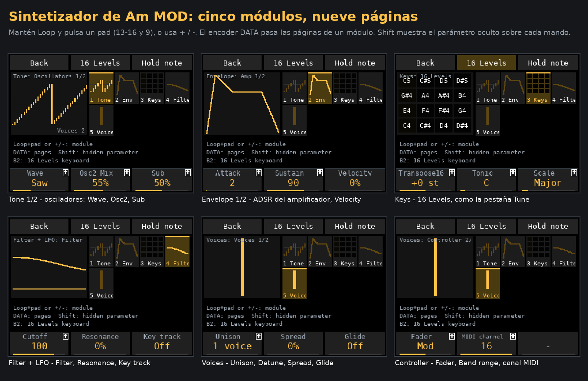

# Am MOD r30d beta3 — sintetizador, Input ROUTE, salida al cargador

> **BETA — r30d-beta3.** La compatibilidad con otros mods y menús de arranque (Stock, SampQOL, D.S.B, SampleBoot, mpc-boot-thingy) sigue en pruebas. Haz copia de seguridad de tus proyectos y de la tarjeta. Lo marcado como *pendiente* pasó las pruebas en host/emulador, pero aún falta probarlo en un MPC real.

Para el **Akai MPC Sample con firmware original 1.3.0.12**. Esta versión continúa r30c-beta1; el firmware instalado no se reescribe.

## Correcciones en beta3

- **SampleBoot:** Am MOD se instala en `autorun/mods/AM-Mod/` y arranca desde el menú de SampleBoot. **Exit to bootloader** (Mod Settings → About) ahora vuelve al **menú de SampleBoot**, igual que con D.S.B. Comprobado en un MPC físico.
- **Imágenes del menú de arranque:** el logotipo de Am MOD en el carrusel de SampleBoot (`sampleboot.png`) y en el disco de D.S.B (`dsb-record.png`); SampleBoot muestra el nombre «Am MOD».
- **Instalador 1.5.0** detecta SampleBoot e instala en la carpeta correcta. Si el ajuste `ROOT_FILES` de SampleBoot muestra en `mods/` un archivo de la raíz de la tarjeta, como `mpcqol.conf`, Am MOD no arranca (su comprobación del sandbox rechaza un archivo escribible de la tarjeta); el instalador avisa y la solución es `ROOT_FILES=""` en `autorun/sampleboot/sampleboot.conf` (SampQOL deja de ver sus ajustes de la raíz).

## Correcciones en beta2

- Las **entradas USB** (USB, USB L, USB R) ahora pasan por la pista Input: se les aplican Input FX, fader, pan y mute. Antes USB estaba etiquetado como otra entrada y su señal llega en un par de canales que el mod no procesaba.
- **Orden de la lista Input:** Source, Mode, Monitor, Threshold, Record via, Record track, Record FX, Tuner, MIDI In. **Monitor** ofrece Off / Auto / On para cualquier fuente y activa el monitoreo de Rear desde el Mixer. Record track muestra «-» para Master e Input.
- **Pan en K1 de la cadena FX** para pistas, la pista Input y Master (Pad Bank + K1 lo lleva al centro). En la pestaña ROUTE de Input, K1 = Pan, K2 = Threshold y K3 = Source para cualquier fuente, incluido Rear; el pan y el nivel de los canales de Rear siguen en Rear Routing.
- **Modo Rear:** la fila Mode de Rear empieza en **Stereo** (primera opción y valor por defecto al elegir Rear) y ofrece Rear L, Rear R, L+R Split y L+R Mix. El monitor sigue el modo: Rear L reproduce solo la entrada izquierda, Rear R solo la derecha, el resto ambas. El panel físico de nivel de salida del MPC muestra la señal de Rear.
- D.S.B: la etiqueta del registro de AM Mod muestra la versión actual.

## Sintetizador (pad 13 del mezclador)

- **Cinco módulos, nueve páginas.** Tone (Oscillators, Mixer), Envelope (Amp, envolvente del filtro), Keys, Filter + LFO, Voices (Voices, Controller). Los módulos están en los pads 13–16 y 9: **mantén Loop y pulsa un pad**, o avanza con **+ / −**. El encoder **DATA** pasa las páginas dentro de un módulo.
- **Más sonido.** Segundo oscilador (onda, mezcla, semitonos, ajuste fino), sub, ruido, drive, envolvente de filtro propia con cantidad, key tracking, cuatro formas de LFO, rango de bend, unison con detune y spread, glide y sensibilidad a la velocity.
- **Una sola fila de mandos.** K1–K3 llevan el parámetro habitual; el poco usado va en **Shift+K** y se ve sobre el mando mientras mantienes Shift. Consulta la [guía del sintetizador](SYNTH_GUIDE.es.md).
- **La página Keys = pestaña Tune.** K1 Transpose16 / Shift Layout, K2 Tonic / Shift Role, K3 Scale / Shift Colour; los valores se leen como en Tune: «D# (P)», «Natural Minor (P)», «−4 st».
- **Fader** (Off / Mod / Pitch) es K1 de la página Controller. Parámetros como LFO Depth, Sub, Noise, Drive y Key track muestran «Off» en cero.
- **Takeover.** Los mandos K del sintetizador siguen el modo Parameter takeover (Pickup, Scaled, Jump) como el resto del mezclador.
- Al entrar en el sintetizador se quita la selección de pistas; los pads 9–12 muestran los efectos de la pista Input, porque el sintetizador es la fuente de Input. El pad 14 ya no saca del sintetizador.
- Las miniaturas reflejan la disposición de los pads; el dibujo grande de la izquierda muestra la onda, la envolvente o la curva del filtro en vivo.

## Entrada y grabación

- **Shift+Sample abre la lista Input ROUTE desde cualquier pantalla** (Seq, Step Edit, compresor, Project), nunca el Input Config original. Filas: Source (Mic / Rear / USB / Resample / Synth), Mode (Rear y USB: Stereo, L, R …), Monitor, Threshold, Tuner y filas de grabación. K1 Pan, K2 Threshold, K3 Source; **B2 FX, B3 MIDI In**, Shift+B2 abre la pantalla original. La lista se desplaza y la disposición de pads se conserva.
- **Sample Record:** K1 elige el Source de entrada (incluido Synth), Shift+K1 el modo Rear/USB. Con el teclado **16 Levels** del sintetizador activo, los mandos siguen la pestaña Tune (K1 Transpose16 / Layout, K2 Tonic / Role, K3 Scale / Colour) y se redibujan al soltar Shift.
- El sintetizador siempre sigue el volumen master; las opciones *Direct out* y *Mic layer* ya no existen. Cambiar el Source de entrada quita Input del sintetizador.

## Piano Roll

- **Selección de área:** mantén **DATA**, gira el encoder (tiempo) y mueve el fader (filas); el área se selecciona en vivo. Suelta DATA para conservarla. Un clic corto en DATA sin movimiento sigue seleccionando la nota bajo el cursor (Shift añade).

## Intercambio de Layout y Transpose16

- En la pestaña Tune, la página Keys del sintetizador y Sample Record: **K1 = Transpose16, Shift+K1 = Layout**. El reinicio del mando sigue el nuevo orden.

## MIDI

- Valores globales de MIDI/sintetizador por defecto, página **MIDI Buttons** (lista con desplazamiento, B3 asignar, B2 borrar/cancelar, faders asignables) y fuente MIDI para el fader.
- Los botones modificadores del controlador (por ejemplo Shift de un MiniLab) actúan como botones normales salvo que se mantenga el Shift del propio MPC; así el Shift del teclado ya no mantiene el Shift del MPC.
- MIDI In desde Input Config: B3 / Shift+B2 cambian el modo de entrada, Shift+B3 Buttons, Shift+B2 Clear; la lista de sintetizadores MIDI se desplaza.

## Efectos

- Efectos de **Henry Skillz**: HS Saturator, HS Bass Focus y HS Heat (DSP de [hs-mpc-plugins](https://github.com/Holla-Back-Entertainment/hs-mpc-plugins), usado con permiso), con ilustraciones propias, barra de pestañas de página y resaltado de la página de Heat. Add Effect tiene una pestaña del autor HS y búsqueda por nombre (B2). *Pendiente de comprobar en el dispositivo.*

## Cargador de arranque y D.S.B

- **Mod Settings → About → Exit to bootloader** (B3 confirma, B1 cancela) guarda una copia del proyecto en `Projects/Mod-Exit-Last` y vuelve al **menú de D.S.B**; sin D.S.B el MPC arranca el firmware original. Consulta [Menús de arranque y salida al cargador](BOOTLOADERS.es.md).
- **Traspaso del estado de D.S.B:** la marca «arranque correcto» de D.S.B ahora llega al archivo de estado real de la tarjeta, así que un arranque sano de Am MOD ya no cuenta como fallo y el menú deja de ofrecer Stock tras dos arranques.
- El diario de arranque de D.S.B y el registro de corrección de estado se copian junto al mod en la tarjeta para diagnóstico (`dsb-boot.log`, `dsb-state-fix.log`).
- Idea de arranque rápido: elige **AM Mod** una vez en el menú y usa **Exit to bootloader** cuando quieras otro sistema.

## Otros

- La búsqueda del navegador muestra la etiqueta **Find**; Shift+B2 borra todo el texto.
- Hold note del sintetizador mantiene la última nota de 16 Levels y la muestra resaltada.
- La retención de la cola de efectos y el fundido del sintetizador eliminan clics al terminar las notas.

## Límites

- Los módulos del sintetizador, Input ROUTE, el takeover de los mandos del sintetizador, la selección de área en Piano Roll y el intercambio Layout/Transpose16 se terminaron después de la última comprobación completa en el dispositivo: *pendientes* de verificación en hardware.
- La grabación de Mic con To Seq puede no reproducir la muestra nueva en la secuencia en algunos casos; se agradecen los registros del dispositivo.
- Exit to bootloader entrega el control solo a **D.S.B**. SampleBoot y mpc-boot-thingy se admiten para iniciar el mod; volver a ellos desde el mod no está implementado.
- La carga y el guardado entre mods de proyectos Internal (Am MOD, Stock, SampQOL) no están certificados por completo.

Consulta [Limitaciones conocidas](KNOWN_ISSUES.md), [Instalación](INSTALL.es.md) y el [registro de cambios](../CHANGELOG.md).
