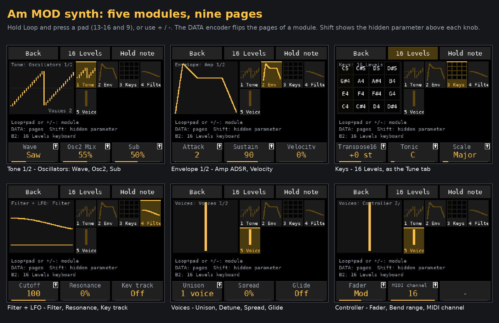

# Am MOD r30d beta2 — synth, Input ROUTE, bootloader exit

> **BETA — r30d-beta2.** Compatibility with other mods and boot menus (Stock, SampQOL, D.S.B, SampleBoot, mpc-boot-thingy) is still being tested. Back up your projects and card first. Items marked *pending* passed host/emulator checks but still need a check on a physical MPC.

For **Akai MPC Sample stock firmware 1.3.0.12**. This release continues r30c-beta1; installed firmware is never rewritten.

## Fixes in beta2

- **USB inputs** (USB, USB L, USB R) now go through the Input track: Input FX, fader, pan and mute apply to them. USB was mislabelled as a different input before, and its signal arrives on a native channel pair the mod did not process.
- **Input list order:** Source, Mode, Monitor, Threshold, Record via, Record track, Record FX, Tuner, MIDI In. **Monitor** has Off / Auto / On for every source and enables Rear monitoring from the Mixer. Record track shows "-" for Master and Input.
- **Pan on K1 of the FX chain** for tracks, the Input track and Master (Pad Bank + K1 resets it to centre). On the Input ROUTE tab K1 = Pan, K2 = Threshold, K3 = Source for every source, Rear included; the L/R pan and level of the Rear channels stay in Rear Routing.
- **Rear mode:** the Mode row for Rear starts in **Stereo** (listed first, the default when you choose Rear) and offers Rear L, Rear R, L+R Split and L+R Mix. The monitor follows the mode: Rear L plays the left jack only, Rear R the right one, the others both. The MPC's physical output-level panel shows the Rear signal.
- D.S.B: the record label under AM Mod now shows the current version.

## Synth (Mixer pad 13)

- **Five modules, nine pages.** Tone (Oscillators, Mixer), Envelope (Amp, Filter envelope), Keys, Filter + LFO, Voices (Voices, Controller). Modules sit on pads 13–16 and 9; **hold Loop and press a pad**, or step with **+ / −**. The **DATA** encoder flips the pages inside a module.
- **More sound.** Second oscillator (wave, mix, semitone, fine), sub oscillator, noise, drive, a separate filter envelope with amount, key tracking, four LFO shapes, bend range, unison with detune and spread, glide, velocity sensitivity.
- **One row of knobs.** K1–K3 hold the frequently used parameter; the rarely used one is on **Shift+K** and is shown above the knob while Shift is held. See the [synth guide](SYNTH_GUIDE.md) for every page.
- **Keys page = Tune tab.** K1 Transpose16 / Shift Layout, K2 Tonic / Shift Role, K3 Scale / Shift Colour; values read like the Tune tab, e.g. “D# (P)”, “Natural Minor (P)”, “−4 st”.
- **Fader** (Off / Mod / Pitch) is K1 of the Controller page. Parameters such as LFO Depth, Sub, Noise, Drive and Key track read “Off” at zero.
- **Takeover.** The synth's K knobs follow the Parameter takeover mode (Pickup, Scaled, Jump) like the rest of the Mixer.
- Entering the synth in the Mixer clears the track selection; pads 9–12 show the Input track's effects, because the synth is the Input track's source. Pad 14 no longer leaves the synth.
- Thumbnails mirror the pad layout; the big module drawing on the left shows the live waveform, envelope or filter curve.

## Input and recording

- **Shift+Sample opens the Input ROUTE list from every screen** (Seq, Step Edit, compressor, Project), never the stock Input Config. Rows: Source (Mic / Rear / USB / Resample / Synth), Mode (Rear and USB: Stereo, L, R …), Monitor, Threshold, Tuner and record rows. K1 Pan, K2 Threshold, K3 Source; **B2 FX, B3 MIDI In**, Shift+B2 opens the stock screen. The list scrolls and the pad layout stays as you left it.
- **Sample Record:** K1 selects the input Source (including Synth), Shift+K1 the Rear/USB mode. With the **16 Levels** synth keyboard on, the knobs follow the Tune tab (K1 Transpose16 / Layout, K2 Tonic / Role, K3 Scale / Colour) and redraw when Shift is released.
- The synth always follows the master volume; the old *Direct out* and *Mic layer* options are gone. Changing the Input source takes the Input off the synth.

## Piano Roll

- **Area selection:** hold **DATA**, turn the encoder (time) and move the fader (rows); the covered area is selected live. Release DATA to keep it. A short DATA click without movement still selects the note under the cursor (Shift adds).

## Layout swap

- **Layout and Transpose16 swapped** on the Tune tab, the synth Keys page and Sample Record: **K1 = Transpose16, Shift+K1 = Layout**. Resetting the knob follows the new order.

## MIDI

- Global MIDI/synth defaults, a **MIDI Buttons** page (scrolling list, B3 assign, B2 delete/cancel, faders assignable) and a fader MIDI source.
- Controller modifier buttons (for example Shift on a MiniLab) act as plain buttons unless the MPC's own Shift is held, so a keyboard Shift no longer holds the MPC Shift.
- MIDI In from Input Config: B3 / Shift+B2 switch the input mode, Shift+B3 Buttons, Shift+B2 Clear; the MIDI synth list scrolls.

## Effects

- **Henry Skillz** effects HS Saturator, HS Bass Focus and HS Heat (DSP from [hs-mpc-plugins](https://github.com/Holla-Back-Entertainment/hs-mpc-plugins), used with permission), with their own visuals, a page tab strip and a Heat page highlight. Add Effect has an HS author tab and name search (B2). *Pending device check.*

## Bootloader and D.S.B

- **Mod Settings → About → Exit to bootloader** (B3 confirms, B1 cancels) saves a project copy to `Projects/Mod-Exit-Last` and returns to the **D.S.B menu**; without D.S.B the MPC starts stock firmware. See [Boot menus and bootloader exit](BOOTLOADERS.md).
- **D.S.B state carry-over:** D.S.B's “start OK” marking now reaches the card's real state file, so a healthy Am MOD start is no longer counted as a crash and the menu stops offering Stock after two starts.
- The D.S.B boot journal and the state-fix log are copied beside the mod on the card for diagnostics (`dsb-boot.log`, `dsb-state-fix.log`).
- Fast-boot idea: pick **AM Mod** once in a boot menu and use **Exit to bootloader** whenever you want a different system.

## Other

- Browser search shows a **Find** label; Shift+B2 clears the whole text.
- Synth Hold note holds the last 16 Levels note and shows it highlighted.
- Synth FX tail hold and fade-out remove clicks when notes end.

## Limits

- The synth modules, Input ROUTE, takeover for synth knobs, Piano Roll area selection and the layout swap were finished after the last full device check: *pending* hardware verification.
- To Seq recording of a Mic take may not play the new sample in the sequence in every situation; logs from the device are welcome.
- Exit to bootloader hands over to **D.S.B** only. SampleBoot and mpc-boot-thingy are supported for starting the mod; returning to them from the mod is not implemented.
- Cross-mod Load/Save of Internal projects (Am MOD, Stock, SampQOL) is not fully certified.

See [Known limitations](KNOWN_ISSUES.md), [Installation](INSTALL.md) and the [changelog](../CHANGELOG.md).
