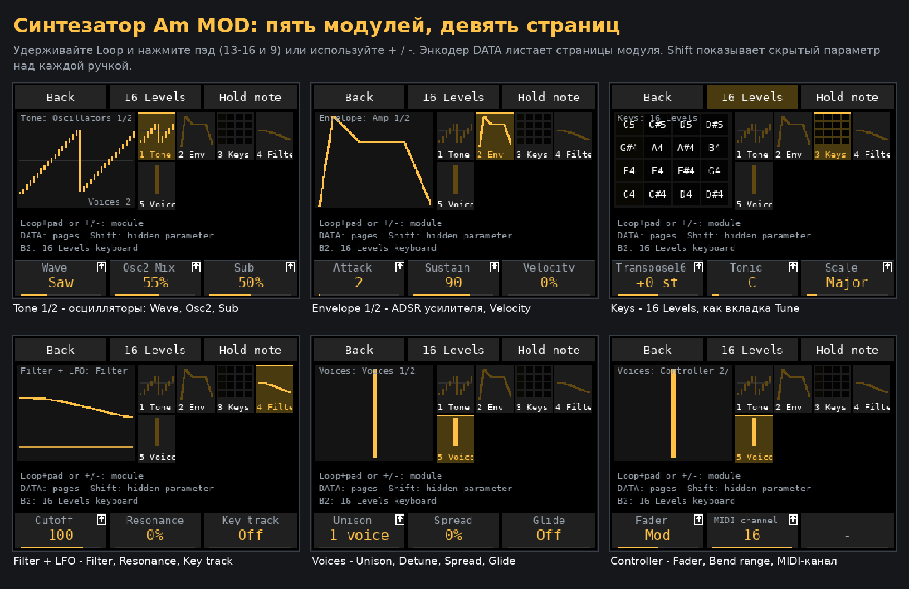

# Am MOD r30d beta2 — синт, Input ROUTE, выход в загрузчик

> **БЕТА — r30d-beta2.** Совместимость с другими модами и меню загрузки (Stock, SampQOL, D.S.B, SampleBoot, mpc-boot-thingy) ещё тестируется. Сделайте резервную копию проектов и карты. Пункты с пометкой *ожидает проверки* прошли проверки на хосте/в эмуляторе, но ещё не проверены на настоящем MPC.

Для **Akai MPC Sample, штатная прошивка 1.3.0.12**. Релиз продолжает r30c-beta1; установленная прошивка не перезаписывается.

## Исправления в beta2

- **Входы USB** (USB, USB L, USB R) теперь проходят через трек Input: на них действуют Input FX, фейдер, панорама и mute. Раньше USB был подписан как другой вход, а его сигнал приходит на пару каналов, которую мод не обрабатывал.
- **Порядок списка Input:** Source, Mode, Monitor, Threshold, Record via, Record track, Record FX, Tuner, MIDI In. **Monitor** — Off / Auto / On для любого источника, включает мониторинг Rear из Mixer. Record track показывает «-» для Master и Input.
- **Pan на K1 в цепочке FX** для треков, трека Input и Master (Pad Bank + K1 — в центр). На вкладке ROUTE входа K1 = Pan, K2 = Threshold, K3 = Source для любого источника, включая Rear; панорама и уровень каналов Rear остались в Rear Routing.
- **Режим Rear:** строка Mode для Rear начинается со **Stereo** (первый пункт и значение по умолчанию при выборе Rear), дальше Rear L, Rear R, L+R Split и L+R Mix. Монитор следует режиму: Rear L — только левое гнездо, Rear R — только правое, остальные — оба. Физическая панель уровня выхода MPC показывает сигнал Rear.
- D.S.B: подпись записи AM Mod показывает текущую версию.

## Синтезатор (пэд 13 в микшере)

- **Пять модулей, девять страниц.** Tone (Oscillators, Mixer), Envelope (Amp, Filter envelope), Keys, Filter + LFO, Voices (Voices, Controller). Модули стоят на пэдах 13–16 и 9: **удерживайте Loop и нажмите пэд** или переключайте **+ / −**. Энкодер **DATA** листает страницы внутри модуля.
- **Больше звука.** Второй осциллятор (форма, микс, полутона, тонкая настройка), саб, шум, drive, отдельная огибающая фильтра с глубиной, key tracking, четыре формы LFO, диапазон bend, unison с detune и spread, glide, чувствительность к velocity.
- **Один ряд ручек.** На K1–K3 — часто используемый параметр, редкий — на **Shift+K**; он показывается над ручкой, пока удерживается Shift. Все страницы описаны в [руководстве по синту](SYNTH_GUIDE.ru.md).
- **Страница Keys = вкладка Tune.** K1 Transpose16 / Shift Layout, K2 Tonic / Shift Role, K3 Scale / Shift Colour; значения как в Tune: «D# (P)», «Natural Minor (P)», «−4 st».
- **Фейдер** (Off / Mod / Pitch) — K1 страницы Controller. Параметры LFO Depth, Sub, Noise, Drive, Key track при нуле показывают «Off».
- **Takeover.** Ручки K синта работают в режиме Parameter takeover (Pickup, Scaled, Jump) — как остальной микшер.
- При входе в синт выделение треков снимается; пэды 9–12 показывают эффекты трека Input, потому что синт — источник Input-трека. Пэд 14 больше не выводит из синта.
- Миниатюры повторяют расположение пэдов; большой рисунок слева показывает живую волну, огибающую или кривую фильтра.

## Вход и запись

- **Shift+Sample открывает список Input ROUTE с любого экрана** (Seq, Step Edit, компрессор, Project), а не штатный Input Config. Строки: Source (Mic / Rear / USB / Resample / Synth), Mode (Rear и USB: Stereo, L, R …), Monitor, Threshold, Tuner и строки записи. K1 Pan, K2 Threshold, K3 Source; **B2 FX, B3 MIDI In**, Shift+B2 открывает штатный экран. Список прокручивается, раскладка пэдов остаётся прежней.
- **Sample Record:** K1 выбирает Source входа (включая Synth), Shift+K1 — режим Rear/USB. При включённой клавиатуре синта **16 Levels** ручки работают как во вкладке Tune (K1 Transpose16 / Layout, K2 Tonic / Role, K3 Scale / Colour) и перерисовываются при отпускании Shift.
- Синт всегда следует за мастер-громкостью; опции *Direct out* и *Mic layer* убраны. Смена источника Input снимает Input с синта.

## Пианоролл

- **Выделение области:** удерживайте **DATA**, крутите энкодер (время) и двигайте фейдер (строки) — область выделяется на ходу. Отпустите DATA, чтобы оставить выделение. Короткий клик DATA без движения по-прежнему выбирает ноту под курсором (Shift добавляет).

## Перестановка Layout и Transpose16

- На вкладке Tune, странице Keys синта и в Sample Record: **K1 = Transpose16, Shift+K1 = Layout**. Сброс ручки следует новому порядку.

## MIDI

- Глобальные настройки MIDI/синта по умолчанию, страница **MIDI Buttons** (прокручиваемый список, B3 назначить, B2 удалить/отмена, назначение фейдеров) и MIDI-источник для фейдера.
- Модификаторы контроллера (например, Shift на MiniLab) работают как обычные кнопки, пока не удерживается Shift самого MPC, поэтому Shift клавиатуры больше не зажимает Shift MPC.
- MIDI In из Input Config: B3 / Shift+B2 переключают режим входа, Shift+B3 Buttons, Shift+B2 Clear; список MIDI-синтов прокручивается.

## Эффекты

- Эффекты **Henry Skillz** HS Saturator, HS Bass Focus и HS Heat (DSP из [hs-mpc-plugins](https://github.com/Holla-Back-Entertainment/hs-mpc-plugins), использованы с разрешения автора) со своими иллюстрациями, полосой вкладок страниц и подсветкой страницы Heat. В Add Effect есть вкладка автора HS и поиск по имени (B2). *Ожидает проверки на устройстве.*

## Загрузчик и D.S.B

- **Mod Settings → About → Exit to bootloader** (B3 — подтвердить, B1 — отмена) сохраняет копию проекта в `Projects/Mod-Exit-Last` и возвращает в **меню D.S.B**; без D.S.B MPC запускает штатную прошивку. См. [Меню загрузки и выход в загрузчик](BOOTLOADERS.ru.md).
- **Перенос состояния D.S.B:** отметка D.S.B «запуск удался» теперь попадает в настоящий файл состояния на карте, поэтому успешный старт Am MOD не считается сбоем, и меню перестаёт предлагать Stock после двух запусков.
- Журнал загрузки D.S.B и лог исправления состояния копируются на карту рядом с модом для диагностики (`dsb-boot.log`, `dsb-state-fix.log`).
- Идея быстрой загрузки: один раз выберите **AM Mod** в меню, а когда нужна другая система — используйте **Exit to bootloader**.

## Прочее

- В поиске браузера — подпись **Find**; Shift+B2 очищает весь текст.
- Hold note синта удерживает последнюю ноту 16 Levels и показывает её подсвеченной.
- Удержание хвоста эффектов и плавное затухание синта убирают щелчки при окончании нот.

## Ограничения

- Модули синта, Input ROUTE, takeover ручек синта, выделение области в пианоролле и перестановка Layout/Transpose16 доделаны после последней полной проверки на устройстве: *ожидают проверки* на железе.
- Запись Mic с режимом To Seq может не проигрывать новый сэмпл в секвенции в некоторых ситуациях; логи с устройства приветствуются.
- Exit to bootloader передаёт управление только **D.S.B**. SampleBoot и mpc-boot-thingy поддерживаются для запуска мода; возврат в них из мода не реализован.
- Кросс-модовая загрузка и сохранение Internal-проектов (Am MOD, Stock, SampQOL) сертифицированы не полностью.

См. [Известные ограничения](KNOWN_ISSUES.ru.md), [Установку](INSTALL.ru.md) и [журнал изменений](../CHANGELOG.md).
