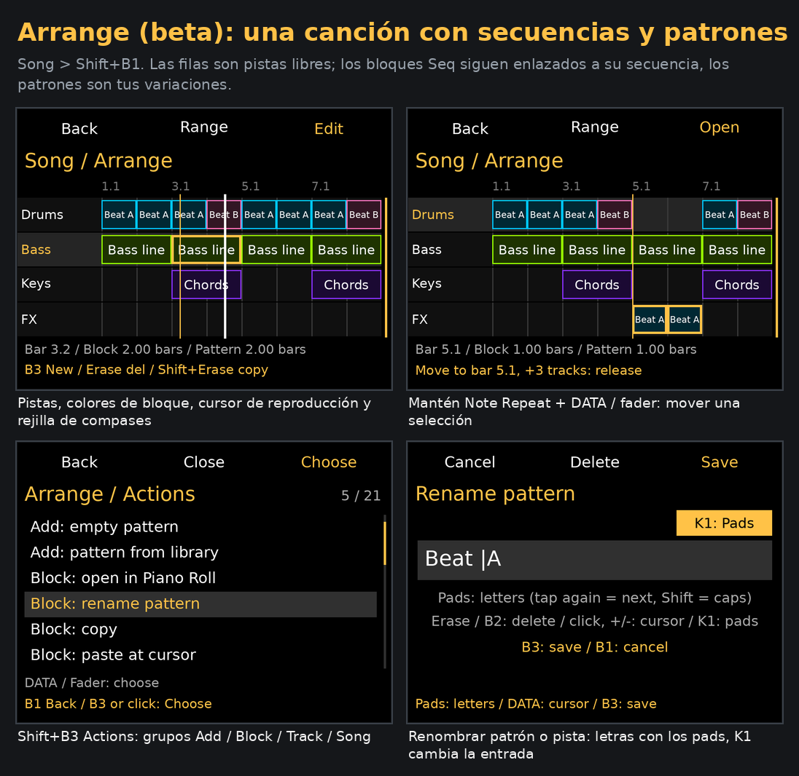

# Am MOD r31a — Arrange (beta), editor de bloques, renombrar, carpeta Logs

Para el **firmware original 1.3.0.12 del Akai MPC Sample**. Continúa r30d-beta4; el firmware instalado nunca se reescribe. **Arrange es una función beta**: haz copia de tus proyectos antes de arreglarlos.

## Arrange (beta)

Una línea de tiempo de la canción dentro de la pantalla Song: **Song → Shift+B1** (transporte parado). Instrucciones completas: [guía de Arrange](ARRANGE_GUIDE.es.md).

- **Las filas son pistas libres** que suenan juntas. Un **bloque Seq** es una ventana en vivo a una secuencia original (regrábala y el bloque la sigue); un **patrón** es tu copia para variaciones y no cambia con su origen.
- **Añade una secuencia tocando su pad** y confirmando; **B3 New** en un lugar vacío lista las secuencias con notas y *Empty pattern*.
- **Selecciona** con un clic de DATA o mantén DATA y dibuja un rectángulo sobre varias filas. **Mantén Note Repeat + DATA / fader** para mover un bloque o toda la selección, dibujados en su nuevo lugar; al soltar se aplica. **Erase** borra, **Shift+Erase** copia justo después, **Chop** corta, **Shift − / +** deshacer / rehacer.
- **Menú Actions agrupado** (Shift+B3): Add / Block / Track / Song, incluidos *Track: delete* (con confirmación), *Block: rename pattern* y *Track: rename*.
- **Play / Stop** con el transporte original de Song, **Shift+Play desde el cursor**; la reproducción se detiene al final del último bloque. **Loop** (encendido si está activo) repite el rango, la selección, el bloque o toda la canción, redondeado a compases.
- **Las ediciones durante la reproducción se oyen**: mover, copiar o borrar bloques y editar un bloque Seq vuelven a renderizar la canción sin parar.
- **Los colores de bloque** siguen el color de la secuencia y los nombres van centrados. **La rejilla sigue los compases** (los tiempos con más zoom) y se desplaza y escala con los bloques; el cursor se lee como compás.tiempo. **Stop + DATA** salta al inicio / al final.
- **Exportar el arreglo**: Shift+B1 abre el menú original Song Export (mezcla y stems) para todo el arreglo; tus pasos de Song se restauran después.

## Piano Roll dentro de un bloque

- Se abre sobre Arrange (B3 Open, Shift+clic de DATA o *Block: open in Piano Roll*); B1 vuelve.
- La cabecera muestra la posición del bloque en la canción; la regla cuenta **compases de la canción**; un **cursor de reproducción** avanza dentro del bloque y **Shift+B2 Follow** lo mantiene a la vista.
- Cada fila muestra su pad y el **inicio del nombre del sample**.
- **Shift+pads** seleccionan filas completas. **Shift+Erase** copia la selección o, sin selección, pega en el cursor; el portapapeles se conserva al abrir otro bloque, así puedes copiar de una secuencia a un patrón. **Erase** borra al soltar.
- Los pads eligen una fila; clic o B3 insertan un evento en una celda vacía. **Mantén Note Repeat + DATA / fader** para mover los eventos seleccionados.
- **Los bloques Seq se editan en su sitio** con el deshacer / rehacer original (Shift − / +).

## Renombrar con la entrada de texto del mod

Los patrones y las pistas de Arrange se renombran como los archivos del explorador: los pads escriben letras (multitoque, Shift para mayúsculas) y se iluminan con ellas, DATA mueve el cursor, **K1** cambia entre pads y encoder y se resalta en pantalla, B3 guarda.

## Otros cambios desde r30d-beta4

- **Registros en su propia carpeta.** Los registros del mod (`MPC_CLONE_TRIAL.txt`, `MPC_MOD_EVENTS.txt`, `MPC_MOD_CONSOLE.txt`, `MPC_MOD_ENTRY.txt`) se escriben ahora en **`Logs/`** dentro de la carpeta del mod (`autorun/Logs/`, `autorun/mods/AM-Mod/Logs/` o `autorun/os/AM-Mod/Logs/`). El primer arranque borra las copias antiguas junto a los archivos del mod (solo nombres conocidos). **El instalador 1.6.0** recoge los registros de ambos lugares para los informes de error.
- **Botón de encendido:** el diálogo de apagado tiene **B1 Cancel, B2 Bootloader, B3 Power off**. B2 y B3 guardan antes una copia del proyecto en `Projects/Mod-Exit-Last.xpj`; si falla, el mod sigue encendido.
- **Ruteo Rear:** monitor, panorama y nivel independientes para Rear L / Rear R (Input settings → Rear → B2 Routing y filas en Mixer → Input → ROUTE). El monitor de Rear usa la ruta original y llega al Master del mezclador. Sample Record ya no tiene Shift+B2 Routing; B2 sigue siendo To Seq.
- **To Seq:** la toma grabada empieza en la posición exacta, se conservan varias notas en espera y no se coloca nada antes de Play.
- **Las repeticiones de la Song secuencial** suenan como se ajustan; la lista sigue los cambios de Repeats y el deshacer.
- **SD Card Access con SampleBoot** libera y restaura correctamente el enlace `autorun/mods/<nombre>`; D.S.B y una tarjeta sin cargador siguen funcionando.
- **Sample Swap / reemplazo desde el explorador** mantiene fijo el pad de destino; **Screen Mirror** transmite más fotogramas.
- **Piano Roll** muestra qué secuencia se edita y la posición del cursor.
- **La pantalla de arranque y About** muestran **r31a**.

## Experimental

- **Grabación de Synth Keys:** Mixer → Synth → 16 Levels → **Shift+Seq Record** activa una prueba solo para la sesión que graba las teclas del sintetizador en la secuencia (necesita un pad A16 vacío) y las reproduce con el sintetizador. Aún no comprobado por un usuario en un MPC físico.

## Estado

Las funciones de Arrange se probaron en un MPC físico con las versiones de prueba de Arrange hasta Test 25, con el mismo código. **Aún sin comprobar en el equipo:** el paquete r31a final, el traslado de los registros a `Logs/` (cambia los scripts de arranque) y la prueba de grabación de Synth Keys.

## Límites

- **No hay mezclador mientras suena Song o Arrange**: la pantalla Song original no se puede volver a abrir durante la reproducción, así que Knob FX muestra *Stop playback to open the Mixer*.
- Todavía no hay grabación en Arrange (Rec, tomas de audio) ni secciones con nombre; las canciones muy largas (más de 128 compases) aún no se admiten.
- Seq 128 es la ranura de servicio de Arrange; después de Arrange la secuencia actual puede ser Seq 128.
- No se puede abrir un bloque mientras suena la canción.
- El firmware original y las versiones anteriores de Am MOD pueden perder los datos de Arrange al volver a guardar un proyecto.

[Guía de Arrange](ARRANGE_GUIDE.es.md) · [Instalación](INSTALL.es.md) · [Registro de cambios](../CHANGELOG.md)
