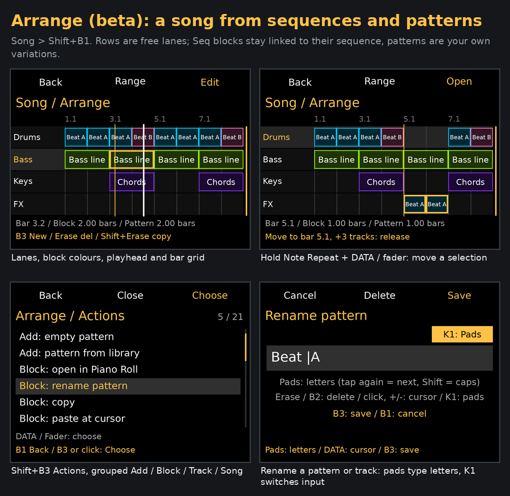

# Am MOD r31a — Arrange (beta), block editor, renaming, Logs folder

For **Akai MPC Sample stock firmware 1.3.0.12**. Continues r30d-beta4; installed firmware is never rewritten. **Arrange is a beta feature**: back up your projects before arranging them.

## Arrange (beta)

A song timeline inside the Song screen: **Song → Shift+B1** (transport stopped). Full instructions: [Arrange guide](ARRANGE_GUIDE.md).

- **Rows are free lanes** that play together. A **Seq block** is a live window into a stock sequence (re-record the sequence and the block follows); a **pattern** is your own copy for variations and does not change with its source.
- **Add a sequence by tapping its pad** and confirming; **B3 New** on an empty place lists the sequences with notes plus *Empty pattern*.
- **Select** with a DATA click, or hold DATA and draw a rectangle across rows. **Hold Note Repeat + DATA / fader** moves a block or the whole selection, drawn at its new place; release applies. **Erase** deletes, **Shift+Erase** copies right after, **Chop** cuts, **Shift − / +** undo / redo.
- **Grouped Actions menu** (Shift+B3): Add / Block / Track / Song, including *Track: delete* (with confirmation), *Block: rename pattern* and *Track: rename*.
- **Play / Stop** through the stock Song transport, **Shift+Play from the cursor**, playback stops at the end of the last block. **Loop** (lit when on) loops the range, the selection, the block or the whole song, rounded to bars.
- **Edits while playing are heard**: moving, copying or deleting blocks and editing a Seq block re-render the song without stopping.
- **Block colours** follow the sequence colour, names are centred. The **grid follows bar lines** (beats when zoomed in) and scrolls and zooms with the blocks; the cursor reads bar.beat. **Stop + DATA** jumps to the start / end.
- **Export the arrangement**: Shift+B1 opens the stock Song Export menu (mixdown and stems) for the whole arrangement; your Song steps are restored afterwards.

## Piano Roll inside a block

- Opens on top of Arrange (B3 Open, Shift+DATA click or *Block: open in Piano Roll*); B1 returns.
- Header shows the block's place in the song; the ruler counts **song bars**; a **playhead** runs inside the block and **Shift+B2 Follow** keeps it in view.
- Each row shows its pad and the **beginning of the sample name**.
- **Shift+pads** select whole rows. **Shift+Erase** copies the selection or, with nothing selected, pastes at the cursor; the clipboard survives opening another block, so you can copy from a sequence into a pattern. **Erase** deletes on release.
- Pads choose a row; click or B3 inserts an event in an empty cell. **Hold Note Repeat + DATA / fader** moves the selected events.
- **Seq blocks are edited in place** with the stock Undo / Redo (Shift − / +).

## Renaming with the Mod text input

Patterns and Arrange tracks are renamed like files in the browser: pads type letters (multi-tap, Shift for capitals) and light with their letters, DATA moves the cursor, **K1** switches between pad and encoder input and is highlighted on screen, B3 saves.

## Other changes since r30d-beta4

- **Logs in their own folder.** The mod's journals (`MPC_CLONE_TRIAL.txt`, `MPC_MOD_EVENTS.txt`, `MPC_MOD_CONSOLE.txt`, `MPC_MOD_ENTRY.txt`) are now written to **`Logs/`** inside the mod folder (`autorun/Logs/`, `autorun/mods/AM-Mod/Logs/` or `autorun/os/AM-Mod/Logs/`). The first start removes the old copies beside the mod files (known names only). **Installer 1.6.0** collects the logs from both places for bug reports.
- **Power button:** the shutdown dialog has **B1 Cancel, B2 Bootloader, B3 Power off**. B2 and B3 first save a copy of the project to `Projects/Mod-Exit-Last.xpj`; if that save fails the mod stays on.
- **Rear input routing:** independent Rear L / Rear R monitor, pan and level (Input settings → Rear → B2 Routing, and rows in Mixer → Input → ROUTE). Rear monitoring goes through the stock path and reaches the Mixer Master. Sample Record no longer has Shift+B2 Routing; B2 is still To Seq.
- **To Seq:** the recorded take starts at the exact position, several waiting notes are kept, and nothing is placed before Play.
- **Sequential Song repeats** play as set; the playback list follows Repeats changes and Undo.
- **SD Card Access under SampleBoot** releases and restores the `autorun/mods/<name>` binding correctly; D.S.B and a plain card keep working.
- **Sample Swap / browser replacement** keeps its target pad pinned; **Screen Mirror** streams more frames.
- **Piano Roll** shows which sequence is edited and the cursor position.
- **Boot screen and About** show **r31a**.

## Experimental

- **Synth Keys recording:** Mixer → Synth → 16 Levels → **Shift+Seq Record** turns on a session-only trial that records the synth keys into the sequence (it needs an empty pad A16) and plays them back through the synth. Not yet checked by a user on a physical MPC.

## Status

The Arrange features above were tested on a physical MPC in the Arrange test builds up to Test 25, which use the same code. **Not yet checked on a device:** the final r31a package itself, the move of the logs to `Logs/` (it changes the start scripts) and the Synth Keys recording trial.

## Limits

- **No Mixer while Song or Arrange plays**: the stock Song screen refuses to be re-entered during playback, so Knob FX shows *Stop playback to open the Mixer*.
- No recording in Arrange (Rec, audio takes) and no named song sections yet; very long songs (more than 128 bars) are not supported yet.
- Seq 128 is Arrange's service slot; after Arrange the current sequence may be Seq 128.
- A block cannot be opened while the song plays.
- Stock firmware and older Am MOD versions may drop the Arrange data when they re-save a project.

[Arrange guide](ARRANGE_GUIDE.md) · [Known limitations](KNOWN_ISSUES.md) · [Installation](INSTALL.md) · [Changelog](../CHANGELOG.md)
