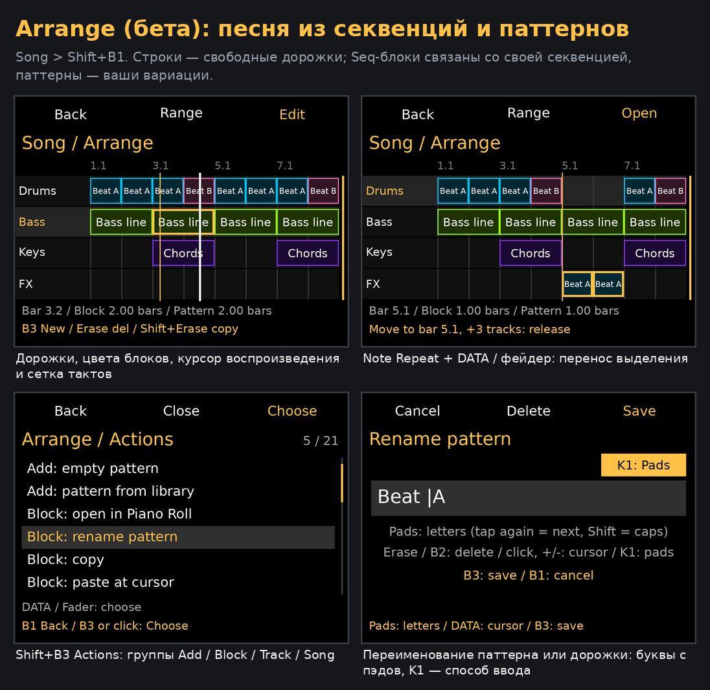

# Am MOD r31a — Arrange (бета), редактор блоков, переименование, папка Logs

Для **штатной прошивки Akai MPC Sample 1.3.0.12**. Продолжает r30d-beta4; установленная прошивка не перезаписывается. **Arrange — бета-функция**: сделайте копию проектов, прежде чем их аранжировать.

## Arrange (бета)

Временная шкала песни внутри экрана Song: **Song → Shift+B1** (транспорт остановлен). Полная инструкция: [руководство по Arrange](ARRANGE_GUIDE.ru.md).

- **Строки — свободные дорожки**, звучат одновременно. **Seq-блок** — живое окно в штатную секвенцию (перезапишите секвенцию — блок изменится вместе с ней); **паттерн** — ваша копия для вариаций, от исходника не зависит.
- **Секвенция добавляется нажатием её пэда** и подтверждением; **B3 New** на пустом месте показывает секвенции с нотами и *Empty pattern*.
- **Выделение** — клик DATA или удерживать DATA и рисовать прямоугольник через строки. **Note Repeat + DATA / фейдер** переносит блок или всё выделение, блоки рисуются на новом месте; отпускание применяет. **Erase** удаляет, **Shift+Erase** копирует следом, **Chop** режет, **Shift − / +** — Undo / Redo.
- **Сгруппированное меню Actions** (Shift+B3): Add / Block / Track / Song, в том числе *Track: delete* (с подтверждением), *Block: rename pattern* и *Track: rename*.
- **Play / Stop** через штатный транспорт Song, **Shift+Play — от курсора**, воспроизведение останавливается в конце последнего блока. **Loop** (горит, когда включён) зацикливает диапазон, выделение, блок или всю песню с округлением до тактов.
- **Правки во время воспроизведения слышны сразу**: перенос, копирование и удаление блоков, правка Seq-блока пересобирают песню без остановки.
- **Цвета блоков** берутся у секвенции, названия по центру. **Сетка идёт по тактам** (при увеличении — по долям) и движется и масштабируется вместе с блоками; курсор показывается как такт.доля. **Stop + DATA** — в начало / в конец.
- **Экспорт аранжировки**: Shift+B1 открывает штатное меню Song Export (сведение и стемы) для всей аранжировки; ваши шаги Song после этого восстанавливаются.

## Пианоролл внутри блока

- Открывается поверх Arrange (B3 Open, Shift+клик DATA или *Block: open in Piano Roll*); B1 — назад.
- Заголовок показывает место блока в песне; линейка считает **такты песни**; **курсор воспроизведения** идёт внутри блока, **Shift+B2 Follow** держит его на экране.
- В каждой строке — пэд и **начало имени сэмпла**.
- **Shift+пэды** выделяют строки целиком. **Shift+Erase** копирует выделение или, если ничего не выделено, вставляет на курсор; буфер сохраняется при открытии другого блока — так можно скопировать из секвенции в паттерн. **Erase** удаляет при отпускании.
- Пэд выбирает строку; клик или B3 вставляет событие в пустую клетку. **Note Repeat + DATA / фейдер** переносит выделенные события.
- **Seq-блоки правятся на месте** со штатным Undo / Redo (Shift − / +).

## Переименование стандартным вводом мода

Паттерны и дорожки Arrange переименовываются как файлы в браузере: пэды набирают буквы (мультитап, Shift — заглавные) и подсвечиваются ими, DATA двигает курсор, **K1** переключает ввод между пэдами и энкодером и подсвечен на экране, B3 сохраняет.

## Другие изменения после r30d-beta4

- **Журналы в отдельной папке.** Журналы мода (`MPC_CLONE_TRIAL.txt`, `MPC_MOD_EVENTS.txt`, `MPC_MOD_CONSOLE.txt`, `MPC_MOD_ENTRY.txt`) теперь пишутся в **`Logs/`** внутри папки мода (`autorun/Logs/`, `autorun/mods/AM-Mod/Logs/` или `autorun/os/AM-Mod/Logs/`). При первом запуске старые копии рядом с файлами мода удаляются (только известные имена). **Установщик 1.6.0** собирает журналы из обоих мест для отчёта об ошибке.
- **Кнопка питания:** в диалоге выключения **B1 Cancel, B2 Bootloader, B3 Power off**. B2 и B3 сначала сохраняют копию проекта в `Projects/Mod-Exit-Last.xpj`; если сохранить не удалось, мод остаётся включённым.
- **Маршрутизация Rear:** независимые мониторинг, панорама и уровень Rear L / Rear R (Input settings → Rear → B2 Routing и строки в Mixer → Input → ROUTE). Мониторинг Rear идёт штатным путём и доходит до Master микшера. В Sample Record больше нет Shift+B2 Routing; B2 — по-прежнему To Seq.
- **To Seq:** записанный дубль ставится точно в позицию, несколько ожидающих нот сохраняются, до Play ничего не ставится.
- **Repeats обычного Song** играют как заданы; список воспроизведения следует за изменением Repeats и Undo.
- **SD Card Access под SampleBoot** правильно освобождает и восстанавливает привязку `autorun/mods/<имя>`; D.S.B и обычная карта работают как раньше.
- **Sample Swap / замена из браузера** держит целевой пэд; **Screen Mirror** передаёт больше кадров.
- **Пианоролл** показывает, какая секвенция правится, и позицию курсора.
- **Загрузочный экран и About** показывают **r31a**.

## Экспериментально

- **Запись Synth Keys:** Mixer → Synth → 16 Levels → **Shift+Seq Record** включает пробный режим на одну сессию: клавиши синта пишутся в секвенцию (нужен пустой пэд A16) и воспроизводятся через синт. На физическом MPC пользователем ещё не проверялось.

## Статус

Функции Arrange выше проверены на физическом MPC в тестовых сборках Arrange до Test 25 с тем же кодом. **Ещё не проверено на устройстве:** сам итоговый пакет r31a, перенос журналов в `Logs/` (он меняет скрипты запуска) и пробная запись Synth Keys.

## Ограничения

- **Микшер не открывается, пока играет Song или Arrange**: штатный экран Song нельзя открыть заново во время воспроизведения, поэтому Knob FX показывает *Stop playback to open the Mixer*.
- Записи в Arrange (Rec, аудиодубли) и именованных частей песни пока нет; очень длинные песни (больше 128 тактов) пока не поддерживаются.
- Seq 128 — служебный слот Arrange; после Arrange текущей секвенцией может остаться Seq 128.
- Блок нельзя открыть во время воспроизведения.
- Штатная прошивка и старые версии Am MOD могут потерять данные Arrange при пересохранении проекта.

[Руководство по Arrange](ARRANGE_GUIDE.ru.md) · [Известные ограничения](KNOWN_ISSUES.ru.md) · [Установка](INSTALL.ru.md) · [Журнал изменений](../CHANGELOG.md)
