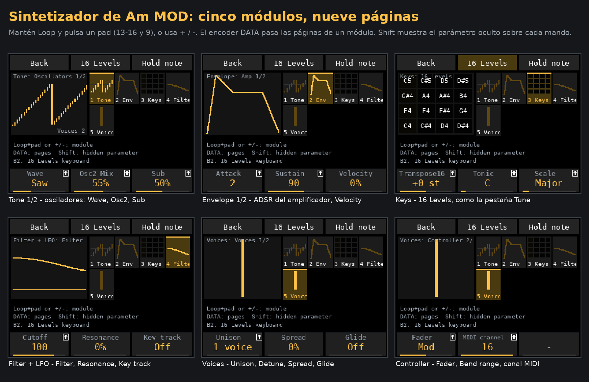

# Guía del sintetizador y de la entrada de Am MOD (r30d)

[README](../README.es.md) · [Guía de usuario](USER_GUIDE.es.md) · [English](SYNTH_GUIDE.md) · [Русский](SYNTH_GUIDE.ru.md)

El sintetizador es un instrumento integrado que vive en la **pista Input**. Se toca con MIDI, con los pads (teclado 16 Levels) o desde la pantalla Sample Record, y se graba como cualquier otra entrada. *En r30d: pendiente de verificación en el dispositivo.*

## Abrir y moverse

1. **Knob FX** → **pad 13**. Se quita la selección de pistas y los pads 9–12 muestran los efectos de Input, porque el sintetizador alimenta Input.
2. Los **módulos** están en los pads 13–16 y 9 (físicamente: fila superior 13–16, el pad 9 bajo el 13). **Mantén Loop y pulsa un pad** para saltar, o avanza con **+ / −**.
3. El encoder **DATA** pasa las páginas del módulo abierto (una o dos páginas).
4. **B1** Atrás, **B2** teclado 16 Levels sí/no, **B3** Hold note (mantiene la última nota de 16 Levels y la muestra resaltada).
5. **Shift** (mantenido) muestra el parámetro oculto sobre cada mando; su distintivo está en la esquina superior derecha.
6. **Pad Bank + mando** restablece ese parámetro a su valor por defecto.
7. Los tres mandos siguen el modo **Parameter takeover** (Pickup, Scaled o Jump) configurado en el MPC; en Pickup lleva el mando al valor mostrado para tomar el control.

## Mapa de mandos

| Módulo / página | K1 · Shift | K2 · Shift | K3 · Shift |
|---|---|---|---|
| **Tone 1/2 – Oscillators** | Wave · Osc2 Wave | Osc2 Mix · Osc2 Semi | Sub · Osc2 Fine |
| **Tone 2/2 – Mixer** | Level · Drive | Noise · – | Bend range · – |
| **Envelope 1/2 – Amp** | Attack · Decay | Sustain · Release | Velocity · – |
| **Envelope 2/2 – Filter env** | F.Attack · F.Decay | F.Sustain · F.Release | Env > Cutoff · – |
| **Keys** (como la pestaña Tune) | Transpose16 · Layout | Tonic · Role | Scale · Colour |
| **Filter + LFO 1/2 – Filter** | Cutoff · Type | Resonance · – | Key track · – |
| **Filter + LFO 2/2 – LFO** | Rate · Shape | Depth · – | Target · – |
| **Voices 1/2 – Voices** | Unison · Detune | Spread · – | Glide · – |
| **Voices 2/2 – Controller** | Fader · Bend range | MIDI channel · Mic | – |

Ondas: seno, diente de sierra, cuadrada, triangular. El dibujo grande de la izquierda sigue lo que editas; las cinco miniaturas de la derecha reflejan la disposición de los pads.

## Página Keys y teclado 16 Levels

- **B2** convierte los pads en un teclado 16 Levels que usa el motor del proyecto: disposiciones **Monochrome / Piano / Scale / Degrees**, tono y escala del proyecto por defecto, y los colores y roles del proyecto.
- **Transpose16** (K1) mueve las notas a lo largo de la escala (pasos en Degrees, semitonos en el resto); **Layout** es Shift+K1. **Tonic** K2 / **Role** Shift+K2 (qué color editas), **Scale** K3 / **Colour** Shift+K3. Los valores se muestran como en Tune, p. ej. «D# (P)»: *(P)* indica el valor del proyecto.
- La misma pantalla y los mismos mandos aparecen en **Sample Record** cuando el botón 16 Levels está activo.

## Controller, MIDI y grabación

- **Fader:** K1 en Controller elige qué hace el fader físico: **Off / Mod / Pitch**. Bend range está en Shift+K1.
- **MIDI channel** (K2): el canal que escucha el sintetizador; **Mic** (Shift+K2) añade el micrófono. En el modo MIDI Input *Instrument* o con el rol de canal *Synth*, un teclado toca el sintetizador.
- El sintetizador siempre sigue el volumen master y las colas de efectos se apagan sin clics.

## Input ROUTE (Shift+Sample)

**Shift+Sample** abre la lista Input ROUTE del mezclador desde cualquier pantalla (Seq, Step Edit, compresor, Project). La disposición de pads se conserva. Filas:

| Fila | Significado |
|---|---|
| **Source** (K3) | Mic / Rear / USB / Resample / **Synth** |
| **Mode** | para Rear y USB: Stereo, L, R (Rear también L+R split / mix) |
| **Monitor** | Off / Auto / On |
| **Threshold** (K2) | umbral de grabación |
| **Tuner >** | ventana del afinador |
| Filas de grabación | de dónde toma la señal la grabación (Input / Track / Master), Dry/Wet, pista A–H |

K1 es Pan. **B2 FX** abre los efectos de Input, **B3 MIDI In** los ajustes de entrada MIDI, **Shift+B2** la pantalla Input Config original. Gira el encoder para elegir fila, pulsa para editar, gira para cambiar y pulsa para aceptar. Cambiar el Source quita Input del sintetizador.

### En la pantalla Sample Record

| Teclado | K1 · Shift | K2 · Shift | K3 · Shift |
|---|---|---|---|
| 16 Levels **apagado** | Source · modo Rear/USB | Free / Seq (original) | original |
| 16 Levels **encendido** | Transpose16 · Layout | Tonic · Role | Scale · Colour |

**B2** es **To Seq** (la toma se inserta en la secuencia en reproducción); Rear routing pasó a Shift+B2.

## Selección de área en Piano Roll

Mantén **DATA**, gira el encoder (tiempo) y mueve el fader (filas): el área entre donde pulsaste y el cursor se selecciona en vivo. Suelta DATA para conservarla. Un clic corto en DATA sigue seleccionando la nota bajo el cursor (Shift añade). B2 *Select range* funciona como antes.

## Solución de problemas

- Sin sonido: comprueba que la pista Input no esté silenciada y que el fader master esté arriba; para grabar el sintetizador en Sample Record, Source debe ser **Synth**.
- El mando no responde: en Pickup pásalo por el valor mostrado; el takeover del MPC puede ponerse en Jump.
- Notas colgadas: pulsa B3 (Hold note) para soltar, o sal y vuelve a entrar en el sintetizador.
