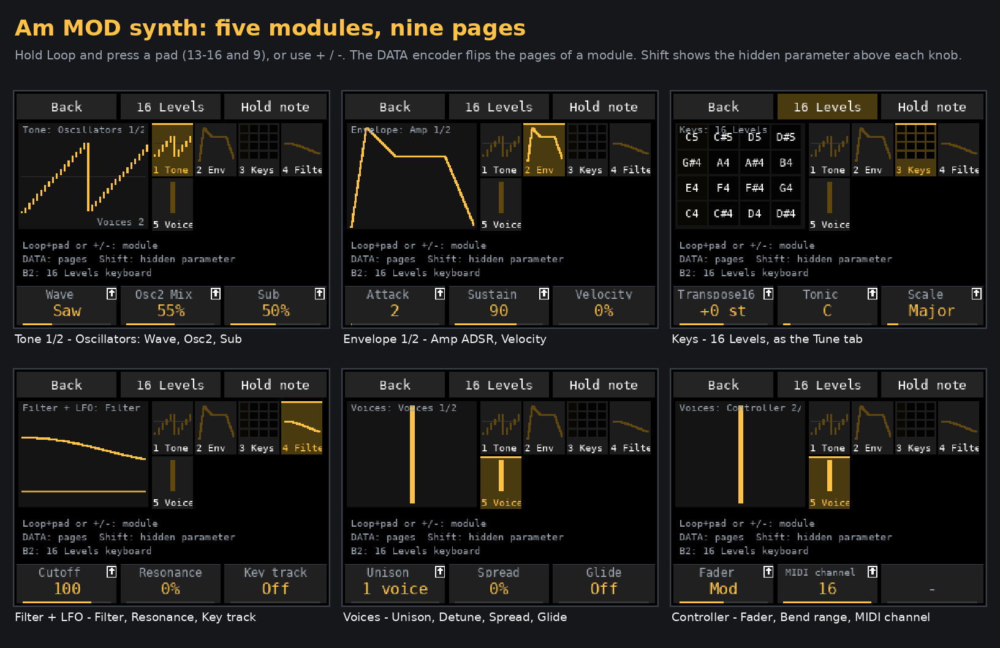

# Am MOD synth and input guide (r30d)

[README](../README.md) · [User guide](USER_GUIDE.md) · [Русский](SYNTH_GUIDE.ru.md) · [Español](SYNTH_GUIDE.es.md)

The synth is a built-in instrument that lives on the **Input track**. It is played from MIDI, from the pads (16 Levels keyboard) or from the Sample Record screen, and it can be recorded like any other input. *Pending device verification for r30d.*

## Open and move around

1. **Knob FX** → press **pad 13**. Track selection is cleared and pads 9–12 show the Input track's effects, because the synth feeds the Input track.
2. **Modules** sit on pads 13–16 and 9 (physical layout: top row 13–16, pad 9 below pad 13). **Hold Loop and press a pad** to jump, or step with **+ / −**.
3. The **DATA** encoder turns the pages inside the open module. A module has one or two pages.
4. **B1** Back, **B2** 16 Levels keyboard on/off, **B3** Hold note (keeps the last 16 Levels note sounding and shows it highlighted).
5. **Shift** (held) shows the hidden parameter above each knob; its badge sits in the knob's top right corner.
6. **Pad Bank + knob** resets that parameter to its default.
7. The three knobs follow the **Parameter takeover** mode (Pickup, Scaled or Jump) set in the MPC; move the knob to the shown value to take control in Pickup.

## Knob map

| Module / page | K1 · Shift | K2 · Shift | K3 · Shift |
|---|---|---|---|
| **Tone 1/2 – Oscillators** | Wave · Osc2 Wave | Osc2 Mix · Osc2 Semi | Sub · Osc2 Fine |
| **Tone 2/2 – Mixer** | Level · Drive | Noise · – | Bend range · – |
| **Envelope 1/2 – Amp** | Attack · Decay | Sustain · Release | Velocity · – |
| **Envelope 2/2 – Filter env** | F.Attack · F.Decay | F.Sustain · F.Release | Env > Cutoff · – |
| **Keys** (as the Tune tab) | Transpose16 · Layout | Tonic · Role | Scale · Colour |
| **Filter + LFO 1/2 – Filter** | Cutoff · Type | Resonance · – | Key track · – |
| **Filter + LFO 2/2 – LFO** | Rate · Shape | Depth · – | Target · – |
| **Voices 1/2 – Voices** | Unison · Detune | Spread · – | Glide · – |
| **Voices 2/2 – Controller** | Fader · Bend range | MIDI channel · Mic | – |

Waveforms: sine, saw, square, triangle. The big drawing on the left follows what you are editing; the five thumbnails on the right mirror the pad layout.

## Keys page and the 16 Levels keyboard

- **B2** turns the pads into a 16 Levels keyboard that uses the project's engine: layouts **Monochrome / Piano / Scale / Degrees**, the project key and scale by default, the project's colours and roles.
- **Transpose16** (K1) moves the notes along the scale (steps in Degrees, semitones elsewhere); **Layout** is Shift+K1. **Tonic** K2 / **Role** Shift+K2 (which colour you edit), **Scale** K3 / **Colour** Shift+K3. Values are shown as on the Tune tab, e.g. “D# (P)” — *(P)* means the project's value.
- The same screen and knobs appear on **Sample Record** when the 16 Levels button is on.

## Controller, MIDI and recording

- **Fader:** K1 on Controller selects what the physical fader does: **Off / Mod / Pitch**. Bend range is on Shift+K1.
- **MIDI channel** (K2): the channel the synth listens on; **Mic** (Shift+K2) layers the microphone. In MIDI Input *Instrument* mode or the *Synth* channel role, a keyboard plays the synth.
- The synth always follows the master volume and its FX tails fade without clicks.

## Input ROUTE (Shift+Sample)

**Shift+Sample** opens the Mixer Input ROUTE list from every screen (Seq, Step Edit, compressor, Project). The pad layout stays as it was. Rows:

| Row | Meaning |
|---|---|
| **Source** (K3) | Mic / Rear / USB / Resample / **Synth** |
| **Mode** | for Rear and USB: Stereo, L, R (Rear also L+R split / mix) |
| **Monitor** | Off / Auto / On |
| **Threshold** (K2) | recording threshold |
| **Tuner >** | the tuner window |
| Record rows | where the recording takes the signal (Input / Track / Master), Dry/Wet, track A–H |

K1 is Pan. **B2 FX** opens the Input effects, **B3 MIDI In** the MIDI input settings, **Shift+B2** the stock Input Config screen. Turn the encoder to browse, click to edit, turn to change, click to accept. Changing the Source takes the Input off the synth.

### On the Sample Record screen

| Keyboard | K1 · Shift | K2 · Shift | K3 · Shift |
|---|---|---|---|
| 16 Levels **off** | Source · Rear/USB mode | Free / Seq (stock) | stock |
| 16 Levels **on** | Transpose16 · Layout | Tonic · Role | Scale · Colour |

**B2** is **To Seq** (the take is inserted into the playing sequence); Rear routing moved to Shift+B2.

## Piano Roll area selection

Hold **DATA**, turn the encoder (time) and move the fader (rows): the area between where you pressed and the cursor is selected live. Release DATA to keep it. A short click on DATA still selects the note under the cursor (Shift adds). B2 *Select range* works as before.

## Troubleshooting

- No sound: check the Input track is not muted and the master fader is up; in Sample Record the Source must be **Synth** to record it.
- Knob does not respond: with Pickup, move it through the displayed value; the MPC takeover setting can be switched to Jump.
- Notes hang: press B3 (Hold note) to release, or leave and re-enter the synth page.
