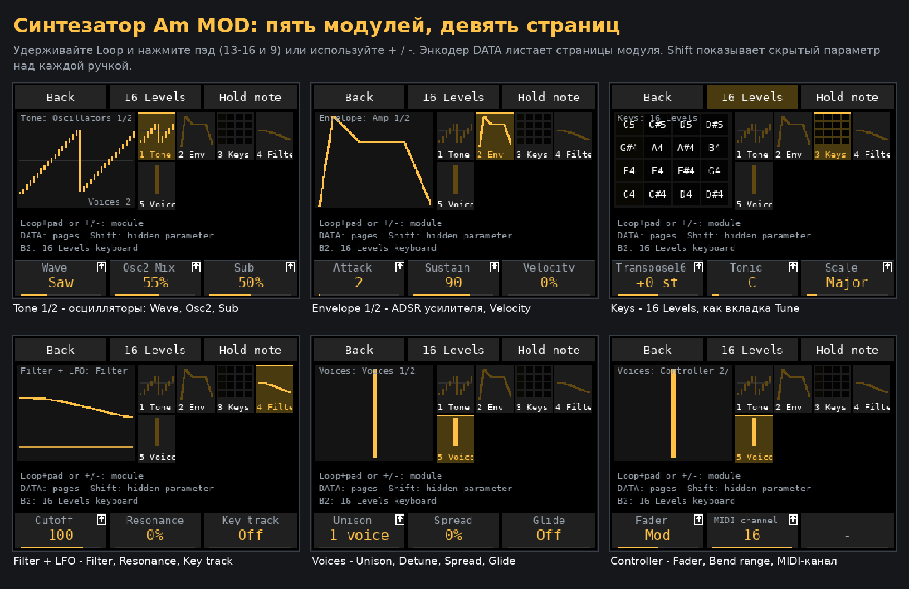

# Руководство по синту и входу Am MOD (r30d)

[README](../README.ru.md) · [Руководство](USER_GUIDE.ru.md) · [English](SYNTH_GUIDE.md) · [Español](SYNTH_GUIDE.es.md)

Синт — встроенный инструмент на **треке Input**. На нём играют с MIDI, с пэдов (клавиатура 16 Levels) или с экрана Sample Record, его можно записывать как любой вход. *В r30d ожидает проверки на устройстве.*

## Открыть и перемещаться

1. **Knob FX** → **пэд 13**. Выделение треков снимается, пэды 9–12 показывают эффекты трека Input: синт подаётся на Input.
2. **Модули** стоят на пэдах 13–16 и 9 (физически: верхний ряд 13–16, пэд 9 под пэдом 13). **Удерживайте Loop и нажмите пэд**, либо листайте **+ / −**.
3. Энкодер **DATA** листает страницы внутри открытого модуля (одна или две страницы).
4. **B1** Назад, **B2** клавиатура 16 Levels вкл/выкл, **B3** Hold note (держит последнюю ноту 16 Levels и показывает её подсвеченной).
5. **Shift** (удерживаемый) показывает скрытый параметр над каждой ручкой; значок — в правом верхнем углу ручки.
6. **Pad Bank + ручка** сбрасывает параметр к значению по умолчанию.
7. Три ручки работают в режиме **Parameter takeover** (Pickup, Scaled или Jump), заданном на MPC; в Pickup подведите ручку к показанному значению, чтобы перехватить управление.

## Карта ручек

| Модуль / страница | K1 · Shift | K2 · Shift | K3 · Shift |
|---|---|---|---|
| **Tone 1/2 – Oscillators** | Wave · Osc2 Wave | Osc2 Mix · Osc2 Semi | Sub · Osc2 Fine |
| **Tone 2/2 – Mixer** | Level · Drive | Noise · – | Bend range · – |
| **Envelope 1/2 – Amp** | Attack · Decay | Sustain · Release | Velocity · – |
| **Envelope 2/2 – Filter env** | F.Attack · F.Decay | F.Sustain · F.Release | Env > Cutoff · – |
| **Keys** (как вкладка Tune) | Transpose16 · Layout | Tonic · Role | Scale · Colour |
| **Filter + LFO 1/2 – Filter** | Cutoff · Type | Resonance · – | Key track · – |
| **Filter + LFO 2/2 – LFO** | Rate · Shape | Depth · – | Target · – |
| **Voices 1/2 – Voices** | Unison · Detune | Spread · – | Glide · – |
| **Voices 2/2 – Controller** | Fader · Bend range | MIDI channel · Mic | – |

Формы волны: синус, пила, прямоугольник, треугольник. Большой рисунок слева показывает редактируемое; пять миниатюр справа повторяют раскладку пэдов.

## Страница Keys и клавиатура 16 Levels

- **B2** превращает пэды в клавиатуру 16 Levels на движке проекта: раскладки **Monochrome / Piano / Scale / Degrees**, ключ и гамма проекта по умолчанию, цвета и роли проекта.
- **Transpose16** (K1) сдвигает ноты по гамме (шаги в Degrees, полутона в остальных); **Layout** — Shift+K1. **Tonic** K2 / **Role** Shift+K2 (какой цвет правите), **Scale** K3 / **Colour** Shift+K3. Значения как во вкладке Tune, например «D# (P)» — *(P)* означает значение проекта.
- Тот же экран и ручки на **Sample Record**, когда включена кнопка 16 Levels.

## Controller, MIDI и запись

- **Фейдер:** K1 на Controller выбирает, что делает физический фейдер: **Off / Mod / Pitch**. Bend range — Shift+K1.
- **MIDI channel** (K2): канал, который слушает синт; **Mic** (Shift+K2) подмешивает микрофон. В режиме MIDI Input *Instrument* или с ролью канала *Synth* синт играет с клавиатуры.
- Синт всегда следует мастер-громкости, хвосты эффектов затухают без щелчков.

## Input ROUTE (Shift+Sample)

**Shift+Sample** открывает список Input ROUTE микшера с любого экрана (Seq, Step Edit, компрессор, Project). Раскладка пэдов остаётся прежней. Строки:

| Строка | Назначение |
|---|---|
| **Source** (K3) | Mic / Rear / USB / Resample / **Synth** |
| **Mode** | для Rear и USB: Stereo, L, R (для Rear также L+R split / mix) |
| **Monitor** | Off / Auto / On |
| **Threshold** (K2) | порог записи |
| **Tuner >** | окно тюнера |
| Строки записи | откуда запись берёт сигнал (Input / Track / Master), Dry/Wet, трек A–H |

K1 — Pan. **B2 FX** открывает эффекты Input, **B3 MIDI In** — настройки MIDI-входа, **Shift+B2** — штатный экран Input Config. Энкодер: крутить — выбор строки, клик — правка, крутить — менять, клик — принять. Смена Source снимает Input с синта.

### На экране Sample Record

| Клавиатура | K1 · Shift | K2 · Shift | K3 · Shift |
|---|---|---|---|
| 16 Levels **выкл** | Source · режим Rear/USB | Free / Seq (штатно) | штатно |
| 16 Levels **вкл** | Transpose16 · Layout | Tonic · Role | Scale · Colour |

**B2** — **To Seq** (дубль вставляется в играющую секвенцию); Rear routing перенесён на Shift+B2.

## Выделение области в пианоролле

Удерживайте **DATA**, крутите энкодер (время) и двигайте фейдер (строки): область между точкой нажатия и курсором выделяется на ходу. Отпустите DATA, чтобы оставить. Короткий клик DATA по-прежнему выбирает ноту под курсором (Shift добавляет). B2 *Select range* работает по-прежнему.

## Если что-то не так

- Нет звука: проверьте, что трек Input не заглушён, а мастер-фейдер поднят; для записи синта в Sample Record Source должен быть **Synth**.
- Ручка не реагирует: в Pickup проведите её через показанное значение; режим takeover на MPC можно переключить на Jump.
- Ноты зависли: нажмите B3 (Hold note), чтобы отпустить, или выйдите и снова войдите в синт.
